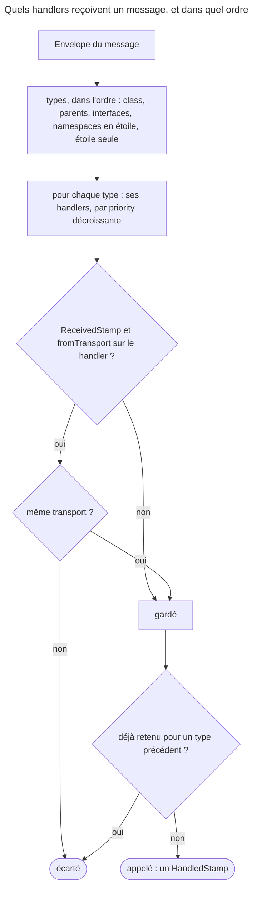

## Objectif

Écrire un message et son handler, savoir ce qui les apparie, ce qui se passe
quand il y a plusieurs handlers, et faire évoluer un message sans casser ceux
qui attendent en file.

## L'essentiel

Un message est une class ordinaire qui porte des **identifiers**. Un handler
porte `#[AsMessageHandler]`, et c'est le **type de son argument** qui le relie
au message. Plusieurs handlers pour un même message sont tous appelés. Et un
message en file a été sérialisé par l'ancien code : il doit survivre au
deployment.

## Le schéma



Deux conséquences : **`priority` ne trie qu'à l'intérieur d'un même type**, et
**`fromTransport` ne concerne que les messages reçus**.

## L'exemple

```php
final class OrderPlaced
{
    public function __construct(public readonly int $orderId) {}
}

#[AsMessageHandler]
final class CreateInvoice
{
    public function __invoke(OrderPlaced $message): void { /* recharge l'achat, facture */ }
}

#[AsMessageHandler(priority: 10)]
final class NotifyCustomer
{
    public function __invoke(OrderPlaced $message): void { /* recharge l'achat, notifie */ }
}
```

`dispatch(new OrderPlaced(42))` appelle les deux, `NotifyCustomer` d'abord.

## Le message

Une class ordinaire, sans interface ni class parente, qui doit être
**sérialisable** : un transport asynchrone l'écrit puis la relit. On y met un
**identifier**, pas un object chargé — la copie sérialisée serait périmée à la
lecture ; le handler recharge l'état courant.

Le serializer par défaut s'appuie sur `unserialize()`, qui **n'appelle pas le
constructor**. Un message de la version 1 lu par la version 2, PHP 8.4 :

| Changement de la class | Lecture de l'ancien message |
|---|---|
| property **promue** ajoutée au constructor, avec défaut | **`Error`** : « must not be accessed before initialization » |
| property **déclarée** ajoutée, avec défaut | lue avec sa default value |
| property retirée | décodé, avec la deprecation « Creation of dynamic property » |

Pour un changement de sens : une **nouvelle class**, l'ancienne gardée le temps
que les files se vident.

## Le handler

- `#[AsMessageHandler]` est lu par l'autoconfiguration ; le **type de
  l'argument** désigne le message. Aucune table à écrire.
- L'attribute se pose aussi sur des **methods**, plusieurs par class ; le type
  peut être une **union** (`Ping|Pong`) ou une **interface**.
- Sans type, le build échoue : « must have a type-hint corresponding to the
  message class it handles ».
- Les options de l'attribute en 8.0 : `bus`, `fromTransport`, `handles`,
  `method`, `priority`, `sign`.

`fromTransport: 'async'` écarte un message **reçu** d'un autre transport, mais
pas un message traité en synchrone :

| Le message arrive… | Handler `fromTransport: 'async'` | Handler sans option |
|---|---|---|
| lu par un worker sur `other` | **écarté** | appelé |
| lu par un worker sur `async` | appelé | appelé |
| dispatché sans routage, en synchrone | **appelé** | appelé |

Sans `ReceivedStamp`, tout handler est gardé : `fromTransport` ne rend pas un
handler « asynchrone seulement ».

## Plusieurs handlers

- Tous sont appelés ; `priority` **ordonne**, sans exclure. Sans priority :
  l'ordre d'enregistrement.
- Mais seulement **dans un même type** : les types du message sont parcourus
  dans l'ordre class, parents, interfaces, avant les priorities. Un handler
  typé `Invoice` passe avant un handler typé `Billable` à `priority: 100`.
- Un `HandledStamp` **par handler** : `last()` rend le dernier, `all()` tous.
  Une return value n'a de sens qu'avec un handler unique, en synchrone.

## Pièges d'examen

**Aucune interface à implémenter**, ni pour le message ni pour le handler.

**Le message est apparié par le type de l'argument** — union et interface
comprises ; sans type, le container refuse de se construire.

**Plusieurs handlers sont légitimes** et tous s'exécutent ; `priority` les
ordonne.

**Une property promue ajoutée casse les messages déjà en file**, même avec un
défaut.

**Ne pas transporter d'object chargé** : un identifier, et un rechargement dans
le handler.

## Application

- Un handler coûteux reçoit `fromTransport: 'async'` et tourne quand même en
  test, sans routage → c'est le **routage** qui décide de l'asynchrone.
- `public string $channel = 'email'` ajouté au constructor fait échouer les
  messages en file → le déclarer comme property, hors du constructor.

## QCM d'entraînement

**Question 1.** Un handler porte `#[AsMessageHandler(fromTransport: 'async')]`.
Son message n'est routé nulle part et il est dispatché. Le handler tourne-t-il ?

- **A.** Non : il n'accepte que les messages venus d'`async`
- **B.** Oui, comme tout handler du message
- **C.** Non, et `dispatch()` lève `NoHandlerForMessageException`
- **D.** Seulement si un worker consomme `async`

<details>
<summary>Correction</summary>

**Bonne réponse : B.** Sans `ReceivedStamp`, le filter `from_transport` n'est
pas consulté ; il n'agit que sur un message lu par un worker.

</details>

**Question 2.** `Invoice` implémente `Billable`. Handler X typé `Invoice`,
sans priority ; handler Y typé `Billable`, `priority: 100`. Dans quel ordre
tournent-ils ?

- **A.** Y puis X : la priority la plus haute d'abord
- **B.** Un seul des deux : le plus précis
- **C.** X puis Y : le type passe avant
- **D.** Un ordre aléatoire

<details>
<summary>Correction</summary>

**Bonne réponse : C.** Les types sont parcourus dans l'ordre class, parents,
interfaces ; la priority ne range que les handlers d'un même type.

</details>

**Question 3.** La version 2 d'un message ajoute `public string $source =
'web';`, déclarée hors du constructor. Un message de la version 1 est lu. Que
vaut `$message->source` ?

- **A.** `'web'`, sa default value
- **B.** Une `Error` : property non initialisée
- **C.** `null`
- **D.** Une exception du serializer, version inconnue

<details>
<summary>Correction</summary>

**Bonne réponse : A.** Une property déclarée garde sa default value à la
désérialisation ; B serait vrai pour une property promue au constructor.

</details>

**Question 4.** La version 2 d'un message retire une property. Un message de
la version 1 est lu sous PHP 8.4. Que se passe-t-il ?

- **A.** Une `Error` à la lecture
- **B.** Le message est rejeté vers le failure transport
- **C.** La property est ignorée en silence
- **D.** Décodé, avec une deprecation PHP

<details>
<summary>Correction</summary>

**Bonne réponse : D.** `unserialize()` recrée la property disparue comme
property dynamique, ce que PHP déprécie depuis la version 8.2.

</details>

## Fiche express

**Si tu dois retenir seulement 7 choses :**

- Un message est une **class ordinaire** sérialisable, avec des
  **identifiers**.
- **`#[AsMessageHandler]`** + le **type de l'argument** relient handler et
  message.
- Union et interface acceptées ; **sans type**, le build échoue.
- **Plusieurs handlers** : tous appelés, un `HandledStamp` chacun.
- **`priority`** ordonne, et seulement **dans un même type**.
- **`fromTransport`** ne concerne que les messages **reçus**.
- Property **promue** ajoutée → les anciens messages cassent.

Moyen mnémotechnique :
**« le type relie, la priority range, la file se souvient »**.

```text
message = class + identifiers ; handler = #[AsMessageHandler] + type (union, interface) ; types : class > parents > interfaces > * ;
priority dans un type ; fromTransport si ReceivedStamp ; unserialize sans constructor : déclarée oui, promue non
```

## Sources officielles

- [Messenger, « Creating a Message & Handler »](https://github.com/symfony/symfony-docs/blob/8.0/messenger.rst)
- [Messenger 8.0, `AsMessageHandler`](https://github.com/symfony/symfony/blob/8.0/src/Symfony/Component/Messenger/Attribute/AsMessageHandler.php)
- [Messenger 8.0, `HandlersLocator`](https://github.com/symfony/symfony/blob/8.0/src/Symfony/Component/Messenger/Handler/HandlersLocator.php)
- [Messenger 8.0, `PhpSerializer`](https://github.com/symfony/symfony/blob/8.0/src/Symfony/Component/Messenger/Transport/Serialization/PhpSerializer.php)

