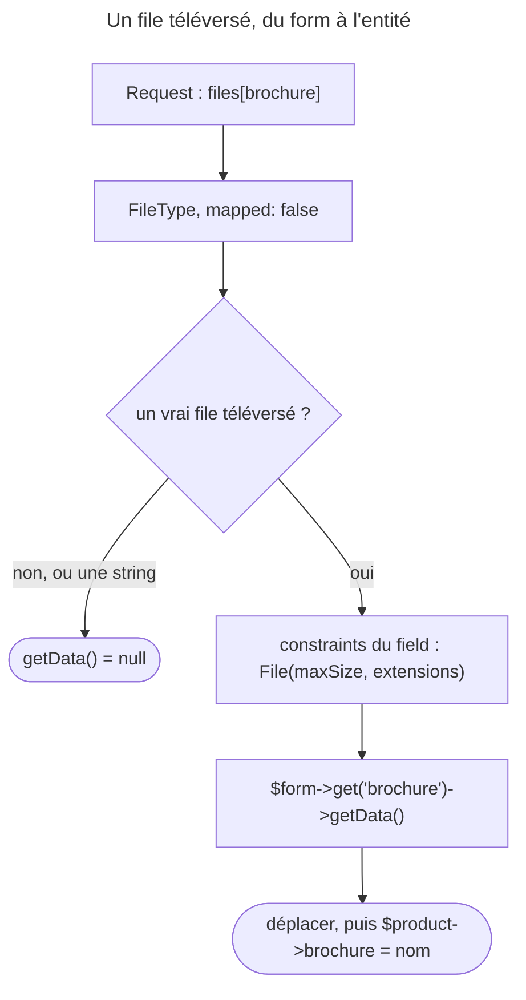

## Objectif

Brancher un téléversement sur un form sans corrompre l'entité. `UploadedFile`,
`move()` et le caractère non fiable des métadonnées client sont traités dans le
lot Controllers.

## L'essentiel

L'entité stocke le **nom** d'un file ; le form reçoit un **file** téléversé.
Le field `FileType` est donc déclaré `mapped: false`, porte ses propres
constraints, et le controller lit le file sur le form avant de le déplacer et
d'écrire le nom sur l'entité.

## Le schéma



## L'exemple : la brochure

```php
class Product
{
    public string $name = '';
    public string $brochure = '';   // le nom du fichier, pas le fichier
}
```

## Le field

```php
->add('brochure', FileType::class, [
    'label' => 'Brochure (PDF)',
    'mapped' => false,
    'required' => false,
    'constraints' => [
        new Assert\File(maxSize: '1024k', extensions: ['pdf']),
    ],
])
```

| Option | Pourquoi |
|---|---|
| `mapped: false` | l'entité n'a pas de property « file » |
| `required: false` | téléversement facultatif : sur un form de modification, rien envoyé = garder l'existant |
| `constraints` | un field non mappé ne profite pas des constraints de l'entité |

- Laissé mappé, rien n'échoue : `FileType` a pour `data_class` la class
  `File`, et la property reçoit le **path temporaire** du file. Une corruption
  silencieuse.
- Un `b.txt` échoue : « The extension of the file is invalid ("txt"). Allowed
  extensions are "pdf". ».
- L'option `extensions` exige le component **Mime** : sans lui,
  `FileValidator` lève une `LogicException`.

## Récupérer le file

```php
$file = $form->get('brochure')->getData();
if ($file) {
    // déplacer le fichier, puis stocker son nom sur l'entité
}
```

Un file envoyé : un `UploadedFile`, et `$product->brochure` reste vide. Rien
envoyé, avec `required: false` : le form est valide et `getData()` vaut
`null` — d'où le test.

## Ce que `FileType` écarte

- Un listener `PRE_SUBMIT` de `FileType` ne garde que de vrais files
  téléversés : une **string** postée à la place devient `null`, sans erreur.
- `multiple: true` : la valeur est un **array** de files, et `data_class` vaut
  `null`.
- Le handler compte : `HttpFoundationRequestHandler`, celui du framework,
  reconnaît un `UploadedFile` ; le handler natif attend l'array de `$_FILES`.

## Pièges d'examen

**Un field de file n'est presque jamais mappé** — et le mapper par erreur
n'échoue pas : l'entité reçoit le path temporaire.

**Un field non mappé n'arrive pas dans l'object**, et vaut `null` quand rien n'a
été envoyé.

**Les constraints d'un field non mappé se déclarent sur le field.**

**`extensions` sans le component Mime** : `LogicException`.

## Application

- La colonne `brochure` contient `/tmp/phpXyZ` → le field était mappé :
  `mapped: false`, et le nom final écrit après le déplacement.
- `getClientOriginalName()` plante quand le user ne change pas de brochure →
  tester `if ($file)` : `getData()` vaut `null` sans envoi.

## QCM d'entraînement

**Question 1.** Le field `brochure` porte
`new Assert\File(extensions: ['pdf'])`, mais `symfony/mime` n'est pas
installé. Que se passe-t-il à la validation d'un PDF ?

- **A.** Le PDF est accepté : l'extension est lue sur le nom
- **B.** Une `LogicException`
- **C.** Une violation « The extension of the file is invalid »
- **D.** L'option `extensions` est ignorée sans erreur

<details>
<summary>Correction</summary>

**Bonne réponse : B.** `FileValidator` a besoin de Mime pour contrôler les
extensions : sans lui, il lève une exception au lieu de valider.

</details>

**Question 2.** Un attaquant poste la string `/etc/passwd` dans le field
`FileType` `brochure`, à la place d'un file. Que rend `getData()` ?

- **A.** La string `/etc/passwd`
- **B.** Un `UploadedFile` pointant sur `/etc/passwd`
- **C.** `null`
- **D.** Une `TransformationFailedException`, le form invalide

<details>
<summary>Correction</summary>

**Bonne réponse : C.** Le listener `PRE_SUBMIT` de `FileType` ne garde que de
vrais files téléversés : la string est remplacée par `null`.

</details>

**Question 3.** Un field `FileType` est déclaré avec `'multiple' => true`, et
deux files sont envoyés. Que rend `getData()` ?

- **A.** Un array de deux `UploadedFile`
- **B.** Le dernier file envoyé, seul
- **C.** Le premier file envoyé, seul
- **D.** Une exception : `data_class` exige un seul file

<details>
<summary>Correction</summary>

**Bonne réponse : A.** Avec `multiple`, la valeur est un array de files, et
`data_class` vaut `null` au lieu de `File`.

</details>

**Question 4.** Sur un form de modification, le field de brochure a
`required: false`. Le user enregistre sans choisir de file. Que valent le
form et `getData()` du field ?

- **A.** Form invalide : un field de file doit recevoir un file
- **B.** Form valide, `getData()` vaut l'ancienne brochure
- **C.** Form valide, `getData()` vaut `null`
- **D.** Form invalide, `getData()` vaut `null`

<details>
<summary>Correction</summary>

**Bonne réponse : C.** Rien n'est envoyé et rien n'est exigé : le form est
valide, et le controller garde la brochure existante en testant `null`.

</details>

## Fiche express

**Si tu dois retenir seulement 6 choses :**

- `FileType` : **`mapped: false`** — mappé, l'entité reçoit le path temporaire.
- Lire le file **sur le form**, par son field : `get()`, puis `getData()`.
- Rien envoyé : **`null`** ; tester avant d'utiliser.
- Constraints : **sur le field**, option `constraints`.
- `extensions` sans Mime : **`LogicException`**.
- Une string postée → `null` ; `multiple: true` → un array.

Moyen mnémotechnique : **« Recevoir, valider, déplacer, nommer »**.

## Sources officielles

- [How to Upload Files](https://github.com/symfony/symfony-docs/blob/8.0/controller/upload_file.rst)
- [Form 8.0, `FileType`](https://github.com/symfony/symfony/blob/8.0/src/Symfony/Component/Form/Extension/Core/Type/FileType.php)
- [Validator 8.0, `FileValidator`](https://github.com/symfony/symfony/blob/8.0/src/Symfony/Component/Validator/Constraints/FileValidator.php)

