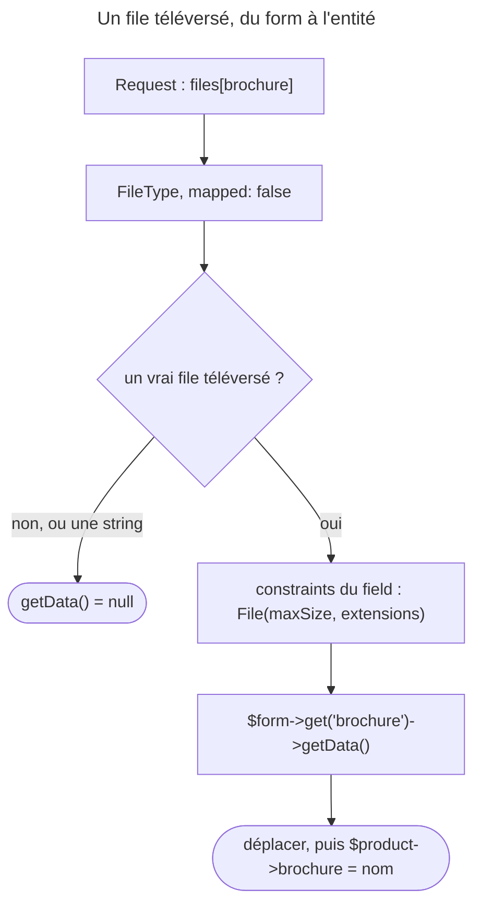

## Objectif

Brancher un téléversement sur un form sans corrompre l'entité. `UploadedFile`,
`move()` et le caractère non fiable des métadonnées client sont traités dans le
lot Controllers.

## Avant la règle : le problème à résoudre

Une fiche produit doit accepter une brochure PDF. L'entité `Product` stocke le
**nom** du file (`brochure.pdf`), mais le form reçoit un **file**
téléversé, un object avec un path temporaire.

Deux mondes se rencontrent : la donnée de l'entité (une string) et la donnée du
form (un file). Les relier directement, comme pour un field texte, mélangerait
les deux. Il faut donc un field qui **reçoit** le file sans l'écrire dans
l'entité, une validation qui porte sur ce file, et un moyen de le **lire** pour
le traiter.

## Le fil rouge : la brochure

```php
class Product
{
    public string $name = '';
    public string $brochure = '';   // le nom du fichier, pas le fichier
}
```

## Le cycle complet en un schéma



## Le field

```php
->add('brochure', FileType::class, [
    'label' => 'Brochure (PDF)',
    'mapped' => false,
    'required' => false,
    'constraints' => [
        new Assert\File(maxSize: '1024k', extensions: ['pdf']),
    ],
])
```

**`mapped: false`** est l'astuce centrale. L'entité stocke en général un *nom de
file*, pas un file ; le field n'a donc pas de property correspondante.

Le laisser mappé ne lève même pas d'erreur. Exécuté avec `symfony/form` 8.0.15
et `HttpFoundationExtension`, sur `public string $brochure` : le form est
**valide** et la property reçoit le **path temporaire** du file —
`FileType` a pour `data_class` la class `File` (exécuté), et l'object est
converti en string à l'écriture. Une corruption silencieuse, pas une exception.

**`required: false`** rend le téléversement facultatif — utile sur un form
de modification, où l'absence de file signifie « garder l'existant ».

**`constraints`** : un field non mappé ne profite pas des constraints déclarées
sur l'entité ; on les pose sur le field. Exécuté : un `b.pdf` passe, un `b.txt`
échoue avec « The extension of the file is invalid ("txt"). Allowed extensions
are "pdf". ». L'option `extensions` de `File` exige le component **Mime** :
sans lui, `FileValidator` lève une `LogicException` (exécuté).

## Récupérer le file

Un field non mappé n'atterrit pas dans l'object. Il se lit sur le form :

```php
$file = $form->get('brochure')->getData();

if ($file) {
    // déplacer le fichier, puis stocker son nom sur l'entité
}
```

Exécuté : avec un file envoyé, `getData()` rend un `UploadedFile` et
`$product->brochure` reste vide ; sans file, avec `required: false`, le form
est valide et `getData()` vaut `null`. D'où le test.

## Ce que `FileType` écarte

Un listener `PRE_SUBMIT` de `FileType` ne garde que de vrais files
téléversés, reconnus par le handler de Request. Exécuté : une **string**
postée à la place du file devient `null`, sans erreur. Avec
`multiple: true`, la valeur est un **array** de files, et `data_class` vaut
alors `null`.

Le handler compte : `HttpFoundationRequestHandler`, celui du framework,
reconnaît un `UploadedFile` ; le handler natif attend l'array de
`$_FILES`.

## Concrètement dans ton application

- Un téléversement facultatif : `FileType`, `mapped: false`,
  `required: false`.
- La validation du file : `new Assert\File(...)` dans l'option `constraints`
  du field, avec `symfony/mime` installé pour `extensions`.
- Le traitement : la donnée du field lue sur le form, un test, le
  déplacement, puis le nom écrit sur l'entité.
- Plusieurs files : `multiple: true`, et une loop sur l'array.

## À comprendre

- **Pourquoi `mapped: false` ?** Parce que le form manipule un file et
  l'entité un nom : c'est le controller qui fait la conversion, après le
  déplacement.
- **Pourquoi les constraints sur le field ?** Parce que l'entité ne voit
  jamais le file : ses constraints porteraient sur le nom, pas sur le contenu.
- **Pourquoi une string postée devient-elle `null` ?** Pour qu'un client ne
  puisse pas faire passer un path du serveur pour un file téléversé.

## À mémoriser

- `FileType`, **`mapped: false`**, `required: false`, `constraints`.
- Mappé sur une string : le **path temporaire**, sans erreur.
- Lecture : **`$form->get('champ')->getData()`**, `null` si rien n'est envoyé.
- Constraints : sur le **field** ; `extensions` exige **Mime**.
- Une string postée devient `null` ; `multiple` rend un **array**.
- Moyen mnémotechnique : **« Recevoir, valider, déplacer, nommer »**.

## Pièges d'examen

**Un field de file n'est presque jamais mappé** — et le mapper par erreur
n'échoue pas : l'entité reçoit le path temporaire.

**Un field non mappé n'arrive pas dans l'object**, et vaut `null` quand rien n'a
été envoyé.

**Les constraints d'un field non mappé se déclarent sur le field.**

**`extensions` sans le component Mime** : `LogicException`.

## Application : trois scénarios

**Scénario 1 — Le path étrange en base.** Après chaque envoi, la colonne
`brochure` contient un path comme `/tmp/phpXyZ`. *Solution.* Le field est
mappé : le déclarer `mapped: false`, et écrire le nom final sur l'entité après
le déplacement.

**Scénario 2 — Le PDF que l'entité ne vérifie pas.** `#[Assert\File]` est posé
sur `Product::$brochure`, et un `.exe` passe. *Solution.* Le field n'est pas
mappé : déplacer la constraint dans l'option `constraints` du field.

**Scénario 3 — L'erreur sur un form de modification.** Le controller appelle
`getClientOriginalName()` sur la donnée du field `brochure`, et plante quand
le user ne change pas de brochure. *Solution.* `getData()` vaut `null`
sans envoi : tester `if ($file)` avant de l'utiliser.

## QCM d'entraînement

Cinq questions sur le téléversement. Choisis avant d'ouvrir la correction.

**Question 1.** Un `FileType` déclaré sans aucune option est relié à `public string $brochure`. Un PDF est envoyé. Que contient `$brochure` après une submission valide ?

- **A.** Le nom d'origine du file, `b.pdf`
- **B.** Le contenu du file, en string
- **C.** Le path temporaire du file
- **D.** Rien : une exception de type est levée

<details>
<summary>Correction</summary>

**Bonne réponse : C.** Exécuté : le form est valide et la property reçoit le
path temporaire, l'object `File` étant converti en string.

A est le piège : le nom d'origine se lit par `getClientOriginalName()`. B et D
inventent des comportements.

</details>

**Question 2.** Le field `brochure`, non mappé, porte `new Assert\File(extensions: ['pdf'])` dans son option `constraints`, mais l'application n'a pas installé `symfony/mime`. Que se passe-t-il à la validation d'un envoi ?

- **A.** Une `LogicException` : Mime est requis
- **B.** La constraint est ignorée sans message
- **C.** L'extension est vérifiée sur le nom d'origine seulement
- **D.** Le form est invalide avec un message « Mime missing »

<details>
<summary>Correction</summary>

**Bonne réponse : A.** Exécuté : « You cannot validate the mime-type of files as
the Mime component is not installed ».

B, C et D supposent une validation dégradée ; le code lève une exception.

</details>

**Question 3.** Un attaquant poste la string `/etc/passwd` dans le field `FileType` `brochure`, à la place d'un file. Que rend `getData()` sur ce field ?

- **A.** La string `/etc/passwd`
- **B.** Un object `File` pointant vers `/etc/passwd`
- **C.** Une `TransformationFailedException` rendue en erreur
- **D.** `null`, sans erreur

<details>
<summary>Correction</summary>

**Bonne réponse : D.** Le listener `PRE_SUBMIT` de `FileType` ne garde que de
vrais files téléversés (exécuté : form valide, donnée `null`).

A et B supposent que la string passe. C invente une erreur.

</details>

**Question 4.** Un field `FileType` est déclaré avec `'multiple' => true`. Deux files sont envoyés. Que rend `getData()` ?

- **A.** Le premier file seulement
- **B.** Un array de deux `UploadedFile`
- **C.** Un object `File` qui les regroupe
- **D.** `null` : `multiple` exige `mapped: true`

<details>
<summary>Correction</summary>

**Bonne réponse : B.** Exécuté : un array de deux éléments ; `data_class` vaut
alors `null`.

A et C inventent une réduction. D invente une obligation.

</details>

**Question 5.** Sur un form de modification, le field de brochure est facultatif. Le user l'enregistre sans choisir de file. Que vaut le form, et que rend `getData()` du field ?

- **A.** Invalide : un `FileType` doit recevoir un file
- **B.** Valide, et `getData()` rend la brochure déjà enregistrée
- **C.** Valide, et `getData()` vaut `null`
- **D.** Valide, et `getData()` rend un file vide

<details>
<summary>Correction</summary>

**Bonne réponse : C.** Avec `required: false`, rien n'est envoyé, rien n'est
lu (exécuté).

A ignore `required: false`. B confond le field non mappé avec la donnée de
l'entité. D invente un file vide.

</details>

## Fiche express

**Si tu dois retenir seulement 5 choses :**

- **`FileType` + `mapped: false`** : l'entité garde un nom, le form reçoit un
  file.
- Mappé par erreur sur une string : le **path temporaire**, sans exception.
- Lecture : **`getData()` sur le field**, `$form->get('…')`, puis **`if ($file)`**.
- Constraints **sur le field** ; `extensions` exige **Mime**.
- Une string postée devient **`null`** ; `multiple` rend un **array**.

**En une phrase, pour tout reconstruire :**

```text
FileType(mapped: false, required: false, constraints: [File(...)])
  → $form->get('brochure')->getData() ?: null → déplacer → $product->brochure = nom
```

## Sources officielles

- [How to Upload Files](https://github.com/symfony/symfony-docs/blob/8.0/controller/upload_file.rst)
- [Form 8.0, `FileType`](https://github.com/symfony/symfony/blob/8.0/src/Symfony/Component/Form/Extension/Core/Type/FileType.php)
- [Validator 8.0, `FileValidator`](https://github.com/symfony/symfony/blob/8.0/src/Symfony/Component/Validator/Constraints/FileValidator.php)
