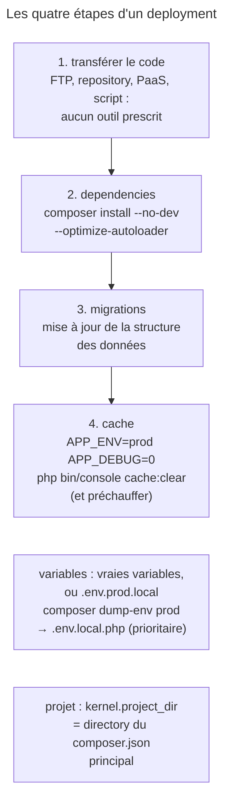

## Objectif

Connaître les étapes qu'un deployment Symfony comporte toujours, et les
commands exactes qui les réalisent.

## L'essentiel

La documentation ne prescrit aucun outil de deployment, mais quatre étapes
qu'il comporte toujours : transférer le code, installer les dependencies,
migrer les données, vider le cache. Deux commands sont à connaître
exactement, et les variables d'environment de production peuvent être
compilées dans un `.env.local.php`.

## Le schéma



## L'exemple : un script de deployment

```bash
composer install --no-dev --optimize-autoloader
composer dump-env prod
# … les migrations de la base de données
APP_ENV=prod APP_DEBUG=0 php bin/console cache:clear
```

## Les quatre étapes du tronc commun

1. **Transférer le code** sur le serveur de production.
2. **Installer les dependencies**, par Composer, avant ou après le transfert.
3. **Exécuter les migrations**, ou toute mise à jour de structure de données.
4. **Vider le cache**, et éventuellement le préchauffer.

Étiqueter une version, préparer une zone temporaire, lancer les tests, vider
un cache externe : cités comme fréquents, non comme obligatoires.

## Les deux commands à connaître exactement

- `composer install --no-dev --optimize-autoloader` : **`--no-dev`**
  n'installe pas les packages de développement ; **`--optimize-autoloader`**
  construit une *class map*, pour les performances de l'autochargeur.
- `APP_ENV=prod APP_DEBUG=0 php bin/console cache:clear` : le cache dépend de
  l'environment ; vider celui de `dev` ne sert à rien en production.
- Si `composer install` échoue sur *class not found*, exporter `APP_ENV=prod`
  avant de le relancer, pour que les scripts `post-install-cmd` tournent en
  `prod`.
- `--no-dev` ne retire pas `dump()` d'une application FrameworkBundle :
  VarDumper arrive par ErrorHandler, en dependency ordinaire.

## Les variables d'environment en production

- De **vraies** variables, posées par le serveur web, l'hébergeur ou la ligne
  de command, ou un file **`.env.prod.local`** : la documentation ne
  départage pas.
- `composer dump-env prod` produit un `.env.local.php` qui **prend le pas** sur
  les autres files ; `--empty` génère la même structure sans valeurs. Sans
  Composer sur le serveur, la command `dotenv:dump` fait la même chose.
- Sur un serveur sans la CLI Symfony, `symfony/requirements-checker` vérifie
  les prérequis.
- `kernel.project_dir` est le directory du `composer.json` principal ;
  `Kernel::getProjectDir()` remonte depuis le kernel et, sans en trouver,
  rend le directory du kernel, sans erreur : kernel dans `app/src/`, aucun
  `composer.json`, le résultat est `app/src` — silencieusement faux. Un
  deployment sans `composer.json` redéfinit donc cette method.

## Pièges d'examen

**`--no-dev` et `--optimize-autoloader` répondent à deux besoins différents** :
ne pas installer le superflu, et accélérer l'autochargement.

**`cache:clear` s'exécute avec `APP_ENV=prod`**, pas avec l'environment
courant.

**`.env.local.php` l'emporte** sur les autres files de configuration.

**`kernel.project_dir` vient de l'emplacement du `composer.json`** ; sans lui,
le directory du kernel est rendu sans erreur.

**`--no-dev` ne retire pas `dump()`** d'une application FrameworkBundle :
VarDumper arrive par ErrorHandler.

**Aucun outil n'est prescrit** : FTP, repository versionné, PaaS ou script de
deployment sont tous cités.

## Application

- Une image de production sans `composer.json` → redéfinir
  `Kernel::getProjectDir()`.
- Des variables relues à chaque Request → `composer dump-env prod`.

## QCM d'entraînement

**Question 1.** Le serveur de production n'a pas Composer. Quelle command
produit tout de même le `.env.local.php` optimisé ?

- **A.** `php bin/console cache:warmup --env=prod`
- **B.** `php bin/console dotenv:dump`
- **C.** `php bin/console secrets:set --local`
- **D.** Aucune : il faut Composer

<details>
<summary>Correction</summary>

**Bonne réponse : B.** La command Symfony `dotenv:dump` fait ce que fait
`composer dump-env` quand Composer n'est pas installé sur le serveur.

</details>

**Question 2.** Une image Docker de production embarque `src/` et `public/`,
sans `composer.json`. Les paths de l'application sont faux, sans erreur.
Que faut-il faire ?

- **A.** Définir `APP_PROJECT_DIR` dans `.env.prod.local`
- **B.** Lancer `cache:clear` avec `APP_DEBUG=0`
- **C.** Ajouter `--optimize-autoloader` à l'installation
- **D.** Redéfinir `Kernel::getProjectDir()`

<details>
<summary>Correction</summary>

**Bonne réponse : D.** Le directory du projet est déduit du `composer.json`
principal ; sans lui, il faut le donner en redéfinissant la method.

</details>

**Question 3.** Une nouvelle version ajoute une colonne à une table. Quelle
étape du tronc commun du deployment s'en charge ?

- **A.** Exécuter les migrations
- **B.** Installer les dependencies
- **C.** Vider le cache
- **D.** Préchauffer le cache

<details>
<summary>Correction</summary>

**Bonne réponse : A.** La documentation range la mise à jour de la structure
de données parmi les quatre étapes, sous la forme des migrations.

</details>

**Question 4.** L'équipe lance la suite de tests avant chaque deployment. Que
dit la documentation de cette étape ?

- **A.** Elle est obligatoire, avant le transfert du code
- **B.** Elle remplace la vérification des prérequis
- **C.** Elle est fréquente, mais pas obligatoire
- **D.** Elle doit tourner sur le serveur de production

<details>
<summary>Correction</summary>

**Bonne réponse : C.** Seules quatre étapes sont toujours là ; lancer les
tests est cité parmi les pratiques fréquentes, comme étiqueter une version.

</details>

## Fiche express

**Si tu dois retenir seulement 6 choses :**

- Quatre étapes : **code, dependencies, migrations, cache**.
- **`composer install --no-dev --optimize-autoloader`**.
- **`APP_ENV=prod APP_DEBUG=0 php bin/console cache:clear`**.
- Variables réelles ou `.env.prod.local` ; **`composer dump-env prod`**, ou
  `dotenv:dump` sans Composer.
- **`kernel.project_dir`** = directory du `composer.json` principal.
- Aucun outil prescrit.

Moyen mnémotechnique : **« Code, vendors, schéma, cache »**.

## Sources officielles

- [How to Deploy a Symfony Application](https://github.com/symfony/symfony-docs/blob/8.0/deployment.rst)
- [`Kernel::getProjectDir()`, branche 8.0](https://github.com/symfony/symfony/blob/8.0/src/Symfony/Component/HttpKernel/Kernel.php)
- [`composer.json` d'ErrorHandler, branche 8.0](https://github.com/symfony/symfony/blob/8.0/src/Symfony/Component/ErrorHandler/composer.json)

