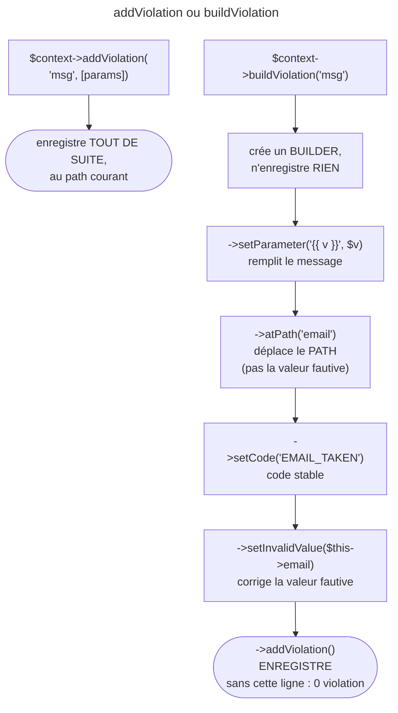

## Objectif

Signaler une violation depuis un callback ou un validator, et savoir laquelle
des deux methods du contexte utiliser.

## L'essentiel

Le contexte d'exécution signale une violation de deux façons : directement,
ou par un **builder** qu'on configure — field visé, code, parameters — puis
qu'on **enregistre** par `addViolation()`. L'oubli de ce dernier appel est le
piège central : la règle échoue, et la validation passe.

## Le schéma



## L'exemple : une adresse déjà réservée

```php
#[Assert\Callback('check')]
class Registration
{
    public string $email = '';

    public function check(ExecutionContextInterface $context): void
    {
        if ($this->isReserved($this->email)) {
            $context->buildViolation('L\'adresse {{ value }} est déjà prise.')
                ->setParameter('{{ value }}', $this->email)
                ->atPath('email')
                ->setCode('EMAIL_TAKEN')
                ->addViolation();
        }
    }
}
```

## Les deux façons

| Method du contexte | Effet |
|---|---|
| `addViolation('msg', [params])` | enregistre **immédiatement**, au path courant |
| `buildViolation('msg', [params])` | rend un builder : field, code, valeur fautive réglables |

Seul le builder permet de choisir le field visé, le code ou la valeur fautive.

## Le builder n'écrit rien tout seul

`buildViolation()` **ne crée aucune violation** : elle prépare un object. Tant
que `addViolation()` n'est pas appelée au bout de la chaîne d'appels, rien
n'est enregistré. `addViolation()` existe donc des deux côtés : sur le
contexte, elle enregistre ; sur le builder, elle termine la chaîne d'appels.

## Ce que l'on peut régler

Les dix methods de `ConstraintViolationBuilderInterface` (8.0, relues par
réflexion) :

| Method | Effet |
|---|---|
| `atPath()` | attribue la violation à une autre property que celle en cours |
| `setParameter()` / `setParameters()` | remplit les emplacements `{{ … }}` |
| `setCode()` | un code machine stable, lu par `getCode()` |
| `setInvalidValue()` | la valeur affichée comme fautive |
| `setPlural()` | le nombre qui choisit la forme plurielle |
| `setTranslationDomain()` / `disableTranslation()` | le traitement du message |
| `setCause()` | la cause technique, pour le debug |
| `addViolation()` | enregistre, en fin de chaîne d'appels |

- Sans `atPath()`, une violation de class est attachée à l'object, path vide :
  le form l'affiche à sa **racine**, pas sur le field.
- Le path se compose : `atPath('address.city')`.
- `atPath()` ne change pas la valeur fautive : elle reste l'object entier ;
  `setInvalidValue()` la corrige.

## Les emplacements du message

Le message porte des emplacements `{{ … }}`, remplis par `setParameter()`.
C'est ce qui permet de le traduire sans y concaténer la valeur. La violation
garde les deux formes : `getMessageTemplate()` rend le modèle, `getMessage()`
le texte rempli.

## Une constraint sur mesure

Le builder sert d'abord dans un `ConstraintValidator` : une class `Slug`
(extends `Constraint`) et sa class `SlugValidator`.

```php
public function validate(mixed $value, Constraint $constraint): void
{
    if (!$constraint instanceof Slug) {
        throw new UnexpectedTypeException($constraint, Slug::class);
    }
    if (null === $value || '' === $value) {
        return;
    }
    if (!is_string($value)) {
        throw new UnexpectedValueException($value, 'string');
    }
    if (!preg_match('/^[a-z0-9-]+$/', $value)) {
        $this->context->buildViolation($constraint->message)
            ->setParameter('{{ value }}', $value)
            ->addViolation();
    }
}
```

- `validatedBy()` rend par défaut le nom de la class suivi de `Validator`.
- Le validator **reçoit `null`** : le `return` est son travail, pour laisser
  `NotNull` ou `NotBlank` décider.
- `UnexpectedValueException` devient une violation ; `UnexpectedTypeException`
  remonte : c'est une erreur de code.
- `getTargets()` vaut `PROPERTY_CONSTRAINT` : posée sur une class, la
  constraint lève une `ConstraintDefinitionException`.
- En 8.0, une option se déclare dans le constructor, qui appelle
  `parent::__construct(null, $groups, $payload)`.

## Pièges d'examen

**`buildViolation()` seule n'enregistre rien.** Sans `addViolation()` au bout de
la chaîne d'appels, la validation passe alors que la règle est violée.

**`addViolation()` existe des deux côtés** : sur le contexte, elle enregistre
directement ; sur le builder, elle termine la chaîne d'appels. Ce ne sont pas les
mêmes methods.

**Sans `atPath()`, une violation de portée class reste attachée à l'object** et
le form l'affiche en tête, pas sur le field.

**`atPath()` déplace le path, pas la valeur fautive.**

**Un validator maison doit ignorer `null` lui-même.**

## Application

- Une API doit distinguer « email pris » de « email invalide » sans lire le
  texte → `->setCode(Registration::EMAIL_TAKEN)`, lu par `getCode()`.
- Une erreur de date de fin affichée au-dessus du form → `->atPath('end')`
  avant `->addViolation()`.

## QCM d'entraînement

**Question 1.** La constraint `Slug` ne redéfinit pas `getTargets()`, et elle
est posée sur une **class**. Que se passe-t-il ?

- **A.** Elle valide l'object entier comme une string
- **B.** Elle est ignorée, sans erreur
- **C.** Une `InvalidArgumentException` dans le validator
- **D.** Une `ConstraintDefinitionException`

<details>
<summary>Correction</summary>

**Bonne réponse : D.** Par défaut, `getTargets()` ne vise que les properties ;
il faut rendre `CLASS_CONSTRAINT` pour la poser sur une class.

</details>

**Question 2.** Un `Callback` de class ajoute une violation **sans**
`atPath()`. Où un form Symfony l'affiche-t-il ?

- **A.** Sur le form racine
- **B.** Sur le premier field du form
- **C.** Sur chaque field, une fois par field
- **D.** Nulle part : une violation sans path est ignorée

<details>
<summary>Correction</summary>

**Bonne réponse : A.** Sans path, la violation est attachée à l'object, donc au
form racine ; `atPath()` la place sur le field fautif.

</details>

**Question 3.** `SlugValidator` reçoit une constraint `Email` au lieu de
`Slug`, et lève `UnexpectedTypeException`. Que voit l'appelant ?

- **A.** Une violation « This value should be of type string. »
- **B.** L'exception, qui remonte
- **C.** Aucune violation : la constraint est sautée
- **D.** Une violation sans message, au path courant

<details>
<summary>Correction</summary>

**Bonne réponse : B.** Une mauvaise constraint est une erreur de code, pas de
donnée ; seule `UnexpectedValueException` devient une violation.

</details>

**Question 4.** Dans un `Callback` de class, la violation dirigée vers `email`
doit porter l'adresse comme valeur fautive. Quel appel ajouter ?

- **A.** Rien : `atPath('email')` change aussi la valeur fautive
- **B.** `setParameter('{{ value }}', $this->email)`
- **C.** `setInvalidValue($this->email)`
- **D.** `setCause($this->email)`

<details>
<summary>Correction</summary>

**Bonne réponse : C.** `atPath()` ne déplace que le path ; la valeur fautive
reste l'object validé tant que `setInvalidValue()` ne la remplace pas.

</details>

## Fiche express

**Si tu dois retenir seulement 6 choses :**

- `addViolation()` du **contexte** : immédiat ; `buildViolation()` : un builder.
- Le builder **n'enregistre rien** sans `->addViolation()` à la fin.
- `atPath()` : le field visé ; sans lui, l'erreur est à la **racine** du form.
- `atPath()` ne change pas la **valeur fautive** : `setInvalidValue()`.
- `setParameter()` remplit `{{ … }}` ; `setCode()` donne un code stable.
- Constraint maison : `SlugValidator` par défaut, `return` sur `null`,
  `UnexpectedValueException` → violation.

Moyen mnémotechnique : **« Construire, viser, coder, ajouter »**.

## Sources officielles

- [Créer une constraint sur mesure](https://github.com/symfony/symfony-docs/blob/8.0/validation/custom_constraint.rst), [`Constraint`](https://github.com/symfony/symfony/blob/8.0/src/Symfony/Component/Validator/Constraint.php) et [`RecursiveContextualValidator`](https://github.com/symfony/symfony/blob/8.0/src/Symfony/Component/Validator/Validator/RecursiveContextualValidator.php), branche 8.0
- [`ConstraintViolationBuilderInterface`, branche 8.0](https://github.com/symfony/symfony/blob/8.0/src/Symfony/Component/Validator/Violation/ConstraintViolationBuilderInterface.php)
- [`ExecutionContextInterface`, branche 8.0](https://github.com/symfony/symfony/blob/8.0/src/Symfony/Component/Validator/Context/ExecutionContextInterface.php)

