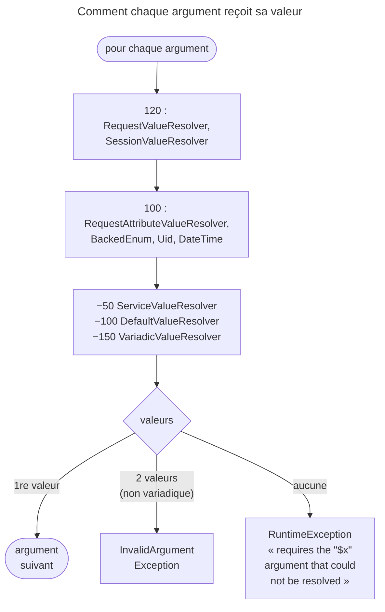
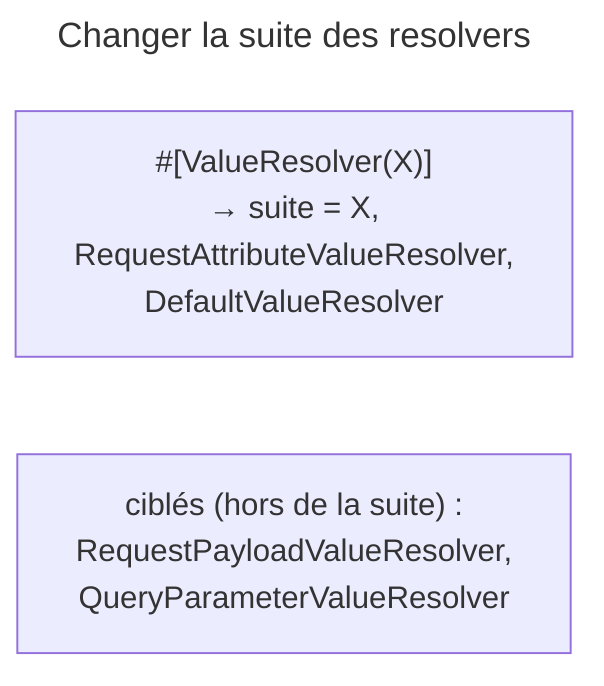

## Objectif

Comprendre le mécanisme qui remplit les arguments d'un controller : qui décide,
dans quel ordre, et comment s'y insérer. C'est ce mécanisme qui explique
pourquoi typer `Request`, `SessionInterface` ou une enum suffit.

## L'essentiel

Le kernel ne remplit pas lui-même les arguments d'un controller : il essaie une
**chaîne de resolvers**, triés par priority, et le **premier** qui fournit une
valeur gagne ; si aucun ne sait, une `RuntimeException` part. Deux resolvers,
dits **ciblés**, ne tournent que si un attribute les désigne : ce sont les
`#[Map…]`, qui échouent en 404 sur l'URL, en 422 sur le body.

## Le schéma





## L'exemple : un resolver maison

```php
final class CurrentLocaleResolver implements ValueResolverInterface
{
    public function resolve(Request $request, ArgumentMetadata $argument): iterable
    {
        if (Locale::class !== $argument->getType()) {
            return;   // rien produit : le resolver suivant essaie
        }

        yield new Locale($request->getLocale());
    }
}
```

## Le contrat

Chaque resolver implémente `ValueResolverInterface` et sa method unique
`resolve(Request $request, ArgumentMetadata $argument): iterable`.
`ArgumentMetadata` porte ce que la signature déclare : nom, type, variadicité,
default value, attributes. La documentation dit « toujours un array » — vide,
à un élément, à plusieurs pour un variadique ; le type est `iterable`, et un
generator fonctionne. Retourner la valeur elle-même est l'erreur classique.

## Ce que fait `ArgumentResolver`

Le premier resolver qui produit une valeur **arrête** la chaîne de resolvers ; deux valeurs
pour un argument non variadique lèvent une `InvalidArgumentException`. Un array
vide passe la main sans erreur : seul l'échec de **toute** la chaîne de resolvers lève.

## L'ordre

Les services tagués `controller.argument_value_resolver` sont triés par
**priority**, fixée par FrameworkBundle. `SessionValueResolver`, à 120, passe
avant `DefaultValueResolver` : la session s'il y en a une, `null` sinon. Un resolver maison qui lit
les attributes se place à `100` ou plus. La documentation écrit
`SessionInterface $session = null` ; PHP 8.4 déprécie ce nullable implicite :
écrire `?SessionInterface $session = null`.

## Le catalogue

| Resolver | Ce qu'il remplit |
|---|---|
| `RequestAttributeValueResolver` | un argument qui porte le nom d'un attribute — les parameters de route |
| `RequestValueResolver` | un argument typé `Request` ou une sous-classe |
| `SessionValueResolver` | un argument typé `SessionInterface` |
| `BackedEnumValueResolver`, `UidValueResolver` | un cas d'enum, un identifier Uid |
| `DateTimeValueResolver` | un `\DateTimeInterface` — un `DateTimeImmutable` si le type est l'interface |
| `ServiceValueResolver` | un service du locator propre à l'action |
| `DefaultValueResolver` | la default value, ou `null` pour un type nullable |
| `VariadicValueResolver` | un argument variadique depuis un attribute array |

Une valeur invalide venue de l'URL donne **404** pour une enum, une date ou un
Uid. Un `Request` mal importé reçoit « Looks like you required a Request object
with the wrong class name ».

## Les resolvers ciblés

`RequestPayloadValueResolver` et `QueryParameterValueResolver` portent le tag
`controller.targeted_value_resolver` : hors de la chaîne de resolvers, ils ne s'exécutent
que si un attribute les désigne.

`#[ValueResolver]` épingle un resolver par son nom — le FQCN pour ceux du
framework. La chaîne de resolvers compte alors **trois** éléments : l'épinglé,
`RequestAttributeValueResolver`, `DefaultValueResolver` ; la documentation ne
cite que le dernier. Deux épinglés sur un argument lèvent une
`LogicException` ; `disabled: true` en saute un.

| Attribute | Source | Échec par défaut |
|---|---|---|
| `#[MapQueryParameter]` | un parameter de la query string | **404** |
| `#[MapQueryString]` | la query string, vers un object | **404** |
| `#[MapRequestPayload]` | le body, vers un object | **422** |
| `#[MapUploadedFile]` | un file téléversé | **422** |

Un body illisible — JSON malformé — donne **400**, un format sans decoder
**415** ; `validationFailedStatusCode` change le 422, pas ceux-là.
`#[MapQueryParameter]` accepte `filter`, `flags` et `options` : avec
`FILTER_NULL_ON_FAILURE`, une valeur invalide devient `null` au lieu de lever.

## Pièges d'examen

- La documentation dit « toujours un array » ; le type est `iterable`.
- Un array vide passe la main ; si aucun resolver ne fournit de valeur, une
  `RuntimeException` est levée.
- Le premier resolver qui fournit une valeur **arrête** la chaîne de resolvers.
- Une valeur invalide dans l'URL donne **404**, pas 400.
- `#[MapQueryParameter]` échoue en **404**, `#[MapRequestPayload]` en **422**.
- Un JSON malformé donne **400**, pas 422 : il n'y a rien à valider.
- Un resolver ciblé ne s'exécute pas sans son attribute.
- `SessionInterface $session = null` est déprécié en PHP 8.4.

## Application

- Injecter un object maison dans toutes les actions → un resolver tagué,
  priority adaptée, `yield` de la valeur.
- Un `?page=abc` doit donner la page par défaut, pas un 404 →
  `FILTER_NULL_ON_FAILURE` et un argument nullable.

## QCM d'entraînement

**Question 1.** Un resolver rend deux valeurs pour un argument non variadique.
Que fait `ArgumentResolver` ?

- **A.** Il lève une `InvalidArgumentException`
- **B.** Il garde la première valeur
- **C.** Il garde la dernière valeur
- **D.** Il passe les deux valeurs, regroupées dans un array

<details>
<summary>Correction</summary>

**Bonne réponse : A.** Au-delà d'une valeur, seul un argument variadique est
admis ; sinon le resolver est désigné comme fautif par l'exception.

</details>

**Question 2.** Un argument porte `#[ValueResolver(BackedEnumValueResolver::class)]`.
Combien de resolvers sa chaîne de resolvers compte-t-elle ?

- **A.** Un seul : celui épinglé
- **B.** Trois
- **C.** Tous, l'épinglé en tête
- **D.** Deux : l'épinglé puis le défaut

<details>
<summary>Correction</summary>

**Bonne réponse : B.** L'épinglé, puis `RequestAttributeValueResolver`, puis
`DefaultValueResolver` ; les autres resolvers de la chaîne de resolvers sont écartés.

</details>

**Question 3.** Un argument porte deux attributes `#[ValueResolver]`, sans
`disabled`. Que se passe-t-il ?

- **A.** Le premier l'emporte
- **B.** Le dernier l'emporte
- **C.** Une `LogicException`
- **D.** Les deux sont essayés dans l'ordre

<details>
<summary>Correction</summary>

**Bonne réponse : C.** Un seul resolver peut être épinglé par argument ; un
second attribute n'est admis que pour en désactiver un.

</details>

**Question 4.** L'argument `?int $page` porte `#[MapQueryParameter]` avec le
filter `FILTER_VALIDATE_INT` et le drapeau `FILTER_NULL_ON_FAILURE`. La query
string vaut `?page=abc`. Quelle valeur reçoit l'argument ?

- **A.** Un 404, la valeur étant invalide
- **B.** `0`
- **C.** Une `TypeError`
- **D.** `null`

<details>
<summary>Correction</summary>

**Bonne réponse : D.** Le drapeau change l'échec du filter en `null` ; sans
lui, la même valeur aurait produit l'erreur 404 par défaut.

</details>

## Fiche express

**Si tu dois retenir seulement 7 choses :**

- `resolve()` rend un **`iterable`** : vide = « pas moi ».
- Premier resolver qui fournit → **gagne** ; aucun → `RuntimeException`.
- Priority : **120** Request/Session, **100** attributes, **−100** défaut.
- Valeur d'URL invalide (enum, date, Uid) → **404**.
- Ciblés : **payload** et **query parameter**, seulement sur attribute.
- `#[ValueResolver]` → épinglé + attributes + défaut ; deux épinglés → exception.
- `#[Map…]` : URL **404**, body **422**, illisible **400**.

Moyen mnémotechnique : **« Premier qui donne, premier servi »**.

## Sources officielles

- [Value Resolvers](https://github.com/symfony/symfony-docs/blob/8.0/controller/value_resolver.rst)
- [Controller, « Automatic Mapping Of The Request »](https://github.com/symfony/symfony-docs/blob/8.0/controller.rst)
- [`ArgumentResolver`](https://github.com/symfony/symfony/blob/8.0/src/Symfony/Component/HttpKernel/Controller/ArgumentResolver.php)
- [Priorities dans FrameworkBundle](https://github.com/symfony/symfony/blob/8.0/src/Symfony/Bundle/FrameworkBundle/Resources/config/web.php)
- [`MapQueryParameter`](https://github.com/symfony/symfony/blob/8.0/src/Symfony/Component/HttpKernel/Attribute/MapQueryParameter.php)
- [PHP 8.4, nullable implicite déprécié](https://github.com/php/doc-en/blob/master/appendices/migration84/deprecated.xml)

