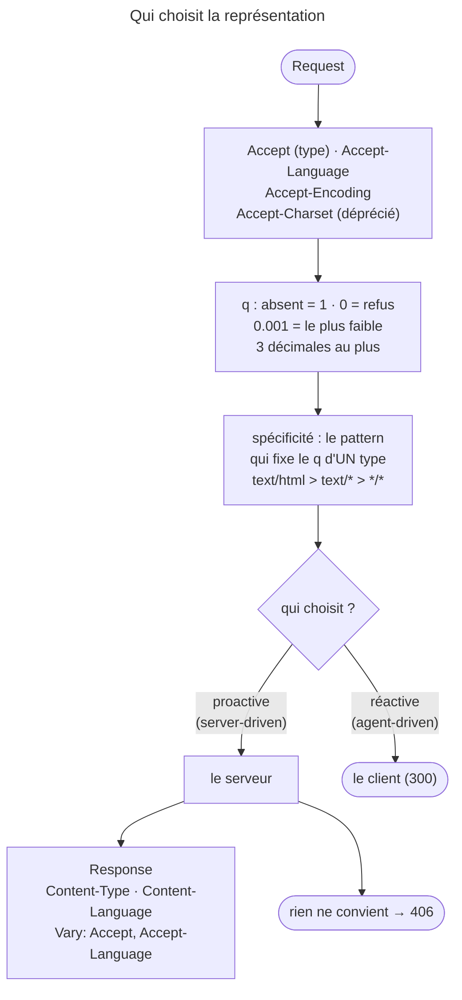

## Objectif

Choisir la représentation d'une ressource à partir des headers `Accept*`, et
signaler ce choix correctement.

## L'essentiel

Une ressource a plusieurs **représentations** ; le client décrit ses
préférences dans les headers `Accept*`, le serveur choisit et l'annonce. Chaque
préférence porte un poids `q`, à `1` par défaut. Côté Symfony, deux accessors
ne négocient pas ce qu'on croit : `getAcceptableContentTypes()` trie sans
spécificité, `getPreferredFormat()` lit `_format` avant `Accept`.

## Le schéma



## L'exemple : lire les préférences

```php
// Accept: text/html,application/xhtml+xml,application/json;q=0.9,*/*;q=0.8
$request->getAcceptableContentTypes();
// ['text/html', 'application/xhtml+xml', 'application/json', '*/*']

$request->getPreferredFormat();     // 'html' — sauf si _format est posé
```

## Le facteur de qualité, exactement

- Sans `q`, le poids vaut **`1`** — pas « moins que le précédent ». Seul `q`
  ordonne.
- L'échelle va de `0` à `1` : **`0` signifie *not acceptable***, `0.001` est la
  préférence la plus faible. `Accept: */*;q=0.8, image/png;q=0` veut dire
  « tout sauf du PNG ».
- La grammaire n'admet que **trois décimales** : `q=0.3333` est mal formé. Le
  nom du parameter `q` est insensible à la casse.
- La spécificité ne départage pas deux types : elle désigne **quel pattern fixe
  le `q` d'un type donné** — pour `text/html`, `text/html` avant `text/*`, avant
  `*/*`.
- Pour `Accept-Language`, l'ordre d'écriture à qualité égale
  « cannot be relied upon ». Dans `Accept-Encoding`, `identity` veut dire
  « pas de codage ».

`getAcceptableContentTypes()` trie sur la qualité décroissante, puis sur
**l'ordre d'écriture du client** — ni sur la spécificité, ni en retirant les
`q=0`.

## Les headers de Response

```http
Content-Type: application/json
Content-Language: fr
Vary: Accept, Accept-Language
```

`Vary` n'est pas facultatif dès qu'on négocie : sans lui, un cache partagé sert
la première représentation obtenue à tous. `Vary: *` est légal — un cache doit
alors revalider — mais **un proxy n'a pas le droit d'en générer**. Si rien ne
convient, `406 Not Acceptable` est conforme, même si servir une représentation
par défaut est souvent préférable.

## Proactive contre réactive

- **Proactive** (§12.1), *server-driven* : un algorithme côté serveur choisit,
  d'après les `Accept*` **et** des caractéristiques implicites — adresse réseau,
  morceaux de `User-Agent`. C'est celle que l'examen vise.
- **Réactive** (§12.2), *agent-driven* : le serveur renvoie une liste
  d'alternatives, par exemple avec `300 Multiple Choices`, et le client choisit.

Le mot *driven* du synonyme donne l'indice : *server-driven* contre
*agent-driven*.

## Pièges d'examen

**`q=0` refuse explicitement.** `Accept: */*;q=0.8, image/png;q=0` signifie
« tout sauf du PNG ».

**Sans `q`, la valeur est `1.0`** — pas `0`, et pas une pondération implicite
par la position.

**Oublier `Vary` est le bug de cache classique** et n'a aucun symptôme
localement, où il n'y a pas de cache partagé.

**`Accept` est une préférence, pas une constraint.** Un serveur peut répondre
autre chose ; il l'annonce par `Content-Type`.

## Application

- Une API JSON qui reçoit `Accept: text/html` → `406`, ou du JSON annoncé par
  `Content-Type`.
- Un `_format` de route qui doit l'emporter sur `Accept` → `getPreferredFormat()`
  le fait déjà.

## QCM d'entraînement

**Question 1.** Lequel de ces éléments d'un header `Accept` est **mal formé**
selon RFC 9110 ?

- **A.** `text/html;q=0.001`
- **B.** `text/html;Q=1.000`
- **C.** `text/html;q=0`
- **D.** `text/*;q=0.3333`

<details>
<summary>Correction</summary>

**Bonne réponse : D.** La grammaire de `qvalue` n'admet pas plus de trois
décimales ; le nom `q` est insensible à la casse, et `0.001` reste valide.

</details>

**Question 2.** Que signifie `identity` dans un header `Accept-Encoding` ?

- **A.** Aucun codage de contenu
- **B.** Le même codage que la Request
- **C.** N'importe quel codage, comme `*`
- **D.** Un codage choisi par le proxy

<details>
<summary>Correction</summary>

**Bonne réponse : A.** La RFC fait de `identity` un synonyme de « no
encoding », pour dire qu'aucun codage n'est préféré.

</details>

**Question 3.** Le serveur renvoie une liste de représentations disponibles,
et c'est le client qui choisit avant de redemander. Quelle négociation ?

- **A.** Proactive, dite *server-driven*
- **B.** Réactive, dite *agent-driven*
- **C.** Transparente, gérée par le cache
- **D.** Aucune : la RFC impose un `406`

<details>
<summary>Correction</summary>

**Bonne réponse : B.** Dans la négociation réactive, la sélection revient au
user agent, qui choisit dans la liste — par exemple après un `300`.

</details>

**Question 4.** Qui n'a **pas** le droit de générer `Vary: *` ?

- **A.** Le serveur d'origine
- **B.** Un controller Symfony
- **C.** Un proxy
- **D.** Personne : `*` est interdit

<details>
<summary>Correction</summary>

**Bonne réponse : C.** La valeur `*` est légale pour le serveur d'origine ; la
RFC interdit seulement à un proxy de l'écrire dans un `Vary`.

</details>

## Fiche express

**Si tu dois retenir seulement 7 choses :**

- Une ressource, plusieurs **représentations** ; le client préfère, le serveur
  choisit.
- `q` par défaut **`1`** ; **`q=0` refuse** ; `0.001` le plus faible ; 3
  décimales.
- La spécificité choisit le pattern qui fixe le `q` d'un type, elle n'ordonne pas deux types entre eux.
- `getAcceptableContentTypes()` : qualité, puis **ordre d'écriture**.
- `getPreferredFormat()` : **`_format` avant `Accept`**.
- Négocier impose **`Vary`** ; `406` si rien ne convient.
- Proactive = *server-driven* ; réactive = *agent-driven*.

Moyen mnémotechnique : **« Le client préfère, le serveur choisit, Vary le dit »**.

## Sources officielles

- [RFC 9110 §12 — *Content Negotiation*](https://github.com/httpwg/httpwg.github.io/blob/master/specs/rfc9110.html#content.negotiation)
- [`Request`](https://github.com/symfony/symfony/blob/8.0/src/Symfony/Component/HttpFoundation/Request.php) — `getAcceptableContentTypes()` (branche 8.0, `6f841c0`)
