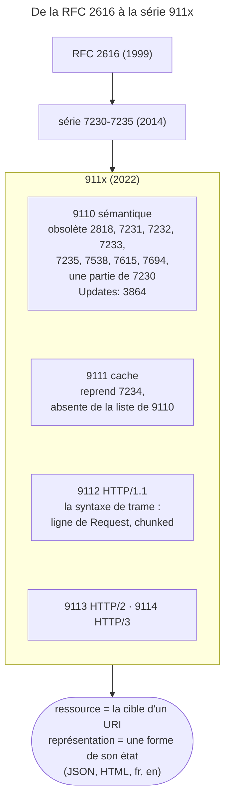

## Objectif

Situer RFC 9110 parmi les spécifications HTTP et reconnaître son vocabulaire.

## L'essentiel

RFC 9110, *HTTP Semantics* (2022), définit **le sens** d'HTTP — methods,
status codes, fields, négociation — indépendamment de la version. Le cache et
chaque version de transport ont leur propre RFC. L'examen vérifie deux choses :
qui remplace quoi, et le vocabulaire, surtout **ressource** contre
**représentation**.

## Le schéma



## L'exemple : une ressource, deux représentations

```http
GET /article/42 HTTP/1.1
Accept: application/json

HTTP/1.1 200 OK
Content-Type: application/json
Vary: Accept
ETag: "a42-json"
```

Le même URI peut rendre du HTML avec un autre `ETag` : c'est la même ressource,
une autre représentation, et `Vary` nomme le field qui a servi à choisir.

## Ce que RFC 9110 remplace

Son résumé dit qu'elle obsolète les RFC **2818, 7231, 7232, 7233, 7235, 7538,
7615, 7694, et des parties de 7230**.

- **7230 n'est obsolétée qu'en partie** : la sémantique passe dans 9110, la
  syntaxe de trame HTTP/1.1 dans **9112** — seule ligne marquée d'un astérisque
  dans la Table 1 du §1.4.
- **7234 n'y figure pas** : le caching est repris par **RFC 9111**.
- **2818**, *HTTP Over TLS*, y figure, et on l'oublie presque toujours.
- **Obsolète n'est pas met à jour** : 9110 porte `Updates: 3864`, qui reste en
  vigueur, amendée.

Une method ou un status code signifie la même chose en HTTP/1.1, HTTP/2 et
HTTP/3 : seul le transport change.

## Vocabulaire imposé

- **Message** (§6) : données de contrôle, fields de header, contenu, fields de
  fin (*trailers*). La « ligne de départ » est la forme HTTP/1.1, donc 9112.
- **Ressource** : la cible identifiée par un URI ; ce n'est pas un file.
- **Représentation** : une forme concrète de l'état d'une ressource à un
  instant donné. Plusieurs par ressource — d'où la content negotiation,
  `Vary` et un `ETag` par représentation.
- **Field de header** : un nom insensible à la casse, une valeur.
- **Intermédiaires** (§3.7) : proxy, gateway — « a.k.a. reverse proxy » — et
  tunnel.

## Pièges d'examen

**« RFC 9110 remplace RFC 2616 » est un raccourci.** 2616 a d'abord été éclatée
en 7230-7235 ; c'est cette série-là que les 911x remplacent, et pas d'un bloc :
9110 prend la sémantique, 9111 le cache, 9112 la trame HTTP/1.1.

**Une ressource n'est pas sa représentation, et ce n'est pas un détail de
vocabulaire.** `/article/42` désigne une ressource ; le JSON français et le HTML
anglais qu'elle peut rendre sont des représentations. C'est pourquoi la
content negotiation porte sur la représentation, et pourquoi `Vary` nomme les
fields qui ont servi à la choisir. Confondre les deux rend `Vary` inexplicable.

**Les properties des methods — sûre, idempotente — sont bien définies par RFC
9110 (§9.2), mais elles sont évaluées sous l'item *HTTP methods*** de ce lot.

**RFC 9110 ne décrit aucune syntaxe de trame.** Le codage `chunked` ou la ligne
de Request relèvent de RFC 9112.

## Application

- Chercher la definition de `Cache-Control: max-age` → RFC 9111, pas 9110.
- Une API qui sert JSON ou HTML selon `Accept` → `Vary: Accept` dans la
  Response.

## QCM d'entraînement

**Question 1.** Une Response porte deux lignes `Set-Cookie`. Un intermédiaire
peut-il les fusionner en une seule ligne séparée par des virgules ?

- **A.** Non : `Set-Cookie` ne se combine pas en une valeur
- **B.** Oui, comme tout field répété
- **C.** Oui, mais seulement en HTTP/2
- **D.** Seulement si les deux cookies portent le même `Path`

<details>
<summary>Correction</summary>

**Bonne réponse : A.** La fusion suppose une syntaxe de liste ; RFC 9110
désigne `Set-Cookie` comme le cas particulier qui ne la respecte pas.

</details>

**Question 2.** Dans le vocabulaire de RFC 9110, quelle forme d'intermédiaire
est un reverse proxy ?

- **A.** Un proxy, choisi par le client
- **B.** Un tunnel, qui relaie sans interpréter
- **C.** Un cache partagé, défini par 9111
- **D.** Une gateway

<details>
<summary>Correction</summary>

**Bonne réponse : D.** La gateway se présente comme le serveur d'origine et
transmet les Requests vers l'intérieur ; la RFC la glose « a.k.a. reverse
proxy ».

</details>

**Question 3.** `/article/42` est servi en JSON et en HTML. Combien d'`ETag`
distincts faut-il ?

- **A.** Un : l'`ETag` identifie la ressource
- **B.** Deux : un par représentation
- **C.** Aucun : la négociation interdit l'`ETag`
- **D.** Un par client qui a fait la Request

<details>
<summary>Correction</summary>

**Bonne réponse : B.** L'`ETag` qualifie la représentation sélectionnée et
distingue les représentations d'une même ressource : JSON et HTML en font deux.

</details>

**Question 4.** Où se trouve la definition de `Cache-Control: max-age` ?

- **A.** RFC 9110, avec les autres fields
- **B.** RFC 9112, avec la trame HTTP/1.1
- **C.** RFC 9111
- **D.** RFC 7234, toujours en vigueur

<details>
<summary>Correction</summary>

**Bonne réponse : C.** Le cache a été sorti de la sémantique : RFC 9111
obsolète 7234, qui ne figure pas dans la liste de 9110.

</details>

## Fiche express

**Si tu dois retenir seulement 6 choses :**

- **9110** sémantique, **9111** cache, **9112** HTTP/1.1, 9113 HTTP/2, 9114
  HTTP/3.
- 9110 obsolète **une partie** de 7230 ; la trame va dans 9112.
- 7234 n'est pas dans sa liste ; **2818** y est.
- `Obsoletes` remplace, **`Updates`** amende (3864 reste en vigueur).
- **Ressource** ≠ **représentation** : d'où la négociation, `Vary`, l'`ETag`.
- Noms de fields **insensibles à la casse**.
- Devant un énoncé absolu — « toute », « aucune », « jamais » — relire : §3.1
  écrit « *most* resources are identified by a URI ».

Moyen mnémotechnique : **« 10, 11, 12 » du plus général au plus concret** —
le sens, le cache, la trame.

## Sources officielles

- [RFC 9110 — *HTTP Semantics*](https://github.com/httpwg/httpwg.github.io/blob/master/specs/rfc9110.html) — §3 *Terminology*, §6 *Message Abstraction*
