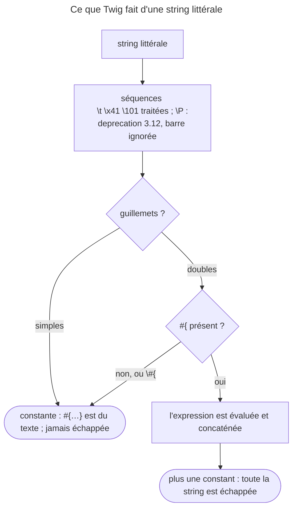

## Objectif

Insérer une expression dans une string, connaître la constraint qui l'entoure,
et savoir ce que Twig fait des barres obliques inverses dans une string.

## Avant la règle : le problème à résoudre

Un template affiche « Total : 42 euros », « Bonjour Ada », un titre
d'onglet fait de trois morceaux. Les écrire avec `~` marche, mais devient
illisible dès trois fragments. Twig offre l'**interpolation** : une expression
placée dans la string, `#{…}`.

Trois choses la gouvernent : **les guillemets** — doubles seulement —, **les
barres obliques inverses** — traitées dans les deux sortes de guillemets, à
l'inverse de PHP —, et **l'escaping** — qui s'applique à la string entière.
Tous les faits de cette page ont été exécutés avec Twig 3.22.2.

## Le fil rouge : la ligne de total

```twig
{# templates/cart/_total.html.twig #}
<p>{{ "Total : #{(price * qty)|number_format(2, ',', ' ')} euros" }}</p>
<title>{{ "#{page.title} — #{site.name}" }}</title>
<p>{{ 'Le marqueur #{…} s’écrit entre guillemets doubles' }}</p>
```

Les deux premières lignes interpolent une expression complète — un calcul, un
filter. La dernière, entre guillemets simples, affiche `#{…}` tel quel.

## Le cycle complet en un schéma

Ce que fait Twig d'une string littérale, lu dans le `Lexer` et rejoué :



## La syntaxe

```html
{{ "premier #{middle} dernier" }}
{{ "résultat : #{1 + 2}" }}
{{ "Bonjour #{user.name|upper}" }}
```

`#{expression}` accepte **n'importe quelle expression valide** — variable,
calcul, filter —, pas seulement un nom de variable. Son résultat est inséré dans
la string.

**Rejoué :** les trois lignes donnent la valeur de `middle` encadrée,
`résultat : 3` et `Bonjour ADA`. Une interpolation peut même en contenir une
autre : `"a #{"b #{x}"} c"` rend `a b X c` pour `x = 'X'`.

## La constraint

L'interpolation ne fonctionne que dans une string à **guillemets doubles**. Dans
une string à guillemets simples, `#{…}` est du texte littéral. Un `#` qui n'est
pas suivi de `{` reste du texte, même entre guillemets doubles.

La documentation de Twig 3.22 le précise : le choix des guillemets n'a aucun
effet sur les performances ; il ne décide que de l'interpolation.

**Rejoué :** `'Bonjour #{user.name}'` s'affiche tel quel, accolades
comprises ; `"n°# 3 et #tag"` aussi.

## Échapper

Une barre oblique inverse neutralise l'interpolation :

```html
{# affiche : premier #{1 + 2} dernier #}
{{ "premier \#{1 + 2} dernier" }}
```

## Les séquences d'escaping, dans les deux guillemets

Contrairement à PHP, Twig traite les séquences d'escaping **aussi entre
guillemets simples** : le `Lexer` passe toute string littérale par la même
function. `'a\nb'` contient donc un vrai saut de ligne. Sont reconnus `\n`,
`\t`, `\r`, `\v`, `\f`, `\\`, les formes hexadécimale `\x…` et octale `\0` à
`\377`, et le guillemet de la string : `\'` entre simples, `\"` entre doubles.

Tout autre caractère précédé d'une barre oblique inverse est **déprécié depuis
Twig 3.12** : la barre est ignorée en Twig 3, elle ne le sera plus en Twig 4.
Un path Windows s'écrit donc en doublant la barre : `'c:\\Program Files'`.

**Rejoué :**

| String | Résultat |
|---|---|
| `'a\nb'` | `a`, un vrai saut de ligne, `b` |
| `'\x41\101'` | `AA` — hexadécimal puis octal |
| `'l\'arbre'`, `"dit \"oui\""` | `l'arbre`, `dit "oui"` |
| `'c:\Program Files'` | `c:Program Files`, et la deprecation « Character "P" should not be escaped » |
| `'c:\\Program Files'` | `c:\Program Files` |

## L'escaping de la string entière

Une string **littérale** est une constant : `SafeAnalysisNodeVisitor` la juge
sûre, et `{{ '<b>x</b>' }}` affiche du gras, sans escaping. Une string
**interpolée** est une expression : son résultat est échappé **en entier**.

**Rejoué** avec l'autoescape `html` et `name = 'Ada'` :

| Écriture | Source HTML produit |
|---|---|
| `{{ '<b>x</b>' }}` | `<b>x</b>` |
| `{{ "<b>#{name}</b>" }}` | `&lt;b&gt;Ada&lt;/b&gt;` |
| `{{ "<b>#{name\|raw}</b>" }}` | `&lt;b&gt;Ada&lt;/b&gt;` — `raw` dans l'interpolation ne protège rien |
| `{{ '<b>' ~ name ~ '</b>' }}` | `&lt;b&gt;Ada&lt;/b&gt;` — la concaténation non plus |

Pour du HTML autour d'une valeur, on écrit le HTML **hors** de l'expression :
`<b>{{ name }}</b>`.

## L'alternative

L'operator `~` concatène, et reste souvent plus lisible sur deux fragments :

```html
{{ "Bonjour #{user.name} !" }}
{{ "Bonjour " ~ user.name ~ " !" }}
```

Rappel utile : `+` additionne des nombres ; il ne concatène pas.

La précédence demande une attention : dans Twig 3.22, `~` (40) lie **plus fort**
que `+` (30), et la table de la documentation annonce le passage de `~` à 27 en
Twig 4.

**Rejoué :** `{{ 1 + 2 ~ 3 }}` rend `24` — `2 ~ 3` d'abord ;
`{{ "total " ~ 1 + 2 }}` échoue, « Unsupported operand types: string + int ».
Les deux lèvent la deprecation 3.15 qui demande des parenthèses :
`{{ "total " ~ (1 + 2) }}` rend `total 3`. L'interpolation,
`"total #{1 + 2}"`, n'a pas le problème.

## Concrètement dans ton application

- Une phrase avec deux ou trois valeurs : l'interpolation, entre guillemets
  doubles.
- Un calcul dans une phrase : `"#{a + b}"`, ou `~` avec des parenthèses.
- Du HTML autour d'une valeur : dans le template, pas dans la string.
- Un path Windows ou une regex : doubler chaque barre oblique inverse.
- Un `#{` à afficher : guillemets simples, ou `\#{` entre doubles.

## À comprendre

- **Pourquoi les guillemets doubles seulement ?** Le `Lexer` ne cherche `#{`
  que dans une string à guillemets doubles ; les simples restent un moyen
  d'écrire un texte tel quel.
- **Pourquoi l'escaping prend-il toute la string ?** Une fois l'expression
  insérée, Twig ne sait plus quelle partie venait du template : le résultat
  entier est une valeur calculée.
- **Pourquoi `~` pose-t-il problème avec `+` ?** En Twig 3, il lie plus fort ;
  Twig 4 inversera l'ordre, d'où la deprecation qui demande des parenthèses dès
  maintenant.

## À mémoriser

- **`#{expression}`**, toute expression, **guillemets doubles** seulement.
- **`\#{`** échappe l'interpolation ; un **`#` seul** reste du texte.
- Séquences d'escaping traitées dans **les deux** guillemets ; **`\P`**
  inconnu : deprecation 3.12.
- String littérale : **constante**, non échappée ; string interpolée :
  **échappée en entier**.
- **`~`** (40) lie plus fort que **`+`** (30) : parenthèses.
- Moyen mnémotechnique : **« doubles pour interpoler, simples pour copier, et
  des parenthèses autour du calcul »**.

## Pièges d'examen

**L'interpolation ne fonctionne qu'entre guillemets doubles.** En guillemets
simples, la même écriture est du texte littéral affiché tel quel — et rien ne
signale l'erreur.

**Le choix des guillemets ne coûte rien en performance.**

**`\n` est un saut de ligne même entre guillemets simples**, à l'inverse de
PHP.

**L'operator d'addition ne concatène pas.**

## Application : trois scénarios

**Scénario 1 — Le gras qui s'affiche en texte brut.** `{{ "<strong>#{price}</strong> €" }}`
affiche `<strong>` en toutes lettres. *Solution.* La string interpolée est
échappée en entier : écrire `<strong>{{ price }}</strong> €`.

**Scénario 2 — Le total qui plante.** `{{ "Total : " ~ price + shipping }}`
lève « Unsupported operand types ». *Solution.* `~` passe avant `+` en Twig 3 :
`{{ "Total : " ~ (price + shipping) }}`, ou `"Total : #{price + shipping}"`.

**Scénario 3 — Le path qui perd ses barres.** `'c:\Users\ada'` s'affiche sans
barres, avec des deprecations. *Solution.* Doubler les barres :
`'c:\\Users\\ada'`.

## QCM d'entraînement

Cinq questions sur les strings. Choisis avant d'ouvrir la correction.

**Question 1.** Avec l'autoescape `html` et `name = 'Ada'`, que contient le
source HTML produit par `{{ "<b>#{name}</b>" }}` ?

- **A.** `<b>Ada</b>`
- **B.** `<b>#{name}</b>`
- **C.** `&lt;b&gt;Ada&lt;/b&gt;`
- **D.** `<b>Ada</b>`, `name` seul étant échappé

<details>
<summary>Correction</summary>

**Bonne réponse : C.** Rejoué avec Twig 3.22.2 : la string interpolée n'est
plus une constant ; le résultat entier est échappé, `<b>` et `</b>` compris.

A vaudrait pour `<b>{{ name }}</b>`. D suppose un escaping partiel, qui
n'existe pas. B décrit des guillemets simples.

</details>

**Question 2.** Que fait `{{ "total " ~ 1 + 2 }}` ?

- **A.** Il affiche `total 3`
- **B.** Il affiche `total 12`, la concaténation passant d'abord
- **C.** Il ne compile pas
- **D.** Il lève une erreur au rendu

<details>
<summary>Correction</summary>

**Bonne réponse : D.** Rejoué : `~` lie plus fort que `+` en Twig 3.22, donc
`("total " ~ 1) + 2`, et PHP refuse « string + int ». Une deprecation 3.15
demande des parenthèses.

A est le résultat de `"total " ~ (1 + 2)`. B et C sont faux.

</details>

**Question 3.** Que rend `{{ 'c:\Program Files' }}` sur Twig 3.22 ?

- **A.** `c:\Program Files`, la barre étant conservée telle quelle
- **B.** `c:Program Files`, avec une deprecation
- **C.** Une `SyntaxError`
- **D.** `c:` suivi d'un caractère de contrôle

<details>
<summary>Correction</summary>

**Bonne réponse : B.** Rejoué : `\P` n'est pas une séquence reconnue ; la barre
est ignorée en Twig 3 — « Character "P" should not be escaped » — et ne le
sera plus en Twig 4.

A demande `'c:\\Program Files'`. C et D sont faux.

</details>

**Question 4.** Que rend `{{ '\x41\101' }}`, entre guillemets simples ?

- **A.** `\x41\101`, tel quel
- **B.** `x41101`
- **C.** `A\101`
- **D.** `AA`

<details>
<summary>Correction</summary>

**Bonne réponse : D.** Rejoué : le `Lexer` traite les formes hexadécimale et
octale dans les deux sortes de guillemets ; `\x41` et `\101` valent tous deux
`A`.

A est le comportement de PHP entre guillemets simples. B et C sont faux.

</details>

**Question 5.** Avec `x = 'X'`, que rend `{{ "a #{"b #{x}"} c" }}` ?

- **A.** `a b X c`
- **B.** Une `SyntaxError` : guillemets imbriqués
- **C.** `a #{"b X"} c`
- **D.** `a b #{x} c`

<details>
<summary>Correction</summary>

**Bonne réponse : A.** Rejoué : le marqueur accepte toute expression, y compris
une autre string interpolée.

B, C et D supposent que le `Lexer` s'arrête au guillemet intérieur.

</details>

## Fiche express

**Si tu dois retenir seulement 7 choses :**

- **`#{expression}`** : toute expression, **guillemets doubles**.
- Guillemets simples : **texte littéral**, sans erreur.
- **`\#{`** affiche le marqueur ; un **`#`** seul reste du texte.
- **`\n`, `\x41`, `\101`** traités dans les deux guillemets.
- **`\P`** inconnu : barre ignorée, **deprecation** ; doubler les barres.
- String interpolée : **échappée en entier** ; littérale : non.
- **`~`** lie plus fort que **`+`** : des parenthèses.

**En une phrase, pour tout reconstruire :**

```text
#{expr} entre doubles seulement ; \#{ pour l'afficher ; escapes dans les deux guillemets, \P déprécié ;
littérale = constante non échappée, interpolée = échappée en entier ; ~ avant + : parenthèses
```

## Sources officielles

- [Twig 3.22, « String Interpolation » et « Literals »](https://github.com/twigphp/Twig/blob/v3.22.0/doc/templates.rst)
- [Twig 3.22, précédence des operators](https://github.com/twigphp/Twig/blob/v3.22.0/doc/operators_precedence.rst)
- [Twig 3.22, `Lexer`](https://github.com/twigphp/Twig/blob/v3.22.0/src/Lexer.php) et [`SafeAnalysisNodeVisitor`](https://github.com/twigphp/Twig/blob/v3.22.0/src/NodeVisitor/SafeAnalysisNodeVisitor.php)
