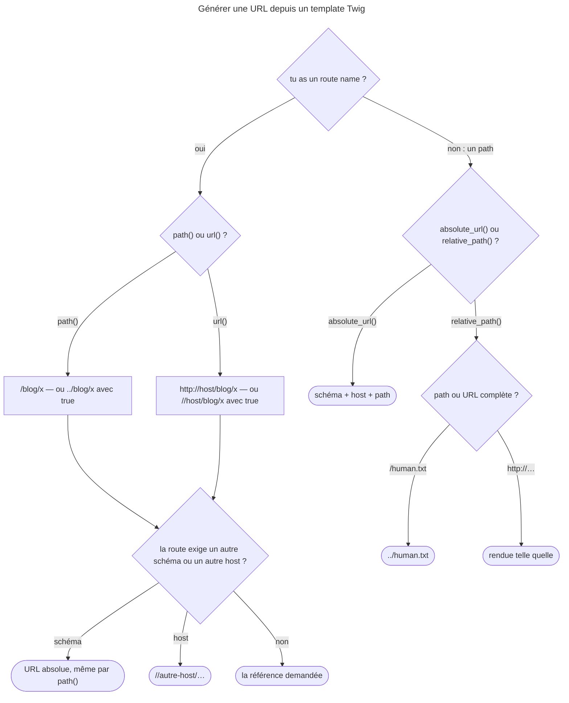

## Objectif

Générer une URL depuis un template. Le generator lui-même et ses quatre types de
référence sont traités dans le lot Routing.

## L'essentiel

Deux functions prennent un **route name** — `path()` pour un path, `url()` pour
une URL complète — et deux autres prennent un **path** — `absolute_url()` et
`relative_path()`. Le generator peut élargir la référence demandée, et une URL
ne s'écrit jamais à la main.

## Le schéma


## Deux functions

```html
<a href="{{ path('blog_show', {slug: post.slug}) }}">Lire</a>
<link rel="canonical" href="{{ url('blog_show', {slug: post.slug}) }}">
```

| Appel | Type de référence | Depuis `/products/hover-board` |
|---|---|---|
| `path(nom, params)` | `ABSOLUTE_PATH` | `/post/mon-article` |
| `path(nom, params, true)` | `RELATIVE_PATH` | `../post/mon-article` |
| `url(nom, params)` | `ABSOLUTE_URL` | `http://example.com/post/mon-article` |
| `url(nom, params, true)` | `NETWORK_PATH` | `//example.com/post/mon-article` |

Les deux premiers arguments sont communs ; le **troisième diffère** :
`relative` pour `path()`, `schemeRelative` pour `url()`.

## Ce que le generator décide seul

- Une route qui exige un autre **schéma** que la Request rend une URL absolue,
  même par `path()` : `https://example.com/sec`.
- Une route liée à un autre **host** rend une référence `//api.example.com/o`.
- Un parameter absent de la route part en **query string** : `/post/x?ref=nl`.
- Une route inconnue lève `RouteNotFoundException`, que le template reçoit dans
  une `RuntimeError`.
- Sans Request — une command qui envoie un email —, `url()` prend le host du
  contexte du router, `localhost` par défaut : `http://localhost/post/z`.
  `framework.router.default_uri` le corrige.

## Deux functions voisines, sans route

`HttpFoundationExtension` ajoute deux functions qui prennent un **path** :

- `absolute_url('/images/logo.png')` → `http://example.com/images/logo.png`,
  souvent combinée à `asset()` ;
- `relative_path('/human.txt')` → `../human.txt` depuis `/products/hover-board`.

`relative_path()` rend **inchangée** une URL complète : avec
`'http://example.com/human.txt'`, le résultat est l'URL elle-même — contrairement
à l'exemple de la documentation de référence ; le code 8.0 tranche.

## L'escaping

`path()` et `url()` déclarent un `is_safe_callback` : leur output n'échappe pas
sans parameters, ou avec un seul parameter littéral. Sinon il est échappé : le
`&` d'une query string devient `&amp;`, ce qui est correct dans un attribute
HTML.

## Jamais d'URL écrite à la main

Une URL ne s'écrit jamais à la main dans un template : changer le path d'une
route mettrait alors les liens en défaut sans qu'aucun test ne le signale. Le
generator applique aussi le schéma et le host exigés, retire un parameter égal à
sa default value et encode les valeurs.

## Pièges d'examen

**Le troisième argument n'a pas le même sens dans les deux functions** : path
relatif pour l'une, URL sans schéma pour l'autre.

**La function de path peut retourner une URL absolue**, quand la route exige
un autre schéma — ou une référence `//hôte/…` quand elle est liée à un autre
host.

**Un parameter absent de la route part en query string** — une faute de
frappe ne produit aucune erreur.

**`absolute_url()` prend un path, pas un route name.**

**`relative_path()` laisse une URL complète inchangée** : seul un path,
`/human.txt`, devient relatif — contrairement à l'exemple de la documentation
de référence.

## Application

- Les liens d'une newsletter envoyée par une command pointent vers
  `http://localhost/…` → configurer `framework.router.default_uri`.
- `relative_path(url('download'))` rend l'URL complète → écrire
  `path('download', {}, true)`.

## QCM d'entraînement

**Question 1.** Depuis `http://example.com/products/hover-board`, que rend
`{{ relative_path('http://example.com/human.txt') }}` sur Symfony 8.0 ?

- **A.** `../human.txt`
- **B.** `/human.txt`, le path extrait de l'URL
- **C.** `http://example.com/human.txt`
- **D.** `human.txt`

<details>
<summary>Correction</summary>

**Bonne réponse : C.** `UrlHelper::getRelativePath()` rend tel quel tout
argument qui contient `://`. A est l'exemple de la documentation ; on l'obtient
en passant `/human.txt`.

</details>

**Question 2.** La route `post` est `/post/{slug}`. Que contient le **source
HTML** produit par `{{ path('post', {slug: 'x', ref: 'nl', utm: 'a'}) }}` ?

- **A.** `/post/x?ref=nl&utm=a`
- **B.** `/post/x?ref=nl&amp;utm=a`
- **C.** `/post/x`
- **D.** `/post/x/nl/a`, les valeurs ajoutées au path

<details>
<summary>Correction</summary>

**Bonne réponse : B.** Avec plus d'un parameter, l'output n'est plus dispensé
d'escaping. A est ce que le navigateur interprète.

</details>

**Question 3.** La page est servie sur `example.com`. La route `status` est
liée au host `api.example.com`. Que rend `{{ path('status') }}` ?

- **A.** `/status`
- **B.** `http://api.example.com/status`
- **C.** Une erreur : host différent
- **D.** `//api.example.com/status`

<details>
<summary>Correction</summary>

**Bonne réponse : D.** Le generator élargit en `NETWORK_PATH`. B serait le
résultat d'un schéma différent.

</details>

**Question 4.** Une command Symfony 8.0, sans Request, rend un email avec
`{{ url('post', {slug: 'z'}) }}`. `default_uri` n'est pas configuré. Que
contient l'email ?

- **A.** Une erreur : aucune Request à lire
- **B.** `/post/z`, sans host
- **C.** `//post/z`
- **D.** `http://localhost/post/z`

<details>
<summary>Correction</summary>

**Bonne réponse : D.** Sans Request, `url()` prend le host du contexte du
router, que FrameworkBundle fixe à `localhost` par défaut ; `default_uri` le
remplace.

</details>

## Fiche express

**Si tu dois retenir seulement 7 choses :**

- **`path()`** : path absolu ; **`url()`** : URL complète.
- **`true`** en troisième argument : relatif pour `path()`, sans schéma pour
  `url()`.
- **Autre schéma** → URL absolue ; **autre host** → `//host/…`.
- Parameter en plus → **query string**, sans erreur.
- Plus d'un parameter → output **échappé** (`&amp;`).
- **`absolute_url()` / `relative_path()`** : un path ; une URL complète reste
  **inchangée**.
- Hors Request, **`url()`** rend **`http://localhost/…`** sans `default_uri`.

Moyen mnémotechnique : **« path pour la page, url pour l'extérieur, et
jamais à la main »**.

```text
path = /x, url = http://host/x ; true = relatif / sans schéma ; schéma ≠ → absolue, host ≠ → //host ;
extra → query ; >1 param → &amp; ; absolute_url/relative_path sur un path, URL complète inchangée
```

## Sources officielles

- [Symfony Twig Reference, `path`, `url`, `absolute_url`, `relative_path`](https://github.com/symfony/symfony-docs/blob/8.0/reference/twig_reference.rst)
- [Twig Bridge 8.0, `RoutingExtension`](https://github.com/symfony/symfony/blob/8.0/src/Symfony/Bridge/Twig/Extension/RoutingExtension.php) et [`HttpFoundationExtension`](https://github.com/symfony/symfony/blob/8.0/src/Symfony/Bridge/Twig/Extension/HttpFoundationExtension.php)
- [Symfony Routing, générer des URL dans une command](https://github.com/symfony/symfony-docs/blob/8.0/routing.rst)
- [HttpFoundation 8.0, `UrlHelper`](https://github.com/symfony/symfony/blob/8.0/src/Symfony/Component/HttpFoundation/UrlHelper.php)
- [Routing 8.0, `UrlGenerator`](https://github.com/symfony/symfony/blob/8.0/src/Symfony/Component/Routing/Generator/UrlGenerator.php)

