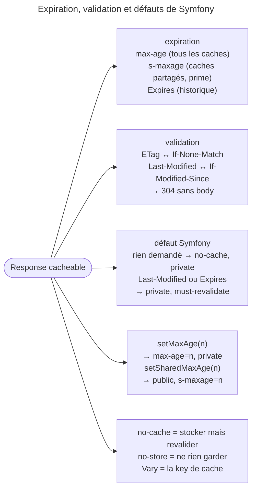

## Objectif

Décrire la fraîcheur et la validation d'une Response par ses headers, et savoir
lequel s'adresse à quel cache.

> **Périmètre.** Cette page couvre les **headers du protocole**. Le reverse
> proxy Symfony et les strategies d'expiration et de validation qu'il implémente
> appartiennent à l'item *HTTP Caching (reverse proxies, expiration,
> validation)* du sujet Miscellaneous.

## L'essentiel

Une Response se met en cache selon deux modèles : l'**expiration** (le cache
sait combien de temps elle reste fraîche) et la **validation** (il demande au
serveur si sa copie vaut encore, et reçoit un `304`). Symfony part de
`private` : rien n'entre dans un cache partagé sans `public`. Le reverse proxy
de Symfony relève d'un autre item, *HTTP Caching*.

## Le schéma



## L'exemple : expiration et validation

```php
$response->setPublic();
$response->setMaxAge(3600);                // public, max-age=3600
$response->setEtag('a1b2c3');
$response->setLastModified($article->getUpdatedAt());

if ($response->isNotModified($request)) {
    return $response;                      // 304, body vidé
}
```

## Deux modèles

L'expiration économise des Requests : le cache ne contacte pas le serveur
avant l'échéance. La validation économise de la bande passante : le serveur
répond `304 Not Modified` sans body si la copie est encore bonne.

## Expiration

- Les directives **s'accumulent**. `setMaxAge(3600)` seul émet
  `max-age=3600, private`, le `private`
  étant ajouté par défaut tant que ni `public` ni `s-maxage` n'est posé ;
  `setSharedMaxAge()` appelle lui-même `setPublic()`.
- La documentation recommande pourtant `setPublic()` + `setMaxAge()` plutôt
  que `setSharedMaxAge()` : `s-maxage` interdit de servir une Response périmée
  en scénario `stale-if-error`.
- `max-age` s'adresse à **tous** les caches ; `s-maxage` aux caches partagés,
  pour qui il prime. `getMaxAge()` rend `s-maxage` quand les deux existent.
- `Cache-Control` prime sur `Expires`.

| Directive | Effet |
|---|---|
| `must-revalidate` | interdit de servir une Response périmée |
| `stale-while-revalidate=N` | sert le périmé `N` secondes, le temps de revalider |
| `immutable` | ne pas revalider avant l'échéance |

Mnémonique : `s-` = *shared*, et il **prime** sans être exclusif.

## Validation

Le client renvoie `If-None-Match` (contre l'`ETag`) ou `If-Modified-Since`
(contre la date). `isNotModified()` commence par une **garde de method** : hors
`GET`, `HEAD` et `QUERY`, elle rend `false` sans rien comparer. Ensuite, la date
n'est écartée que si la Request porte `If-None-Match` **et** la Response un
`ETag` ; sans `ETag`, la date est évaluée et peut donner un `304` — là où RFC
9110 §13.1.3 ignorerait `If-Modified-Since`. Un ETag faible :
`setEtag('a1b2c3', true)`.

## Vary

```php
$response->setVary(['Accept-Language', 'Accept-Encoding']);
```

`Vary` déclare les headers de Request qui font varier la représentation : il
entre dans la key de cache. Sans lui, un cache partagé sert la version
française à un client anglophone.

## Pièges d'examen

**`private` est le défaut de Symfony.** Une Response n'est pas mise en cache
partagé tant qu'on n'a pas appelé `setPublic()`.

**`s-maxage` prime sur `max-age`, mais seulement pour les caches partagés.**

**Négocier sans `Vary` casse le cache.** Toute Response qui dépend d'un header
de Request doit le déclarer.

**`no-cache` ne veut pas dire « ne pas stocker ».** Il impose une
revalidation avant chaque usage. « Ne pas stocker » s'écrit `no-store`.

**`isNotModified()` sur un `POST` renvoie `false`.** La garde de method passe
avant la comparaison d'ETag : ce n'est pas « l'ETag ne correspond pas », c'est
« la question n'est pas posée ».

**`setSharedMaxAge()` rend la Response publique** — mais la doc recommande
`setPublic()` + `setMaxAge()`, à cause de `stale-if-error`.

**`max-age` n'est pas « pour les caches privés ».** Un cache partagé l'utilise
dès que `s-maxage` est absent ; c'est bien pourquoi `s-maxage` « prime » sur lui.

## Application

- Une page publique identique pour tous, une heure → `setPublic()` puis
  `setMaxAge(3600)`.
- Un document lourd qui change rarement → `ETag` et `isNotModified()`.

## QCM d'entraînement

**Question 1.** Une Response neuve reçoit seulement `setMaxAge(3600)`. Quel
header `Cache-Control` part ?

- **A.** `public, max-age=3600`
- **B.** `max-age=3600`, rien d'autre
- **C.** `max-age=3600, private`
- **D.** `max-age=3600, s-maxage=3600`

<details>
<summary>Correction</summary>

**Bonne réponse : C.** `setMaxAge()` n'appelle pas `setPublic()`, et Symfony
ajoute `private` tant que ni `public` ni `s-maxage` n'est posé.

</details>

**Question 2.** Une Response porte `max-age=60` et `s-maxage=3600`. Que rend
`$response->getMaxAge()` ?

- **A.** `3600`
- **B.** `60`, la directive générale
- **C.** `null` : deux valeurs sont ambiguës
- **D.** `60` en debug, `3600` en production

<details>
<summary>Correction</summary>

**Bonne réponse : A.** La method teste `s-maxage` d'abord, puis seulement
`max-age` : la valeur des caches partagés l'emporte.

</details>

**Question 3.** Une Request `GET` porte un `If-None-Match` qui ne correspond à
rien, et un `If-Modified-Since` récent. La Response a un `Last-Modified` ancien
et **aucun** `ETag`. Que rend `isNotModified()` ?

- **A.** `false` : `If-None-Match` écarte la date
- **B.** `true`, et la Response devient un `304`
- **C.** `false` : sans `ETag`, rien n'est comparé
- **D.** Une exception : les deux headers se contredisent

<details>
<summary>Correction</summary>

**Bonne réponse : B.** La date n'est écartée que si la Response porte un
`ETag` ; ici elle est comparée, et la copie du client est jugée à jour.

</details>

**Question 4.** Un controller rend `new Response('ok')` sans toucher au cache.
Quel `Cache-Control` part ?

- **A.** Aucun header `Cache-Control`
- **B.** `public, max-age=0`
- **C.** `no-store`
- **D.** `no-cache, private`

<details>
<summary>Correction</summary>

**Bonne réponse : D.** Faute de toute information de cache, Symfony impose la
revalidation et réserve la Response au cache privé du navigateur.

</details>

## Fiche express

**Si tu dois retenir seulement 7 choses :**

- Expiration (**`max-age`**, **`s-maxage`**) contre validation (**`ETag`**,
  `Last-Modified`).
- Défaut : **`private`** ; rien demandé → `no-cache, private`.
- `setSharedMaxAge()` rend **public** ; `setMaxAge()` non.
- `s-maxage` **prime** pour les caches partagés ; `max-age` vaut pour tous.
- `isNotModified()` : **`false` hors `GET`/`HEAD`/`QUERY`** ; sinon `304` et body
  vidé.
- `no-cache` = revalider ; **`no-store`** = ne rien garder.
- Négocier impose **`Vary`**.

Moyen mnémotechnique : **« Expirer épargne des Requests, valider des octets »**.

## Sources officielles

- [RFC 9110](https://github.com/httpwg/httpwg.github.io/blob/master/specs/rfc9110.html) — §8.8 *Validator Fields*, §12.5.5 *Vary*
- [`Response`](https://github.com/symfony/symfony/blob/8.0/src/Symfony/Component/HttpFoundation/Response.php) — `isNotModified()` l. 1118, `setSharedMaxAge()` l. 841,
  `setPublic()`, `setMaxAge()` (branche 8.0, `6f841c0`)
- [Cache HTTP](https://github.com/symfony/symfony-docs/blob/8.0/http_cache.rst)
- [Expiration](https://github.com/symfony/symfony-docs/blob/8.0/http_cache/expiration.rst) —
  la note qui recommande `setPublic()` + `setMaxAge()` plutôt que `setSharedMaxAge()`
- [RFC 9111](https://github.com/httpwg/httpwg.github.io/blob/master/specs/rfc9111.html) —
  §5.2 (`must-revalidate`, `s-maxage`) ; RFC 5861 §3 (`stale-while-revalidate`) ; RFC 8246 (`immutable`)
