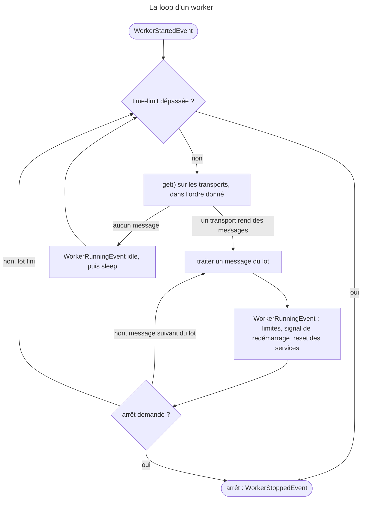

## Objectif

Consommer une file, comprendre pourquoi un worker doit s'arrêter tout seul, et
ce qu'il garde — ou non — d'un message au suivant.

## Avant la règle : le problème à résoudre

Un message envoyé dans une file attend qu'un process vienne le chercher. Ce
process ne répond à aucune Request : il tourne, lit, traite, recommence —
pendant des heures. Trois difficultés en découlent : **dans quel ordre** il lit
plusieurs files, **quand il s'arrête**, et **ce qu'il garde en mémoire** d'un
message au suivant.

On suppose connus les transports et le routage.

## Le fil rouge : deux files et un superviseur

```bash
# lancé par Supervisor ou systemd, relancé dès qu'il s'arrête
php bin/console messenger:consume async_high async \
    --limit=100 --memory-limit=128M --time-limit=3600

# à chaque déploiement, après la mise en place du nouveau code
php bin/console messenger:stop-workers
```

Le worker lit `async_high` d'abord, `async` quand la première est vide. Il
s'arrête de lui-même après 100 messages, 128 Mo ou une heure ; le superviseur
le relance. `messenger:stop-workers` lui fait prendre le nouveau code.

## Le cycle complet en un schéma

Lu dans `Worker::run()` et rejoué avec Messenger 8.0 :



Tout ce qui arrête un worker passe donc par **un listener**, entre deux
messages : aucune option ni command de Messenger n'interrompt un traitement en
cours.

## La command

```bash
php bin/console messenger:consume async
php bin/console messenger:consume async -vv          # ce qui est traité
php bin/console messenger:consume --all              # tous les récepteurs
php bin/console messenger:consume async_high async   # priorité par l'ordre
```

Quand plusieurs transports sont passés, ils sont consultés **dans l'ordre
donné** : après chaque message traité, le worker repart du premier ; il ne lit
le second que si le premier est vide. Exécuté avec Messenger 8.0.15 : deux
messages envoyés sur `low`, puis un sur `high`, et
`messenger:consume high low --limit=3` traite `high-1`, puis `low-1`, puis
`low-2`.

Précisément, lu dans `Worker::run()` : le worker traite le **lot** qu'un
transport rend à `get()` — un message pour la plupart des transports — puis
« quit and start the loop again » depuis le premier.

Les options de `messenger:consume` en 8.0 : `--limit`, `--failure-limit`,
`--memory-limit`, `--time-limit`, `--sleep`, `--bus`, `--queues`, `--no-reset`,
`--all`, `--exclude-receivers`, `--keepalive`.

**Rejoué, ce que la command refuse — ou ne refuse pas** (la deuxième ligne est
lue dans `interact()`) **:**

| Appel | Résultat |
|---|---|
| `messenger:consume low --exclude-receivers=high` | **exit 1** : « The "--exclude-receivers" option can only be used with the "--all" option. » |
| `messenger:consume` sans récepteur, en mode interactif | une question : quels récepteurs consommer ? |
| `messenger:consume` sans récepteur, **non interactif** | **exit 0** : « Consuming messages from transport "" » — le worker tourne et ne lit rien |

La dernière ligne est celle d'un superviseur mal configuré : `interact()` n'est
pas appelé hors mode interactif, et l'erreur « Please pass at least one
receiver » qu'il porte non plus.

## Un worker est un process long

Et c'est là qu'est la difficulté. Un process PHP qui tourne pendant des jours
accumule de la mémoire et garde en cache des objects périmés. La solution n'est
pas de corriger les fuites : c'est de **s'arrêter régulièrement**, et de laisser
un superviseur relancer.

```bash
--limit=10          # après 10 messages
--memory-limit=128M # au-delà de ce seuil
--time-limit=3600   # après une heure
--failure-limit=5   # après trop d'échecs
```

Un superviseur — Supervisor, systemd — redémarre alors le process. L'arrêt est
**gracieux** : le message en cours est terminé avant l'arrêt.

**`--limit` compte les messages reçus, pas les réussis.** Rejoué : trois
messages, le premier en échec, `--limit=2` — le worker traite l'échec et le
deuxième, puis s'arrête. Lu dans `StopWorkerOnMessageLimitListener` : tout tour
non idle compte.

## Le deployment

Un worker démarré avant un deployment exécute **l'ancien code**. La command
prévue pour cela :

```bash
php bin/console messenger:stop-workers
```

Elle ne tue rien : elle pose un signal que chaque worker lit **après le message
en cours**, puis s'arrête proprement. Le superviseur le relance avec le nouveau
code. Oublier cette étape est la cause classique d'un comportement mixte après
mise en production.

Lu dans `StopWorkerOnRestartSignalListener::shouldRestart()` : le signal est
une date dans un cache, et seul un worker **démarré avant** elle s'arrête. Le
worker relancé, plus récent que le signal, n'est pas visé.

## L'état entre deux messages

Le worker garde les **mêmes instances de services** d'un message à l'autre —
mais entre deux messages, `ResetServicesListener` appelle le **réinitialiseur
de services** : chaque service qui implémente `ResetInterface` (ou porte le tag
`kernel.reset`) voit sa method `reset()` appelée. Exécuté, trois messages,
deux services qui comptent ce qu'ils ont vu :

| Worker | Service ordinaire | Service `ResetInterface` |
|---|---|---|
| par défaut | 1, 2, **3** — l'état s'accumule | 1, **1**, **1** — remis à zéro |
| `--no-reset` | 1, 2, 3 | 1, 2, **3** |

Un service qui garde de l'état sans implémenter `ResetInterface` contamine donc
les messages suivants. C'est le pendant du point précédent : un worker n'est
pas une Request.

Effet de bord observé pendant ces exécutions : le transport `in-memory://`
implémente lui-même `ResetInterface`, et le premier reset **vide sa file**.
Rejoué : sur un seul transport, les trois messages passent, parce que
`get()` les a tous rendus d'un coup ; avec `consume high low`, `high-1` passe,
puis le reset vide `low`, et `low-1`, `low-2` sont perdus. Il sert aux tests,
pas à un worker.

## Concrètement dans ton application

- Toujours au moins une limite : `--time-limit`, `--memory-limit` ou `--limit`.
- Un superviseur qui relance, et des récepteurs **nommés** dans sa command.
- `messenger:stop-workers` dans le script de deployment, après le nouveau
  code.
- Les files rapides en premier : `messenger:consume async_high async`.
- Un service qui met en cache : `ResetInterface`, et un `reset()` qui vide.
- `--no-reset` seulement en connaissance de cause.

## À comprendre

- **Pourquoi s'arrêter plutôt que corriger ?** Une fuite se cache partout : dans
  une bibliothèque, un cache, un logger. Un process qui redémarre souvent n'a
  pas le temps de la rendre visible.
- **Pourquoi un arrêt demandé n'interrompt-il pas un message ?** Les listeners
  qui arrêtent le worker tournent sur `WorkerRunningEvent`, entre deux
  messages.
- **Pourquoi un reset ?** Les services sont partagés pour la performance ; le
  reset rend à chacun l'état d'un process neuf.

## À mémoriser

- **`messenger:consume high low`** : `low` seulement si `high` est vide.
- Limites : **`--limit`**, **`--memory-limit`**, **`--time-limit`**,
  **`--failure-limit`** ; un **superviseur** relance.
- **`--limit`** compte aussi les échecs.
- **`messenger:stop-workers`** : arrêt **après** le message en cours.
- Entre deux messages : **`ResetInterface`** remis à zéro, sauf **`--no-reset`**.
- **`--exclude-receivers`** exige **`--all`**.
- Moyen mnémotechnique : **« lire dans l'ordre, s'arrêter entre deux,
  repartir neuf »**.

## Pièges d'examen

**Un worker exécute le code chargé à son démarrage** : sans redémarrage, un
deployment ne l'atteint pas.

**`messenger:stop-workers` ne tue pas** : elle demande un arrêt après le message
courant.

**Plusieurs transports : priority stricte**, pas de tourniquet.

**Les services sont partagés entre messages**, sauf ceux qui implémentent
`ResetInterface` ; `--no-reset` supprime même cette remise à zéro.

**Les limites ne sont pas un pansement** : elles sont la façon prévue d'exploiter
un worker.

## Application : trois scénarios

**Scénario 1 — Le worker qui ne fait rien.** Supervisor lance
`messenger:consume --time-limit=3600`, sans nom de transport ; aucun message
n'est traité, aucune erreur. *Solution.* Hors mode interactif, la command
consomme une liste vide : nommer les récepteurs, ou passer `--all`.

**Scénario 2 — La limite atteinte trop tôt.** `--limit=50` pendant une panne
d'API : le worker s'arrête après 50 échecs. *Solution.* C'est voulu : `--limit`
compte les messages reçus ; `--failure-limit` est l'option qui vise les échecs.

**Scénario 3 — Le cache qui fuit d'un client à l'autre.** Un service garde les
tarifs du client courant dans une property ; le client suivant les voit.
*Solution.* `ResetInterface` sur le service, un `reset()` qui vide la property.

## QCM d'entraînement

Cinq questions sur les workers. Choisis avant d'ouvrir la correction.

**Question 1.** Un superviseur lance `messenger:consume --time-limit=3600`, non
interactif, sans nom de récepteur. Que se passe-t-il ?

- **A.** Une exception : « Please pass at least one receiver. »
- **B.** Le worker consomme tous les transports
- **C.** Il consomme le transport nommé `async` par défaut
- **D.** Le worker tourne une heure sans rien lire

<details>
<summary>Correction</summary>

**Bonne réponse : D.** Rejoué : « Consuming messages from transport "" »,
exit 0. Lu dans `ConsumeMessagesCommand` : l'exception est levée dans
`interact()`, qui n'est pas appelé hors mode interactif.

A est vrai en mode interactif seulement. B demande `--all`. C est faux.

</details>

**Question 2.** Trois messages, le premier en échec. Le worker tourne avec
`--limit=2`. Combien de messages traite-t-il ?

- **A.** Trois : l'échec ne compte pas
- **B.** Deux : l'échec et le suivant
- **C.** Un : le premier échec arrête le worker
- **D.** Deux réussis, après avoir sauté l'échec

<details>
<summary>Correction</summary>

**Bonne réponse : B.** Rejoué. Lu dans `StopWorkerOnMessageLimitListener` :
chaque message reçu compte, réussi ou non.

A et D supposent qu'on ne compte que les réussites. C confond avec
`--failure-limit=1`.

</details>

**Question 3.** Un worker a démarré après un `messenger:stop-workers`. Le
signal l'arrête-t-il ?

- **A.** Oui, au prochain message
- **B.** Oui, immédiatement
- **C.** Non : il a démarré après le signal
- **D.** Non : le signal est effacé dès le premier arrêt

<details>
<summary>Correction</summary>

**Bonne réponse : C.** Lu dans `StopWorkerOnRestartSignalListener` : le worker
compare sa date de démarrage à celle du signal, gardée en cache.

A et B arrêteraient le worker relancé en boucle. D est faux : le signal reste ;
c'est la comparaison des dates qui protège le nouveau worker.

</details>

**Question 4.** `messenger:consume async --exclude-receivers=failed`. Résultat ?

- **A.** Le worker consomme `async`, `failed` est ignoré
- **B.** Une erreur : l'option exige `--all`
- **C.** Le worker consomme tous les transports sauf `failed`
- **D.** L'option est ignorée en silence

<details>
<summary>Correction</summary>

**Bonne réponse : B.** Rejoué, exit 1 : « The "--exclude-receivers" option can
only be used with the "--all" option. »

C décrit `--all --exclude-receivers=failed`. A et D sont faux.

</details>

**Question 5.** Deux transports `in-memory://`, un message sur `high`, deux sur
`low`. `messenger:consume high low`, réglages par défaut. Combien de messages
sont traités ?

- **A.** Trois, `high` d'abord
- **B.** Trois, en alternance
- **C.** Aucun : `in-memory://` ne se consomme pas
- **D.** Un seul : `high-1`

<details>
<summary>Correction</summary>

**Bonne réponse : D.** Rejoué : `high-1`, puis le reset des services vide
`low`, que `in-memory://` expose comme service réinitialisable. Avec
`--no-reset`, les trois passent.

A est vrai avec `--no-reset`. B et C sont faux.

</details>

## Fiche express

**Si tu dois retenir seulement 7 choses :**

- **`messenger:consume high low`** : priority stricte, par l'ordre.
- Un worker **s'arrête de lui-même** ; un **superviseur** le relance.
- **`--limit`** compte les messages reçus, échecs compris.
- **`messenger:stop-workers`** : après le message courant, workers plus anciens
  seulement.
- **`ResetInterface`** : remis à zéro entre deux messages, sauf `--no-reset`.
- Sans récepteur, **non interactif** : un worker qui ne lit rien.
- **`in-memory://`** est vidé par le reset : un transport de test.

**En une phrase, pour tout reconstruire :**

```text
consume a b (ordre = priority, repart du premier) ; arrêt entre deux messages par listeners : limit (tout message), memory, time, failure ;
stop-workers = date en cache, workers démarrés avant ; reset ResetInterface sauf --no-reset ; --exclude-receivers ⇒ --all
```

## Sources officielles

- [Messenger, « Consuming Messages » et « Deploying to Production »](https://github.com/symfony/symfony-docs/blob/8.0/messenger.rst)
- [Messenger 8.0, `Worker`](https://github.com/symfony/symfony/blob/8.0/src/Symfony/Component/Messenger/Worker.php)
- [Messenger 8.0, `ResetServicesListener`](https://github.com/symfony/symfony/blob/8.0/src/Symfony/Component/Messenger/EventListener/ResetServicesListener.php)
- [Messenger 8.0, `ConsumeMessagesCommand`](https://github.com/symfony/symfony/blob/8.0/src/Symfony/Component/Messenger/Command/ConsumeMessagesCommand.php)
- [Messenger 8.0, `StopWorkerOnRestartSignalListener`](https://github.com/symfony/symfony/blob/8.0/src/Symfony/Component/Messenger/EventListener/StopWorkerOnRestartSignalListener.php)
- [Messenger 8.0, `StopWorkerOnMessageLimitListener`](https://github.com/symfony/symfony/blob/8.0/src/Symfony/Component/Messenger/EventListener/StopWorkerOnMessageLimitListener.php)
