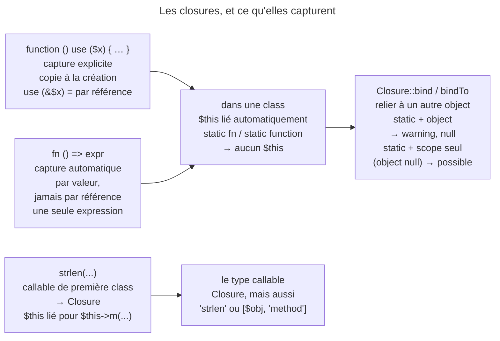

## Objectif

Choisir entre `function () use (...)` et `fn () =>`, et savoir ce que chacune
capture.

## L'essentiel

Deux syntaxes, deux captures. `function () use ($x)` capture **explicitement**,
par valeur au moment de la **definition** — sauf `&$x`. `fn () => …` capture
**automatiquement**, toujours par valeur, et ne contient qu'une expression.
Dans une class, une closure est liée à `$this`, sauf si elle est `static`.

## Le schéma



## L'exemple

```php
$factor = 3;

$triple = function (int $n) use ($factor): int {
    return $n * $factor;      // $factor copié à la DÉFINITION
};
$arrow = fn (int $n): int => $n * $factor;   // capturé automatiquement, par valeur

$factor = 10;
$triple(5);                   // 15, pas 50
```

## Function anonyme classique

La capture est **explicite** : rien n'entre dans le scope sans `use`, et la
valeur est copiée à la definition. Avec `use (&$factor)`, la variable est
capturée par référence, et c'est la valeur au moment de l'appel qui compte.

## Function fléchée

La capture est **automatique et par valeur** : pas de `use`, et aucune capture
par référence possible — modifier une variable capturée ne touche pas
l'originale. Une function fléchée n'a **qu'une seule expression**, dont la
valeur est renvoyée : pas d'accolades, pas de `return`.

## Binding de `$this`

Une closure définie dans une class est **automatiquement liée** à l'instance :
`$this` y est disponible. Le mot-clé `static` empêche ce binding —
`static fn () => 42`. `Closure::bind()` et `bindTo()` relient une closure à un
autre object, sauf une closure `static`, qui ne peut porter aucun object : PHP
émet « Cannot bind an instance to a static closure » et rend `null`. Changer
seulement son scope de class, object à `null`, reste possible.

Les callables de première class produisent une `Closure` : `strlen(...)`,
`$this->render(...)`, `Article::create(...)`.

## Pièges d'examen

**`use` capture à la definition, pas à l'appel.** Modifier la variable après
coup ne change rien, sauf capture par référence.

**Une function fléchée ne peut pas capturer par référence.** Il n'y a pas de
syntaxe `fn () use (&$x)`.

**`static function` ≠ method statique.** Sur une closure, `static` signifie
« non liée à `$this` ».

**Une closure est un object.** `$closure instanceof \Closure` est vrai, et le
type `callable` accepte aussi des strings et des arrays `[$obj, 'method']`.

## Application

- Un callback qui doit modifier un compteur extérieur → `function () use (&$count)`.
- Un tri en une ligne → `usort($items, fn ($a, $b) => $a <=> $b)`.

## QCM d'entraînement

**Question 1.** `$n = 0; $inc = fn () => $n++;` puis deux appels à `$inc()`.
Que vaut `$n` ?

- **A.** 2
- **B.** 0
- **C.** Une `Error`
- **D.** Un warning, puis 2

<details>
<summary>Correction</summary>

**Bonne réponse : B.** La function fléchée travaille sur une copie de `$n` ;
l'incrément ne remonte jamais vers la variable du scope parent.

</details>

**Question 2.** Que rend `Closure::bind(static fn () => 1, new Foo())` ?

- **A.** `null`, avec un warning
- **B.** La closure, désormais liée à `Foo`
- **C.** Une `Error`
- **D.** La closure inchangée

<details>
<summary>Correction</summary>

**Bonne réponse : A.** Une closure `static` ne peut porter aucun object : PHP
signale qu'il ne peut pas lier l'instance, et renvoie `null`.

</details>

**Question 3.** Que produit l'expression `strlen(...)` ?

- **A.** La string `'strlen'`
- **B.** Un `int`
- **C.** Une `Closure`
- **D.** Un array callable

<details>
<summary>Correction</summary>

**Bonne réponse : C.** La syntaxe de callable de première class crée un object
`Closure` vers la function, appelable ensuite comme `$fn('abc')`.

</details>

**Question 4.** Que fait PHP de `$f = fn () => { return 1; };` ?

- **A.** Il l'accepte
- **B.** Il l'accepte s'il n'y a qu'une instruction
- **C.** La closure rend `null`
- **D.** Une erreur de syntaxe

<details>
<summary>Correction</summary>

**Bonne réponse : D.** Une function fléchée attend une expression après `=>` ;
un block entre accolades n'en est pas une, et le parser refuse le file.

</details>

## Fiche express

**Si tu dois retenir seulement 6 choses :**

- `use ($x)` : capture **explicite**, copie à la **definition**.
- `use (&$x)` : par **référence**, valeur à l'appel.
- `fn () =>` : capture **automatique**, par **valeur**, **une** expression.
- Dans une class : **`$this`** lié, sauf closure **`static`**.
- `bind` d'une closure `static` à un object → **`null`** + warning.
- `strlen(...)` → **`Closure`** ; `callable` accepte aussi strings et arrays.

Moyen mnémotechnique : **« use se fige, fn copie, & partage »**.

## Sources officielles

- Manuel PHP — *Anonymous functions*, *Arrow functions*

