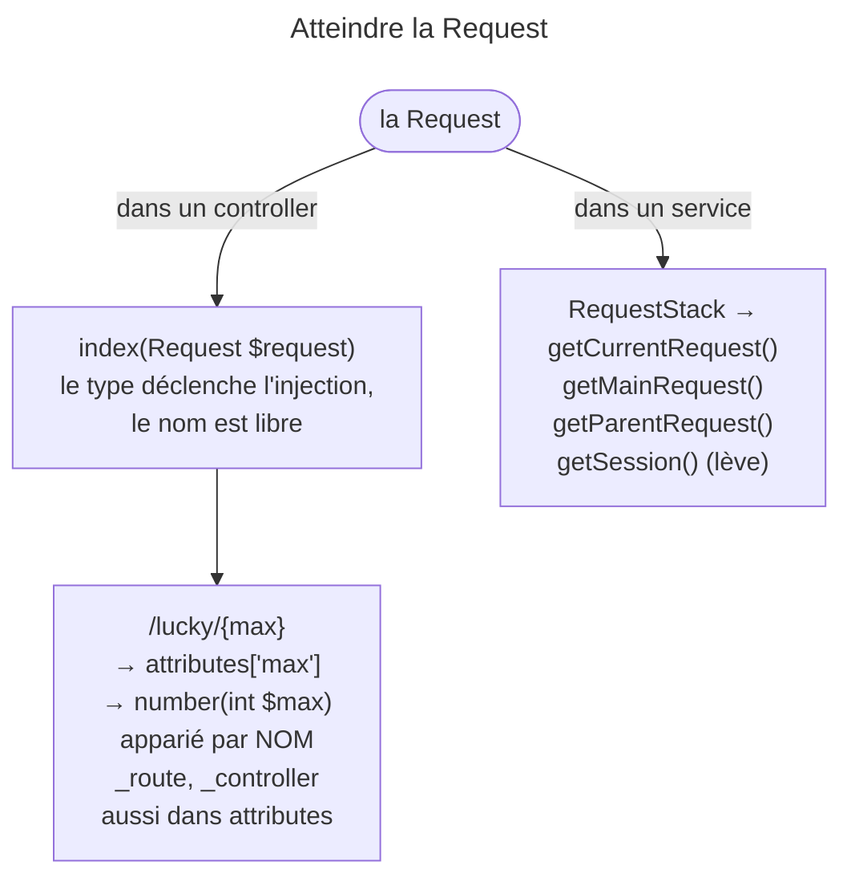
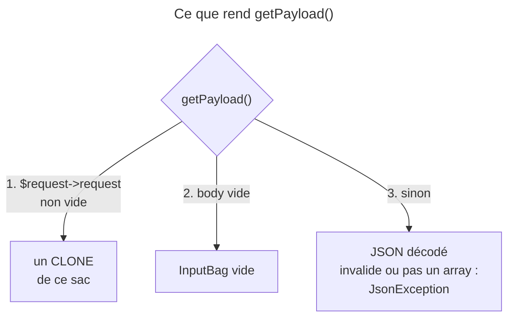

## Objectif

Savoir comment un controller obtient la Request et où atterrissent les
parameters de route. Le modèle des sacs appartient au lot HTTP, le component
lui-même au lot Symfony Architecture.

## L'essentiel

Un controller obtient la Request en **typant un argument** ; un service, lui,
reçoit `RequestStack`. Les parameters de route arrivent par
`$request->attributes`, puis par le **nom** de l'argument. Pour le body,
`getPayload()` est la method à connaître — et elle n'est pas symétrique : le
form l'emporte sur le JSON.

## Le schéma





## L'exemple : une route à parameter

```php
#[Route('/lucky/number/{max}')]
public function number(Request $request, int $max): Response
{
    $limit = $request->query->getInt('limit', 10);   // ?limit=5
    // ...
}
```

## L'obtenir

Typer un argument avec `Symfony\Component\HttpFoundation\Request` suffit : le
type déclenche l'injection, le nom est libre. Dans un **service**, construit une
fois pour toutes, on injecte `RequestStack` : `getCurrentRequest()` rend la
sub-Request si on est dedans, `getMainRequest()` celle du serveur,
`getParentRequest()` `null` quand la courante est la principale, et
`getSession()` lève une `SessionNotFoundException` au lieu de rendre `null`.

## Les parameters de route

Un parameter du path est déposé dans `$request->attributes`, puis passé au
controller **comme named argument** : la correspondance se fait sur le
**nom**, jamais sur la position. Réordonner les arguments ne change rien ; en
renommer un casse tout. `attributes` porte aussi `_route` et `_controller`.

## Body et query string

`$request->query` porte la query string. `getPayload()` procède dans cet
ordre : si `$request->request` n'est pas vide, elle rend un **clone** de ce sac
— le form l'emporte, le JSON n'est pas lu ; sinon, un body vide donne un
`InputBag` vide ; sinon le body est décodé en JSON. Un JSON mal formé lève une
`JsonException`, comme un JSON valide qui ne décode pas en array.

## Pièges d'examen

**Les parameters de route s'apparient par leur nom, jamais par leur position.**
Réordonner les arguments du controller ne casse rien ; en renommer un casse
tout.

**La Request ne s'injecte pas dans un service.** Typer un argument suffit dans
un controller, mais un service est construit une fois pour toutes : il reçoit
`RequestStack`.

**`getPayload()` ne fusionne pas form et JSON.** Si le sac des parameters
de form n'est pas vide, elle rend celui-là et ne regarde même pas le body
brut.

**Un body JSON invalide ne donne pas un sac vide** : il lève une exception. Le
sac vide est réservé au cas où le body est **vide**.

**`getPayload()` rend un clone.** Écrire dans l'object retourné ne change rien à
la Request.

## Application

- Une extension Twig qui a besoin de la locale courante → `RequestStack`.
- Une API qui accepte un form ou du JSON → `getPayload()`, en sachant que le
  form passe en premier.

## QCM d'entraînement

**Question 1.** Un `POST` porte un body **vide** et aucun field de form. Que
rend `getPayload()` ?

- **A.** `null`
- **B.** Une `JsonException`
- **C.** Un `InputBag` vide
- **D.** Le sac `query`, en repli

<details>
<summary>Correction</summary>

**Bonne réponse : C.** Le sac vide est réservé au body vide ; c'est un body
non vide et invalide qui lève une exception.

</details>

**Question 2.** Un controller écrit dans l'object rendu par `getPayload()`,
alors que la Request porte des fields de form. `$request->request` change-t-il ?

- **A.** Oui : c'est le même object
- **B.** Non : `getPayload()` rend un clone
- **C.** Oui, après un appel à `save()`
- **D.** Non : le sac rendu est en lecture seule

<details>
<summary>Correction</summary>

**Bonne réponse : B.** La method rend une copie du sac des fields : écrire
dedans laisse la Request intacte, sans que l'object soit en lecture seule.

</details>

**Question 3.** Une action liée à `/post/{year}/{slug}` déclare
`show(string $slug, int $year)`, dans l'ordre inverse du path. Que se
passe-t-il ?

- **A.** Une erreur : l'ordre doit suivre le path
- **B.** `$slug` reçoit l'année, `$year` le slug
- **C.** Une exception à la compilation du container
- **D.** Rien : l'appariement se fait par nom

<details>
<summary>Correction</summary>

**Bonne réponse : D.** Les parameters de route s'apparient par leur nom ;
seul le renommage d'un argument casse la correspondance.

</details>

**Question 4.** Le client poste le JSON mal formé `{"a":`. Que fait
`getPayload()` ?

- **A.** Elle rend un `InputBag` vide
- **B.** Elle rend le body brut sous la key `0`
- **C.** Elle lève une `JsonException`
- **D.** Elle rend `null`

<details>
<summary>Correction</summary>

**Bonne réponse : C.** Le décodage est fait avec l'option qui change une erreur
en exception : un body invalide ne passe jamais pour un sac vide.

</details>

## Fiche express

**Si tu dois retenir seulement 6 choses :**

- Controller : **typer** `Request` ; service : **`RequestStack`**.
- Parameters de route : `attributes`, puis le **nom** de l'argument.
- `_route` et `_controller` sont dans **`attributes`**.
- `getPayload()` : form d'abord, en **clone** ; body vide → sac vide.
- JSON invalide ou pas un array → **`JsonException`**.
- `getSession()` de `RequestStack` **lève** au lieu de rendre `null`.

Moyen mnémotechnique : **« Le nom, pas la place »**.

## Sources officielles

- [Controller, « The Request Object as a Controller Argument »](https://github.com/symfony/symfony-docs/blob/8.0/controller.rst)
- [`Request::getPayload()`, branche 8.0](https://github.com/symfony/symfony/blob/8.0/src/Symfony/Component/HttpFoundation/Request.php)
- [`RequestStack`, branche 8.0](https://github.com/symfony/symfony/blob/8.0/src/Symfony/Component/HttpFoundation/RequestStack.php)

