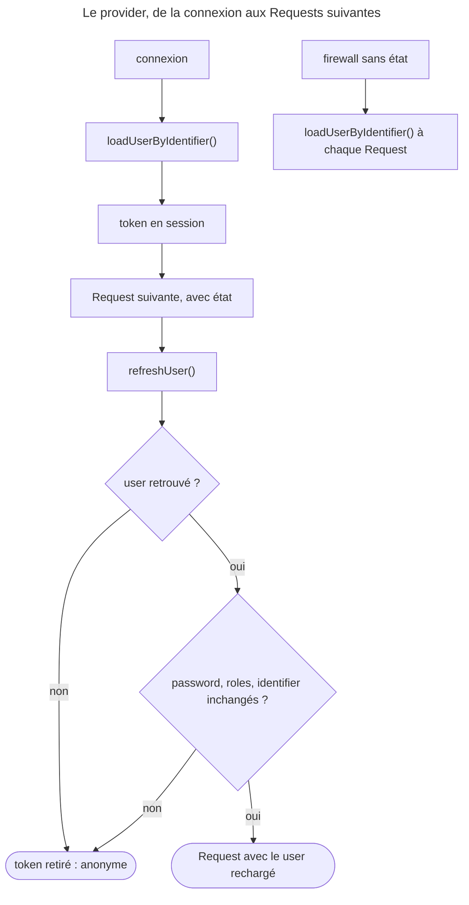

## Objectif

Savoir d'où vient l'object user, quelle method du provider est appelée à quel
moment, et ce qui arrive quand le user change pendant sa session.

## L'essentiel

Un provider **charge** le user à partir de l'identifier saisi, puis le
**relit** à chaque Request d'un firewall avec état. Un user supprimé ou modifié
est donc déconnecté au rechargement suivant, sans erreur 500.

## Le schéma



## L'exemple

```php
class FileUserProvider implements UserProviderInterface
{
    public function loadUserByIdentifier(string $identifier): UserInterface
    {
        $data = $this->all()[$identifier] ?? throw new UserNotFoundException();

        return new InMemoryUser($identifier, $data['pw'], $data['roles']);
    }

    public function refreshUser(UserInterface $user): UserInterface
    {
        return $this->loadUserByIdentifier($user->getUserIdentifier());
    }

    public function supportsClass(string $class): bool
    {
        return InMemoryUser::class === $class;
    }
}
```

## Le contrat

| Method | Quand |
|---|---|
| `loadUserByIdentifier()` | à la **connexion** : trouver le user |
| `refreshUser()` | à **chaque Request suivante** d'un firewall avec état |
| `supportsClass()` | dire si ce provider gère cette class |

Le user n'est pas conservé tel quel : il est **rechargé**, puis **comparé** à
celui du token.

## Ce que l'exécution montre

| Request | Methods appelées | Résultat |
|---|---|---|
| connexion HTTP Basic | `loadUserByIdentifier(alice)` | 200 |
| Request suivante, cookie de session | `refreshUser(alice)` | 200 |
| après suppression d'`alice` | `refreshUser` lève `UserNotFoundException` | **401** : token retiré |
| après ajout de `ROLE_EDITOR` à `alice` | `refreshUser(alice)` | token abandonné, `alice` **anonyme** |
| firewall sans état, deux Requests | `loadUserByIdentifier` à chaque fois | 200, jamais `refreshUser` |

- Un user supprimé : `ContextListener` retire la key du token de la session,
  qui survit ; le user redevient anonyme.
- `ContextListener::hasUserChanged()` abandonne le token quand le password, les
  roles ou l'identifier diffèrent — ou quand `isEqualTo()` rend `false` pour une
  class `EquatableInterface`. Un role ajouté en base **déconnecte**.

## Les providers fournis

| Key | Source |
|---|---|
| `memory` | des users écrits dans la configuration (tests, prototypes) |
| `ldap` | un annuaire LDAP |
| `chain` | plusieurs providers essayés dans l'ordre |
| `id` | un service qui implémente `UserProviderInterface` |
| `entity` | une entité Doctrine — avec l'intégration Doctrine seulement |

Sans elle, `entity` est refusé : « Unrecognized option "entity" …
Available options are "chain", "id", "ldap", "memory". »

## Provider et firewall

Un firewall utilise **un** provider. Avec plusieurs providers, chaque firewall
nomme le sien par la key `provider`, sinon `InvalidConfigurationException`.

Un provider qui implémente `PasswordUpgraderInterface` reçoit le password
réencodé quand l'algorithme change.

## Pièges d'examen

**`refreshUser()` s'exécute à chaque Request d'un firewall avec état**, pas
seulement à la connexion — et jamais sur un firewall sans état.

**Un user supprimé est déconnecté** au rechargement suivant : 401 ou
redirect, pas 500 ; la session survit, sans son token.

**Des roles modifiés en base déconnectent aussi** : le nouveau role ne s'obtient
qu'en se reconnectant.

**`entity` n'est pas fourni par SecurityBundle** : il faut l'intégration
Doctrine. `id` branche un provider maison.

**Plusieurs providers imposent de nommer celui du firewall.**

## Application

- Un admin ajoute un role à un user connecté, qui se retrouve déconnecté → c'est
  voulu : `hasUserChanged()` compare les roles.
- Un provider maison n'est pas trouvé dans `security.yaml` → le brancher par
  `id`.

## QCM d'entraînement

**Question 1.** Sur un firewall **avec état**, quelle method du provider est
appelée à la deuxième Request d'un user connecté ?

- **A.** `loadUserByIdentifier()`, comme à la connexion
- **B.** `refreshUser()`
- **C.** Aucune : le user est lu dans la session
- **D.** `supportsClass()` seulement

<details>
<summary>Correction</summary>

**Bonne réponse : B.** Le token vient de la session, mais son user est rechargé
par `refreshUser()` à chaque Request suivante.

</details>

**Question 2.** Un user est supprimé de la source pendant sa session. À sa
Request suivante sur une page protégée, que se passe-t-il ?

- **A.** Une erreur 500 : `UserNotFoundException` non attrapée
- **B.** La page s'affiche avec le user de la session
- **C.** Le token est retiré : anonyme
- **D.** La session entière est détruite

<details>
<summary>Correction</summary>

**Bonne réponse : C.** `ContextListener` attrape l'exception et retire le token ;
la session survit, et la page protégée répond 401 en HTTP Basic.

</details>

**Question 3.** Un admin ajoute `ROLE_EDITOR` à un user connecté. À la Request
suivante, ce user a-t-il le nouveau role ?

- **A.** Non : il est déconnecté, le token est abandonné
- **B.** Oui : `refreshUser()` relit ses roles
- **C.** Oui, mais seulement après expiration de la session
- **D.** Non : les roles sont figés jusqu'au cache clear

<details>
<summary>Correction</summary>

**Bonne réponse : A.** `hasUserChanged()` compare les roles et abandonne le
token ; le nouveau role ne s'obtient qu'en se reconnectant.

</details>

**Question 4.** Sur un firewall `stateless: true`, combien de fois
`refreshUser()` est-il appelé sur deux Requests authentifiées ?

- **A.** Une fois, à la seconde Request
- **B.** Deux fois
- **C.** Jamais
- **D.** Une fois, à la première Request

<details>
<summary>Correction</summary>

**Bonne réponse : C.** Sans état, chaque Request se réauthentifie par
`loadUserByIdentifier()` ; il n'y a pas de token de session à rafraîchir.

</details>

## Fiche express

**Si tu dois retenir seulement 7 choses :**

- **`loadUserByIdentifier()`** à la connexion.
- **`refreshUser()`** à chaque Request d'un firewall **avec état**.
- Sans état : jamais `refreshUser()`.
- User supprimé : **anonyme** (401), pas 500 ; la session survit.
- Roles, password ou identifier changés : **déconnexion**.
- `memory`, `ldap`, `chain`, **`id`** ; `entity` avec Doctrine seulement.
- Plusieurs providers : **`provider`** sur chaque firewall.

Moyen mnémotechnique : **« Charger une fois, relire à chaque fois »**.

```text
loadUserByIdentifier (connexion) → refreshUser (chaque Request avec état) → hasUserChanged (roles, password, identifier) ;
supprimé = anonyme ; stateless = pas de refresh ; memory/ldap/chain/id (+ entity avec Doctrine)
```

## Sources officielles

- [`UserProviderInterface`, branche 8.0](https://github.com/symfony/symfony/blob/8.0/src/Symfony/Component/Security/Core/User/UserProviderInterface.php)
- [User Providers](https://github.com/symfony/symfony-docs/blob/8.0/security/user_providers.rst)
- [Security HTTP 8.0, `ContextListener`](https://github.com/symfony/symfony/blob/8.0/src/Symfony/Component/Security/Http/Firewall/ContextListener.php)
- [SecurityBundle 8.0, `SecurityBundle`](https://github.com/symfony/symfony/blob/8.0/src/Symfony/Bundle/SecurityBundle/SecurityBundle.php)
- [Doctrine Bridge 8.0, `EntityFactory`](https://github.com/symfony/symfony/blob/8.0/src/Symfony/Bridge/Doctrine/DependencyInjection/Security/UserProvider/EntityFactory.php)

