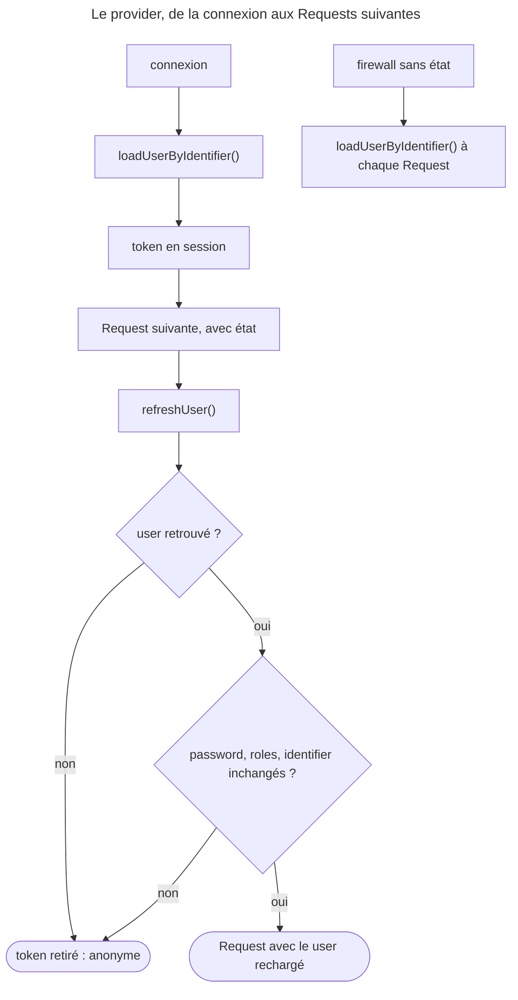

## Objectif

Savoir d'où vient l'object user, quelle method du provider est appelée à quel
moment, et ce qui arrive quand le user change pendant sa session.

## Avant la règle : le problème à résoudre

Les users d'une application vivent quelque part : une table, un annuaire, un
file, une API. Le firewall, lui, ne sait qu'une chose : l'identifier que le
visiteur a saisi.

Il faut donc un intermédiaire qui **charge** le user à partir de cet
identifier. Et une question se pose dès la deuxième Request : faut-il
**garder** le user de la connexion — avec le risque qu'il ait été supprimé ou
que ses droits aient changé depuis — ou le **relire** à chaque fois ?

## Le fil rouge : un provider maison

```php
class FileUserProvider implements UserProviderInterface
{
    public function loadUserByIdentifier(string $identifier): UserInterface
    {
        $data = $this->all()[$identifier] ?? throw new UserNotFoundException();

        return new InMemoryUser($identifier, $data['pw'], $data['roles']);
    }

    public function refreshUser(UserInterface $user): UserInterface
    {
        return $this->loadUserByIdentifier($user->getUserIdentifier());
    }

    public function supportsClass(string $class): bool
    {
        return InMemoryUser::class === $class;
    }
}
```

```yaml
security:
    providers:
        files: { id: App\Security\FileUserProvider }
    firewalls:
        main: { provider: files, http_basic: ~ }
```

## Le cycle complet en un schéma



## Le contrat

Un provider charge un user à partir de son identifier. Trois methods :

| Method | Quand |
|---|---|
| `loadUserByIdentifier()` | à la **connexion** : trouver le user |
| `refreshUser()` | à **chaque Request suivante** d'un firewall avec état : recharger depuis la source |
| `supportsClass()` | dire si ce provider gère cette class |

`refreshUser()` est le point à comprendre. Le user n'est pas conservé tel
quel entre deux Requests : il est **rechargé**, puis **comparé** à celui du token.

## Ce que l'exécution montre

Le provider ci-dessus, dans une application SecurityBundle 8.0.15 :

| Request | Methods appelées | Résultat |
|---|---|---|
| connexion HTTP Basic | `loadUserByIdentifier(alice)` | 200 |
| Request suivante, cookie de session | `refreshUser(alice)` | 200 |
| même Request après suppression d'`alice` | `refreshUser(alice)`, qui lève `UserNotFoundException` | **401** |
| même Request après ajout de `ROLE_EDITOR` à `alice` | `refreshUser(alice)` | token abandonné, `alice` **anonyme** |
| firewall sans état, deux Requests | `loadUserByIdentifier` à chaque fois, jamais `refreshUser` | 200 |

Un user supprimé n'est donc pas une erreur 500 : `ContextListener`
intercepte l'exception, journalise « Username could not be found in the
selected user provider », retire le token, et le user redevient anonyme.
Il ne détruit pas la session : il en **supprime la key du token**
(`$session->remove($this->sessionKey)`), les autres données restent.

Un role ajouté en base ne s'obtient donc pas en cours de session : il
**déconnecte**. `ContextListener::hasUserChanged()` abandonne le token quand le
password, les roles ou l'identifier diffèrent — ou, si la class implémente
`EquatableInterface`, quand `isEqualTo()` rend `false` ; celui d'`InMemoryUser`,
utilisé ici, compare aussi les roles.

## Les providers fournis

SecurityBundle 8.0 enregistre `memory` et `ldap` (`SecurityBundle::build()`), et
reconnaît `chain` et `id` dans sa configuration. `entity` vient du bridge
Doctrine (`EntityFactory`) et n'existe qu'avec l'intégration Doctrine. Exécuté,
sans elle : « Unrecognized option "entity" under "security.providers.users".
Available options are "chain", "id", "ldap", "memory". »

| Key | Source |
|---|---|
| `entity` | une entité Doctrine, par une property — avec l'intégration Doctrine |
| `memory` | des users écrits dans la configuration |
| `ldap` | un annuaire LDAP |
| `chain` | plusieurs providers essayés dans l'ordre |
| `id` | un service qui implémente `UserProviderInterface` |

`memory` sert aux tests et aux prototypes ; les passwords y sont écrits en
clair ou pré-hachés dans la configuration.

## Provider et firewall

Un firewall utilise **un** provider. Quand plusieurs sont déclarés, chaque
firewall doit désigner le sien par la key `provider`, sinon la configuration est
ambiguë et échoue (`InvalidConfigurationException`, exécuté).

## Mettre à jour le hash

Un provider qui implémente `PasswordUpgraderInterface` reçoit le password
réencodé quand l'algorithme a changé. C'est ce qui rend la migration
transparente pour le user.

## Concrètement dans ton application

- Une table d'users : le provider `entity`, avec l'intégration
  Doctrine.
- Une source maison (API, file) : une class `UserProviderInterface`,
  branchée par `id`.
- Des comptes de test : `memory`.
- Deux sources à essayer : `chain`.
- Un user banni en cours de session : rien à faire — `refreshUser()` le
  déconnecte à la Request suivante.

## À comprendre

- **Pourquoi recharger à chaque Request ?** Pour qu'un compte supprimé ou dont
  les droits ont changé ne garde pas ses accès grâce à une vieille session.
- **Pourquoi déconnecter quand les roles changent ?** Parce que le token
  portait des droits calculés à la connexion : en changer en silence serait
  plus risqué que de demander une nouvelle connexion.
- **Pourquoi `supportsClass()` ?** Pour que, dans un `chain`, chaque provider
  ne recharge que les users qu'il sait recharger.

## À mémoriser

- `loadUserByIdentifier()` : connexion ; `refreshUser()` : chaque Request avec
  état ; jamais sans état.
- User supprimé : token retiré, anonyme (401 ou redirect), pas 500.
- Roles, password ou identifier changés : token abandonné.
- Keys : `memory`, `ldap`, `chain`, `id` ; `entity` avec Doctrine.
- Plusieurs providers : `provider` par firewall.
- `PasswordUpgraderInterface` : migration de hash transparente.
- Moyen mnémotechnique : **« Charger une fois, relire à chaque fois »**.

## Pièges d'examen

**`refreshUser()` s'exécute à chaque Request d'un firewall avec état**, pas
seulement à la connexion — et jamais sur un firewall sans état.

**Un user supprimé est déconnecté** au rechargement suivant : 401 ou
redirect, pas 500 ; la session survit, sans son token.

**Des roles modifiés en base déconnectent aussi** : le nouveau role ne s'obtient
qu'en se reconnectant.

**`entity` n'est pas fourni par SecurityBundle** : il faut l'intégration
Doctrine. `id` branche un provider maison.

**Plusieurs providers imposent de nommer celui du firewall.**

## Application : trois scénarios

**Scénario 1 — Le role qui n'arrive pas.** Un admin donne `ROLE_EDITOR` à
`alice`, connectée ; elle se retrouve déconnectée. *Solution.* C'est voulu :
`refreshUser()` relit le user, les roles diffèrent, le token est abandonné ;
elle obtient le nouveau role en se reconnectant.

**Scénario 2 — L'API qui ne rafraîchit jamais.** Un provider journalise
`refreshUser()`, jamais appelé sur l'API. *Solution.* Le firewall de l'API est
`stateless: true` : `loadUserByIdentifier()` est appelé à chaque Request.

**Scénario 3 — La configuration refusée.** `providers: { users: { entity: … }
}` lève « Unrecognized option "entity" ». *Solution.* Le provider `entity` vient
de l'intégration Doctrine : l'installer, ou brancher un provider maison par
`id`.

## QCM d'entraînement

Six questions sur les user providers. Choisis avant d'ouvrir la correction.

**Question 1.** Sur un firewall **avec état**, quelle method du provider est appelée à la deuxième Request d'un user connecté ?

- **A.** `loadUserByIdentifier()`, comme à la connexion
- **B.** `refreshUser()`
- **C.** Aucune : le user est lu dans la session
- **D.** `supportsClass()` seulement

<details>
<summary>Correction</summary>

**Bonne réponse : B.** Exécuté : la Request avec le cookie appelle
`refreshUser(alice)`.

A décrit la connexion, ou un firewall sans état. C oublie le rechargement. D ne
charge rien.

</details>

**Question 2.** Un user est supprimé de la source pendant sa session. À sa Request suivante sur une page protégée, que se passe-t-il ?

- **A.** Une erreur 500 : `UserNotFoundException` non attrapée
- **B.** La page s'affiche avec le user de la session
- **C.** Le token est retiré : anonyme
- **D.** La session entière est détruite

<details>
<summary>Correction</summary>

**Bonne réponse : C.** Exécuté : 401 sur un firewall HTTP Basic.
`ContextListener` retire seulement la key du token de la session.

A est le piège. B oublie le rechargement. D : les autres données de session
restent.

</details>

**Question 3.** Un admin ajoute `ROLE_EDITOR` à un user connecté. À la Request suivante, ce user a-t-il le nouveau role ?

- **A.** Non : il est déconnecté, le token est abandonné
- **B.** Oui : `refreshUser()` relit ses roles
- **C.** Oui, mais seulement après expiration de la session
- **D.** Non : les roles sont figés jusqu'au cache clear

<details>
<summary>Correction</summary>

**Bonne réponse : A.** `hasUserChanged()` compare les roles et abandonne le
token (exécuté : le user redevient anonyme).

B est le piège : le user est relu, mais comparé. C et D sont faux.

</details>

**Question 4.** Sur un firewall `stateless: true`, combien de fois `refreshUser()` est-il appelé sur deux Requests authentifiées ?

- **A.** Une fois, à la seconde Request
- **B.** Deux fois
- **C.** Jamais
- **D.** Une fois, à la première Request

<details>
<summary>Correction</summary>

**Bonne réponse : C.** `loadUserByIdentifier()` est appelé à chaque Request
(exécuté). Sans session, il n'y a rien à rafraîchir.

A, B et D supposent un token gardé entre deux Requests.

</details>

**Question 5.** Une application sans l'intégration Doctrine déclare `providers: { users: { entity: { class: App\Entity\User, property: email } } }`. Résultat ?

- **A.** Le provider est ignoré
- **B.** Une `InvalidConfigurationException`
- **C.** Le provider fonctionne avec PDO
- **D.** Une erreur seulement à la première connexion

<details>
<summary>Correction</summary>

**Bonne réponse : B.** Exécuté : « Unrecognized option "entity" … Available
options are "chain", "id", "ldap", "memory". ».

A, C et D supposent que la key est connue.

</details>

**Question 6.** Quelle key de provider branche une class maison qui implémente `UserProviderInterface` ?

- **A.** `custom`
- **B.** `service`
- **C.** `class`
- **D.** `id`

<details>
<summary>Correction</summary>

**Bonne réponse : D.** `id` désigne le service du provider.

A, B et C n'existent pas.

</details>

## Fiche express

**Si tu dois retenir seulement 6 choses :**

- **`loadUserByIdentifier()`** à la connexion ; **`refreshUser()`** à chaque
  Request **avec état**.
- **Sans état** : jamais `refreshUser()`, toujours `loadUserByIdentifier()`.
- User **supprimé** : token retiré, anonyme — pas de 500.
- **Roles, password ou identifier changés** : token abandonné, reconnexion.
- Keys : **`memory`, `ldap`, `chain`, `id`** ; `entity` avec Doctrine.
- Plusieurs providers : **`provider` par firewall**.

**En une phrase, pour tout reconstruire :**

```text
connexion → loadUserByIdentifier() → token ; Request suivante (avec état) → refreshUser()
  → disparu ou changé ? token retiré : user rechargé ; sans état → loadUserByIdentifier() à chaque fois
```

## Sources officielles

- [`UserProviderInterface`, branche 8.0](https://github.com/symfony/symfony/blob/8.0/src/Symfony/Component/Security/Core/User/UserProviderInterface.php)
- [User Providers](https://github.com/symfony/symfony-docs/blob/8.0/security/user_providers.rst)
- [Security HTTP 8.0, `ContextListener`](https://github.com/symfony/symfony/blob/8.0/src/Symfony/Component/Security/Http/Firewall/ContextListener.php)
- [SecurityBundle 8.0, `SecurityBundle`](https://github.com/symfony/symfony/blob/8.0/src/Symfony/Bundle/SecurityBundle/SecurityBundle.php)
- [Doctrine Bridge 8.0, `EntityFactory`](https://github.com/symfony/symfony/blob/8.0/src/Symfony/Bridge/Doctrine/DependencyInjection/Security/UserProvider/EntityFactory.php)
