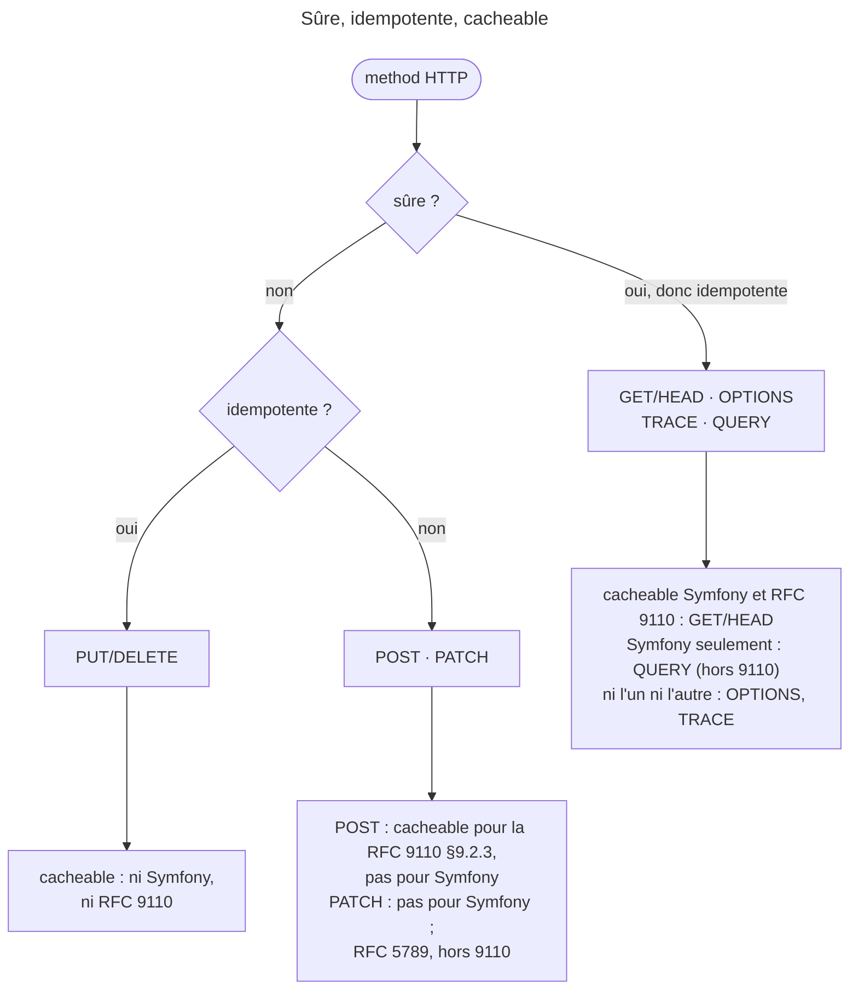

## Objectif

Classer une method selon les trois properties de RFC 9110 — sûre, idempotente,
cacheable — qui sont indépendantes les unes des autres.

## L'essentiel

Trois properties indépendantes classent une method : **sûre** (lecture
seule), **idempotente** (la rejouer ne change rien de plus) et **cacheable**.
Toute method sûre est idempotente, pas l'inverse. Le piège de l'examen : la
RFC et Symfony ne donnent pas la même liste de cacheables. Lire d'abord le
référentiel de la question : les deux affirmations sont justes, chacune chez
elle.

## Le schéma



## L'exemple : les trois questions de `Request`

```php
$request->isMethodSafe();        // GET, HEAD, OPTIONS, TRACE, QUERY
$request->isMethodIdempotent();  // + PUT, DELETE, PURGE
$request->isMethodCacheable();   // GET, HEAD, QUERY uniquement
```

`PURGE` n'est pas une method standard, mais une convention de reverse proxy.

## Les trois properties

- **Sûre** (*safe*) : la method ne demande aucune modification d'état.
  « Sûre » décrit l'intention, pas le code : rien n'empêche un `GET`
  d'incrémenter un compteur.
- **Idempotente** : rejouer la même Request N fois a le même **effet sur
  l'état** que l'exécuter une fois — le status code peut différer.
- **Cacheable** : la Response peut être stockée et réutilisée.

## Ce que la table enseigne

- **`PUT` et `DELETE` sont idempotents sans être sûrs** : remplacer par la
  même valeur, supprimer ce qui est déjà supprimé.
- **`POST` n'est ni l'un ni l'autre** : deux `POST` identiques créent deux
  ressources, d'où l'avertissement du navigateur au rechargement.
- **`PATCH` n'est pas idempotent** : il décrit une modification relative. Il
  est défini par RFC 5789, pas par 9110.
- **`QUERY`** porte un body comme `POST` mais garde la sémantique de `GET` :
  sûre, idempotente **et** cacheable dans Symfony 8.0.
- Symfony ajoute, et retire : `QUERY` aux safe methods, `QUERY` et `PURGE` aux
  idempotentes — mais il retire `POST` des cacheables.
- Le nom d'une method est **sensible à la casse** (§9.1), à l'inverse des noms
  de fields.

## Pièges d'examen

**« Sûre » ne veut pas dire « sécurisée ».** Le terme signifie « sans effet de
bord attendu ».

**`OPTIONS` et `TRACE` sont sûrs mais non cacheables.**

**Les cacheables sont `GET`, `HEAD` et `QUERY` — trois, pas deux.** Oublier
`QUERY` est l'erreur attendue, et elle se propage : `Response::isNotModified()`
s'ouvre sur `isMethodCacheable()`, donc la validation d'une Response suit
exactement cette liste.

**`DELETE` est idempotent.** L'intuition « la seconde suppression échoue, donc
ce n'est pas idempotent » confond l'*effet sur l'état*, qui est identique, avec
le *status code renvoyé*, qui peut différer.

## Application

- Un form de recherche aux critères trop longs pour l'URL → `QUERY`.
- Une suppression rejouée par un client après un timeout → `DELETE` reste sans
  risque : il est idempotent.

## QCM d'entraînement

**Question 1.** Une Request est un `POST`. Que rend
`$request->isMethodCacheable()` ?

- **A.** `true`, comme le dit RFC 9110 §9.2.3
- **B.** `false`
- **C.** `true` seulement avec un header `Cache-Control`
- **D.** `null` : la RFC laisse la question ouverte

<details>
<summary>Correction</summary>

**Bonne réponse : B.** La RFC définit une sémantique de cache pour `POST`,
mais Symfony ne retient que `GET`, `HEAD` et `QUERY` comme cacheables.

</details>

**Question 2.** Comment Symfony 8.0 classe-t-il la method `QUERY` ?

- **A.** Sûre et idempotente, non cacheable
- **B.** Ni sûre ni idempotente : elle a un body
- **C.** Sûre, idempotente et cacheable
- **D.** Idempotente seulement, comme `PURGE`

<details>
<summary>Correction</summary>

**Bonne réponse : C.** Malgré son body, `QUERY` garde la sémantique de `GET` :
les trois methods de `Request` répondent vrai pour elle.

</details>

**Question 3.** Selon RFC 9110, le nom d'une method est-il sensible à la
casse ?

- **A.** Non, comme les noms de fields
- **B.** Seulement en HTTP/2
- **C.** Non : la RFC impose les majuscules partout
- **D.** Oui, contrairement aux fields

<details>
<summary>Correction</summary>

**Bonne réponse : D.** §9.1 rend les methods sensibles à la casse, alors que
§5.1 déclare les noms de fields de header insensibles à la casse.

</details>

**Question 4.** Combien de methods `isMethodSafe()` reconnaît-il dans
Symfony 8.0 ?

- **A.** Cinq
- **B.** Quatre, comme la RFC
- **C.** Deux : `GET` et `HEAD`
- **D.** Six, avec `PURGE`

<details>
<summary>Correction</summary>

**Bonne réponse : A.** `GET`, `HEAD`, `OPTIONS`, `TRACE` et `QUERY` : Symfony
ajoute `QUERY` aux quatre safe methods que déclare RFC 9110.

</details>

## Fiche express

**Si tu dois retenir seulement 6 choses :**

- Sûre ⊂ idempotente ; **cacheable** est indépendante.
- `PUT`/`DELETE` : **idempotents, non sûrs**. `POST`/`PATCH` : ni l'un ni
  l'autre.
- Idempotence = **effet sur l'état**, pas status code.
- Symfony cacheables : **`GET`, `HEAD`, `QUERY`** ; RFC : `GET`, `HEAD`, `POST`.
- `OPTIONS` et `TRACE` : sûrs, **non cacheables**.
- `PATCH` vient de **RFC 5789** ; methods sensibles à la casse.

Moyen mnémotechnique : **« Sûre implique idempotente, jamais l'inverse »**.

## Sources officielles

- [RFC 9110 §9.2 — *Common Method Properties*](https://github.com/httpwg/httpwg.github.io/blob/master/specs/rfc9110.html#method.properties)
- [`Request`](https://github.com/symfony/symfony/blob/8.0/src/Symfony/Component/HttpFoundation/Request.php) — `isMethodSafe()` l. 1444, `isMethodIdempotent()` l. 1452,
  `isMethodCacheable()` l. 1462 (branche 8.0, `6f841c0`)
