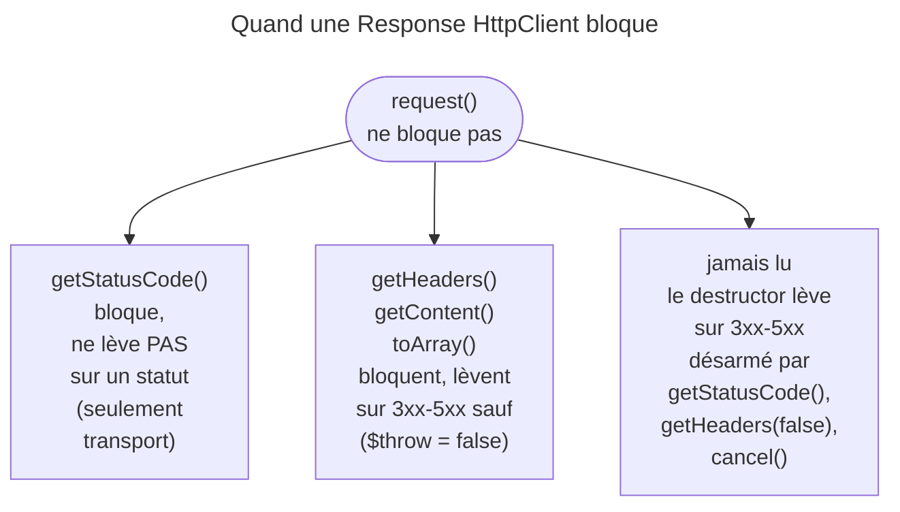
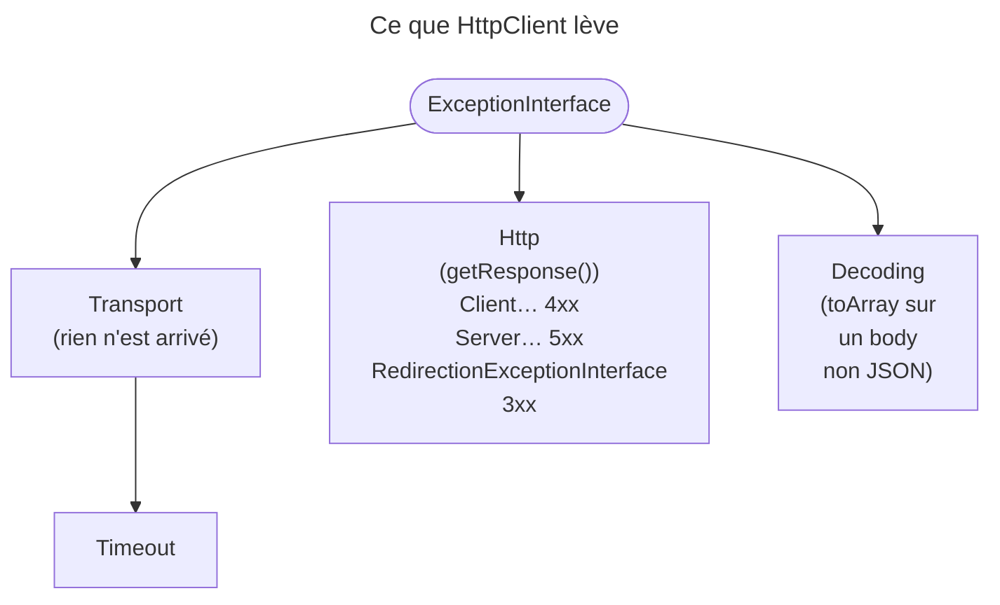

## Objectif

Émettre une Request sortante avec `HttpClientInterface` et comprendre **quand**
elle s'exécute réellement — c'est tout l'enjeu de cet item.

## L'essentiel

`HttpClientInterface::request()` **rend la main tout de suite** : la Request
n'est attendue qu'au premier accès à la Response. On lance donc toutes les
Requests, puis on les lit. Lire, c'est aussi décider des erreurs : un statut
3xx-5xx lève à la lecture — ou à la destruction si personne ne l'a lu.

## Le schéma





## L'exemple : des Requests en parallèle

```php
$responses = [];
foreach ($urls as $url) {
    $responses[] = $client->request('GET', $url);   // toutes lancées
}

foreach ($client->stream($responses) as $response => $chunk) {
    if ($chunk->isLast()) {
        // cette Response est complète
    }
}
```

## L'interface

Trois methods, injectées par autowiring via `HttpClientInterface` :
`request($method, $url, $options)`, `stream($responses, $timeout)` et
`withOptions($options)`, qui rend une **nouvelle** instance du client.

## Le point central : les Responses sont lazy

Le client est asynchrone par défaut : `getStatusCode()`, `getContent()` ou
`toArray()` bloquent, pas `request()`. Lire chaque Response dans la loop qui
l'émet rend l'ensemble séquentiel, sans erreur visible.

## La Response

`getHeaders()`, `getContent()` et `toArray()` **lèvent** sur un statut
3xx-5xx, sauf avec `$throw = false`. `getStatusCode()` ne déclare qu'une
`TransportExceptionInterface` : c'est l'appel qui inspecte un 404 sans rien
attraper. `toArray()` décode et peut lever une `DecodingExceptionInterface`,
même avec `false`.

| Option | Sens |
|---|---|
| `json` | encode et pose `Content-Type: application/json` ; exclusif avec `body` |
| `timeout` | délai **d'inactivité**, pas la durée totale |
| `max_duration` | durée totale ; `0` = illimitée (défaut) |
| `max_redirects` | `20` par défaut ; `0` = aucun redirect suivi |

Deux zéros, deux sens : `max_duration = 0` illimite, `max_redirects = 0`
interdit. En test, `MockHttpClient` et `MockResponse` remplacent le réseau.

## La hiérarchie d'exceptions

Seule `HttpExceptionInterface` expose `getResponse()`, parce qu'elle seule a
une Response à montrer. `TimeoutExceptionInterface` hérite de
`TransportExceptionInterface`. `RedirectionExceptionInterface` ne lève qu'une
fois `max_redirects` atteint.

## Une Response jamais lue lève quand même

Si rien n'a lu le statut, le **destructor** lève sur un 3xx-5xx : un
`$client->request('POST', $url);` non assigné devient synchrone et lève sur
un 500. `getInfo('http_code')` ne désarme pas ce filet.

## Rejouer les échecs : RetryableHttpClient

| Échec | Rejoué |
|---|---|
| 423, 425, 429, 502, 503 | pour toute method |
| 500, 504, 507, 510, erreur de transport | methods idempotentes seulement |
| autre statut, dont 404 | jamais |

Trois retries par défaut, donc quatre Requests au plus ; délai de 1 s doublé
à chaque essai, `Retry-After` prioritaire. Épuisés, la dernière Response est
rendue telle quelle. Dans une application : l'option `retry_failed`.

## Un stream dont une Response échoue

L'échec d'une Response est levé par les methods de **son chunk** ; non
attrapée, la `TransportExceptionInterface` termine la loop pour toutes : le
`try`/`catch` va **dans** la loop. Le statut se lit au premier chunk
(`isFirst()`), sinon un 404 lève au stream. Un `timeout` passé à `stream()`
donne un chunk dont `isTimeout()` vaut `true`.

## Pièges d'examen

**`toArray()` n'est pas `json_decode()`** : sur un body invalide, il lève une
`DecodingExceptionInterface`, pas une `ClientExceptionInterface`.

**Un POST en 500 n'est pas rejoué**, un POST en 503 l'est.

## Application

- Interroger dix APIs indépendantes → dix `request()`, puis `stream()`.
- Lire le body JSON d'une erreur 404 → `getContent()` avec `$throw` à `false`.

## QCM d'entraînement

**Question 1.** Une Response en 500 n'a été consultée que par
`getInfo('http_code')`, puis elle est détruite. Que se passe-t-il ?

- **A.** Rien : le code a été lu
- **B.** Une `ServerException` levée par le destructor
- **C.** Un simple avertissement dans les logs
- **D.** Une `TransportException` : la connexion est coupée

<details>
<summary>Correction</summary>

**Bonne réponse : B.** Lire une info ne vaut pas lecture du statut : seuls
`getStatusCode()`, `getHeaders(false)` ou `cancel()` désarment le destructor.

</details>

**Question 2.** Une Request ne doit jamais durer plus de 10 secondes au
total, Response comprise. Quelle option ?

- **A.** `'timeout' => 10`
- **B.** `'max_redirects' => 10`
- **C.** `'max_duration' => 10`
- **D.** `'buffer' => 10`, en secondes

<details>
<summary>Correction</summary>

**Bonne réponse : C.** `timeout` mesure l'inactivité, pas la durée totale ;
la durée de la Request et de la Response ensemble est `max_duration`.

</details>

**Question 3.** Que rend `$client->withOptions(['headers' => ['X-A' => '1']])` ?

- **A.** Une nouvelle instance du client
- **B.** Le même client, modifié sur place
- **C.** Rien : la method configure le client
- **D.** Une Response, envoyée aussitôt

<details>
<summary>Correction</summary>

**Bonne réponse : A.** Le contrat la décrit comme une nouvelle instance aux
options par défaut changées ; le client d'origine reste intact.

</details>

**Question 4.** Combien de redirects le client suit-il par défaut ?

- **A.** Aucun, il faut les activer
- **B.** Cinq, la limite des navigateurs
- **C.** Un nombre illimité
- **D.** Vingt

<details>
<summary>Correction</summary>

**Bonne réponse : D.** L'option `max_redirects` vaut `20` ; `0` veut dire
qu'aucun redirect n'est suivi, et non « sans limite ».

</details>

## Fiche express

**Si tu dois retenir seulement 7 choses :**

- `request()` **ne bloque pas** ; lancer tout, puis lire.
- **`getStatusCode()`** ne lève pas sur un statut ; les autres, si.
- Jamais lu : le **destructor** lève ; `getInfo()` ne désarme pas.
- `getResponse()` **seulement** sur `HttpExceptionInterface`.
- `timeout` = inactivité ; **`max_duration`** = total ; 20 redirects.
- Retry : 503 pour tous, **500 pour les idempotentes** ; 404 jamais.
- `stream()` : `try`/`catch` **dans** la loop, statut au premier chunk.

Moyen mnémotechnique : **« Lancer tout, lire après, attraper dedans »**.

## Sources officielles

- [Component HttpClient](https://github.com/symfony/symfony-docs/blob/8.0/http_client.rst) — *Processing Responses*, Requests asynchrones
- [`HttpClientInterface`](https://github.com/symfony/symfony/blob/8.0/src/Symfony/Contracts/HttpClient/HttpClientInterface.php) — `request()`, `stream()`,
  `withOptions()` (branche 8.0, `6f841c0`)
- [`HttpExceptionInterface`](https://github.com/symfony/symfony/blob/8.0/src/Symfony/Contracts/HttpClient/Exception/HttpExceptionInterface.php) — `getResponse()`, et les interfaces
  voisines du même directory `Exception/` (branche 8.0)
- [`RetryableHttpClient`](https://github.com/symfony/symfony/blob/8.0/src/Symfony/Component/HttpClient/RetryableHttpClient.php), [`GenericRetryStrategy`](https://github.com/symfony/symfony/blob/8.0/src/Symfony/Component/HttpClient/Retry/GenericRetryStrategy.php)
- [`ResponseInterface`](https://github.com/symfony/symfony/blob/8.0/src/Symfony/Contracts/HttpClient/ResponseInterface.php) — les `@throws` de `getStatusCode()`,
  `getHeaders()`, `getContent()` et `toArray()` (branche 8.0)
