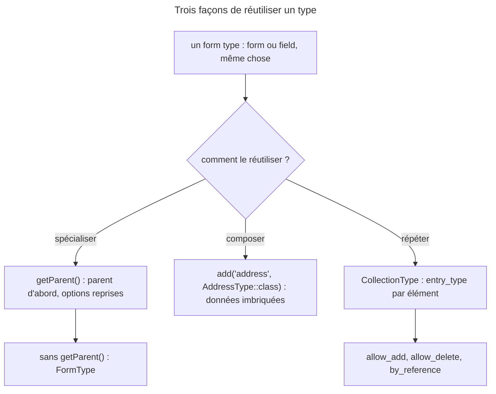

## Objectif

Écrire un type de form, savoir quand le spécialiser par `getParent()` et quand
l'ajouter comme field, et prévoir ce que fait une collection de types.

## Avant la règle : le problème à résoudre

Une boutique a trois besoins dans son form d'achat, `OrderType` :

- un choix de livraison, « Standard » ou « Express », affiché en radio buttons,
  réutilisé dans trois forms ;
- un block d'adresse (rue, ville) qui se retrouve aussi dans le profil client ;
- une liste de tags que le user peut allonger ou raccourcir.

Recopier les options du choix dans trois forms, ou les fields de l'adresse
dans deux, ferait diverger le code au premier changement. La question est donc :
**comment écrire chaque morceau une seule fois**, et le brancher là où il sert.

## Le fil rouge : l'achat

```php
class ShippingType extends AbstractType       // spécialise un type existant
{
    public function configureOptions(OptionsResolver $resolver): void
    {
        $resolver->setDefaults([
            'choices' => ['Standard' => 'standard', 'Express' => 'express'],
            'expanded' => true,
        ]);
    }

    public function getParent(): string
    {
        return ChoiceType::class;
    }
}

class OrderType extends AbstractType
{
    public function buildForm(FormBuilderInterface $builder, array $options): void
    {
        $builder
            ->add('shipping', ShippingType::class)          // un type spécialisé
            ->add('address', AddressType::class)            // un type composé
            ->add('tags', CollectionType::class, [          // un type répété
                'entry_type' => TextType::class,
                'allow_add' => true,
                'allow_delete' => true,
            ]);
    }
}
```

## Le cycle complet en un schéma



## Ce qu'est un type

Un type décrit un field ou un form entier — la distinction n'existe pas :
un form **est** un type, dont les fields sont d'autres types. C'est ce qui
permet d'imbriquer un form dans un autre en l'ajoutant comme un field.

Un type personnalisé étend `AbstractType`. C'est un service ordinaire :
FrameworkBundle autoconfigure `FormTypeInterface` (lu dans
`FrameworkExtension`), donc un type placé dans `src/` n'a rien à déclarer et
peut recevoir des dependencies par son constructor.

## Les six methods

| Method | À quoi elle sert | Défaut dans `AbstractType` |
|---|---|---|
| `buildForm()` | ajoute les fields enfants | vide |
| `configureOptions()` | déclare les options et leurs default values | vide |
| `getParent()` | désigne le type dont on hérite | `FormType::class` |
| `getBlockPrefix()` | fixe le préfixe des blocks Twig | dérivé du nom de class |
| `buildView()` | passe des variables à la vue | vide |
| `finishView()` | ajuste la vue une fois les enfants construits | vide |

Exécuté (réflexion sur `AbstractType`, Form 8.0.15) : ce sont exactement ces six
methods, et aucune n'est abstraite. Un type qui ne fait qu'imposer des options
n'implémente que `configureOptions()` et `getParent()`.

Pourquoi deux methods de vue ? Exécuté sur un type composé : dans `buildView()`,
la vue n'a **encore aucun enfant** (0) ; dans `finishView()`, elle les a (1), et
on peut y modifier les variables d'un enfant.

## `getParent()` : spécialiser un type existant

Le type parent fournit tout : ses fields, ses options, son rendu. Le type
personnalisé se contente d'en modifier une partie — `ShippingType` garde tout
`ChoiceType` et ne change que `choices` et `expanded`.

Sans `getParent()` redéfini, `AbstractType` rend `FormType::class`, la racine de
tous les types. Exécuté sur les 38 types du cœur de Form 8.0.15 : seuls
`FormType::getParent()` et `ButtonType::getParent()` rendent `null`.

### L'ordre d'exécution

`ResolvedFormType` enchaîne, pour chaque method, **parent d'abord, puis le
type, puis ses extensions**. Pour les options, il **clone** le resolver du
parent avant d'appeler `configureOptions()` : un type hérite des options de ses
ancêtres et peut en changer les défauts.

Exécuté avec un parent qui ajoute `a` et déclare `color: red, size: 1`, un
enfant qui ajoute `b` et redéfinit `color: blue`, et une extension de l'enfant
qui ajoute `c` : les appels sont `parent`, `child`, `extension` ; l'enfant voit
`color=blue size=1` ; les fields sont `a, b, c`.

### Le préfixe de block

`getBlockPrefix()` dérive le préfixe du nom de class, suffixe `Type` retiré, en
*snake case* : `ShippingType` → `shipping`, `DeliveryAddressType` →
`delivery_address` ; une class `ShippingForm`, sans suffixe `Type`, donne
`shipping_form` (exécuté). La vue reçoit la liste de toute la lignée. Exécuté
pour un field `shipping` d'un form `order` :

```text
["form", "choice", "shipping", "_order_shipping"]
```

Le rendu cherche d'abord le block le plus spécifique, puis remonte la lignée :
c'est ce qui permet de ne thématiser que ce qui change.

## Composer plutôt qu'étendre

Un type peut aussi être **utilisé** comme field d'un autre :
`->add('address', AddressType::class)`. C'est la voie normale ; `getParent()`
sert à *spécialiser* un type, pas à l'imbriquer.

La différence se voit dans les données. Exécuté :

| Écriture | Résultat |
|---|---|
| `OrderType` fait `->add('address', AddressType::class)` | les fields de l'adresse vont dans `$order->address->city` |
| `OrderType::getParent()` rend `AddressType::class` | `OrderType` **devient** une adresse : ses fields sont `city, ref`, au même niveau |

Ajouter imbrique des données ; hériter reprend un comportement.

## Une collection de types

`CollectionType` répète un même type, `entry_type`, pour chaque élément d'un
array ou d'une collection. Exécuté sur Form 8.0.15 avec les tags `['a', 'b']` :

| Soumis | Sans option | Avec l'option |
|---|---|---|
| `['a', 'b', 'c']` | ignoré, et l'extension Validator signale « This form should not contain extra fields. » | `allow_add` : `['a', 'b', 'c']` |
| `['a']` | `['a', null]` : l'élément manquant devient `null` | `allow_delete` : `['a']` |
| `['a', '']` | avec `allow_delete` : `['a', null]` | `delete_empty` en plus : `['a']` |

`allow_add` donne aussi un **prototype** : la vue porte `vars.prototype`, un
field nommé `__name__` (`prototype_name` le change) que le JavaScript copie en
remplaçant ce marqueur. Sans `allow_add`, pas de prototype.

**`by_reference`** compte dès que la collection est un object — exécuté avec un
`ArrayObject`, soumis `['a', 'c']` à la place de `['a', 'b']` :

| `by_reference` | Avec `addTag()` / `removeTag()` | Sans adder ni remover |
|---|---|---|
| `true`, le défaut | aucun appel : modifiée **sur place** | aucun appel : modifiée sur place |
| `false` | `removeTag(b)`, puis `addTag(c)` | `setTags()` avec une **nouvelle** instance |

Un adder qui pose l'autre côté d'une relation n'est donc appelé qu'avec
`by_reference: false`.

## Concrètement dans ton application

- Un field réutilisé avec les mêmes options : un type avec `getParent()` et
  `configureOptions()`, rien d'autre.
- Un group de fields qui correspond à un object (une adresse) : un type avec
  `buildForm()` et `data_class`, ajouté par `->add()`.
- Une liste que le user édite : `CollectionType`, `allow_add` et
  `allow_delete`, le prototype pour le bouton « Ajouter ».
- Une relation dont l'entité gère les deux côtés dans `addTag()` :
  `by_reference: false`.

## À comprendre

- **Pourquoi un form est-il un type ?** Parce qu'ainsi une seule mécanique —
  options, inheritance, rendu par blocks — sert au field le plus simple comme au
  form entier, et l'un s'imbrique dans l'autre sans cas particulier.
- **Pourquoi le parent passe-t-il en premier ?** Pour que l'enfant reçoive des
  options et des fields déjà en place, qu'il peut modifier.
- **Pourquoi `by_reference: true` court-circuite-t-il les adders ?** Parce que
  la collection lue est modifiée en place : il n'y a rien à réécrire dans
  l'object, donc aucun mutator à appeler.

## À mémoriser

- Form ou field : c'est toujours un type.
- Six methods, toutes facultatives ; `getParent()` vaut `FormType` par défaut.
- Sans parent, parmi les types du cœur : `FormType` et `ButtonType`.
- Ordre : parent, type, extensions ; resolver d'options cloné du parent.
- Préfixe de block : nom de class sans `Type`, en *snake case* ; la vue porte
  toute la lignée.
- Hériter spécialise ; ajouter imbrique les données.
- `CollectionType` : `allow_add` (et le prototype `__name__`), `allow_delete`,
  `delete_empty` ; `by_reference: false` pour passer par les adders.
- Moyen mnémotechnique : **« Spécialiser, composer, répéter »**.

## Pièges d'examen

**Un form est un type ; la distinction field / form n'existe pas.**

**Aucune des methods d'un type n'est obligatoire.**

**Sans parent déclaré, le parent est la racine de tous les types**, pas
« aucun ».

**Le parent passe avant l'enfant** : son `buildForm()` s'exécute d'abord, ses
options sont reprises puis modifiables.

**Sans `allow_add`, un élément en trop n'est pas ajouté** ; sans `allow_delete`,
un élément absent devient `null` au lieu de disparaître.

**`by_reference: true` n'appelle jamais `addTag()`** sur une collection object.

## Application : trois scénarios

**Scénario 1 — Le choix de livraison recopié trois fois.** *Solution.* Un
`ShippingType` qui rend `ChoiceType::class` dans `getParent()` et fixe
`choices` et `expanded` dans `configureOptions()` ; chaque form l'ajoute
par `->add('shipping', ShippingType::class)`.

**Scénario 2 — L'adresse aplatie.** Un développeur fait hériter `OrderType` de
`AddressType` pour « avoir l'adresse dans l'achat », et `city` se retrouve
au niveau de l'`Order`. *Solution.* Composer : `->add('address',
AddressType::class)`, avec une `data_class` sur `AddressType`.

**Scénario 3 — L'adder jamais appelé.** `Post::addTag()` pose `$tag->post`,
mais les nouveaux tags n'ont jamais de post. *Solution.* `by_reference: false`
sur la collection : avec le défaut `true`, la collection est modifiée sur place
et `addTag()` n'est pas appelé.

## QCM d'entraînement

Sept questions sur les types. Choisis avant d'ouvrir la correction.

**Question 1.** Dans une application, `ContactType` décrit un form entier et `PhoneType` une seule zone de saisie. Comment le component Form les distingue-t-il ?

- **A.** `ContactType` est un form, `PhoneType` un field : deux interfaces différentes
- **B.** Par `getParent()` : seul un field déclare un parent
- **C.** Il ne les distingue pas : ce sont deux form types
- **D.** Par `buildForm()` : seul un form ajoute des enfants

<details>
<summary>Correction</summary>

**Bonne réponse : C.** Un form et un field sont des types ; un form est un type
dont les fields sont d'autres types.

A est le piège : la distinction n'existe pas dans le component. B : les deux
ont un parent, `FormType` par défaut. D : `buildForm()` est facultative pour
tous.

</details>

**Question 2.** Un type composé doit ajouter un attribute HTML au widget de l'un de ses fields enfants, au moment de construire la vue. Quelle method le permet ?

- **A.** `finishView()` : les vues enfants y existent déjà
- **B.** `buildView()` : elle reçoit les vues enfants construites
- **C.** `buildForm()` : la vue se règle à la construction du form
- **D.** `configureOptions()` : un attribute est une option de vue

<details>
<summary>Correction</summary>

**Bonne réponse : A.** Exécuté : dans `buildView()`, la vue n'a encore aucun
enfant ; dans `finishView()`, l'enfant est là et ses `attr` se modifient.

B est le piège : c'est l'ordre inverse. C et D ne touchent pas la vue
construite.

</details>

**Question 3.** Un type `MoneyRangeType extends AbstractType` n'écrit aucune method. Il est ajouté sous le nom `range` dans le form `filter`. Que contient `vars.block_prefixes` ?

- **A.** `["money_range", "_filter_range"]` : aucun parent déclaré
- **B.** `["form", "money_range_type", "_filter_range"]`
- **C.** `["_filter_range", "money_range", "form"]`
- **D.** `["form", "money_range", "_filter_range"]`

<details>
<summary>Correction</summary>

**Bonne réponse : D.** Le parent implicite est `FormType`, le préfixe retire
`Type` et passe en *snake case*, et la liste va du plus général au plus
spécifique (exécuté).

A oublie le parent implicite. B garde le suffixe. C inverse l'ordre.

</details>

**Question 4.** Un type parent déclare `color: 'red'` et `size: 1` dans `configureOptions()`. Son type enfant redéfinit seulement `color: 'blue'`. Quelles valeurs reçoit le `buildForm()` de l'enfant, sans option passée ?

- **A.** `color` vaut `'red'` : le parent est résolu en dernier
- **B.** `color` vaut `'blue'` et `size` vaut `1`
- **C.** `color` vaut `'blue'`, et `size` est inconnue de l'enfant
- **D.** Une exception : `color` est définie deux fois

<details>
<summary>Correction</summary>

**Bonne réponse : B.** Le resolver du parent est cloné, puis l'enfant change un
défaut (exécuté).

A inverse l'ordre. C oublie l'inheritance des options. D invente un conflit.

</details>

**Question 5.** Le form d'achat doit enregistrer la ville dans `$order->address->city`. Quelle écriture dans `OrderType` ?

- **A.** `getParent()` qui rend `AddressType::class`
- **B.** `->add('city', TextType::class)` sur `OrderType` lui-même
- **C.** `->add('address', AddressType::class)`
- **D.** Une type extension de `AddressType` qui cible `OrderType`

<details>
<summary>Correction</summary>

**Bonne réponse : C.** Ajouter le type comme field imbrique ses données sous
`address` (exécuté : `$order->address->city` vaut la ville soumise).

A est le piège : hériter met `city` au niveau de l'`Order`. B écrit
`$order->city`. D : une extension modifie un type, elle ne l'imbrique pas.

</details>

**Question 6.** Une collection de tags vaut `['a', 'b']`, avec `allow_delete` mais sans `delete_empty`. On soumet `['a', '']`. Que contient la collection ?

- **A.** `['a']` : la string vide est supprimée
- **B.** `['a', '']` : la valeur est gardée telle quelle
- **C.** `['a', 'b']` : une valeur vide ne remplace rien
- **D.** `['a', null]` : la string vide devient `null`

<details>
<summary>Correction</summary>

**Bonne réponse : D.** Exécuté : l'élément reste, sa valeur vide normalisée en
`null`.

A est le comportement **avec** `delete_empty`. B oublie que le form normalise
la string vide en `null`. C invente une conservation.

</details>

**Question 7.** `Post::$tags` est un `ArrayObject`, et `Post` n'a qu'un `setTags()`, sans adder ni remover. La collection a `by_reference: false`. Que se passe-t-il à la submission ?

- **A.** `setTags()` est appelé avec une nouvelle instance
- **B.** Rien n'est appelé : la collection est modifiée sur place
- **C.** Une exception : un adder est obligatoire avec `false`
- **D.** `setTags()` reçoit l'instance d'origine, modifiée

<details>
<summary>Correction</summary>

**Bonne réponse : A.** Exécuté : `setTags()` est appelé, et l'instance reçue
n'est pas celle d'origine.

B est le comportement avec `by_reference: true`. C invente une obligation. D
oublie la copie que `false` impose.

</details>

## Fiche express

**Si tu dois retenir seulement 7 choses :**

- Un form **est** un type ; un field aussi.
- Six methods, **toutes facultatives** ; `buildView()` avant les enfants,
  `finishView()` après.
- `getParent()` vaut **`FormType`** par défaut ; dans le cœur, seuls
  `FormType` et `ButtonType` n'ont pas de parent.
- Ordre : **parent, type, extensions** ; options du parent clonées puis
  modifiables.
- Préfixe : nom de class **sans `Type`**, en *snake case* ; la vue porte toute
  la lignée.
- **Hériter spécialise, ajouter imbrique.**
- `CollectionType` : `allow_add` (+ prototype), `allow_delete`, `delete_empty` ;
  **`by_reference: false`** pour les adders.

**En une phrase, pour tout reconstruire :**

```text
SPÉCIALISER : getParent() → parent d'abord, options clonées
COMPOSER    : add('x', XType::class) → données sous x
RÉPÉTER     : CollectionType(entry_type, allow_add, allow_delete, by_reference)
```

## Sources officielles

- [How to Create a Custom Form Field Type](https://github.com/symfony/symfony-docs/blob/8.0/form/create_custom_field_type.rst)
- [CollectionType](https://github.com/symfony/symfony-docs/blob/8.0/reference/forms/types/collection.rst) et [`by_reference`](https://github.com/symfony/symfony-docs/blob/8.0/reference/forms/types/options/by_reference.rst.inc)
- [Form 8.0, `AbstractType`](https://github.com/symfony/symfony/blob/8.0/src/Symfony/Component/Form/AbstractType.php) et [`ResolvedFormType`](https://github.com/symfony/symfony/blob/8.0/src/Symfony/Component/Form/ResolvedFormType.php)
