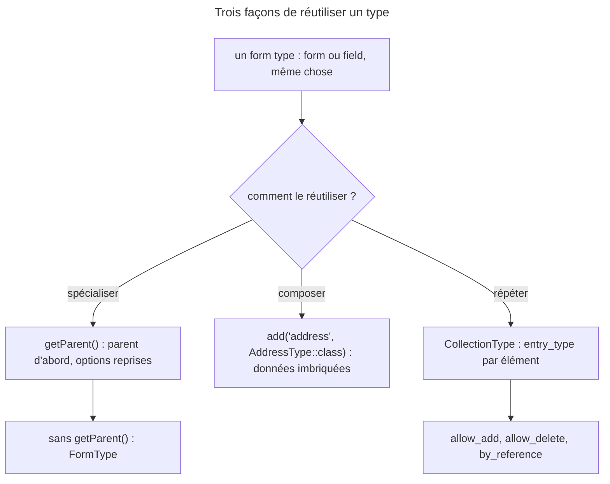

## Objectif

Écrire un type de form, savoir quand le spécialiser par `getParent()` et quand
l'ajouter comme field, et prévoir ce que fait une collection de types.

## L'essentiel

Un form **est** un type, comme chacun de ses fields. Pour réutiliser un type,
trois voies : le **spécialiser** (`getParent()` : on hérite et on change
quelques options), le **composer** (`add()` : il devient un field, ses
données s'imbriquent), le **répéter** (`CollectionType`).

## Le schéma



## L'exemple : l'achat

```php
class ShippingType extends AbstractType       // spécialise un type existant
{
    public function configureOptions(OptionsResolver $resolver): void
    {
        $resolver->setDefaults([
            'choices' => ['Standard' => 'standard', 'Express' => 'express'],
            'expanded' => true,
        ]);
    }

    public function getParent(): string
    {
        return ChoiceType::class;
    }
}

// dans OrderType::buildForm()
$builder
    ->add('shipping', ShippingType::class)                    // spécialisé
    ->add('address', AddressType::class)                      // composé
    ->add('tags', CollectionType::class, ['entry_type' => TextType::class]); // répété
```

## Ce qu'est un type

Un type décrit un field ou un form entier : la distinction n'existe pas. C'est
ce qui permet d'imbriquer un form dans un autre. Un type étend `AbstractType`
et c'est un service ordinaire, autoconfiguré : il peut recevoir des
dependencies par son constructor.

## Les six methods

| Method | Role | Défaut dans `AbstractType` |
|---|---|---|
| `buildForm()` | ajoute les fields enfants | vide |
| `configureOptions()` | déclare les options et leurs défauts | vide |
| `getParent()` | le type dont on hérite | `FormType::class` |
| `getBlockPrefix()` | le préfixe des blocks Twig | dérivé du nom de class |
| `buildView()` | passe des variables à la vue | vide |
| `finishView()` | ajuste la vue une fois les enfants construits | vide |

Relu par réflexion : aucune n'est abstraite. Dans `buildView()`, la vue n'a
encore aucun enfant ; dans `finishView()`, elle les a.

## `getParent()` : spécialiser un type existant

- Sans `getParent()`, le parent est `FormType`, la racine ; parmi les types du
  cœur, seuls `FormType` et `ButtonType` rendent `null`.
- `ResolvedFormType` enchaîne **parent, puis type, puis extensions**, et
  **clone** le resolver du parent avant `configureOptions()` : un type hérite
  des options de ses ancêtres et peut en changer les défauts.
- `getBlockPrefix()` : nom de class sans `Type`, en *snake case* —
  `DeliveryAddressType` → `delivery_address`. La vue reçoit toute la lignée
  dans `block_prefixes`, du plus général au plus spécifique :
  `["form", "choice", "shipping", "_order_shipping"]`.

## Composer plutôt qu'étendre

| Écriture | Résultat |
|---|---|
| `->add('address', AddressType::class)` | les fields vont dans `$order->address->city` |
| `OrderType::getParent()` rend `AddressType::class` | `OrderType` **devient** une adresse : `city` au niveau de l'`Order` |

Ajouter imbrique des données ; hériter reprend un comportement.

## Une collection de types

Tags `['a', 'b']`, `entry_type: TextType` :

| Soumis | Sans option | Avec l'option |
|---|---|---|
| `['a', 'b', 'c']` | ignoré, « This form should not contain extra fields. » | `allow_add` : ajouté, et un prototype `__name__` |
| `['a']` | `['a', null]` | `allow_delete` : `['a']` |
| `['a', '']` | avec `allow_delete` : `['a', null]` | `delete_empty` en plus : `['a']` |

**`by_reference`**, sur une collection object : avec `true` (le défaut),
ni setter, ni adder, ni remover n'est appelé — l'instance change sur place ;
avec `false`, `removeTag()` / `addTag()`, ou `setTags()` avec une nouvelle
instance.

## Pièges d'examen

**Un form est un type ; la distinction field / form n'existe pas.**

**Aucune des methods d'un type n'est obligatoire.**

**Sans parent déclaré, le parent est la racine de tous les types**, pas
« aucun ».

**Le parent passe avant l'enfant** : son `buildForm()` s'exécute d'abord, ses
options sont reprises puis modifiables.

**Sans `allow_add`, un élément en trop n'est pas ajouté** ; sans `allow_delete`,
un élément absent devient `null` au lieu de disparaître.

**`by_reference: true` n'appelle jamais `addTag()`** sur une collection object.

## Application

- `Post::addTag()` pose `$tag->post`, mais n'est jamais appelé →
  `by_reference: false` sur la collection.
- Un choix de livraison recopié dans trois forms → un `ShippingType` dont
  `getParent()` rend `ChoiceType::class`.

## QCM d'entraînement

**Question 1.** Un type composé doit ajouter un attribute HTML au widget de
l'un de ses fields enfants, au moment de construire la vue. Quelle method ?

- **A.** `buildView()` : elle reçoit les vues enfants construites
- **B.** `buildForm()` : la vue se règle à la construction du form
- **C.** `finishView()` : les vues enfants y existent déjà
- **D.** `configureOptions()` : un attribute est une option de vue

<details>
<summary>Correction</summary>

**Bonne réponse : C.** Dans `buildView()`, la vue n'a encore aucun enfant ;
dans `finishView()`, l'enfant est là et ses `attr` se modifient.

</details>

**Question 2.** `MoneyRangeType extends AbstractType` n'écrit aucune method. Il
est ajouté sous le nom `range` dans le form `filter`. Que contient
`vars.block_prefixes` ?

- **A.** `["money_range", "_filter_range"]`
- **B.** `["form", "money_range", "_filter_range"]`
- **C.** `["form", "money_range_type", "_filter_range"]`
- **D.** `["_filter_range", "money_range", "form"]`

<details>
<summary>Correction</summary>

**Bonne réponse : B.** Le parent implicite est `FormType`, le préfixe perd
`Type`, et la liste va du plus général au plus spécifique.

</details>

**Question 3.** Un type parent déclare `color: 'red'` et `size: 1`. Son type
enfant redéfinit seulement `color: 'blue'`. Que reçoit le `buildForm()` de
l'enfant, sans option passée ?

- **A.** `color` vaut `'red'` : le parent est résolu en dernier
- **B.** `color` vaut `'blue'`, et `size` est inconnue de l'enfant
- **C.** Une exception : `color` est définie deux fois
- **D.** `color` vaut `'blue'` et `size` vaut `1`

<details>
<summary>Correction</summary>

**Bonne réponse : D.** Le resolver du parent est cloné, puis l'enfant change
un défaut ; `size` est héritée telle quelle.

</details>

**Question 4.** `Post::$tags` est un `ArrayObject`, et `Post` n'a qu'un
`setTags()`. La collection a `by_reference: false`. Que se passe-t-il à la
submission ?

- **A.** `setTags()` est appelé avec une nouvelle instance
- **B.** Rien n'est appelé : la collection est modifiée sur place
- **C.** Une exception : un adder est obligatoire avec `false`
- **D.** `setTags()` reçoit l'instance d'origine, modifiée

<details>
<summary>Correction</summary>

**Bonne réponse : A.** Avec `false`, la collection est copiée puis rendue par
le setter ; B décrit le défaut, `true`.

</details>

## Fiche express

**Si tu dois retenir seulement 6 choses :**

- Un form **est** un type ; aucune des six methods n'est obligatoire.
- Sans `getParent()` : **`FormType`**.
- Parent **d'abord**, options **clonées** puis modifiables.
- **Spécialiser** (`getParent()`) ≠ **composer** (`add()`, données imbriquées).
- `CollectionType` : **`allow_add`**, **`allow_delete`**, `delete_empty`.
- **`by_reference: false`** pour que l'adder soit appelé.

Moyen mnémotechnique : **« Spécialiser, composer, répéter »**.

## Sources officielles

- [How to Create a Custom Form Field Type](https://github.com/symfony/symfony-docs/blob/8.0/form/create_custom_field_type.rst)
- [CollectionType](https://github.com/symfony/symfony-docs/blob/8.0/reference/forms/types/collection.rst) et [`by_reference`](https://github.com/symfony/symfony-docs/blob/8.0/reference/forms/types/options/by_reference.rst.inc)
- [Form 8.0, `AbstractType`](https://github.com/symfony/symfony/blob/8.0/src/Symfony/Component/Form/AbstractType.php) et [`ResolvedFormType`](https://github.com/symfony/symfony/blob/8.0/src/Symfony/Component/Form/ResolvedFormType.php)

