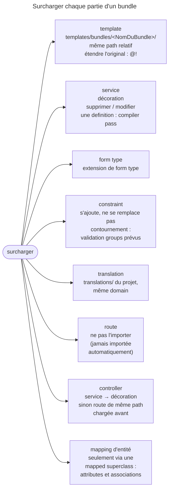

## Objectif

Savoir quel mécanisme employer pour surcharger chaque partie d'un bundle tiers —
et pourquoi ils diffèrent.

## L'essentiel

Il n'existe pas de mécanisme unique pour surcharger un bundle tiers : chaque
sous-système a le sien, et l'examen vérifie qu'on a la liste. Deux exceptions
dominent : la **validation**, qui ne se surcharge pas, et le **routage**, qui
ne s'importe jamais tout seul. Et le controller a deux cas.

## Le schéma



## L'exemple : étendre le template que l'on surcharge

```twig
{# templates/bundles/AcmeUserBundle/registration/confirmed.html.twig #}


Bienvenue !
```

## Vue d'ensemble

Dix lignes pour les **huit** sections du document officiel : décoration et
compiler pass relèvent tous deux de *Services & Configuration*, et le
controller se dédouble. Symfony n'importe **jamais** une route de bundle
automatiquement : la « surcharger », c'est ne pas l'importer, ou copier le file
et importer sa copie.

## Les templates

Un file de même nom et de même path relatif sous
`templates/bundles/<NomDuBundle>/`. L'étendre par son nom ordinaire crée une
**loop infinie** : le nom résout vers la surcharge elle-même. `@!` désigne le
template **original**. Un template ajouté à un emplacement nouveau demande
parfois de vider le cache, **même en mode debug**.

## Le controller a deux cas

Le document ouvre sa section par une condition :
« si le controller est un service, voir la section suivante » : la **décoration**. La route de même path, chargée avant
celle du bundle, n'est que la branche « sinon » — et les controllers modernes
sont des services autoconfigurés.

## Les translations ne dépendent pas des bundles

Elles sont liées à un **domain** : `translations/AcmeUserBundle.es.yaml` à la
racine surcharge celui du bundle sans rien déclarer, le nom du bundle n'étant
que celui du domain.

## La validation ne se surcharge pas

Symfony fusionne la configuration de validation de **tous** les bundles en un
seul arbre de métadonnées : on **ajoute** une constraint à une property, on
n'en **remplace** jamais. Le contournement suppose des validation groups prévus
par le bundle.

## Pièges d'examen

**Étendre le template que l'on surcharge crée une loop infinie.** Le nom résout
vers la surcharge, donc vers lui-même. Le préfixe `@!` désigne l'original et
rompt le cycle.

**Une constraint de validation ne se remplace pas.** Symfony fusionne la
configuration de tous les bundles : on ajoute, on ne retire jamais. Le seul
contournement est un validation group prévu par le bundle.

**Décoration et compiler pass ne sont pas au même niveau.** La décoration
enveloppe un service existant ; supprimer ou modifier une definition demande une
compiler pass.

**Un contrôleur-service ne se surcharge pas par une route.** Le document
renvoie d'abord à la décoration ; la route de même path est la solution de
repli, pour un controller qui n'est pas un service.

**Une translation se surcharge par le domain, pas par le bundle.** Le nom du
bundle dans le nom de file n'est que le nom du domain.

## Application

- Ajouter un log autour du mailer d'un bundle → décorer son service.
- Personnaliser une page d'erreur → `templates/bundles/TwigBundle/`, comme pour
  tout bundle.

## QCM d'entraînement

**Question 1.** Le controller d'un bundle à surcharger **est un service**.
Quelle technique le document indique-t-il ?

- **A.** Une route de même path, chargée avant
- **B.** Un compiler pass qui remplace la class
- **C.** La décoration du service
- **D.** Un template dans `templates/bundles/`

<details>
<summary>Correction</summary>

**Bonne réponse : C.** Le document renvoie un controller-service à la
décoration ; la route de même path ne vaut que pour un controller qui n'en est
pas un.

</details>

**Question 2.** Comment neutraliser les routes d'un bundle qu'on ne veut pas ?

- **A.** Ne pas les importer
- **B.** Les redéclarer avec `methods: []`
- **C.** Un compiler pass sur le router
- **D.** `framework.router.disable` avec leur nom

<details>
<summary>Correction</summary>

**Bonne réponse : A.** Symfony n'importe jamais automatiquement les routes d'un
bundle : sans import dans `config/routes/`, il n'y a rien à neutraliser.

</details>

**Question 3.** À quelle condition le mapping d'une entité de bundle est-il
surchargeable ?

- **A.** Toujours, par un file dans `config/doctrine/`
- **B.** Si le bundle expose une *mapped superclass*
- **C.** Jamais : le mapping est figé
- **D.** Si l'entité porte `#[Override]`

<details>
<summary>Correction</summary>

**Bonne réponse : B.** Sans *mapped superclass*, il n'y a rien à surcharger ;
avec elle, on peut redéfinir attributes et associations.

</details>

**Question 4.** En mode debug, un template de surcharge tout juste créé n'est
pas pris en compte. Que conseille le document ?

- **A.** Passer en environment `prod`
- **B.** Renommer le bundle
- **C.** Rien : c'est impossible en debug
- **D.** Vider le cache

<details>
<summary>Correction</summary>

**Bonne réponse : D.** Un template ajouté à un emplacement nouveau peut exiger
de vider le cache, et le document le signale même en mode debug.

</details>

## Fiche express

**Si tu dois retenir seulement 7 choses :**

- Template : **`templates/bundles/<NomDuBundle>/`**, même path relatif.
- Étendre l'original : **`@!`**, sinon loop infinie.
- Service : **décoration** ; supprimer une definition : **compiler pass**.
- Form type : **extension** ; constraint : on **ajoute**, jamais on ne remplace.
- Translation : même **domain**, dans `translations/`.
- Route : **ne pas l'importer** ; controller-service : décoration.
- Mapping : seulement via une **mapped superclass**.

Moyen mnémotechnique : **« Une question par sous-système »**.

## Sources officielles

- [How to Override any Part of a Bundle](https://github.com/symfony/symfony-docs/blob/8.0/bundles/override.rst)

