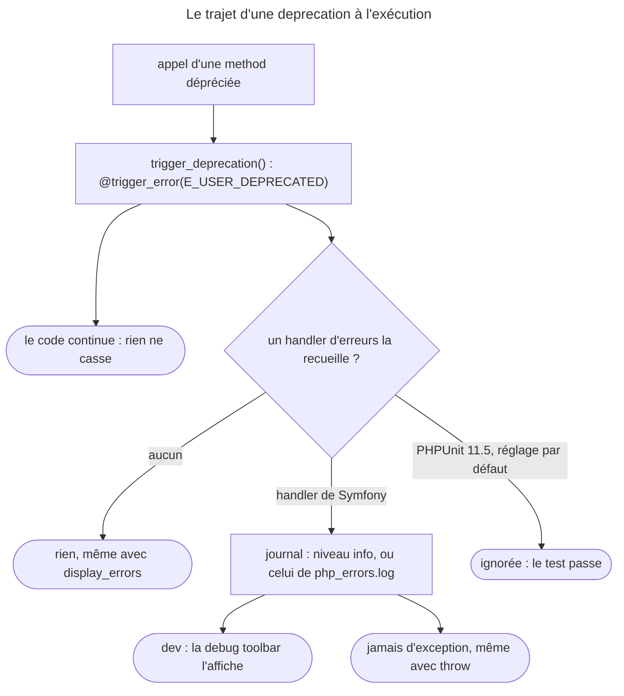

## Objectif

Savoir ce que devient, à l'exécution, du code qui appelle une fonctionnalité
dépréciée — et pourquoi rien ne casse.

## Avant la règle : le problème à résoudre

Une application appelle une method que Symfony a dépréciée. Rien ne casse :
ni page, ni command, ni test. Faut-il s'en réjouir ou s'inquiéter ? Et comment
**trouver** ces appels avant la prochaine majeure, qui les supprimera ?

Trois questions : ce qu'est **techniquement** une deprecation à l'exécution,
**où** elle devient visible, et **comment** la corriger sans risque.

## Périmètre

Deux limites, à avoir en tête. Le **PHPUnit Bridge** est hors périmètre
d'examen, alors que c'est lui qui, en pratique, fait échouer une suite sur les
deprecations. Et le détail de la façon de **déclarer** une deprecation
appartient à *Deprecations best practices* (Symfony Architecture), prérequis de
cette page.

## Le fil rouge : un appel déprécié dans une bibliothèque

```php
// dans acme/pkg 1.2
public function oldThing(): void
{
    trigger_deprecation('acme/pkg', '1.2', 'Old thing is deprecated.');
    // … le code continue et fonctionne
}

// dans ton application : l'appel réussit, en silence
$service->oldThing();
// le journal, si le handler de Symfony est actif :
// [info] User Deprecated: Since acme/pkg 1.2: Old thing is deprecated.
```

## Le cycle complet en un schéma



## Rappel : reconnaître une deprecation

Deux marqueurs, pour deux publics :

| Marqueur | Pour qui |
|---|---|
| l'annotation PHPDoc `@deprecated`, avec la version | le lecteur du code |
| l'appel `trigger_deprecation()` | le code qui tourne |

Et un calendrier : une deprecation n'entre que dans une **mineure** (sauf cas
critique sur une version encore maintenue), jamais sur une class ou une method
**nouvelle** ; le code déprécié ne disparaît qu'à la **majeure** suivante.

## Une notice, et elle est silencée

Le point de fond tient en une phrase : une deprecation Symfony est une notice
`E_USER_DEPRECATED` **silencée**. Lu dans `trigger_deprecation()` (contrats
Symfony, branche 8.0) : l'appel est `@trigger_error(…, \E_USER_DEPRECATED)`,
et le message commence par `Since <paquet> <version>:`.

Silencée veut dire déclenchée avec l'operator `@`. Conséquences directes :

- **rien n'échoue** — ni la Request, ni la command, ni le test ;
- **rien n'apparaît dans l'output**, ni page ni console ;
- la notice n'existe que si **un handler d'erreurs la recueille**.

Exécuté sur PHP 8.4, `display_errors` actif :

| Situation | Ce qu'on voit |
|---|---|
| `trigger_deprecation()`, aucun handler | rien ; le script continue |
| `trigger_error(…, E_USER_DEPRECATED)` sans `@` | `Deprecated: …` dans l'output |
| handler d'erreurs de Symfony 8.0 + journal | une entrée de niveau `info` : `User Deprecated: Since acme/pkg 1.2: …` |

Le handler de Symfony ne lève **jamais** d'exception pour une deprecation
(`ErrorHandler.php`, 8.0 : *E_DEPRECATED and E_USER_DEPRECATED levels never
throw*). Le code déprécié fonctionne jusqu'à la majeure suivante : c'est la
backward compatibility promise, pas un oubli.

Rejoué pour cette page, le handler réglé pour lever une exception à **tous**
les niveaux — `throwAt(E_ALL, true)` :

| Notice | Résultat |
|---|---|
| `trigger_deprecation()` | aucune exception, journalisée en `info` |
| `trigger_error(…, E_USER_DEPRECATED)` sans `@` | aucune exception, journalisée en `info` |
| `trigger_error(…, E_USER_WARNING)` | `ErrorException` « User Warning: … » |

C'est ce qui rend l'option `framework.php_errors.throw` — `%kernel.debug%` par
défaut, donc active en dev — sans effet sur les deprecations.

## Les voir

**En développement, dans le navigateur.** La documentation 8.0
(*Upgrading a Major Version*) le dit : ces notices sont montrées dans la barre de
debug. C'est le handler d'erreurs de Symfony qui les recueille et les
journalise.

**Dans le journal.** Symfony traite `E_DEPRECATED` et `E_USER_DEPRECATED` comme
journalisables : l'option `framework.php_errors.log` vaut `true` par défaut, et
accepte une table qui associe un niveau de journal à chaque niveau d'erreur PHP.
Une deprecation devient alors une entrée lisible et dénombrable.

```yaml
framework:
    php_errors:
        log:
            !php/const \E_USER_DEPRECATED: !php/const Psr\Log\LogLevel::ERROR
```

Rejoué sur le handler lui-même : associer `E_USER_DEPRECATED` au niveau
`error` fait passer l'entrée de `info` à `error`.

**Dans les tests.** La même page le dit : PHPUnit seul ne montre aucune notice
de deprecation. Exécuté sur PHPUnit 11.5 : un test qui appelle
`trigger_deprecation()` passe, `OK (1 test, 1 assertion)`, même avec
`failOnDeprecation="true"` — la notice est silencée.

C'est un réglage par défaut, pas une impossibilité. Rejoué sur PHPUnit 11.5.56,
le même test :

| Configuration | Résultat |
|---|---|
| `failOnDeprecation="true"` seul | `OK`, exit code `0` |
| `<source ignoreSuppressionOfDeprecations="true">` | la deprecation est listée ; code `0` |
| les deux | la deprecation est listée ; exit code `1` |

## Les corriger

La démarche que la documentation décrit pour une montée de version mineure :

1. `composer update "symfony/*"` ;
2. lire le file `UPGRADE` de la version atteinte, qui décrit les changements
   et les deprecations ;
3. corriger le code en conséquence — **progressivement**, puisque rien n'est
   cassé pour l'instant.

L'ordre rend la montée sûre : atteindre la dernière mineure, y éteindre les
deprecations, puis passer à la majeure — qui supprime ce qui était déprécié.

## Concrètement dans ton application

- Trouver les appels dépréciés : la debug toolbar en dev, ou le journal.
- Les compter, ou alerter : `php_errors.log` vers un niveau plus haut.
- Préparer une majeure : dernière mineure d'abord, puis zéro deprecation.
- Une deprecation dans une bibliothèque tierce : mettre la bibliothèque à jour.
- Un test « vert » malgré une deprecation : normal par défaut ; le Bridge, hors
  périmètre, ou la configuration de PHPUnit la rendent visible.

## À comprendre

- **Pourquoi silencer ?** Une deprecation prévient sans casser : la
  backward compatibility promise garantit que le code déprécié marche jusqu'à
  la majeure suivante.
- **Pourquoi un handler est-il nécessaire ?** Un handler d'erreurs reçoit même
  les notices silencées ; c'est lui, et non l'affichage de PHP, qui les rend
  visibles.
- **Pourquoi la dernière mineure ?** Elle porte **toutes** les deprecations de
  la branche ; la majeure supprimera ce qu'elles annoncent.

## À mémoriser

- **`@deprecated`** pour le lecteur, **`trigger_deprecation()`** pour l'exécution.
- **`E_USER_DEPRECATED`** silencée par **`@`** : rien n'échoue, rien ne
  s'affiche.
- Message : **`Since <paquet> <version>:`**.
- Handler de Symfony : journal en **`info`**, **jamais d'exception**.
- **`php_errors.log`** : niveau par erreur PHP.
- **PHPUnit** : rien par défaut, même avec `failOnDeprecation`.
- **Dernière mineure → zéro deprecation → majeure.**
- Moyen mnémotechnique : **« Silencée, journalisée, corrigée avant la majeure »**.

## Pièges d'examen

- **Une deprecation ne fait échouer ni la Request ni le test** par elle-même.
- **La notice est silencée** : rien dans l'output, et sans handler
  d'erreurs, aucune trace.
- **En dev, la debug toolbar les montre** — parce que le handler de
  Symfony les recueille, pas parce qu'elles s'affichent.
- **Le code déprécié fonctionne** jusqu'à la majeure suivante.
- **On corrige avant la majeure**, pas après.

## Application : trois scénarios

**Scénario 1 — La CLI muette.** Une command appelle une method dépréciée ; rien
ne s'affiche, même avec `display_errors`. *Solution.* C'est attendu : la notice
est silencée. La chercher dans le journal, où le handler de Symfony l'a inscrite
en `info`.

**Scénario 2 — L'alerte de production.** L'équipe veut que chaque deprecation
remonte dans ses alertes, filtrées au niveau `error`. *Solution.*
`framework.php_errors.log` : associer `E_DEPRECATED` et `E_USER_DEPRECATED` à
`LogLevel::ERROR`.

**Scénario 3 — La montée de 7.x à 8.0.** L'équipe envisage de passer
directement à 8.0 et de corriger ensuite. *Solution.* Monter d'abord à la
dernière 7.x, éteindre ses deprecations pendant que le code déprécié marche
encore, puis passer à 8.0.

## QCM d'entraînement

Cinq questions sur le code déprécié à l'exécution. Choisis avant d'ouvrir la
correction.

**Question 1.** Le handler d'erreurs de Symfony est actif, avec sa configuration
par défaut. À quel niveau de journal une deprecation est-elle inscrite ?

- **A.** `warning`
- **B.** `info`
- **C.** `error`
- **D.** `debug`

<details>
<summary>Correction</summary>

**Bonne réponse : B.** Exécuté : `["info", "User Deprecated: Since acme/pkg
1.2: …"]`.

A et C demandent une table dans `php_errors.log`. D est faux.

</details>

**Question 2.** En dev, `framework.php_errors.throw` vaut `%kernel.debug%`, donc
`true`. Une deprecation devient-elle une `ErrorException` ?

- **A.** Oui, en dev seulement
- **B.** Oui, si elle est déclenchée sans `@`
- **C.** Non, jamais pour une deprecation
- **D.** Oui, mais seulement dans une command

<details>
<summary>Correction</summary>

**Bonne réponse : C.** Exécuté avec `throwAt(E_ALL, true)` : aucune exception,
pour `trigger_deprecation()` comme pour un `trigger_error()` sans `@` ; un
`E_USER_WARNING`, lui, devient une `ErrorException`.

A, B et D inventent des exceptions à la règle.

</details>

**Question 3.** Comment faire inscrire les deprecations au niveau `error` ?

- **A.** `framework.php_errors.throw: true`
- **B.** Une table sous `framework.php_errors.log`
- **C.** `error_reporting(E_ALL)` dans `public/index.php`
- **D.** `display_errors` activé en production

<details>
<summary>Correction</summary>

**Bonne réponse : B.** La référence de configuration 8.0 montre la table, et
le handler, rejoué avec `E_USER_DEPRECATED` associé à `error`, inscrit l'entrée
à ce niveau.

A n'a aucun effet sur une deprecation. C et D ne changent pas le niveau de
journal.

</details>

**Question 4.** Un test PHPUnit 11.5 appelle du code qui déclenche
`trigger_deprecation()`. La configuration ne contient que
`failOnDeprecation="true"`. Que donne la suite ?

- **A.** `OK` : la notice silencée est ignorée
- **B.** Un échec : `failOnDeprecation` l'exige
- **C.** Un avertissement, sans échec
- **D.** Une erreur fatale

<details>
<summary>Correction</summary>

**Bonne réponse : A.** Exécuté : `OK (1 test, 1 assertion)`, code `0`. PHPUnit
n'en tient compte qu'avec `<source ignoreSuppressionOfDeprecations="true">`.

B serait le résultat avec ce second réglage. C et D sont faux.

</details>

**Question 5.** Que garantit une deprecation à l'application qui appelle le code
déprécié ?

- **A.** Que le code sera supprimé à la prochaine mineure
- **B.** Que l'appel lève une exception en dev
- **C.** Rien : le code peut disparaître à tout moment
- **D.** Que le code marche jusqu'à la majeure suivante

<details>
<summary>Correction</summary>

**Bonne réponse : D.** C'est la backward compatibility promise : une mineure ne
casse rien, la majeure supprime.

A confond mineure et majeure. B est faux, voir la question 2. C est faux.

</details>

## Fiche express

**Si tu dois retenir seulement 7 choses :**

- **`trigger_deprecation()`** = `@trigger_error(E_USER_DEPRECATED)`.
- **Silencée** : rien n'échoue, rien ne s'affiche.
- Message **`Since <paquet> <version>:`**.
- Handler de Symfony : **`info`**, **jamais d'exception**, même avec `throw`.
- **Debug toolbar** en dev ; **journal** partout.
- **PHPUnit** : ignorée par défaut, même avec `failOnDeprecation`.
- **Dernière mineure, zéro deprecation, puis majeure.**

**En une phrase, pour tout reconstruire :**

```text
deprecation = @E_USER_DEPRECATED ("Since pkg x.y:") → rien ne casse ; visible via un handler : journal info (php_errors.log), toolbar en dev,
jamais d'exception ; PHPUnit : rien par défaut ; dernière mineure → corriger → majeure
```

## Sources officielles

- [Upgrading a Minor Version](https://github.com/symfony/symfony-docs/blob/8.0/setup/upgrade_minor.rst)
- [Upgrading a Major Version](https://github.com/symfony/symfony-docs/blob/8.0/setup/upgrade_major.rst)
- [Framework configuration reference](https://github.com/symfony/symfony-docs/blob/8.0/reference/configuration/framework.rst)
- [Conventions — Deprecating Code](https://github.com/symfony/symfony-docs/blob/8.0/contributing/code/conventions.rst)
- [`trigger_deprecation()`, branche 8.0](https://github.com/symfony/symfony/blob/8.0/src/Symfony/Contracts/Deprecation/function.php)
- [`ErrorHandler`, branche 8.0](https://github.com/symfony/symfony/blob/8.0/src/Symfony/Component/ErrorHandler/ErrorHandler.php)
