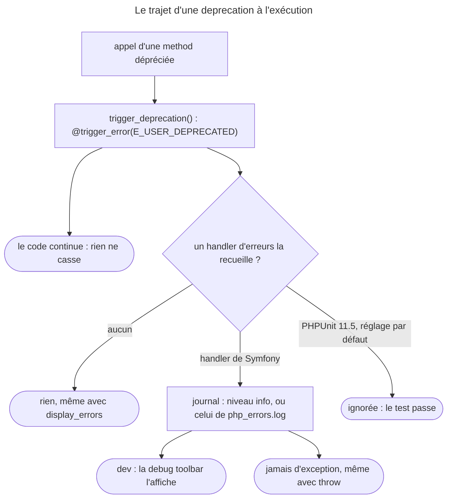

## Objectif

Savoir ce que devient, à l'exécution, du code qui appelle une fonctionnalité
dépréciée — et pourquoi rien ne casse.

## L'essentiel

Une deprecation Symfony est une notice `E_USER_DEPRECATED` **silencée** : rien
n'échoue, rien ne s'affiche. Elle n'existe que si un **handler d'erreurs** la
recueille — la debug toolbar en dev, le journal partout. On la corrige sur la
**dernière mineure**, avant que la majeure ne supprime le code.

Le PHPUnit Bridge est hors périmètre ; déclarer une deprecation relève de
*Deprecations best practices*.

## Le schéma



## L'exemple

```php
// dans acme/pkg 1.2
public function oldThing(): void
{
    trigger_deprecation('acme/pkg', '1.2', 'Old thing is deprecated.');
    // … le code continue et fonctionne
}

$service->oldThing();   // l'appel réussit, en silence
// journal, si le handler de Symfony est actif :
// [info] User Deprecated: Since acme/pkg 1.2: Old thing is deprecated.
```

## Rappel : reconnaître une deprecation

| Marqueur | Pour qui |
|---|---|
| l'annotation PHPDoc `@deprecated`, avec la version | le lecteur du code |
| l'appel `trigger_deprecation()` | le code qui tourne |

Une deprecation n'entre que dans une **mineure**, jamais sur du code
**nouveau** ; le code déprécié ne disparaît qu'à la **majeure** suivante.

## Une notice, et elle est silencée

`trigger_deprecation()` appelle `@trigger_error(…, \E_USER_DEPRECATED)`, avec
un message qui commence par `Since <paquet> <version>:`. Sur PHP 8.4,
`display_errors` actif :

| Situation | Ce qu'on voit |
|---|---|
| `trigger_deprecation()`, aucun handler | rien ; le script continue |
| `trigger_error(…, E_USER_DEPRECATED)` sans `@` | `Deprecated: …` dans l'output |
| handler d'erreurs de Symfony + journal | une entrée `info` : `User Deprecated: Since acme/pkg 1.2: …` |

Le handler de Symfony ne lève **jamais** d'exception pour une deprecation,
même réglé pour lever à tous les niveaux (`throwAt(E_ALL, true)`) : un
`E_USER_WARNING` devient une `ErrorException`, une deprecation reste en `info`.
L'option `framework.php_errors.throw`, active en dev, n'y change donc rien.

## Les voir

- **En dev** : la debug toolbar les montre, parce que le handler de Symfony
  les recueille.
- **Dans le journal** : `framework.php_errors.log` vaut `true`, et accepte une
  table qui associe un niveau de journal à chaque niveau d'erreur PHP.

```yaml
framework:
    php_errors:
        log:
            !php/const \E_USER_DEPRECATED: !php/const Psr\Log\LogLevel::ERROR
```

- **Dans les tests** : PHPUnit seul ne montre rien. Sur PHPUnit 11.5 :

| Configuration | Résultat |
|---|---|
| `failOnDeprecation="true"` seul | `OK`, exit code `0` |
| `<source ignoreSuppressionOfDeprecations="true">` | la deprecation est listée ; code `0` |
| les deux | la deprecation est listée ; exit code `1` |

## Les corriger

`composer update "symfony/*"`, lire le file `UPGRADE` de la version atteinte,
corriger **progressivement**. Pour une majeure : dernière mineure d'abord, zéro
deprecation, puis la majeure.

## Pièges d'examen

- **Une deprecation ne fait échouer ni la Request ni le test** par elle-même.
- **La notice est silencée** : rien dans l'output, et sans handler
  d'erreurs, aucune trace.
- **En dev, la debug toolbar les montre** — parce que le handler de
  Symfony les recueille, pas parce qu'elles s'affichent.
- **Le code déprécié fonctionne** jusqu'à la majeure suivante.
- **On corrige avant la majeure**, pas après.

## Application

- Une command appelle une method dépréciée et rien ne s'affiche → attendu : la
  chercher dans le journal, en `info`.
- L'équipe veut voir chaque deprecation dans ses alertes `error` → une table
  sous `framework.php_errors.log`.

## QCM d'entraînement

**Question 1.** Le handler d'erreurs de Symfony est actif, avec sa configuration
par défaut. À quel niveau de journal une deprecation est-elle inscrite ?

- **A.** `warning`
- **B.** `info`
- **C.** `error`
- **D.** `debug`

<details>
<summary>Correction</summary>

**Bonne réponse : B.** L'entrée se lit « User Deprecated: Since acme/pkg 1.2 » ;
A et C demandent une table dans `php_errors.log`.

</details>

**Question 2.** En dev, `framework.php_errors.throw` vaut `%kernel.debug%`, donc
`true`. Une deprecation devient-elle une `ErrorException` ?

- **A.** Oui, en dev seulement
- **B.** Oui, si elle est déclenchée sans `@`
- **C.** Non, jamais pour une deprecation
- **D.** Oui, mais seulement dans une command

<details>
<summary>Correction</summary>

**Bonne réponse : C.** Les niveaux de deprecation ne lèvent jamais, avec ou sans
`@` ; un `E_USER_WARNING`, lui, devient une `ErrorException`.

</details>

**Question 3.** Comment faire inscrire les deprecations au niveau `error` ?

- **A.** `framework.php_errors.throw: true`
- **B.** `error_reporting(E_ALL)` dans `public/index.php`
- **C.** `display_errors` activé en production
- **D.** Une table sous `framework.php_errors.log`

<details>
<summary>Correction</summary>

**Bonne réponse : D.** La table associe `E_USER_DEPRECATED` au niveau `error` ;
A n'a aucun effet sur une deprecation, B et C ne touchent pas au journal.

</details>

**Question 4.** Un test PHPUnit 11.5 appelle du code qui déclenche
`trigger_deprecation()`. La configuration ne contient que
`failOnDeprecation="true"`. Que donne la suite ?

- **A.** `OK` : la notice silencée est ignorée
- **B.** Un échec : `failOnDeprecation` l'exige
- **C.** Un avertissement, sans échec
- **D.** Une erreur fatale

<details>
<summary>Correction</summary>

**Bonne réponse : A.** PHPUnit n'en tient compte qu'avec
`ignoreSuppressionOfDeprecations` ; B serait le résultat avec ce second réglage.

</details>

## Fiche express

**Si tu dois retenir seulement 7 choses :**

- **`trigger_deprecation()`** = `@trigger_error(E_USER_DEPRECATED)`.
- **Silencée** : rien n'échoue, rien ne s'affiche.
- Message **`Since <paquet> <version>:`**.
- Handler de Symfony : **`info`**, **jamais d'exception**, même avec `throw`.
- **Debug toolbar** en dev ; **journal** partout.
- **PHPUnit** : ignorée par défaut, même avec `failOnDeprecation`.
- **Dernière mineure, zéro deprecation, puis majeure.**

Moyen mnémotechnique :
**« Silencée, journalisée, corrigée avant la majeure »**.

```text
deprecation = @E_USER_DEPRECATED ("Since pkg x.y:") → rien ne casse ; visible via un handler : journal info (php_errors.log), toolbar en dev,
jamais d'exception ; PHPUnit : rien par défaut ; dernière mineure → corriger → majeure
```

## Sources officielles

- [Upgrading a Minor Version](https://github.com/symfony/symfony-docs/blob/8.0/setup/upgrade_minor.rst)
- [Upgrading a Major Version](https://github.com/symfony/symfony-docs/blob/8.0/setup/upgrade_major.rst)
- [Framework configuration reference](https://github.com/symfony/symfony-docs/blob/8.0/reference/configuration/framework.rst)
- [Conventions — Deprecating Code](https://github.com/symfony/symfony-docs/blob/8.0/contributing/code/conventions.rst)
- [`trigger_deprecation()`, branche 8.0](https://github.com/symfony/symfony/blob/8.0/src/Symfony/Contracts/Deprecation/function.php)
- [`ErrorHandler`, branche 8.0](https://github.com/symfony/symfony/blob/8.0/src/Symfony/Component/ErrorHandler/ErrorHandler.php)

