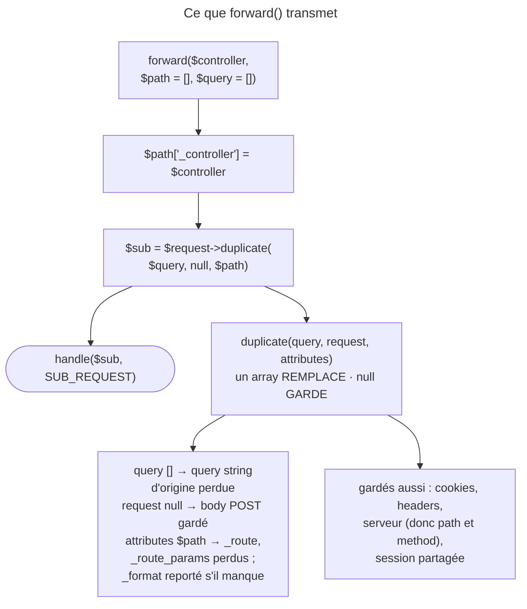

## Objectif

Distinguer un redirect interne d'un redirect HTTP, savoir ce que la
sub-Request garde et ce qu'elle perd, et connaître les effets de bord.

## L'essentiel

`forward()` n'est pas un redirect : le kernel exécute une **sub-Request** dans
le même cycle PHP et rend la Response du controller cible. Une seule Request
HTTP, l'URL ne bouge pas. Tout le reste se lit dans un appel à `duplicate()` :
les attributes sont **remplacés**, la query string est **perdue**, le body POST
et la session sont **gardés**.

## Le schéma



## L'exemple

```php
$response = $this->forward('App\Controller\OtherController::fancy', [
    'name'  => $name,
    'color' => 'green',
]);
```

## Ce que fait `forward()`

Le kernel appelle l'autre controller dans le même cycle PHP et rend la
`Response` que *ce* controller retourne. Le navigateur n'en sait rien, et la
Response peut encore être modifiée avant d'être retournée.

## Le contraste

| | `redirectToRoute()` | `forward()` |
|---|---|---|
| Response envoyée | une `RedirectResponse` 3xx | la Response du controller cible |
| URL affichée | change | **inchangée** |
| Requests HTTP | deux | une |
| Type de Request kernel | main Request | **sub-Request** |

Un redirect dit au client d'aller ailleurs ; un *forward* va chercher le
contenu sans le lui dire.

## Ce que la sub-Request garde et perd

Les trois premiers parameters de `duplicate()` sont la query string, le body
POST et les attributes ; `null` garde l'original, un array le remplace.

- **Perdus** : les attributes, remplacés par l'array `$path` — seul `_format`
  est reporté —, et la query string, dont le défaut est `[]`. Pour la
  transmettre : `forward($ctrl, [], $request->query->all())`.
- **Gardés** : le body POST, passé à `null` ; les cookies, headers et variables
  serveur ; la session, partagée avec la Request en cours.

## Les arguments passent par leur nom

L'array devient les attributes : il fournit les arguments de la cible comme
une route. `RequestAttributeValueResolver` cherche une key portant le **nom**
de l'argument ; l'ordre ne compte pas.

## L'effet de bord à connaître

Après un `forward()`, `app.current_route`, `app.current_route_parameters` et
`_route_params` sont **vides** dans le template de la cible. On les fournit en
ajoutant `_route` et `_route_params` à l'array passé.

## Pièges d'examen

**Un *forward* n'est pas un redirect.** Il n'y a qu'une Request HTTP,
l'URL affichée ne bouge pas, et c'est la Response du controller cible qui part au
navigateur. Aucun 3xx n'est émis.

**La query string d'origine n'arrive pas à la cible.** Le défaut du troisième
argument est un array vide, qui remplace ; il faut la transmettre
explicitement.

**Le body POST, lui, arrive.** L'asymétrie avec la query string vient de ce que
l'un est passé à `null` et l'autre à `[]`.

**Après un forward, la route courante est vide dans le template.** Les attributes
ont été remplacés ; `_route` n'est renseigné que si on le passe soi-même.

**Les arguments du controller cible s'apparient par nom**, comme pour une route.

## Application

- Afficher un widget rendu par un autre controller sans changer d'URL →
  `forward()`, puis retourner sa Response.
- La cible a besoin de `?page=3` → `forward($ctrl, [], $request->query->all())`.

## QCM d'entraînement

**Question 1.** Le form de `/checkout` poste le field `qty=2`, puis l'action
fait un `forward()`. Que lit la cible avec `$request->request->get('qty')` ?

- **A.** `null` : le body est perdu
- **B.** `2`
- **C.** Une exception : le body est déjà lu
- **D.** Une string vide

<details>
<summary>Correction</summary>

**Bonne réponse : B.** Le body POST est passé à `null` dans `duplicate()`,
donc conservé ; c'est la query string qui est remplacée par un array vide.

</details>

**Question 2.** La Request d'origine porte l'attribute `_format` à `json`, et
l'array passé à `forward()` ne le mentionne pas. Que lit la cible ?

- **A.** `null`
- **B.** `html`, la default value
- **C.** `json`
- **D.** Une exception

<details>
<summary>Correction</summary>

**Bonne réponse : C.** Les attributes sont remplacés par l'array passé, mais
`duplicate()` y reporte `_format` quand il manque, pour garder le format.

</details>

**Question 3.** La cible d'un `forward()` écrit une valeur en session ; le
controller appelant la relit juste après. La voit-il ?

- **A.** Oui : la session est partagée
- **B.** Non : la sub-Request a sa propre session
- **C.** Non : la session n'est écrite qu'en fin de Request
- **D.** Une exception : session déjà démarrée

<details>
<summary>Correction</summary>

**Bonne réponse : A.** Le clonage de la Request ne copie pas la session : la
sub-Request porte le même object, et l'écriture est visible tout de suite.

</details>

**Question 4.** Le form de `/checkout` est posté, et l'action fait un
`forward()`. Quelle method HTTP la cible voit-elle ?

- **A.** `GET` : une sub-Request repart à zéro
- **B.** `GET`, comme après un redirect
- **C.** `HEAD`
- **D.** `POST`

<details>
<summary>Correction</summary>

**Bonne réponse : D.** Les variables serveur sont conservées par
`duplicate()` : la method, comme le path, reste celle de la Request d'origine.

</details>

## Fiche express

**Si tu dois retenir seulement 6 choses :**

- `forward()` = **sub-Request** : une Request HTTP, URL **inchangée**, pas de 3xx.
- `duplicate()` : un array **remplace**, `null` **garde**.
- Attributes remplacés par l'array ; **`_format`** reporté.
- Query string **perdue** par défaut ; body POST, cookies, session **gardés**.
- Arguments de la cible : par **nom**, via `RequestAttributeValueResolver`.
- `app.current_route` vide, sauf à passer **`_route`**.

Moyen mnémotechnique : **« Forward ne dit rien au navigateur »**.

## Sources officielles

- [How to Forward Requests to another Controller](https://github.com/symfony/symfony-docs/blob/8.0/controller/forwarding.rst)
- [`AbstractController::forward()`](https://github.com/symfony/symfony/blob/8.0/src/Symfony/Bundle/FrameworkBundle/Controller/AbstractController.php)
- [`Request::duplicate()`](https://github.com/symfony/symfony/blob/8.0/src/Symfony/Component/HttpFoundation/Request.php)
- [`RequestAttributeValueResolver`](https://github.com/symfony/symfony/blob/8.0/src/Symfony/Component/HttpKernel/Controller/ArgumentResolver/RequestAttributeValueResolver.php)

