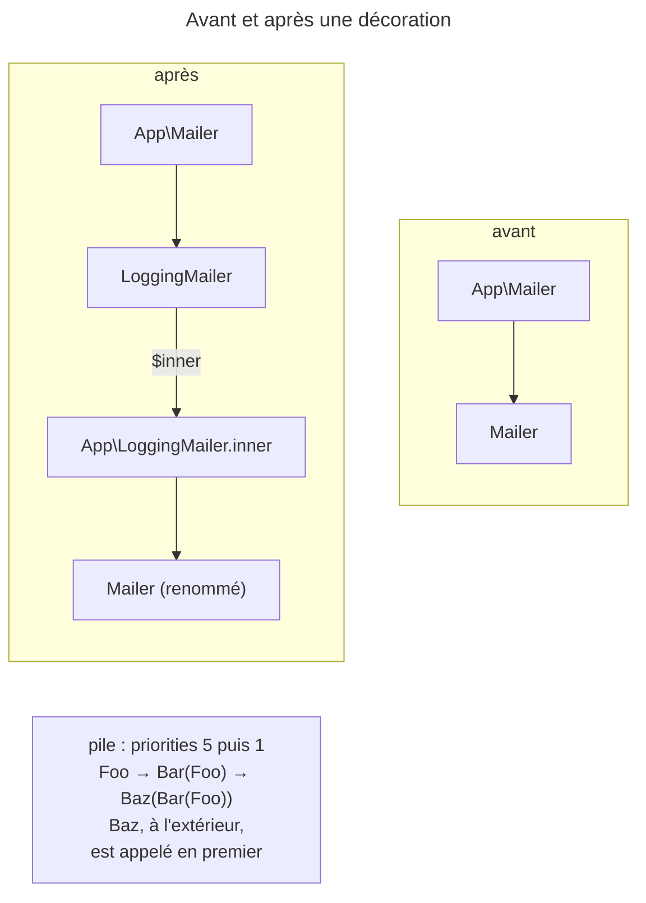

## Objectif

Envelopper un service existant sans le remplacer ni toucher à ses
consommateurs, atteindre l'original par `.inner`, empiler plusieurs decorators
dans le bon ordre et choisir le comportement quand la cible manque. *Quand*
décorer plutôt qu'employer un compiler pass relève de *Framework overloading*.

## L'essentiel

Un decorator **prend la place** d'un service sous **son identifier** : ses
consommateurs le reçoivent sans changer une ligne. L'original n'est pas
perdu : il devient `.inner`. Empilés, les decorators s'appliquent de la plus
haute priority à la plus basse — la plus basse finit **à l'extérieur**.

## Le schéma



## Le fil rouge : un `LoggingMailer`

```php
#[AsDecorator(decorates: Mailer::class)]
class LoggingMailer implements MailerInterface
{
    public function __construct(
        private MailerInterface $inner,     // l'original, câblé sur .inner
        private LoggerInterface $logger,
    ) {
    }

    public function send(Message $message): void
    {
        $this->logger->info('sending');
        $this->inner->send($message);
    }
}
```

## Le mécanisme : prendre la place, garder l'identifier

```yaml
services:
    App\Mailer\LoggingMailer:
        decorates: App\Mailer\Mailer
        arguments: ['@.inner']
```

- `#[AsDecorator]` : `decorates`, `priority` (0), `onInvalid` — en YAML
  `decorates`, `decoration_priority`, `decoration_on_invalid`.
- Le decorator implémente la **même interface** que la cible :

| Le consommateur est typé par… | Ce qu'il reçoit |
|---|---|
| l'interface `MailerInterface` | `Logging(Mailer)` |
| la **class** `Mailer` | `TypeError` : « must be of type App\Mailer, App\LoggingMailer given » |

Remplacer fait disparaître l'original ; décorer le garde, en délégation.

## `.inner` : l'original n'est pas perdu

Le service décoré est **renommé** `<id du decorator>.inner`. Le decorator le
reçoit :

- en autowiring, par un argument typé comme la cible — automatiquement ;
- par `#[AutowireDecorated]` sur l'argument ;
- par `'@.inner'` en configuration.

`decoration_inner_name` change ce nom.

## Empiler des decorators : l'ordre contre-intuitif

Une priority **plus haute** est appliquée **plus tôt**, donc au plus près de la
cible. Trois decorators de `Repo` — `Metrics` (10), `Cache` (5), `Log` (0) —
donnent `Log(Cache(Metrics(Repo)))` : le consommateur appelle `Log` d'abord.

À priority égale, **le premier déclaré est le plus interne**.

## Si la cible n'existe pas

| `decoration_on_invalid` | Résultat |
|---|---|
| `exception` (défaut) | `ServiceNotFoundException` : « …has a dependency on a non-existent service "nope" » |
| `ignore` | le decorator est **retiré** |
| `null` | `nope` existe et désigne le decorator, avec `null` pour original |

## Pièges d'examen

**L'original n'est pas supprimé** : il devient `<décorateur>.inner`.

**La priority la plus haute est la plus interne.** Elle est appliquée en
premier, donc enveloppe directement le service décoré ; c'est la plus basse qui
finit à l'extérieur.

**Le decorator prend l'identifier de la cible** ; rien ailleurs n'a besoin de
changer — à condition que les consommateurs typent l'interface.

**`ignore` retire le decorator**, il ne décore pas « à vide ».

**Un consommateur typé par la class décorée casse.** Il reçoit le decorator, qui
n'est pas de cette class : `TypeError`. Seul le typage par interface rend la
décoration invisible.

**À priority égale, le premier déclaré est le plus interne**, pas le dernier.

## Application

- Journaliser chaque envoi d'email sans toucher aux consommateurs → un
  decorator de `Mailer`, typé par l'interface.
- Un bundle décore un service optionnel → `onInvalid: ignore`, ou `null` avec
  un argument nullable.

## QCM d'entraînement

**Question 1.** Trois decorators visent `Repo` : `Metrics` (priority 10),
`Cache` (5) et `Log` (0). Lequel est appelé en premier quand un consommateur
utilise `Repo` ?

- **A.** `Metrics`, la plus haute priority
- **B.** `Repo`, l'original
- **C.** Celui déclaré en premier dans le file
- **D.** `Log`

<details>
<summary>Correction</summary>

**Bonne réponse : D.** Le consommateur reçoit l'object externe, `Log(…)`, qui
délègue à `Cache`, puis à `Metrics`, puis à `Repo`.

</details>

**Question 2.** `#[AsDecorator(decorates: 'payment.gateway')]` est posé sur une
class, et aucun service `payment.gateway` n'existe. Que se passe-t-il par
défaut ?

- **A.** La compilation échoue
- **B.** Le decorator est retiré en silence
- **C.** Le decorator est enregistré seul, avec `null` pour original
- **D.** Le decorator devient lui-même `payment.gateway`, sans original

<details>
<summary>Correction</summary>

**Bonne réponse : A.** Le défaut est `exception` : « non-existent service ». B
décrit `ignore`, C la valeur `null`.

</details>

**Question 3.** Deux decorators de priority 0, `First` puis `Second`, sont
déclarés dans cet ordre sur la même cible `Core`. Que produit le container ?

- **A.** `First(Second(Core))`
- **B.** Une erreur : deux decorators de même priority sont ambigus
- **C.** `Second(First(Core))`
- **D.** `First(Core)` seulement, le second étant ignoré

<details>
<summary>Correction</summary>

**Bonne réponse : C.** À priority égale, l'ordre de déclaration départage : le
premier déclaré est le plus interne.

</details>

**Question 4.** Un decorator de `nope`, absent, déclare
`decoration_on_invalid: null`. Que contient le container ?

- **A.** Une erreur de compilation, comme par défaut
- **B.** Un service `nope`, le decorator, sans original
- **C.** Rien : le decorator est retiré
- **D.** Un service `nope.inner` vide, et le decorator sous son propre id

<details>
<summary>Correction</summary>

**Bonne réponse : B.** Le decorator prend l'identifier visé et reçoit `null` :
il doit accepter un argument nullable et vérifier sa présence.

</details>

## Fiche express

**Si tu dois retenir seulement 6 choses :**

- Le decorator prend **l'identifier** de la cible ; les consommateurs ne
  changent pas.
- **Même interface** ; un consommateur typé par la class décorée casse.
- L'original devient **`.inner`** ; autowiring, `#[AutowireDecorated]` ou
  `'@.inner'`.
- **Priority haute = au plus près** de la cible ; la plus basse, à l'extérieur.
- Priority égale : **le premier déclaré** est le plus interne.
- Cible absente : `exception` (défaut), `ignore` (retiré), `null`.

Moyen mnémotechnique :
**« Haute priority, au cœur ; basse priority, à la porte »**.

## Sources officielles

- [How to Decorate Services](https://github.com/symfony/symfony-docs/blob/8.0/service_container/service_decoration.rst)
- [DependencyInjection 8.0, `Attribute\AsDecorator`](https://github.com/symfony/symfony/blob/8.0/src/Symfony/Component/DependencyInjection/Attribute/AsDecorator.php)
- [DependencyInjection 8.0, `Compiler\DecoratorServicePass`](https://github.com/symfony/symfony/blob/8.0/src/Symfony/Component/DependencyInjection/Compiler/DecoratorServicePass.php)

