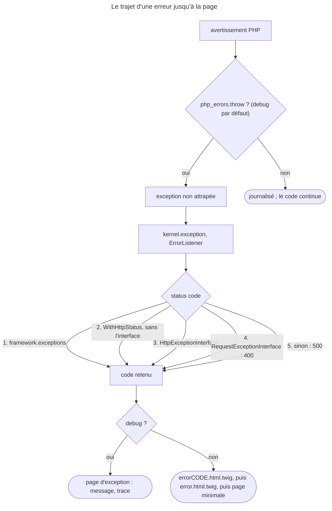

## Objectif

Savoir ce que Symfony fait d'une erreur, et à quel niveau intervenir selon ce
qu'on veut changer.

## Avant la règle : le problème à résoudre

Un produit introuvable doit donner une page 404 aux couleurs du site ; une API
doit répondre ses erreurs en JSON ; un avertissement PHP ne doit pas faire
tomber la production. Or le développeur voit, lui, une page pleine de traces.

Trois questions : **d'où vient le status code** d'une erreur, **pourquoi** la
page diffère entre `dev` et `prod`, et **à quel niveau** intervenir — template,
normalizer, controller d'erreur ou listener.

On suppose connus le cycle Request-Response et l'event `kernel.exception`.

## Le fil rouge : le produit introuvable

```php
#[Route('/product/{id}')]
public function show(int $id, ProductRepository $products): Response
{
    $product = $products->find($id)
        ?? throw $this->createNotFoundException('Produit absent'); // 404

    // throw new \RuntimeException('Produit absent');  // 500 : le message n'est pas lu
    return $this->render('product/show.html.twig', ['product' => $product]);
}
```

```text
templates/bundles/TwigBundle/Exception/
├── error404.html.twig   ← ce 404, en prod
└── error.html.twig      ← tous les autres codes
```

## Le cycle complet en un schéma



## Tout est une exception

Le principe de départ : **toutes les erreurs sont traitées comme des
exceptions**, qu'il s'agisse d'un 404 ou d'une erreur fatale levée dans le code.

Les erreurs PHP non fatales — un avertissement, une notice — ne sont converties
en `ErrorException` que si l'option `framework.php_errors.throw` est vraie. Sa
default value est `%kernel.debug%`. Exécuté sur une key d'array absente
(Symfony 8.0.15) :

| Mode | Résultat |
|---|---|
| debug | 500, `ErrorException` : *Warning: Undefined array key* |
| sans debug | 200 : l'avertissement est journalisé, le code continue |

Rejoué pour cette page par un vrai front controller, sous le component Runtime :
500 *Warning: Undefined array key "nope"* en debug, 200 sans. C'est le Runtime
qui installe le handler d'erreurs de Symfony ; dans un `WebTestCase`, qui n'en
installe aucun, la même Request a rendu 200 dans les deux modes.

De là découle un mécanisme unique, et donc un seul endroit à comprendre.

## Deux affichages, selon l'environment

| Environment | Ce que voit le user |
|---|---|
| `dev` | la **page d'exception** : message, trace complète, journaux |
| `prod` | une **page d'erreur** minimale et générique |

La page de développement contient des informations internes sensibles ; elle
n'est jamais affichée en production. Ce n'est pas un réglage à activer, c'est le
comportement par défaut.

Conséquence pratique : en développement, on ne voit pas sa propre page d'erreur
personnalisée. Pour la prévisualiser, FrameworkBundle fournit des routes
chargées sous `when@dev`, préfixées par `/_error`.

Rejoué en debug, ces routes importées sous `/_error` : `/_error/404` rend le
template `error404.html.twig` avec un statut 404 ; `/_error/404.json` rend du
JSON (`application/json`) ; `/_error/503` rend `error.html.twig`. Lu dans la
route 8.0 : `/{code}.{_format}`, format `html` par défaut.

## Le status code

La documentation 8.0 (*How to Customize Error Pages*) n'en donne qu'une source :
implémenter **`HttpExceptionInterface`**, dont `getStatusCode()` fournit le code ;
sinon **500**. Le code de la branche 8.0 en connaît davantage — `ErrorListener`
et `FlattenException`. Exécuté, une exception levée par controller, avec et sans
debug :

| Exception levée | Statut |
|---|---|
| `RuntimeException` ordinaire | **500** |
| class marquée `#[WithHttpStatus(404)]` | 404 |
| `BadRequestException` de HttpFoundation (`RequestExceptionInterface`) | 400 |
| class déclarée sous `framework.exceptions` avec `status_code: 418` | 418 |
| `NotFoundHttpException` d'une route absente (`HttpExceptionInterface`) | 404 |

L'ordre, lu dans `ErrorListener` : la configuration `framework.exceptions`
d'abord — elle s'impose même à une `HttpExceptionInterface` ; puis l'attribute
`#[WithHttpStatus]`, ignoré si l'exception implémente déjà l'interface ; puis
`getStatusCode()` ; puis 400 pour une `RequestExceptionInterface` ; sinon 500.

La règle à retenir reste celle-ci : une exception métier ordinaire — une
`RuntimeException` — produit un 500, même si le développeur pensait à un 404.
**Le message n'est jamais lu.** Les raccourcis du controller, comme
`createNotFoundException()`, existent pour lever une exception qui porte le bon
statut.

Lu dans `AbstractController` (8.0) : `createNotFoundException()` rend une
`NotFoundHttpException` — message par défaut `Not Found` — qu'il faut **lever**
avec `throw` ; `createAccessDeniedException()` rend une `AccessDeniedException`
et exige le component Security.

## Quatre niveaux d'intervention

La documentation les ordonne du plus léger au plus complet :

| Besoin | Intervention |
|---|---|
| changer l'apparence de la page | **surcharger les templates** d'erreur |
| changer un output non-HTML (JSON, XML) | écrire un **normalizer** |
| changer la logique de génération | **surcharger le controller d'erreur** |
| maîtriser entièrement le traitement | écouter **`kernel.exception`** |

Le principe : prendre le niveau le plus bas qui suffit. Écouter
`kernel.exception` pour changer une couleur est une réaction disproportionnée.

Le controller d'erreur se remplace par une option, lue dans la documentation
8.0 : `framework.error_controller: App\Controller\ErrorController::show`.

## Surcharger un template

Le rendu passe par `TwigErrorRenderer`, qui choisit le file en deux temps :

1. un template pour ce code précis — `error404.html.twig` ;
2. sinon, le template générique — `error.html.twig`.

Sans aucun des deux, la page minimale par défaut s'affiche. En mode debug, les
templates sont ignorés : c'est la page d'exception. Exécuté sans debug, avec les
deux files présents : un 404 rend `error404.html.twig`, un 500, un 400 et un
418 rendent `error.html.twig`.

Ils se placent dans `templates/bundles/TwigBundle/Exception/`. Le template
reçoit `status_code` et `status_text`. La variable
`exception` est disponible : `{{ exception.message }}`, et
`{{ exception.traceAsString }}` — que l'on ne montre jamais à un user
final, la trace contenant des données sensibles.

Lu dans `TwigErrorRenderer::render()` (8.0) : `exception` est une
`FlattenException`, et les trois variables sont passées ensemble au template.

## Un piège d'ordre

**La security n'est pas disponible sur une page 404.** L'ordre de chargement du
routage et de la security fait que le user y apparaît déconnecté. Le
symptôme est déroutant : cela fonctionne en test et échoue en production.

## Concrètement dans ton application

- Un objet introuvable : `throw $this->createNotFoundException()`, jamais une
  `RuntimeException`.
- Une exception métier qui doit dire 409 : `#[WithHttpStatus(409)]`, ou
  `framework.exceptions` si la class n'est pas à toi.
- Une page 404 aux couleurs du site : `error404.html.twig` ; le reste :
  `error.html.twig`.
- La voir en dev : `/_error/404` ; en JSON : `/_error/404.json`.
- Des erreurs d'API en JSON sur mesure : un normalizer.
- Pas de `app.user` dans une page 404 : ne pas y afficher le compte.

## À comprendre

- **Pourquoi tout passer par des exceptions ?** Un seul chemin — `kernel.exception`,
  puis le rendu — traite tous les cas, du 404 à l'erreur fatale.
- **Pourquoi le message n'est-il jamais lu ?** Un message est du texte pour un
  humain ; le statut doit venir d'un contrat explicite : interface, attribute,
  configuration.
- **Pourquoi la page de dev n'apparaît-elle jamais en prod ?** Elle expose la
  trace, les chemins et les journaux : c'est le debug, et non un réglage, qui
  l'active.

## À mémoriser

- **Avertissement PHP** → `ErrorException` seulement si **`php_errors.throw`**
  (`%kernel.debug%`).
- Statut : **`framework.exceptions`** > **`#[WithHttpStatus]`** (sans
  l'interface) > **`getStatusCode()`** > **400** (`RequestExceptionInterface`)
  > **500**.
- **Le message n'est jamais lu.**
- **`dev`** : page d'exception ; **`prod`** : page d'erreur.
- **`error<code>.html.twig`**, puis **`error.html.twig`**, dans
  `templates/bundles/TwigBundle/Exception/`.
- Prévisualiser : **`/_error/{code}`**, **`/_error/{code}.{format}`**.
- **Template → normalizer → controller d'erreur → `kernel.exception`.**
- Moyen mnémotechnique : **« Configuré, attribué, interfacé, sinon 500 »**.

## Pièges d'examen

**Une exception ordinaire donne 500**, quel que soit son message. Ce qui change
le statut : l'interface, l'attribute `#[WithHttpStatus]`, la configuration
`framework.exceptions`, ou une `RequestExceptionInterface` (400).

**Un avertissement PHP n'est une exception qu'en debug**, par défaut.

**La page d'exception détaillée n'existe qu'en `dev`.**

**Sa propre page d'erreur ne s'affiche pas en `dev`** : il faut les routes
`/_error`.

**`error<code>.html.twig` d'abord, `error.html.twig` ensuite.**

**Pas d'information de sécurité sur une 404.**

## Application : trois scénarios

**Scénario 1 — Le faux 404.** Un controller lève
`new \RuntimeException('Product not found')` ; les robots d'indexation voient
des 500. *Solution.* `throw $this->createNotFoundException()`, ou une exception
marquée `#[WithHttpStatus(404)]`.

**Scénario 2 — La page invisible.** Le développeur a écrit `error404.html.twig`
et voit toujours la page d'exception en local. *Solution.* C'est le debug :
ouvrir `/_error/404` pour la prévisualiser.

**Scénario 3 — L'exception d'une bibliothèque.** Une bibliothèque lève
`QuotaExceededException`, qui donne 500 ; il faudrait 429, sans toucher à la
class. *Solution.* `framework.exceptions`, avec `status_code: 429` pour cette
class.

## QCM d'entraînement

Cinq questions sur le traitement des erreurs. Choisis avant d'ouvrir la
correction.

**Question 1.** Un controller écrit `$this->createNotFoundException('Absent');`
sans `throw`, puis rend une page normale. Quel statut reçoit le client ?

- **A.** 404 : l'exception est enregistrée
- **B.** 500 : l'exception est créée sans être gérée
- **C.** 200 : rien n'a été levé
- **D.** 410 : la ressource est déclarée absente

<details>
<summary>Correction</summary>

**Bonne réponse : C.** Lu dans `AbstractController` : la method **rend** une
`NotFoundHttpException` ; seule une exception levée change le statut.

A et B supposent que la créer suffit. D est faux.

</details>

**Question 2.** En `dev`, comment voir sa page d'erreur 404 au format JSON ?

- **A.** `/_error/404?format=json`
- **B.** `/_profiler/404.json`
- **C.** Passer `APP_DEBUG` à `0`, puis `/404.json`
- **D.** `/_error/404.json`

<details>
<summary>Correction</summary>

**Bonne réponse : D.** Rejoué : `application/json`, statut 404. La route est
`/{code}.{_format}`, sous le préfixe `/_error`.

A n'est pas lu par la route. B et C sont faux.

</details>

**Question 3.** Quelles variables `TwigErrorRenderer` passe-t-il à
`error.html.twig` ?

- **A.** `status_code`, `status_text`, `exception`
- **B.** `code` et `message` seulement
- **C.** `exception` seulement, avec sa trace complète
- **D.** `request`, `response` et `exception`

<details>
<summary>Correction</summary>

**Bonne réponse : A.** Lu dans `TwigErrorRenderer::render()` (8.0) ;
`exception` est une `FlattenException`.

B, C et D sont faux.

</details>

**Question 4.** Quelle option remplace le controller qui génère les pages
d'erreur ?

- **A.** `twig.exception_controller`
- **B.** `framework.error_controller`
- **C.** `framework.exceptions.controller`
- **D.** `framework.php_errors.log`

<details>
<summary>Correction</summary>

**Bonne réponse : B.** La documentation 8.0 :
`error_controller: App\Controller\ErrorController::show`.

C n'existe pas : `framework.exceptions` associe un statut à une class
d'exception. D règle le journal des erreurs PHP. A est faux.

</details>

**Question 5.** Une bibliothèque lève `QuotaExceededException`, qui ne porte ni
interface ni attribute. Comment obtenir 429 sans modifier la class ?

- **A.** Lever l'exception avec le message « HTTP 429 Too Many Requests »
- **B.** Créer `error429.html.twig`
- **C.** `framework.exceptions` avec `status_code: 429`
- **D.** `#[WithHttpStatus(429)]` sur le controller

<details>
<summary>Correction</summary>

**Bonne réponse : C.** Exécuté sur le même schéma avec 418 : la configuration
fixe le statut d'une class sans y toucher.

A : le message n'est jamais lu. B choisit un template, pas le statut. D :
l'attribute se pose sur la class d'exception.

</details>

## Fiche express

**Si tu dois retenir seulement 7 choses :**

- Toute erreur devient une **exception** ; un avertissement, **en debug**.
- **Statut** : configuration > attribute > interface > 400 > **500**.
- **Le message n'est jamais lu.**
- **`dev`** : page d'exception ; **`prod`** : page d'erreur.
- **`error404.html.twig`** puis **`error.html.twig`**.
- **`/_error/{code}`** pour prévisualiser, **`.json`** pour un autre format.
- **Template < normalizer < controller d'erreur < `kernel.exception`.**

**En une phrase, pour tout reconstruire :**

```text
erreur → exception (warning : php_errors.throw = debug) → kernel.exception → statut : config > attribute > interface > 400 > 500 ;
debug : page d'exception ; prod : errorCODE puis error.html.twig ; /_error/{code}.{format} ; template < normalizer < controller < listener
```

## Sources officielles

- [How to Customize Error Pages](https://github.com/symfony/symfony-docs/blob/8.0/controller/error_pages.rst)
- [Framework configuration reference](https://github.com/symfony/symfony-docs/blob/8.0/reference/configuration/framework.rst)
- [`ErrorListener`, branche 8.0](https://github.com/symfony/symfony/blob/8.0/src/Symfony/Component/HttpKernel/EventListener/ErrorListener.php)
- [`FlattenException`, branche 8.0](https://github.com/symfony/symfony/blob/8.0/src/Symfony/Component/ErrorHandler/Exception/FlattenException.php)
- [`TwigErrorRenderer`, branche 8.0](https://github.com/symfony/symfony/blob/8.0/src/Symfony/Bridge/Twig/ErrorRenderer/TwigErrorRenderer.php)
- [Routes d'aperçu des erreurs, branche 8.0](https://github.com/symfony/symfony/blob/8.0/src/Symfony/Bundle/FrameworkBundle/Resources/config/routing/errors.php)
