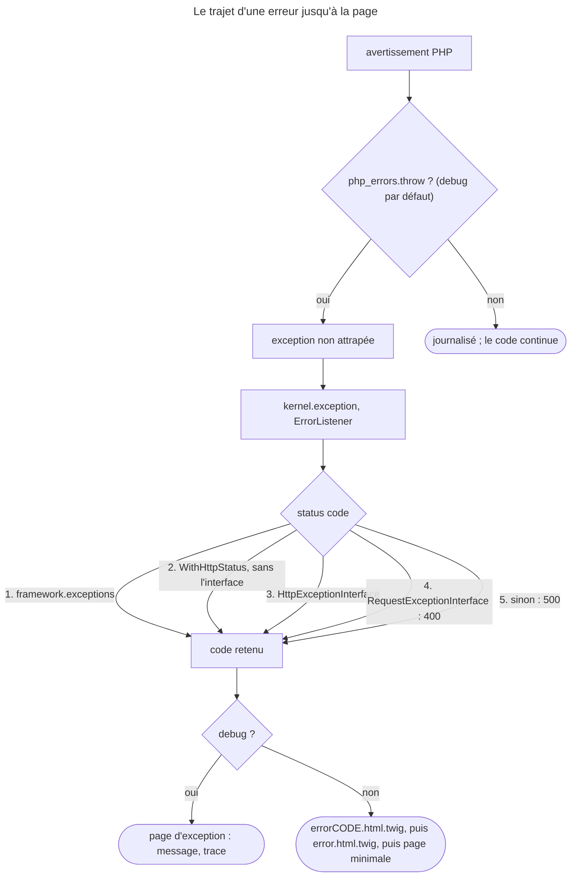

## Objectif

Savoir ce que Symfony fait d'une erreur, et à quel niveau intervenir selon ce
qu'on veut changer.

## L'essentiel

Toute erreur devient une **exception**, et une seule mécanique la traite. Son
**status code** vient de la configuration, d'un attribute ou d'une interface —
sinon **500**, quel que soit le message. En `dev`, on voit la page
d'exception ; en `prod`, une page d'erreur qu'on personnalise au niveau le plus
bas qui suffit.

## Le schéma



## L'exemple

```php
#[Route('/product/{id}')]
public function show(int $id, ProductRepository $products): Response
{
    $product = $products->find($id)
        ?? throw $this->createNotFoundException('Produit absent'); // 404
    // throw new \RuntimeException('Produit absent');  // 500 : le message n'est pas lu

    return $this->render('product/show.html.twig', ['product' => $product]);
}
```

## Tout est une exception

Un 404 comme une erreur fatale passe par la même mécanique. Une erreur PHP non
fatale — un avertissement — ne devient une `ErrorException` que si
`framework.php_errors.throw` est vraie, et sa default value est
`%kernel.debug%` :

| Mode | Key d'array absente |
|---|---|
| debug | 500, `ErrorException` : *Warning: Undefined array key* |
| sans debug | 200 : l'avertissement est journalisé, le code continue |

## Deux affichages, selon l'environment

| Environment | Ce que voit le user |
|---|---|
| `dev` | la **page d'exception** : message, trace, journaux |
| `prod` | une **page d'erreur** minimale |

En `dev`, on ne voit donc pas sa propre page d'erreur : les routes `/_error`,
chargées sous `when@dev`, la prévisualisent — `/_error/404`,
`/_error/404.json` (route `/{code}.{_format}`).

## Le status code

L'ordre, lu dans `ErrorListener` :

| Source | Exemple | Statut |
|---|---|---|
| `framework.exceptions`, pour une class | `status_code: 418` | 418 — s'impose même à l'interface |
| `#[WithHttpStatus]` sur la class | `#[WithHttpStatus(404)]` | 404 — ignoré si l'interface est implémentée |
| `HttpExceptionInterface::getStatusCode()` | `NotFoundHttpException` | 404 |
| `RequestExceptionInterface` | `BadRequestException` | 400 |
| rien de tout cela | `RuntimeException` | **500** |

**Le message n'est jamais lu.** `createNotFoundException()`, dans
`AbstractController`, **rend** une `NotFoundHttpException` — qu'il faut lever
avec `throw`.

## Quatre niveaux d'intervention

| Besoin | Intervention |
|---|---|
| changer l'apparence de la page | **surcharger les templates** d'erreur |
| changer un output non-HTML (JSON, XML) | un **normalizer** de `FlattenException` |
| changer la logique de génération | **surcharger le controller d'erreur** : `framework.error_controller` |
| maîtriser entièrement le traitement | écouter **`kernel.exception`** |

Prendre le niveau le plus bas qui suffit.

## Surcharger un template

- Dans `templates/bundles/TwigBundle/Exception/` : `error404.html.twig` pour ce
  code, sinon `error.html.twig`, sinon la page minimale par défaut.
- En debug, les templates sont ignorés : c'est la page d'exception.
- `TwigErrorRenderer` passe `status_code`, `status_text` et `exception`, une
  `FlattenException` — dont on ne montre jamais la trace à un user.
- La security n'est pas disponible sur une page 404 : le user y apparaît
  déconnecté.

## Pièges d'examen

**Une exception ordinaire donne 500**, quel que soit son message. Ce qui change
le statut : l'interface, l'attribute `#[WithHttpStatus]`, la configuration
`framework.exceptions`, ou une `RequestExceptionInterface` (400).

**Un avertissement PHP n'est une exception qu'en debug**, par défaut.

**La page d'exception détaillée n'existe qu'en `dev`.**

**Sa propre page d'erreur ne s'affiche pas en `dev`** : il faut les routes
`/_error`.

**`error<code>.html.twig` d'abord, `error.html.twig` ensuite.**

**Pas d'information de sécurité sur une 404.**

## Application

- Un controller lève `new \RuntimeException('Product not found')` et les
  robots voient des 500 → `throw $this->createNotFoundException()`.
- Une bibliothèque lève `QuotaExceededException` (500) ; il faudrait 429 sans
  toucher la class → `framework.exceptions`, `status_code: 429`.

## QCM d'entraînement

**Question 1.** Un controller écrit `$this->createNotFoundException('Absent');`
sans `throw`, puis rend une page normale. Quel statut reçoit le client ?

- **A.** 404 : l'exception est enregistrée
- **B.** 500 : l'exception est créée sans être gérée
- **C.** 200 : rien n'a été levé
- **D.** 410 : la ressource est déclarée absente

<details>
<summary>Correction</summary>

**Bonne réponse : C.** La method rend l'exception sans la lever ; seule une
exception levée change le statut de la Response.

</details>

**Question 2.** En `dev`, comment voir sa page d'erreur 404 au format JSON ?

- **A.** `/_error/404?format=json`
- **B.** `/_profiler/404.json`
- **C.** Passer `APP_DEBUG` à `0`, puis `/404.json`
- **D.** `/_error/404.json`

<details>
<summary>Correction</summary>

**Bonne réponse : D.** La route de prévisualisation est `/{code}.{_format}`,
sous le préfixe `/_error` ; un parameter de query string n'est pas lu.

</details>

**Question 3.** Quelles variables `TwigErrorRenderer` passe-t-il à
`error.html.twig` ?

- **A.** `status_code`, `status_text`, `exception`
- **B.** `code` et `message` seulement
- **C.** `exception` seulement, avec sa trace complète
- **D.** `request`, `response` et `exception`

<details>
<summary>Correction</summary>

**Bonne réponse : A.** Les trois sont passées ensemble, et `exception` est une
`FlattenException`, pas l'exception d'origine.

</details>

**Question 4.** Quelle option remplace le controller qui génère les pages
d'erreur ?

- **A.** `twig.exception_controller`
- **B.** `framework.error_controller`
- **C.** `framework.exceptions.controller`
- **D.** `framework.php_errors.log`

<details>
<summary>Correction</summary>

**Bonne réponse : B.** `framework.exceptions` associe un statut à une class
d'exception, et `php_errors.log` règle le journal des erreurs PHP.

</details>

## Fiche express

**Si tu dois retenir seulement 7 choses :**

- Toute erreur devient une **exception** ; un avertissement, **en debug**.
- **Statut** : configuration > attribute > interface > 400 > **500**.
- **Le message n'est jamais lu.**
- **`dev`** : page d'exception ; **`prod`** : page d'erreur.
- **`error404.html.twig`** puis **`error.html.twig`**.
- **`/_error/{code}`** pour prévisualiser, **`.json`** pour un autre format.
- **Template < normalizer < controller d'erreur < `kernel.exception`.**

Moyen mnémotechnique :
**« Configuré, attribué, interfacé, sinon 500 »**.

```text
erreur → exception (warning : php_errors.throw = debug) → kernel.exception → statut : config > attribute > interface > 400 > 500 ;
debug : page d'exception ; prod : errorCODE puis error.html.twig ; /_error/{code}.{format} ; template < normalizer < controller < listener
```

## Sources officielles

- [How to Customize Error Pages](https://github.com/symfony/symfony-docs/blob/8.0/controller/error_pages.rst)
- [Framework configuration reference](https://github.com/symfony/symfony-docs/blob/8.0/reference/configuration/framework.rst)
- [`ErrorListener`, branche 8.0](https://github.com/symfony/symfony/blob/8.0/src/Symfony/Component/HttpKernel/EventListener/ErrorListener.php)
- [`FlattenException`, branche 8.0](https://github.com/symfony/symfony/blob/8.0/src/Symfony/Component/ErrorHandler/Exception/FlattenException.php)
- [`TwigErrorRenderer`, branche 8.0](https://github.com/symfony/symfony/blob/8.0/src/Symfony/Bridge/Twig/ErrorRenderer/TwigErrorRenderer.php)
- [Routes d'aperçu des erreurs, branche 8.0](https://github.com/symfony/symfony/blob/8.0/src/Symfony/Bundle/FrameworkBundle/Resources/config/routing/errors.php)

