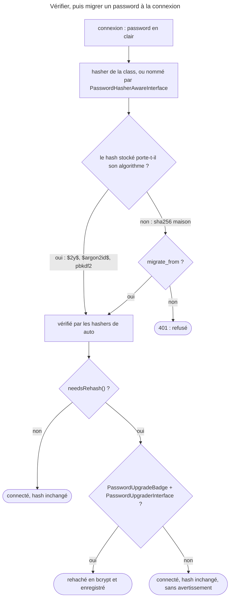

## Objectif

Hacher et vérifier un password, savoir quels anciens hashes restent
lisibles après un changement d'algorithme, et faire migrer ceux qui ne le sont
pas sans demander aux users de changer de password.

## L'essentiel

On hache un password avec un hasher choisi **par class de user**. `auto`
hache en bcrypt et sait encore lire les hashes qui portent leur algorithme.
Pour un ancien format qui ne le porte pas, `migrate_from` relit l'ancien hash
et le rehache à la connexion, sans que le user ne voie rien.

## Le schéma



## L'exemple

```yaml
security:
    password_hashers:
        legacy:                          # l'ancien format, pour vérifier
            algorithm: sha256
            encode_as_base64: false
            iterations: 1
        App\Entity\User:
            algorithm: auto              # bcrypt pour hacher
            migrate_from: [legacy]       # relit les anciens hashes
```

## Hacher

```php
$user->setPassword($hasher->hashPassword($user, $plainPassword));
```

- `hashPassword()` prend **le user**, parce que l'algorithme dépend de sa
  class ; l'interface a aussi `isPasswordValid()` et `needsRehash()`.
- Un hasher déclaré sur `PasswordAuthenticatedUserInterface` couvre toutes les
  classes qui l'implémentent.
- Un user qui implémente `PasswordHasherAwareInterface` choisit son hasher par
  `getPasswordHasherName()`.
- Aucun hasher pour la class : `RuntimeException` « No password hasher has been
  configured for account … ».
- Un controller ne vérifie pas le password lui-même : le badge
  `PasswordCredentials` de l'authenticator s'en charge.

## `auto` hache en bcrypt

`auto` choisit « the best available hasher (currently Bcrypt) ». Il construit
une suite — `native` (bcrypt, coût 13), puis `sodium` s'il est disponible,
puis `pbkdf2` — dont le premier maillon **hache** et les suivants ne servent
qu'à **vérifier**.

- Un hash argon2id existant est accepté, et `needsRehash()` vaut `true`.
- Un bcrypt d'un autre coût est accepté, et `needsRehash()` vaut `true`.
- En test, on abaisse le coût : `cost: 4`, la valeur minimale de bcrypt.

## Quels anciens hashes restent lisibles

Un hash bcrypt ou argon2 **porte son algorithme** (`$2y$…`, `$argon2id$…`) :
`auto` le relit. Un condensat `sha256` maison n'est qu'une suite hexadécimale :
sans `migrate_from`, il n'est plus vérifié, et la connexion est refusée.

## Migrer

`migrate_from` nomme les anciens hashers. À la connexion, le password est
vérifié par l'ancien, puis `PasswordMigratingListener` le rehache. Il faut :

- un `PasswordUpgradeBadge` sur le passport — `form_login`, `json_login` et
  `http_basic` l'ajoutent ;
- un `PasswordUpgraderInterface` pour enregistrer le nouveau hash, en pratique
  le provider, dont `upgradePassword()` reçoit un `$2y$13$…`.

Sans `PasswordUpgraderInterface`, la connexion réussit mais le hash reste
**inchangé**, et rien ne le signale.

## Pièges d'examen

**`hashPassword()` reçoit le user**, pas seulement le password.

**`auto` hache en bcrypt**, même quand sodium est disponible.

**Changer d'algorithme peut casser** : un condensat qui ne porte pas son
algorithme n'est plus vérifié sans `migrate_from`.

**La migration exige un `PasswordUpgraderInterface`**, sinon le réencodage n'est
jamais sauvegardé — et rien ne le signale.

## Application

- Après le passage à `auto`, les anciens comptes `sha256` ne se connectent
  plus → déclarer l'ancien hasher et `migrate_from`.
- Les comptes migrés gardent leur condensat `sha256` → le provider n'implémente
  pas `PasswordUpgraderInterface`.

## QCM d'entraînement

**Question 1.** La configuration retire `cost: 10` pour revenir au coût par
défaut. Un hash `$2y$10$…` est vérifié par `auto`. Que rendent `verify()` et
`needsRehash()` ?

- **A.** `false`, puis `true`
- **B.** `true`, puis `false`
- **C.** `true`, puis `true`
- **D.** `false`, puis `false`

<details>
<summary>Correction</summary>

**Bonne réponse : C.** Le hash bcrypt reste lisible, mais son coût n'est plus
celui configuré : il est accepté et doit être rehaché.

</details>

**Question 2.** Aucun hasher n'est configuré pour la class `App\Entity\User`.
Que fait `hashPassword()` ?

- **A.** Il hache en bcrypt, l'algorithme par défaut
- **B.** Il rend le password en clair
- **C.** Il rend `null`
- **D.** Il lève une `RuntimeException`

<details>
<summary>Correction</summary>

**Bonne réponse : D.** « No password hasher has been configured for account … » :
aucun algorithme n'est choisi à la place de la configuration.

</details>

**Question 3.** Comment une class user choisit-elle, pour chacun de ses
objects, le hasher à utiliser ?

- **A.** En implémentant `PasswordHasherAwareInterface`
- **B.** En ajoutant `#[PasswordHasher('admin')]` sur la class
- **C.** Par un role `ROLE_HASHER_ADMIN`
- **D.** En rendant le nom depuis `getPassword()`

<details>
<summary>Correction</summary>

**Bonne réponse : A.** `getPasswordHasherName()` rend le nom d'un hasher
déclaré ; les autres mécanismes n'existent pas.

</details>

**Question 4.** `migrate_from: [legacy]` est configuré et le provider
implémente `PasswordUpgraderInterface`. Un user `legacy` se connecte. Que reçoit
`upgradePassword()` ?

- **A.** Le password en clair
- **B.** L'ancien condensat `sha256`
- **C.** Un nouveau hash `$2y$13$…`
- **D.** Rien : la method n'est appelée qu'à l'inscription

<details>
<summary>Correction</summary>

**Bonne réponse : C.** Le password vérifié par `legacy` est rehaché par le
nouvel algorithme, et le provider reçoit ce hash bcrypt à persister.

</details>

## Fiche express

**Si tu dois retenir seulement 7 choses :**

- **`hashPassword($user, $plain)`** : le user, car l'algorithme dépend de sa
  class.
- **`auto`** hache en **bcrypt** (coût 13) et vérifie argon2, pbkdf2.
- **`needsRehash()`** vrai pour un autre algorithme ou un autre coût.
- Un hash qui porte son algorithme reste lisible ; un **`sha256`** maison non.
- **`migrate_from`** + **`PasswordUpgradeBadge`** + **`PasswordUpgraderInterface`**.
- Pas d'upgrader : migration **silencieusement** perdue.
- En test : **`cost: 4`**.

Moyen mnémotechnique : **« Hacher en bcrypt, lire l'ancien, rehacher en
silence »**.

```text
hashPassword(user) ; auto = bcrypt (+ vérifie sodium/pbkdf2) ; needsRehash si algo/coût changent ;
sha256 maison = migrate_from ; rehachage = PasswordUpgradeBadge + PasswordUpgraderInterface
```

## Sources officielles

- [Hashing and Verifying Passwords](https://github.com/symfony/symfony-docs/blob/8.0/security/passwords.rst)
- [PasswordHasher 8.0, `PasswordHasherFactory`](https://github.com/symfony/symfony/blob/8.0/src/Symfony/Component/PasswordHasher/Hasher/PasswordHasherFactory.php)
- [PasswordHasher 8.0, `NativePasswordHasher`](https://github.com/symfony/symfony/blob/8.0/src/Symfony/Component/PasswordHasher/Hasher/NativePasswordHasher.php)
- [PasswordHasher 8.0, `PasswordHasherAwareInterface`](https://github.com/symfony/symfony/blob/8.0/src/Symfony/Component/PasswordHasher/Hasher/PasswordHasherAwareInterface.php)
- [Security HTTP 8.0, `PasswordMigratingListener`](https://github.com/symfony/symfony/blob/8.0/src/Symfony/Component/Security/Http/EventListener/PasswordMigratingListener.php)

