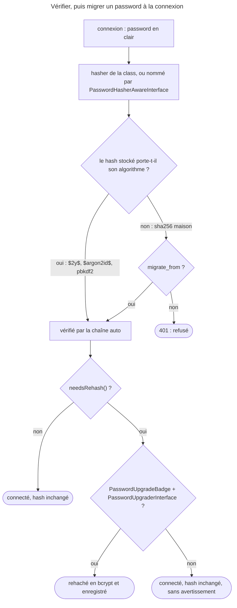

## Objectif

Hacher et vérifier un password, savoir quels anciens hashes restent
lisibles après un changement d'algorithme, et faire migrer ceux qui ne le sont
pas sans demander aux users de changer de password.

## Avant la règle : le problème à résoudre

Une application reprend une base d'utilisateurs dont les passwords sont des
condensats `sha256` maison. Elle doit hacher les nouveaux comptes avec un
algorithme moderne, continuer à accepter les anciens, et les convertir au fil
des connexions — sans que personne ne change de password.

Trois questions : **comment hacher** et ce que fait `auto`, **quels anciens
hashes** restent lisibles, et **comment migrer** les autres.

On suppose connus les users, les providers et les authenticators.

## Le fil rouge : migrer une base `sha256`

```yaml
security:
    password_hashers:
        legacy:                          # l'ancien format, pour vérifier
            algorithm: sha256
            encode_as_base64: false
            iterations: 1
        App\Entity\User:
            algorithm: auto              # bcrypt pour hacher
            migrate_from: [legacy]       # relit les anciens hashes
```

```php
// le provider enregistre le nouveau hash à la connexion
final class UserProvider implements UserProviderInterface, PasswordUpgraderInterface
{
    public function upgradePassword(PasswordAuthenticatedUserInterface $user, string $newHashedPassword): void
    {
        // … persister $newHashedPassword
    }
}
```

## Le cycle complet en un schéma



## Hacher

```php
public function register(UserPasswordHasherInterface $hasher): Response
{
    $user->setPassword($hasher->hashPassword($user, $plainPassword));
}
```

`hashPassword()` prend **le user** et non seulement la string, parce que
la configuration peut associer un algorithme différent à chaque class
de user. L'interface a deux autres methods, `isPasswordValid()` et
`needsRehash()`, sur le même modèle.

Un controller ne vérifie normalement pas le password lui-même : c'est le
badge `PasswordCredentials` de l'authenticator qui déclenche la comparaison.

Rejoué pour cette page avec SecurityBundle 8.0.15, le service
`security.user_password_hasher` :

| Configuration | `hashPassword($user, 'pw')` |
|---|---|
| hasher déclaré sur l'interface `PasswordAuthenticatedUserInterface` | `$2y$13$…` : l'interface couvre toutes les classes qui l'implémentent |
| user implémentant `PasswordHasherAwareInterface`, `getPasswordHasherName()` rendant `legacy` | le condensat `sha256` de `legacy` : le user choisit son hasher |
| aucun hasher pour la class | `RuntimeException` « No password hasher has been configured for account "App\P10\AppUser". » |

## `auto` hache en bcrypt

```yaml
security:
    password_hashers:
        App\Entity\User:
            algorithm: auto
```

La documentation le dit : `auto` choisit « the best available hasher
(currently Bcrypt) ». Lu dans `PasswordHasherFactory` : `auto` construit une
**chaîne de hashers** — `native`, puis `sodium` s'il est disponible, puis `pbkdf2` — dont
le premier maillon hache, et dont les suivants ne servent qu'à **vérifier**.
`native` utilise bcrypt, coût 13 par défaut.

Exécuté avec password-hasher 8.0.8, sodium disponible :

| Opération | Résultat |
|---|---|
| hash par `auto` | préfixe `$2y$13$`, du bcrypt |
| hash argon2id existant, vérifié par `auto` | accepté, et `needsRehash()` vrai |

Exécuté de bout en bout avec un provider `PasswordUpgraderInterface` : un
user stocké en argon2id se connecte (200), et son password est
**rehaché en bcrypt** (`$2y$13$`).

Rejoué pour cette page : un hash bcrypt de coût 10 est vérifié par `auto`, mais
`needsRehash()` est vrai — un changement de coût suffit à déclencher la
migration ; sur son propre hash, `needsRehash()` est faux.

## Quels anciens hashes restent lisibles

Un hash bcrypt ou argon2 **porte son algorithme** (`$2y$…`, `$argon2id$…`).
Un condensat `sha256` fait maison n'est qu'une suite de caractères
hexadécimaux : rien ne dit comment le relire. Exécuté, `auto` sans
`migrate_from` :

| Hash stocké | Vérifié ? |
|---|---|
| argon2id | oui |
| pbkdf2, réglages par défaut | oui |
| `sha256`, 1 itération, hexadécimal | **non** — connexion refusée, 401 |

Changer d'algorithme ne casse donc rien **tant que le nouveau hasher sait lire
l'ancien format**. Sinon, il faut `migrate_from`.

## Migrer

`migrate_from` nomme les anciens hashers, déclarés à côté du nouveau :

```yaml
security:
    password_hashers:
        legacy:
            algorithm: sha256
            encode_as_base64: false
            iterations: 1
        App\Entity\User:
            algorithm: auto
            migrate_from: [legacy]
```

À la connexion, le password est vérifié par `legacy`, puis
`PasswordMigratingListener` le rehache avec le nouvel algorithme. Deux
conditions : un `PasswordUpgradeBadge` sur le passport — `form_login`,
`json_login` et `http_basic` l'ajoutent — et un object
`PasswordUpgraderInterface` pour enregistrer le résultat, en pratique le
provider. Exécuté, hashes `legacy` en base :

| Provider | `migrate_from` | Résultat |
|---|---|---|
| implémente `PasswordUpgraderInterface` | oui | 200, `upgradePassword()` reçoit un `$2y$13$…` |
| ne l'implémente pas | oui | 200, hash **inchangé** |
| l'un ou l'autre | non | **401** |

Le user ne change pas de password et ne voit rien.

Rejoué pour cette page en HTTP Basic, avec les mêmes trois lignes : 200 et le
hash stocké devenu `$2y$13$…` ; 200 et le condensat `sha256` toujours en base ;
401.

## En test

Les algorithmes sûrs sont lents par construction. En environment de test, on
abaisse volontairement le coût — `cost: 4`, « lowest possible value for
bcrypt » : exécuté, préfixe `$2y$04$`.

## Concrètement dans ton application

- Un nouveau compte : `$hasher->hashPassword($user, $plain)`.
- La configuration : `auto`, sur la class ou sur
  `PasswordAuthenticatedUserInterface` pour toutes.
- Une base héritée en `sha256` ou `md5` : déclarer l'ancien hasher, puis
  `migrate_from`.
- Le provider : implémenter `PasswordUpgraderInterface`, sinon rien n'est
  enregistré.
- Un coût relevé : les anciens hashes migrent seuls à la connexion.
- Les tests : `cost: 4` sous `when@test`.

## À comprendre

- **Pourquoi passer le user ?** Le choix du hasher dépend de sa class, ou de ce
  qu'il déclare par `PasswordHasherAwareInterface`.
- **Pourquoi bcrypt et pas argon2 ?** `auto` prend le meilleur disponible selon
  Symfony — « currently Bcrypt » — et garde les autres pour lire les anciens
  hashes.
- **Pourquoi migrer à la connexion ?** C'est le seul moment où le password en
  clair est connu : on ne peut pas rehacher une base sans lui.

## À mémoriser

- **`hashPassword($user, $plain)`** : le user, pas seulement la string.
- **`auto`** = **bcrypt**, coût **13** ; sodium et pbkdf2 seulement pour
  **vérifier**.
- Hash **auto-descriptif** : relu ; **condensat maison** : `migrate_from`.
- **`needsRehash()`** : vrai après un changement d'algorithme **ou de coût**.
- Migration : **`PasswordUpgradeBadge`** + **`PasswordUpgraderInterface`**.
- **`PasswordHasherAwareInterface`** : un hasher par user.
- Test : **`cost: 4`**.
- Moyen mnémotechnique : **« Hacher en bcrypt, lire l'ancien, rehacher en
  silence »**.

## Pièges d'examen

**`hashPassword()` reçoit le user**, pas seulement le password.

**`auto` hache en bcrypt**, même quand sodium est disponible.

**Changer d'algorithme peut casser** : un condensat qui ne porte pas son
algorithme n'est plus vérifié sans `migrate_from`.

**La migration exige un `PasswordUpgraderInterface`**, sinon le réencodage n'est
jamais sauvegardé — et rien ne le signale.

## Application : trois scénarios

**Scénario 1 — La base héritée.** Après le passage à `auto`, les anciens
users, stockés en `sha256` hexadécimal, ne peuvent plus se connecter (401).
*Solution.* Déclarer `legacy` (`sha256`, `encode_as_base64: false`,
`iterations: 1`) et `migrate_from: [legacy]`.

**Scénario 2 — La migration qui ne migre pas.** Les connexions passent, mais
la base garde ses condensats `sha256`. *Solution.* Le provider n'implémente pas
`PasswordUpgraderInterface` : ajouter `upgradePassword()`, qui persiste le
nouveau hash.

**Scénario 3 — Les comptes d'administration.** Les administrateurs doivent être
hachés avec un réglage plus coûteux que les autres. *Solution.* Un hasher nommé,
et une class user qui implémente `PasswordHasherAwareInterface` pour le
désigner.

## QCM d'entraînement

Cinq questions sur les password hashers. Choisis avant d'ouvrir la correction.

**Question 1.** La configuration passe de `cost: 10` à la valeur par défaut. Un
hash `$2y$10$…` est vérifié par `auto`. Que rendent `verify()` et
`needsRehash()` ?

- **A.** `false`, puis `true`
- **B.** `true`, puis `false`
- **C.** `true`, puis `true`
- **D.** `false`, puis `false`

<details>
<summary>Correction</summary>

**Bonne réponse : C.** Exécuté avec password-hasher 8.0.8 : le hash reste
lisible, mais son coût n'est plus celui de la configuration (13).

A croit l'ancien hash illisible. B oublie le coût. D est faux.

</details>

**Question 2.** Aucun hasher n'est configuré pour la class `App\Entity\User`. Que
fait `$hasher->hashPassword($user, 'pw')` ?

- **A.** Il hache en bcrypt, l'algorithme par défaut
- **B.** Il rend le password en clair
- **C.** Il rend `null`
- **D.** Il lève une `RuntimeException`

<details>
<summary>Correction</summary>

**Bonne réponse : D.** Exécuté : « No password hasher has been configured for
account … ».

A suppose un défaut que la factory n'applique pas. B et C sont faux.

</details>

**Question 3.** Comment une class user choisit-elle, pour chacun de ses objects,
un hasher nommé ?

- **A.** En implémentant `PasswordHasherAwareInterface`
- **B.** En ajoutant `#[PasswordHasher('admin')]` sur la class
- **C.** Par un role `ROLE_HASHER_ADMIN`
- **D.** En rendant le nom depuis `getPassword()`

<details>
<summary>Correction</summary>

**Bonne réponse : A.** Lu dans `PasswordHasherAwareInterface` (8.0) :
`getPasswordHasherName(): ?string`. Rejoué : le nom `legacy` donne bien son
condensat `sha256`.

B, C et D n'existent pas.

</details>

**Question 4.** Le hasher est déclaré sous la key
`Symfony\Component\Security\Core\User\PasswordAuthenticatedUserInterface`.
S'applique-t-il à `App\Entity\User`, qui implémente cette interface ?

- **A.** Non : la key doit être la class exacte
- **B.** Oui
- **C.** Seulement si la class est déclarée `final`
- **D.** Seulement pour vérifier, pas pour hacher

<details>
<summary>Correction</summary>

**Bonne réponse : B.** Rejoué : `hashPassword()` rend un `$2y$13$…` pour une class
qui implémente l'interface.

A, C et D sont faux.

</details>

**Question 5.** `migrate_from: [legacy]` est configuré et le provider implémente
`PasswordUpgraderInterface`. Que reçoit `upgradePassword()` à la connexion d'un
user stocké en `sha256` ?

- **A.** Le password en clair
- **B.** L'ancien condensat `sha256`
- **C.** Un nouveau hash `$2y$13$…`
- **D.** Rien : la méthode n'est appelée qu'à l'inscription

<details>
<summary>Correction</summary>

**Bonne réponse : C.** Exécuté : `upgradePassword()` reçoit un hash bcrypt de
coût 13, que le provider enregistre.

A et B sont faux : le provider ne reçoit que le nouveau hash. D confond
migration et inscription.

</details>

## Fiche express

**Si tu dois retenir seulement 7 choses :**

- **`hashPassword($user, $plain)`**.
- **`auto`** hache en **bcrypt** (13) et vérifie argon2, pbkdf2.
- Un **condensat maison** exige **`migrate_from`**.
- **`needsRehash()`** suit l'algorithme **et** le coût.
- Migrer : **`PasswordUpgradeBadge`** + **`PasswordUpgraderInterface`**.
- **`PasswordHasherAwareInterface`** : le user nomme son hasher.
- **`cost: 4`** en test.

**En une phrase, pour tout reconstruire :**

```text
hashPassword($user) ; auto = bcrypt 13 (sodium, pbkdf2 en lecture) ; hash auto-descriptif relu, sha256 maison → migrate_from ;
needsRehash (algo ou coût) + PasswordUpgradeBadge + PasswordUpgraderInterface = rehaché en silence ; cost 4 en test
```

## Sources officielles

- [Hashing and Verifying Passwords](https://github.com/symfony/symfony-docs/blob/8.0/security/passwords.rst)
- [PasswordHasher 8.0, `PasswordHasherFactory`](https://github.com/symfony/symfony/blob/8.0/src/Symfony/Component/PasswordHasher/Hasher/PasswordHasherFactory.php)
- [PasswordHasher 8.0, `NativePasswordHasher`](https://github.com/symfony/symfony/blob/8.0/src/Symfony/Component/PasswordHasher/Hasher/NativePasswordHasher.php)
- [PasswordHasher 8.0, `PasswordHasherAwareInterface`](https://github.com/symfony/symfony/blob/8.0/src/Symfony/Component/PasswordHasher/Hasher/PasswordHasherAwareInterface.php)
- [Security HTTP 8.0, `PasswordMigratingListener`](https://github.com/symfony/symfony/blob/8.0/src/Symfony/Component/Security/Http/EventListener/PasswordMigratingListener.php)
