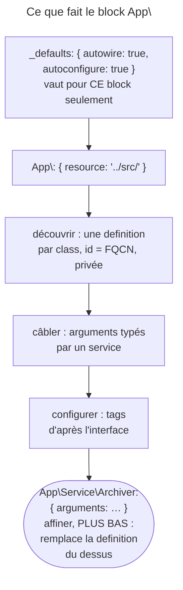

## Objectif

Comprendre comment une class de `src/` devient un service sans une ligne de
configuration, en séparant les trois mécanismes en jeu ; savoir déclarer un
service explicitement, connaître le scope de `_defaults` et l'effet de l'ordre
dans le file, et reconnaître les attributes qui déclarent depuis la class.

## L'essentiel

Une class de `src/` devient un service par trois mécanismes distincts :
**découvrir** (`resource`), **câbler** (`autowire`), **configurer**
(`autoconfigure`). Une déclaration explicite complète la definition découverte
— à condition d'être écrite **dessous**. `_defaults` ne vaut que pour son
block. Et des attributes décident depuis la class.

## Le schéma



## Le fil rouge : un `Archiver` et son subscriber

```php
class Archiver
{
    public function __construct(
        private LoggerInterface $logger,     // un service : autowirable
        private string $directory,           // un scalaire : à fournir
    ) {
    }
}

class ArchiveSubscriber implements EventSubscriberInterface { /* … */ }
```

`Archiver` est découvert, son logger câblé, son `$directory` à fournir.
`ArchiveSubscriber` reçoit son tag de subscriber sans une ligne.

## Trois mécanismes : découvrir, câbler, configurer

| Mécanisme | Écriture | Ce qu'il fait | Ce qu'il ne fait pas |
|---|---|---|---|
| **découvrir** | `App\: { resource: '../src/' }` | une definition par class, id = FQCN | ne câble, ne tague, ne rend pas public |
| **câbler** | `autowire: true` | résout les arguments **typés par un service** | ne devine pas un scalaire |
| **configurer** | `autoconfigure: true` | pose les tags d'après l'interface ou l'attribute | ne crée pas de service |

- Une class découverte et inutilisée ne gêne rien : privée, jamais
  référencée, elle est retirée à la compilation.
- `exclude: '../src/{Entity,Kernel.php}'` retire de la **découverte**
  seulement : une class exclue mais déclarée plus bas est enregistrée.
- En PHP avec `App::config()`, les services sont autowirés et autoconfigurés
  **par défaut** ; en YAML sans `_defaults`, non — `ArgumentCountError` à
  l'instanciation.

## Le cas explicite : des named arguments

```yaml
services:
    # … _defaults et App\ au-dessus …
    App\Service\Archiver:
        arguments:
            $directory: '%kernel.project_dir%/var/archive'   # par son nom, pas sa position
            $logger: '@monolog.logger.archive'               # @ = un service
        calls:
            - setFormat: ['zip']
        tags: ['app.archiver']
```

« Service definitions always *replace* previous ones » :

| Position de la definition explicite | Definition finale d'`Archiver` |
|---|---|
| **après** `App\: resource` | publique, `$directory` fourni |
| **avant** `App\: resource` | privée, sans argument : remplacée en silence |

## Le scope de `_defaults`

`_defaults` ne s'applique qu'au block où il est écrit : chaque `when@dev` ou
`when@test` a le sien. Oublié, il se paie à l'instanciation par une
`ArgumentCountError` (« Too few arguments… ») qui ne nomme pas la cause.

## Déclarer depuis la class : les attributes

| Attribute | Effet |
|---|---|
| `#[AsAlias]` | un alias, **privé**, vers cette class |
| `#[Autoconfigure]` | `public`, `lazy`, `shared`, `tags`, `calls`, `bind`… |
| `#[AutoconfigureTag]` | sur une interface : tague toutes ses implémentations |
| `#[Autowire]` | câble un argument précis |
| `#[When(env: 'prod')]` | service seulement dans cet environment |
| `#[Exclude]` | hors de la découverte, partout |

Hors de son environment, une class `#[When]` garde une definition marquée
`container.excluded` : l'injecter échoue, « …but this type has been
excluded ».

## Pièges d'examen

**Un service découvert est privé** : la découverte ne le rend pas public.

**`exclude` ne supprime pas la class** : elle l'exclut de l'enregistrement
automatique. Une class exclue mais **déclarée** explicitement est enregistrée —
exécuté, avec la visibilité demandée.

**`_defaults` ne traverse pas les blocks `when@`**, et l'oubli se paie par une
`ArgumentCountError` qui ne le mentionne pas.

**`#[When]` exclut hors de son environment** ; `#[Exclude]` exclut partout.

**Une definition explicite placée au-dessus de `App\:` est perdue.** La
découverte, écrite plus bas, la remplace en silence : le service redevient privé
et perd ses arguments. Les configurations explicites se placent dessous.

**`autowire` et `autoconfigure` sont deux réglages distincts.** Le premier
résout les arguments ; le second pose les tags. Un subscriber qui n'est pas
appelé pointe vers l'autoconfiguration, un argument vide vers l'autowiring.

**En PHP avec `App::config()`, autowire et autoconfigure sont actifs par
défaut** ; en YAML, il faut `_defaults`.

## Application

- `Archiver` reçoit son logger mais pas `$directory` → un named argument, un
  `bind` ou `#[Autowire]`.
- Une configuration explicite est ignorée → elle est écrite au-dessus de
  `App\:` : la déplacer dessous.

## QCM d'entraînement

**Question 1.** `services.yaml` déclare d'abord
`App\Service\Archiver: { public: true, arguments: { $directory: '/srv' } }`,
puis `App\: { resource: '../src/' }`. Quelle est la definition finale ?

- **A.** Publique, avec `$directory` : l'explicite l'emporte toujours
- **B.** Une erreur de compilation, à cause du doublon d'identifier
- **C.** Les deux fusionnées : publique, autowirée, avec `$directory`
- **D.** Privée et sans arguments, remplacée par la découverte

<details>
<summary>Correction</summary>

**Bonne réponse : D.** Les definitions se remplacent dans l'ordre du file : la
découverte, écrite plus bas, écrase la definition explicite.

</details>

**Question 2.** En 8.0, `config/services.php` déclare
`App::config(['services' => [Reporter::class => null]])`, sans `_defaults`. Le
constructor de `Reporter` demande une `Clock`. Que se passe-t-il ?

- **A.** `ArgumentCountError`, faute de `_defaults` dans le file PHP
- **B.** Une erreur de syntaxe : `null` n'est pas une definition valide
- **C.** Le service est autowiré et reçoit sa `Clock`
- **D.** Le service est autowiré mais pas autoconfiguré

<details>
<summary>Correction</summary>

**Bonne réponse : C.** Avec `App::config()`, autowire et autoconfigure sont
actifs par défaut ; A décrit le même service déclaré en YAML.

</details>

**Question 3.** Une class porte `#[When(env: 'prod')]`. Un controller
l'injecte, et l'application tourne en `dev`. Que se passe-t-il ?

- **A.** La compilation échoue : « …but this type has been excluded »
- **B.** L'injection reçoit `null` en `dev`
- **C.** La class est injectée normalement, `#[When]` ne visant que les routes
- **D.** Le controller est retiré du routing en `dev`

<details>
<summary>Correction</summary>

**Bonne réponse : A.** La definition existe, marquée exclue, et toute injection
échoue avec ce message ; en `prod`, la class est injectée.

</details>

**Question 4.** Quelle écriture YAML passe le **service**
`monolog.logger.archive` à l'argument `$logger` ?

- **A.** `$logger: 'monolog.logger.archive'`
- **B.** `$logger: '@monolog.logger.archive'`
- **C.** `$logger: '%monolog.logger.archive%'`
- **D.** `$logger: 'service(monolog.logger.archive)'`

<details>
<summary>Correction</summary>

**Bonne réponse : B.** Le `@` désigne un service par son id ; A passe une
string, C un parameter.

</details>

## Fiche express

**Si tu dois retenir seulement 7 choses :**

- **Découvrir** (`resource`), **câbler** (`autowire`), **configurer**
  (`autoconfigure`) : trois mécanismes.
- Découvert = **privé**, id = **FQCN**.
- `exclude` : hors de la découverte, pas du projet.
- Explicite **sous** `App\:`, sinon remplacé en silence.
- **`_defaults`** : son block seulement ; `when@` a le sien.
- **`App::config()`** : autowire et autoconfigure par défaut.
- **`#[When]`** : un environment ; **`#[Exclude]`** : partout.

Moyen mnémotechnique : **« D-C-C : Découvrir, Câbler, Configurer »**.

## Sources officielles

- [Service Container, « Automatic Service Loading in services.yaml »](https://github.com/symfony/symfony-docs/blob/8.0/service_container.rst)
- [DependencyInjection 8.0, `Loader\Configurator\AppReference`](https://github.com/symfony/symfony/blob/8.0/src/Symfony/Component/DependencyInjection/Loader/Configurator/AppReference.php)
- [DependencyInjection 8.0, `Attribute\Autoconfigure`](https://github.com/symfony/symfony/blob/8.0/src/Symfony/Component/DependencyInjection/Attribute/Autoconfigure.php)
- [DependencyInjection 8.0, `Compiler\AutowirePass`](https://github.com/symfony/symfony/blob/8.0/src/Symfony/Component/DependencyInjection/Compiler/AutowirePass.php)

