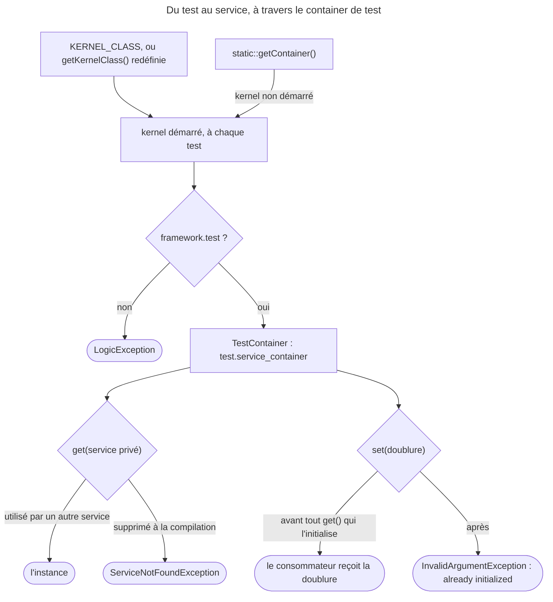

## Objectif

Atteindre depuis un test les objects du framework — le container, un service, le
kernel — et comprendre pourquoi le container de test n'est pas celui de
production.

## L'essentiel

`KernelTestCase` démarre un **kernel neuf à chaque test**. `static::getContainer()`
rend un **container de test** qui atteint aussi les services **privés** — sauf
ceux supprimés à la compilation. Il permet de poser une **doublure**, à
condition de le faire **avant** le premier `get()` du service qui en dépend.

## Le schéma



## L'exemple

```php
class NewsletterGeneratorTest extends KernelTestCase
{
    public function testGenerate(): void
    {
        $container = static::getContainer();             // démarre le kernel
        $repository = $this->createMock(NewsRepositoryInterface::class);
        $container->set(NewsRepositoryInterface::class, $repository); // d'abord
        $generator = $container->get(NewsletterGenerator::class);     // ensuite
    }
}
```

## Démarrer le kernel

- Le kernel est désigné par la variable d'environment `KERNEL_CLASS`, posée
  dans `.env.test` ; une `getKernelClass()` ou `createKernel()` redéfinie
  l'emporte — la variable n'est alors plus lue.
- `bootKernel()` **rend le kernel démarré** et accepte des options :
  `self::bootKernel(['environment' => 'my_test_env', 'debug' => false])`.
- `debug` à `false` est recommandé en CI : plus de vidage automatique du cache,
  des tests nettement plus rapides — à charge de vider le cache soi-même.

## Le container de test

`static::getContainer()` **démarre le kernel** s'il ne l'est pas, puis rend le
service `test.service_container`, un `TestContainer`. Sans `framework.test` :
`LogicException`, « Could not find service "test.service_container" ».

Trois services privés par défaut — `Clock` (utilisé par `Greeter`), son alias
`ClockInterface`, et `Unused` (utilisé par personne) :

| `get()` sur… | Container de test | Container du kernel |
|---|---|---|
| `ClockInterface`, `Clock` | l'instance | `ServiceNotFoundException` |
| `Unused` | `ServiceNotFoundException` : « …has been removed or inlined when the container was compiled » | idem |

Le service privé ne devient pas public : c'est un **autre container**, branché
sur le premier, qui y donne accès. Un service supprimé se rend public dans
`config/services_test.yaml`.

## Remplacer un service par une doublure

`set()` fonctionne sur ce container, y compris sur un **alias privé**, sans
configuration. L'ordre compte :

| Ordre | Résultat |
|---|---|
| `set(ClockInterface, double)` puis `get(Greeter)` | `hello at fake` |
| `get(Greeter)` puis `set(ClockInterface, double)` | `InvalidArgumentException` : « …service is already initialized, you cannot replace it. » |

## Depuis un test d'application

`$client->getContainer()` rend `test.service_container` quand il existe — le
**même object** que `static::getContainer()` — sinon le container du kernel.
`$client->getKernel()` rend le kernel.

## Pièges d'examen

**`static::getContainer()` rend un container de test**, pas le container de
production : les services privés y sont accessibles.

**Un service privé supprimé reste inaccessible** — il faut le rendre public dans
`config/services_test.yaml`.

**`container->set()` doit précéder `get()`** du service consommateur — après,
c'est une exception.

**`getContainer()` démarre le kernel** s'il ne l'est pas.

**`KERNEL_CLASS` désigne le kernel** ; `getKernelClass()` l'emporte sur elle.

**Le kernel redémarre à chaque test**, pas une fois par class — exécuté : deux
tests, deux containers différents.

## Application

- Un `setUp()` récupère le service testé, puis le test pose une doublure :
  « already initialized » → poser la doublure avant le `get()`.
- Un environment de test maison lève « Could not find service
  "test.service_container" » → activer `framework.test`.

## QCM d'entraînement

**Question 1.** Dans un `WebTestCase`, que rend `$client->getContainer()` ?

- **A.** Le container de production, sans accès aux services privés
- **B.** Une copie du container, figée à la création du client
- **C.** Le même `TestContainer` que `static::getContainer()`
- **D.** `null` tant qu'aucune Request n'a été faite

<details>
<summary>Correction</summary>

**Bonne réponse : C.** Le client rend `test.service_container` quand ce service
existe ; A n'est que le repli sans `framework.test`.

</details>

**Question 2.** `framework.test` vaut `false` dans l'environment du test. Que
fait `static::getContainer()` ?

- **A.** Il rend le container du kernel, services privés exclus
- **B.** Il lève une `LogicException`
- **C.** Il active `framework.test` à la volée
- **D.** Il rend `null`

<details>
<summary>Correction</summary>

**Bonne réponse : B.** Le message invite à passer `framework.test` à `true` ; A
décrit le repli du client, pas celui de `KernelTestCase`.

</details>

**Question 3.** Que rend `self::bootKernel(['debug' => false])` ?

- **A.** Le kernel démarré
- **B.** Le container de test
- **C.** Rien : la method est `void`
- **D.** Un client prêt à faire des Requests

<details>
<summary>Correction</summary>

**Bonne réponse : A.** Un kernel dont `isDebug()` vaut `false` ; B est ce que
rend `static::getContainer()`, D ce que rend `createClient()`.

</details>

**Question 4.** `KERNEL_CLASS` vaut `App\Nope`, une class qui n'existe pas ; la
class de test redéfinit `getKernelClass()` pour rendre `App\Kernel`. Que se
passe-t-il au `bootKernel()` ?

- **A.** Une erreur : `App\Nope` n'existe pas
- **B.** `App\Nope` est tenté, puis `App\Kernel` en repli
- **C.** Une `LogicException` : deux kernels sont désignés
- **D.** `App\Kernel` démarre

<details>
<summary>Correction</summary>

**Bonne réponse : D.** La variable n'est lue que par la `getKernelClass()`
d'origine ; la redéfinir remplace cette lecture.

</details>

## Fiche express

**Si tu dois retenir seulement 7 choses :**

- **`KERNEL_CLASS`** désigne le kernel ; **`getKernelClass()`** l'emporte.
- Le kernel **redémarre à chaque test**.
- **`static::getContainer()`** démarre le kernel si besoin.
- Il rend un **`TestContainer`** ; sans **`framework.test`**, `LogicException`.
- Services **privés accessibles**, sauf **supprimés** à la compilation.
- **`set()`** d'une doublure **avant** le `get()` du consommateur.
- **`$client->getContainer()`** : le même container de test.

Moyen mnémotechnique : **« Démarrer, atteindre, doubler avant »**.

```text
KERNEL_CLASS (getKernelClass() l'emporte) → kernel neuf par test ; getContainer() boote → TestContainer (framework.test) :
privés OK sauf supprimés (services_test.yaml) ; set() avant get(), sinon already initialized
```

## Sources officielles

- [Testing](https://github.com/symfony/symfony-docs/blob/8.0/testing.rst)
- [`KernelTestCase`, branche 8.0](https://github.com/symfony/symfony/blob/8.0/src/Symfony/Bundle/FrameworkBundle/Test/KernelTestCase.php)
- [`TestContainer`, branche 8.0](https://github.com/symfony/symfony/blob/8.0/src/Symfony/Bundle/FrameworkBundle/Test/TestContainer.php)
- [`KernelBrowser`, branche 8.0](https://github.com/symfony/symfony/blob/8.0/src/Symfony/Bundle/FrameworkBundle/KernelBrowser.php)

