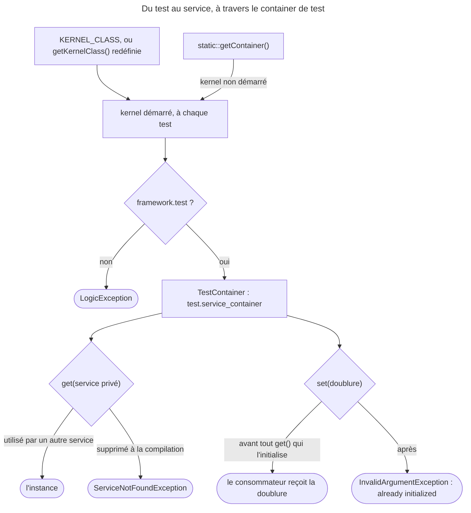

## Objectif

Atteindre depuis un test les objects du framework — le container, un service, le
kernel — et comprendre pourquoi le container de test n'est pas celui de
production.

## Avant la règle : le problème à résoudre

Un service `NewsletterGenerator` doit être testé avec sa vraie configuration,
mais sans la base de données : son repository sera remplacé par une doublure.
Le test doit donc démarrer l'application, **atteindre** un service — privé,
comme presque tous —, et en **remplacer** un autre.

Trois questions : quel kernel démarre et quand, ce que le **container de test**
expose de plus que le container de production, et à quel moment une doublure
peut encore être posée.

On suppose connus les tests d'intégration, et les services publics et privés.

## Le fil rouge : une newsletter sans base de données

```php
class NewsletterGeneratorTest extends KernelTestCase
{
    public function testGenerate(): void
    {
        $container = static::getContainer();             // démarre le kernel

        $repository = $this->createMock(NewsRepositoryInterface::class);
        $container->set(NewsRepositoryInterface::class, $repository); // d'abord

        $generator = $container->get(NewsletterGenerator::class);     // ensuite
    }
}
```

## Le cycle complet en un schéma



## Démarrer le kernel

```php
class NewsletterGeneratorTest extends KernelTestCase
{
    public function testSomething(): void
    {
        self::bootKernel();
        $container = static::getContainer();

        $generator = $container->get(NewsletterGenerator::class);
    }
}
```

`KernelTestCase` **redémarre le kernel à chaque test**, ce qui garantit leur
indépendance. Le kernel à démarrer est désigné par la variable d'environment
`KERNEL_CLASS`, posée dans `.env.test` :

```env
KERNEL_CLASS=App\Kernel
```

Pour un cas plus complexe, `getKernelClass()` ou `createKernel()` peuvent être
redéfinies, et l'emportent alors sur la variable.

Rejoué pour cette page avec FrameworkBundle 8.0.15 : `KERNEL_CLASS` pointant
vers une class inexistante, `App\Nope`, et `getKernelClass()` redéfinie pour
rendre `App\Kernel` — c'est `App\Kernel` qui démarre.

`bootKernel()` accepte des options :

```php
self::bootKernel(['environment' => 'my_test_env', 'debug' => false]);
```

`debug` à `false` est recommandé en intégration continue : la documentation
précise que cela désactive le vidage du cache, et que les tests s'en trouvent
nettement plus rapides — à charge de vider le cache soi-même si
l'environment n'est pas propre à chaque exécution.

Rejoué : `bootKernel()` **rend le kernel démarré** ; avec `'debug' => false`,
`isDebug()` vaut `false`, comme le parameter `kernel.debug` du container.

## Le container de test

`static::getContainer()` ne rend pas le container ordinaire mais un **container
de test spécial**. Sa particularité est décisive : il donne accès aux services
publics **et aux services privés non supprimés**.

En production, un service privé n'est pas récupérable par `get()`. Le container
de test lève cette restriction, sans quoi la plupart des services d'une
application — privés par défaut — seraient intestables.

La limite : un service privé **supprimé**, parce qu'aucun autre ne l'utilise,
reste inaccessible. Il faut alors le déclarer public dans
`config/services_test.yaml`.

Exécuté avec FrameworkBundle 8.0.15, trois services autoconfigurés, privés par
défaut — `Clock` (utilisé par `Greeter`), son alias `ClockInterface`, et
`Unused` (utilisé par personne) :

| `get()` sur… | Container de test | Container du kernel |
|---|---|---|
| `ClockInterface`, `Clock` | l'instance | `ServiceNotFoundException` (exécuté sur `Clock`) |
| `Unused` | `ServiceNotFoundException` : « …has been removed or inlined when the container was compiled » | idem |

Lu dans `KernelTestCase::getContainer()` : la method **démarre le kernel**
s'il ne l'est pas — `bootKernel()` est donc facultatif —, puis rend le service
`test.service_container` ; sans `framework.test`, `LogicException`. Exécuté :
c'est un `TestContainer`.

Rejoué, avec `framework.test` à `false` : `LogicException` « Could not find
service "test.service_container". Try updating the "framework.test" config to
"true". »

Le service privé ne devient pas public pour autant : sa visibilité ne change
pas. C'est un **autre container**, branché sur le premier, qui y donne accès.

## Remplacer un service par une doublure

Le même container permet de **remplacer** un service avant de l'utiliser :

```php
$repository = $this->createMock(NewsRepositoryInterface::class);
$repository->expects(self::once())
    ->method('findNewsFromLastMonth')
    ->willReturn([new News('…')]);

$container->set(NewsRepositoryInterface::class, $repository);

// reçoit la doublure
$generator = $container->get(NewsletterGenerator::class);
```

Aucune configuration supplémentaire n'est requise : `set()` fonctionne sur ce
container, y compris sur un **alias privé**. L'ordre compte — poser la doublure
**avant** de demander le service qui en dépend. Exécuté :

| Ordre | Résultat |
|---|---|
| `set(ClockInterface, double)` puis `get(Greeter)` | `hello at fake` |
| `get(Greeter)` puis `set(ClockInterface, double)` | `InvalidArgumentException` : « …service is already initialized, you cannot replace it. » |

## Depuis un test d'application

Le client expose les mêmes objects :

```php
$client->getContainer();
$client->getKernel();
```

Lu dans `KernelBrowser::getContainer()` (8.0) : il rend `test.service_container`
quand ce service existe, sinon le container du kernel. Rejoué dans un
`WebTestCase` : `$client->getContainer()` est **le même object** que
`static::getContainer()`, un `TestContainer` qui rend le service privé
`Clock` ; `$client->getKernel()` rend le kernel, d'environment `p14web` dans ce
test.

## Concrètement dans ton application

- Tester un service privé : `static::getContainer()->get(MonService::class)`.
- Un service privé que personne n'utilise : le rendre public dans
  `config/services_test.yaml`.
- Remplacer une dependency : `set()` **avant** le premier `get()` du
  consommateur.
- Plusieurs kernels : `KERNEL_CLASS` dans `.env.test`, ou `getKernelClass()`
  redéfinie dans la class de test.
- Une CI plus rapide : `bootKernel(['debug' => false])`, cache vidé à chaque
  exécution.
- Dans un functional test : `$client->getContainer()`, le même container de
  test.

## À comprendre

- **Pourquoi un container à part ?** Rendre les services privés publics en test
  changerait l'application testée ; un second container y donne accès sans
  toucher à la configuration.
- **Pourquoi un service inutilisé reste-t-il inaccessible ?** Il a été supprimé
  à la compilation : il n'existe plus, aucun container ne peut le rendre.
- **Pourquoi `set()` refuse-t-il après `get()` ?** Le consommateur a déjà reçu
  la vraie dependency ; la remplacer ensuite laisserait deux versions en jeu.

## À mémoriser

- **`KERNEL_CLASS`** (`.env.test`) ; **`getKernelClass()`** l'emporte.
- Kernel **redémarré à chaque test** ; **`bootKernel()`** rend le kernel.
- **`static::getContainer()`** démarre le kernel si besoin → **`TestContainer`**
  (`test.service_container`).
- Sans **`framework.test`** : **`LogicException`**.
- Privés **accessibles**, sauf **supprimés** → `services_test.yaml`.
- **`set()` avant `get()`**, sinon « already initialized ».
- Moyen mnémotechnique : **« Démarrer, atteindre, doubler avant »**.

## Pièges d'examen

**`static::getContainer()` rend un container de test**, pas le container de
production : les services privés y sont accessibles.

**Un service privé supprimé reste inaccessible** — il faut le rendre public dans
`config/services_test.yaml`.

**`container->set()` doit précéder `get()`** du service consommateur — après,
c'est une exception.

**`getContainer()` démarre le kernel** s'il ne l'est pas.

**`KERNEL_CLASS` désigne le kernel** ; `getKernelClass()` l'emporte sur elle.

**Le kernel redémarre à chaque test**, pas une fois par class — exécuté : deux
tests, deux containers différents.

## Application : trois scénarios

**Scénario 1 — Le service introuvable.** Un test appelle
`static::getContainer()->get(PdfExporter::class)` et reçoit « …has been removed
or inlined when the container was compiled ». Aucun service ne l'utilise encore.
*Solution.* Le déclarer `public` dans `config/services_test.yaml`.

**Scénario 2 — La doublure refusée.** Un `setUp()` récupère le service testé,
puis le test pose une doublure de sa dependency : « …already initialized, you
cannot replace it ». *Solution.* Poser la doublure dans `setUp()`, **avant** le
`get()` du service testé.

**Scénario 3 — Le container introuvable.** Dans un environment de test maison,
`static::getContainer()` lève « Could not find service
"test.service_container" ». *Solution.* Activer `framework.test` dans cet
environment.

## QCM d'entraînement

Cinq questions sur l'accès aux objects du framework. Choisis avant d'ouvrir la
correction.

**Question 1.** Dans un `WebTestCase`, que rend `$client->getContainer()` ?

- **A.** Le container de production, sans accès aux services privés
- **B.** Une copie du container, figée à la création du client
- **C.** Le même `TestContainer` que `static::getContainer()`
- **D.** `null` tant qu'aucune Request n'a été faite

<details>
<summary>Correction</summary>

**Bonne réponse : C.** Lu dans `KernelBrowser::getContainer()` : le service
`test.service_container` s'il existe. Rejoué : même object, et le service privé
`Clock` est rendu.

A est le repli sans `framework.test`. B et D sont faux.

</details>

**Question 2.** `framework.test` vaut `false` dans l'environment du test. Que
fait `static::getContainer()` ?

- **A.** Il rend le container du kernel, services privés exclus
- **B.** Il lève une `LogicException`
- **C.** Il active `framework.test` à la volée
- **D.** Il rend `null`

<details>
<summary>Correction</summary>

**Bonne réponse : B.** Exécuté : « Could not find service
"test.service_container". Try updating the "framework.test" config to "true". »

A décrit le repli de `$client->getContainer()`, pas celui de `KernelTestCase`.
C et D sont faux.

</details>

**Question 3.** Que rend `self::bootKernel(['debug' => false])` ?

- **A.** Le kernel démarré
- **B.** Le container de test
- **C.** Rien : la method est `void`
- **D.** Un client prêt à faire des Requests

<details>
<summary>Correction</summary>

**Bonne réponse : A.** Exécuté : `App\Kernel`, dont `isDebug()` vaut `false`.

B est ce que rend `static::getContainer()`, D ce que rend `createClient()`. C
est faux.

</details>

**Question 4.** `KERNEL_CLASS` vaut `App\Nope`, une class qui n'existe pas ; la
class de test redéfinit `getKernelClass()` pour rendre `App\Kernel`. Que se
passe-t-il au `bootKernel()` ?

- **A.** Une erreur : `App\Nope` n'existe pas
- **B.** `App\Nope` est tenté, puis `App\Kernel` en repli
- **C.** Une `LogicException` : deux kernels sont désignés
- **D.** `App\Kernel` démarre

<details>
<summary>Correction</summary>

**Bonne réponse : D.** Exécuté. La variable n'est lue que par la
`getKernelClass()` d'origine ; la redéfinir la remplace.

A, B et C supposent que la variable est encore lue.

</details>

**Question 5.** Un service privé, `PdfExporter`, n'est utilisé par aucun autre
service. Comment le rendre accessible au test ?

- **A.** L'appeler par `self::$kernel->getContainer()`
- **B.** Le rendre `public` dans `services_test.yaml`
- **C.** Appeler `bootKernel(['debug' => true])` avant
- **D.** Rien : le container de test rend tous les services

<details>
<summary>Correction</summary>

**Bonne réponse : B.** Supprimé à la compilation, il n'existe plus, même pour le
container de test ; le rendre public en environment de test l'empêche d'être
supprimé.

A est le container de production, plus restrictif encore. C est sans effet sur
la suppression. D oublie les services supprimés.

</details>

## Fiche express

**Si tu dois retenir seulement 7 choses :**

- **`KERNEL_CLASS`** désigne le kernel ; **`getKernelClass()`** l'emporte.
- Le kernel **redémarre à chaque test**.
- **`static::getContainer()`** démarre le kernel si besoin.
- Il rend un **`TestContainer`** ; sans **`framework.test`**, `LogicException`.
- Services **privés accessibles**, sauf **supprimés** à la compilation.
- **`set()`** d'une doublure **avant** le `get()` du consommateur.
- **`$client->getContainer()`** : le même container de test.

**En une phrase, pour tout reconstruire :**

```text
KERNEL_CLASS (getKernelClass() l'emporte) → kernel neuf par test ; getContainer() boote → TestContainer (framework.test) :
privés OK sauf supprimés (services_test.yaml) ; set() avant get(), sinon already initialized
```

## Sources officielles

- [Testing](https://github.com/symfony/symfony-docs/blob/8.0/testing.rst)
- [`KernelTestCase`, branche 8.0](https://github.com/symfony/symfony/blob/8.0/src/Symfony/Bundle/FrameworkBundle/Test/KernelTestCase.php)
- [`TestContainer`, branche 8.0](https://github.com/symfony/symfony/blob/8.0/src/Symfony/Bundle/FrameworkBundle/Test/TestContainer.php)
- [`KernelBrowser`, branche 8.0](https://github.com/symfony/symfony/blob/8.0/src/Symfony/Bundle/FrameworkBundle/KernelBrowser.php)
