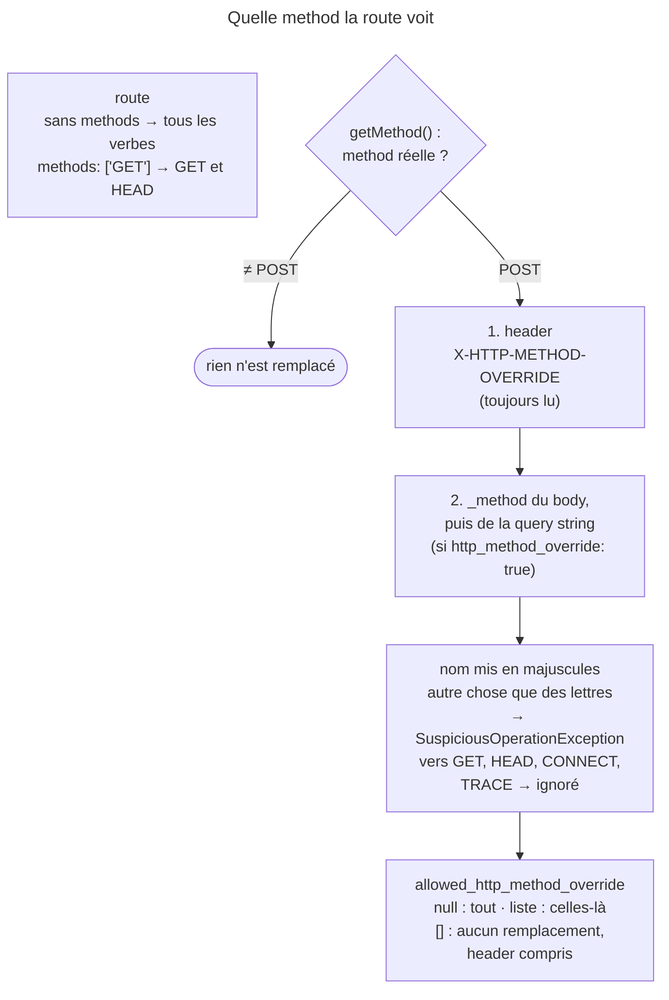

## Objectif

Restreindre une route à certaines methods HTTP, et contourner la limite des
forms HTML.

## L'essentiel

Sans option `methods`, une route accepte **tous** les verbes ; avec
`methods: ['GET']`, elle accepte aussi `HEAD`. Un form HTML ne sait envoyer que
`GET` et `POST` : pour simuler `PUT` ou `DELETE`, un field caché `_method`,
lu seulement si `framework.http_method_override` vaut `true` — `false` par
défaut. Le header d'override, lui, ne dépend pas de cette option.

## Le schéma



## L'exemple : deux routes, un path

```php
#[Route('/api/posts/{id}', methods: ['GET'])]
public function show(int $id): Response {}

#[Route('/api/posts/{id}', methods: ['PUT'])]
public function edit(int $id): Response {}
```

## L'option `methods`

**Par défaut une route accepte tous les verbes.** `methods` restreint, et deux
routes peuvent partager le même path en ne différant que par la method — le
pattern REST. Écrire `HEAD` est superflu : le matcher compare une Request
`HEAD` comme un `GET`.

## La limite des forms HTML

Un form HTML envoie `GET` ou `POST`. Pour atteindre une route en `PUT`, `PATCH`
ou `DELETE`, on ajoute un field caché `_method` :

```html
<input type="hidden" name="_method" value="PUT">
```

Symfony ne le lit que si `framework.http_method_override` vaut `true`. Le
theme de form Twig ajoute ce field dès que la method du form n'est ni `GET`
ni `POST`, que l'option soit activée ou non.

## Ce que fait `Request::getMethod()` (8.0)

- Rien n'est remplacé si la method réelle n'est pas `POST`.
- Le header `X-HTTP-METHOD-OVERRIDE` est lu **en premier**, et il ne dépend pas
  de `http_method_override`, qui ne gouverne que `_method`.
- `_method` est cherché dans le body, puis dans la query string.
- Un remplacement vers `GET`, `HEAD`, `CONNECT` ou `TRACE` est ignoré.
- Le nom est d'abord mis en majuscules : `_method=put` donne `PUT`. Un nom qui
  contient autre chose que des lettres — un chiffre, un tiret — lève une
  `SuspiciousOperationException`.

`framework.allowed_http_method_override` restreint les methods simulables :
`null`, le défaut, les autorise toutes ; une liste les limite, une method hors
liste laissant le `POST` ; un array vide **désactive tout remplacement**,
header compris.

## Pièges d'examen

**Sans restriction de method, une route accepte tous les verbes.** L'absence de
l'option n'est pas un `GET` implicite.

**Le field caché ne suffit pas.** Simuler un verbe par `_method` exige
`http_method_override: true` ; désactivée — ce qui est le cas par défaut — le
field est ignoré et la Request reste un `POST`.

**Le header, lui, n'attend pas cette option.** Seul
`allowed_http_method_override: []` le neutralise.

**`methods: ['GET']` accepte `HEAD`.**

**Deux routes peuvent partager exactement le même path** et ne différer que
par la method : c'est le pattern REST, et il rend la lecture de la liste des
routes indispensable.

## Application

- Un bouton « Supprimer » dans un form HTML → `_method=DELETE` et
  `http_method_override: true`.
- Interdire toute simulation, header compris →
  `allowed_http_method_override: []`.

## QCM d'entraînement

**Question 1.** `http_method_override` est activé. Un `POST` porte le header
`X-HTTP-METHOD-OVERRIDE: DELETE` et le field `_method=PUT`. Que rend
`getMethod()` ?

- **A.** `DELETE`
- **B.** `PUT`
- **C.** `POST`
- **D.** Une exception : deux remplacements

<details>
<summary>Correction</summary>

**Bonne réponse : A.** Le header est consulté avant le parameter : dès qu'il
porte une valeur, le field `_method` n'est plus regardé.

</details>

**Question 2.** `http_method_override` est activé. Un `POST` porte
`_method=PUT2`. Que se passe-t-il ?

- **A.** `PUT2`
- **B.** `POST`, la valeur invalide étant simplement ignorée
- **C.** `PUT`
- **D.** Une `SuspiciousOperationException`

<details>
<summary>Correction</summary>

**Bonne réponse : D.** Après la mise en majuscules, le nom doit être fait de
lettres seulement ; un chiffre le rend suspect, et la method lève.

</details>

**Question 3.** L'override est activé, et `allowed_http_method_override` vaut
`['DELETE']`. Un `POST` porte `_method=PUT`. Que rend `getMethod()` ?

- **A.** `PUT`
- **B.** `POST`
- **C.** Une exception : method non autorisée
- **D.** `DELETE`

<details>
<summary>Correction</summary>

**Bonne réponse : B.** Une method absente de la liste autorisée n'est pas
appliquée : la Request garde sa method réelle, sans exception.

</details>

**Question 4.** L'override est activé. Un `POST` vers `/posts/3?_method=DELETE`
n'a pas de field `_method` dans son body. Que rend `getMethod()` ?

- **A.** `POST` : seul le body compte
- **B.** `GET`
- **C.** `DELETE`
- **D.** Une exception

<details>
<summary>Correction</summary>

**Bonne réponse : C.** Le parameter est cherché dans le body, puis dans la
query string : celle-ci suffit quand le body ne le porte pas.

</details>

## Fiche express

**Si tu dois retenir seulement 6 choses :**

- Sans `methods` → **tous** les verbes ; `GET` accepte **`HEAD`**.
- `_method` lu seulement si **`http_method_override: true`** (`false` par défaut).
- Remplacement depuis un **`POST`** seulement.
- Header **`X-HTTP-METHOD-OVERRIDE`** lu en premier, même option désactivée.
- Jamais vers `GET`, `HEAD`, `CONNECT`, `TRACE` ; nom non alphabétique → exception.
- `allowed_http_method_override: []` coupe **tout**, header compris.

Moyen mnémotechnique : **« Le header passe avant le field »**.

## Sources officielles

- [Routing, section « Matching HTTP Methods »](https://github.com/symfony/symfony-docs/blob/8.0/routing.rst)
- [`Request::getMethod()`](https://github.com/symfony/symfony/blob/8.0/src/Symfony/Component/HttpFoundation/Request.php)
- [FrameworkBundle, `Configuration`](https://github.com/symfony/symfony/blob/8.0/src/Symfony/Bundle/FrameworkBundle/DependencyInjection/Configuration.php)
- [`form_div_layout.html.twig`](https://github.com/symfony/symfony/blob/8.0/src/Symfony/Bridge/Twig/Resources/views/Form/form_div_layout.html.twig)
- [`CompiledUrlMatcherTrait::doMatch()`](https://github.com/symfony/symfony/blob/8.0/src/Symfony/Component/Routing/Matcher/Dumper/CompiledUrlMatcherTrait.php)

