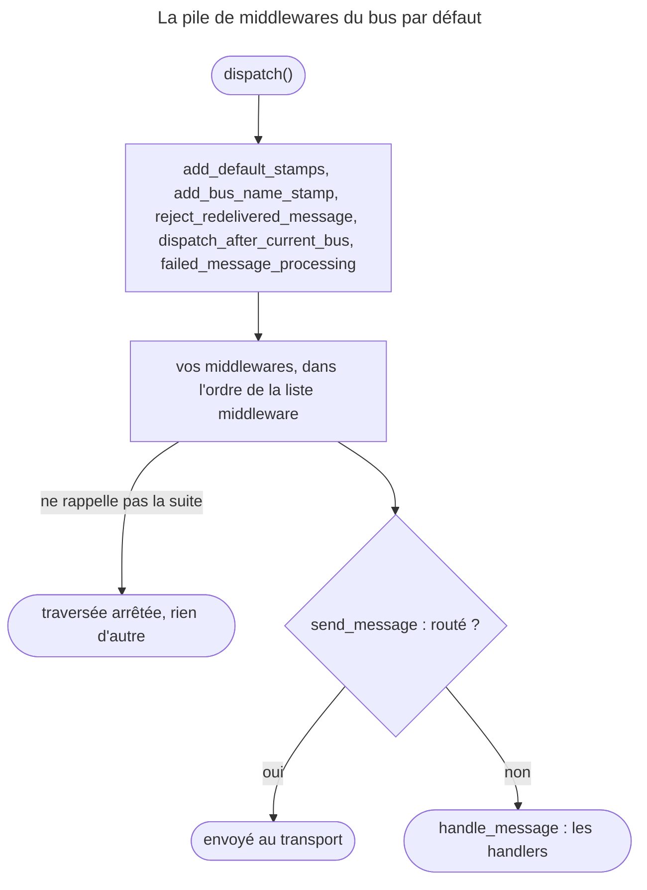

## Objectif

Intercepter un message pendant qu'il traverse le bus, savoir combien de fois la
chaîne de middlewares s'exécute, et où se place un middleware maison.

## Avant la règle : le problème à résoudre

Journaliser chaque message, mesurer le temps de traitement, ouvrir une
transaction, valider un message avant de le traiter : ces besoins concernent
**tous** les messages, pas un handler en particulier. Les écrire dans chaque
handler, c'est les oublier une fois sur deux. Il faut un point de passage
obligé, autour du traitement : c'est la chaîne de middlewares du bus.

Trois questions : **ce que voit** un middleware, **combien de fois** il est
appelé, et **où il se place** dans la pile que Symfony construit.

## Le fil rouge : un audit sur le bus

```yaml
framework:
    messenger:
        buses:
            messenger.bus.default:
                middleware:
                    - 'App\Middleware\AuditMiddleware'
```

```php
final class AuditMiddleware implements MiddlewareInterface
{
    public function handle(Envelope $envelope, StackInterface $stack): Envelope
    {
        $side = $envelope->last(ReceivedStamp::class) ? 'received' : 'dispatched';
        $this->logger->info($side, ['class' => $envelope->getMessage()::class]);

        return $stack->next()->handle($envelope, $stack);
    }
}
```

Chaque message traverse `AuditMiddleware` ; un message asynchrone le traverse
deux fois, et le `ReceivedStamp` dit laquelle.

## Le cycle complet en un schéma

La pile de `messenger.bus.default`, relevée sur le bus construit par
FrameworkBundle 8.0 avec un middleware maison :



Un middleware maison s'insère donc **avant** l'envoi et le traitement : il
peut empêcher l'un comme l'autre.

## Ce qu'un middleware voit

Le bus n'appelle pas le handler directement : il fait traverser une **chaîne de
middleware**, chacun recevant l'**enveloppe** — donc le message *et* ses stamps.

```php
use Symfony\Component\Messenger\Middleware\MiddlewareInterface;
use Symfony\Component\Messenger\Middleware\StackInterface;

final class AuditMiddleware implements MiddlewareInterface
{
    public function handle(Envelope $envelope, StackInterface $stack): Envelope
    {
        $this->logger->info('dispatching', ['class' => $envelope->getMessage()::class]);

        return $stack->next()->handle($envelope, $stack);
    }
}
```

`$stack->next()->handle(...)` passe au suivant. **Ne pas l'appeler interrompt la
chaîne de middlewares** : le message n'atteint jamais son handler. Exécuté avec Messenger
8.0.15, un middleware qui rend l'Envelope sans appeler la suite pour un message
`Halt` **sans handler** : aucun handler appelé, aucun `HandledStamp`, et **aucune
exception** — la `NoHandlerForMessageException` est levée par
`HandleMessageMiddleware`, qui n'a jamais été atteint. Le message disparaît en
silence.

Un middleware peut aussi **modifier l'Envelope** : ajouter un stamp, la
remplacer, agir avant *et* après l'appel suivant.

Rejoué : un stamp maison qu'un middleware ajoute avant d'appeler la suite se
retrouve sur l'Envelope que `dispatch()` retourne.

## Deux passages en asynchrone

La chaîne de middlewares est traversée **deux fois** pour un message asynchrone : à l'envoi,
quand il est dispatché, puis à la réception, quand le worker le récupère du
transport. Exécuté, deux middleware `A` et `B` déclarés dans cet ordre, un
message routé vers un transport :

| Moment | Journal |
|---|---|
| après `dispatch()` | `A:dispatched`, `B` |
| après `messenger:consume --limit=1` | … puis `A:received`, `B`, et le handler |

Un middleware qui journalise écrit donc deux lignes ; un middleware qui compte
compte deux fois. Pour agir d'un seul côté, on regarde les stamps : la présence
d'un `ReceivedStamp` distingue la réception de l'envoi — c'est ce que
`A` a testé ci-dessus.

## Où se place un middleware maison

Le bus est lui-même fait de middleware. Lu dans `FrameworkExtension` (8.0),
puis relevé sur le bus construit, avec un middleware maison `A` :

```text
add_default_stamps_middleware
add_bus_name_stamp_middleware
reject_redelivered_message_middleware
dispatch_after_current_bus
failed_message_processing_middleware
   ← vos middleware, dans l'ordre déclaré
send_message
handle_message
```

`handle_message` (`HandleMessageMiddleware`) appelle les handlers et ferme la
chaîne de middlewares ; `send_message` (`SendMessageMiddleware`) envoie au transport juste
avant. Un middleware déclaré dans `middleware:` s'insère donc **avant** l'envoi
et le traitement — ce qui lui permet d'interrompre l'un et l'autre. Quand le
component Lock est activé, `deduplicate_middleware` s'ajoute en fin de premier
group.

Rejoué une nouvelle fois, sur le bus construit : `AddDefaultStamps`,
`AddBusNameStamp`, `RejectRedeliveredMessage`, `DispatchAfterCurrentBus`,
`FailedMessageProcessing`, `A`, `B`, `SendMessage`, `HandleMessage`.

## Déclarer

```yaml
framework:
    messenger:
        buses:
            messenger.bus.default:
                middleware:
                    - 'App\Middleware\AuditMiddleware'
```

L'ordre de la liste est l'ordre d'exécution : exécuté, `A` avant `B`.

L'option `default_middleware` du bus règle la pile par défaut. Exécuté, un
message sans handler puis un message avec handler :

| `default_middleware` | Pile | Sans handler | Avec handler |
|---|---|---|---|
| (défaut) | complète | `NoHandlerForMessageException` | traité |
| `allow_no_handlers` | complète | accepté, aucun `HandledStamp` | traité |
| `false` | **vide** | accepté | **non traité**, sans erreur |

Avec `false`, la pile se limite à la liste `middleware:` : sans
`send_message` ni `handle_message`, un `dispatch()` ne fait rien et ne le
signale pas. `allow_no_senders` vaut `true` par défaut.

**Rejoué, l'option inverse :** `default_middleware: { enabled: true,
allow_no_senders: false }` fait lever `NoSenderForMessageException` — « No sender
for message … » — à **tout** message non routé, même s'il a des handlers. C'est
une façon d'interdire le synchrone sur un bus.

## Un middleware par défaut à connaître : dispatch_after_current_bus

Un handler qui dispatche un nouveau message peut le faire **trop tôt** : si le
handler échoue ensuite, le message parti ne revient pas. La documentation
(« Transactional Messages ») propose `DispatchAfterCurrentBusStamp`.

```php
#[AsMessageHandler]
final class PlaceOrderHandler
{
    public function __invoke(PlaceOrder $command): void
    {
        // ... enregistrer l'achat
        $this->bus->dispatch(new OrderConfirmationEmail($command->orderId), [new DispatchAfterCurrentBusStamp()]);
        // ... la suite du handler
    }
}
```

Rejoué : le handler du second message tourne **après** la fin du premier
handler ; et si le premier handler lève, le second message **n'est jamais
traité**. C'est le middleware `dispatch_after_current_bus`, de la pile par
défaut, qui retient le message.

## Concrètement dans ton application

- Un besoin transverse — log, mesure, validation : un middleware, pas un bout
  de code dans chaque handler.
- Toujours `return $stack->next()->handle($envelope, $stack);`, sauf pour
  arrêter volontairement.
- Un middleware qui ne doit agir qu'une fois : tester `ReceivedStamp`.
- Un bus d'events sans subscriber obligatoire : `default_middleware:
  allow_no_handlers`.
- Un message dispatché depuis un handler qui peut échouer :
  `DispatchAfterCurrentBusStamp`.
- `default_middleware: false` seulement en redéclarant `send_message` et
  `handle_message`.

## À comprendre

- **Pourquoi une chaîne de middlewares plutôt que des events ?** Chaque maillon décide de
  continuer ou non, et peut agir avant **et** après la suite : un event ne
  peut pas envelopper le traitement.
- **Pourquoi l'arrêt est-il silencieux ?** L'erreur « pas de handler » vient du
  dernier maillon ; si on ne l'atteint pas, personne ne la lève.
- **Pourquoi deux passages ?** Le bus est traversé à l'envoi, dans la Request,
  et à la réception, dans le worker : deux process, deux traversées.

## À mémoriser

- **`handle(Envelope, StackInterface): Envelope`** ; continuer =
  **`$stack->next()->handle()`**.
- Ne pas continuer = **arrêt silencieux**, même sans handler.
- **Deux passages** en asynchrone ; **`ReceivedStamp`** les distingue.
- Pile : défauts, **vos middlewares**, **`send_message`**, **`handle_message`**.
- **`allow_no_handlers`** accepte l'absence de handler ; **`false`** vide la
  pile ; **`allow_no_senders: false`** interdit le non-routé.
- **`DispatchAfterCurrentBusStamp`** : après le handler courant, jamais s'il
  échoue.
- Moyen mnémotechnique : **« recevoir l'Envelope, passer la main, ou tout
  arrêter »**.

## Pièges d'examen

**Ne pas appeler `$stack->next()` arrête tout** — silencieusement, même pour un
message sans handler.

**La chaîne de middlewares s'exécute deux fois** en asynchrone : à l'envoi et à la réception ;
`ReceivedStamp` les distingue.

**Le middleware reçoit l'Envelope**, pas le message nu : les stamps sont
lisibles.

**Un middleware maison passe avant `send_message` et `handle_message`.**

**`default_middleware: false` retire aussi le traitement** : il faut alors
déclarer soi-même `send_message` et `handle_message`.

## Application : trois scénarios

**Scénario 1 — L'email de confirmation d'un achat annulé.** Le handler de
`PlaceOrder` dispatche l'email, puis échoue sur le paiement ; le client reçoit
quand même la confirmation. *Solution.* `DispatchAfterCurrentBusStamp` sur
l'email : il attend la fin du handler, et disparaît si celui-ci lève.

**Scénario 2 — Les messages qui s'évaporent.** Un middleware de filtrage rend
l'Envelope pour les messages qu'il juge inutiles, et pour d'autres par erreur.
Aucune erreur dans les logs. *Solution.* C'est l'arrêt silencieux : vérifier
chaque branche qui ne rappelle pas `$stack->next()`.

**Scénario 3 — Le bus qui ne doit rien traiter sur place.** Un bus de
tâches lourdes ne doit jamais exécuter un handler dans la Request.
*Solution.* `allow_no_senders: false` : un message oublié dans le routage lève
`NoSenderForMessageException` au lieu d'être traité en synchrone.

## QCM d'entraînement

Cinq questions sur les middlewares. Choisis avant d'ouvrir la correction.

**Question 1.** Un handler de `PlaceOrder` dispatche `OrderConfirmationEmail`
avec `DispatchAfterCurrentBusStamp`, puis lève une exception. Le handler de
l'email tourne-t-il ?

- **A.** Oui, avant que le premier handler ne lève
- **B.** Oui, après l'exception, comme un message ordinaire
- **C.** Non, jamais : le message est abandonné
- **D.** Oui, mais seulement au retry du premier message

<details>
<summary>Correction</summary>

**Bonne réponse : C.** Rejoué : sans exception, l'email est traité **après** la
fin du premier handler ; avec exception, il ne l'est jamais. La documentation :
« the UserRegistered event will never be handled ».

A et B décrivent un dispatch sans le stamp. D est faux.

</details>

**Question 2.** Un bus déclare `default_middleware: { enabled: true,
allow_no_senders: false }`. Un message non routé, qui a deux handlers, est
dispatché. Que se passe-t-il ?

- **A.** `NoSenderForMessageException`
- **B.** Les deux handlers tournent, comme d'habitude
- **C.** Le message part vers le premier transport déclaré
- **D.** `NoHandlerForMessageException`

<details>
<summary>Correction</summary>

**Bonne réponse : A.** Rejoué : « No sender for message … ». Lu dans
`SendMessageMiddleware` : sans sender et avec `allowNoSenders` à `false`,
l'exception est levée avant `handle_message`.

B est le comportement par défaut. C et D sont faux.

</details>

**Question 3.** Un middleware ajoute un stamp maison avant d'appeler la suite.
Le message est traité en synchrone. Le stamp est-il sur l'Envelope que
`dispatch()` retourne ?

- **A.** Non : les middlewares ne modifient pas l'Envelope
- **B.** Oui, il y est
- **C.** Non : seul `handle_message` peut ajouter des stamps
- **D.** Seulement si le message est routé

<details>
<summary>Correction</summary>

**Bonne réponse : B.** Rejoué. L'Envelope enrichie descend la chaîne de middlewares, et le
middleware rend celle que lui rend la suite, qui porte le stamp.

A et C sont faux. D est faux : en synchrone aussi.

</details>

**Question 4.** Quel middleware par défaut se trouve juste **avant** les
middlewares déclarés sous `middleware:` ?

- **A.** `failed_message_processing_middleware`
- **B.** `send_message`, qui envoie au transport
- **C.** `handle_message`, qui appelle les handlers
- **D.** `add_default_stamps_middleware`

<details>
<summary>Correction</summary>

**Bonne réponse : A.** Lu dans `FrameworkExtension` et relevé sur le bus
construit : `failed_message_processing_middleware`, puis les vôtres, puis
`send_message` et `handle_message`.

B et C viennent **après**. D ouvre la pile.

</details>

**Question 5.** Quelle configuration accepte un message sans handler, sans
retirer la pile par défaut ?

- **A.** `default_middleware: false`
- **B.** `allow_no_senders: true`
- **C.** Un middleware qui rend l'Envelope sans appeler la suite
- **D.** `default_middleware: allow_no_handlers`

<details>
<summary>Correction</summary>

**Bonne réponse : D.** Rejoué : la forme courte vaut `enabled: true,
allow_no_handlers: true` ; le message sans handler passe, les autres sont
traités.

A vide la pile : plus rien n'est traité. B est déjà le réglage par défaut. C
arrête tout, handlers compris.

</details>

## Fiche express

**Si tu dois retenir seulement 7 choses :**

- Un middleware reçoit l'**Envelope** et rend une Envelope.
- **`$stack->next()->handle()`** continue ; l'omettre arrête, **sans erreur**.
- En asynchrone, **deux passages** ; **`ReceivedStamp`** pour les distinguer.
- Vos middlewares passent **avant** `send_message` et `handle_message`.
- **`allow_no_handlers`** : pas d'erreur sans handler.
- **`default_middleware: false`** : plus d'envoi, plus de traitement.
- **`DispatchAfterCurrentBusStamp`** : après le handler courant, jamais s'il
  échoue.

**En une phrase, pour tout reconstruire :**

```text
défauts (stamps, redelivered, dispatch_after_current_bus, failed) > vos middlewares > send_message > handle_message ;
next() sinon arrêt muet ; 2 passages (ReceivedStamp) ; allow_no_handlers / allow_no_senders / false = pile vide
```

## Sources officielles

- [Messenger, « Middleware » et « Transactional Messages »](https://github.com/symfony/symfony-docs/blob/8.0/messenger.rst)
- [FrameworkBundle 8.0, `FrameworkExtension`](https://github.com/symfony/symfony/blob/8.0/src/Symfony/Bundle/FrameworkBundle/DependencyInjection/FrameworkExtension.php)
- [FrameworkBundle 8.0, `Configuration`](https://github.com/symfony/symfony/blob/8.0/src/Symfony/Bundle/FrameworkBundle/DependencyInjection/Configuration.php)
- [Messenger 8.0, `HandleMessageMiddleware`](https://github.com/symfony/symfony/blob/8.0/src/Symfony/Component/Messenger/Middleware/HandleMessageMiddleware.php)
- [Messenger 8.0, `SendMessageMiddleware`](https://github.com/symfony/symfony/blob/8.0/src/Symfony/Component/Messenger/Middleware/SendMessageMiddleware.php)
- [Messenger 8.0, `DispatchAfterCurrentBusMiddleware`](https://github.com/symfony/symfony/blob/8.0/src/Symfony/Component/Messenger/Middleware/DispatchAfterCurrentBusMiddleware.php)
