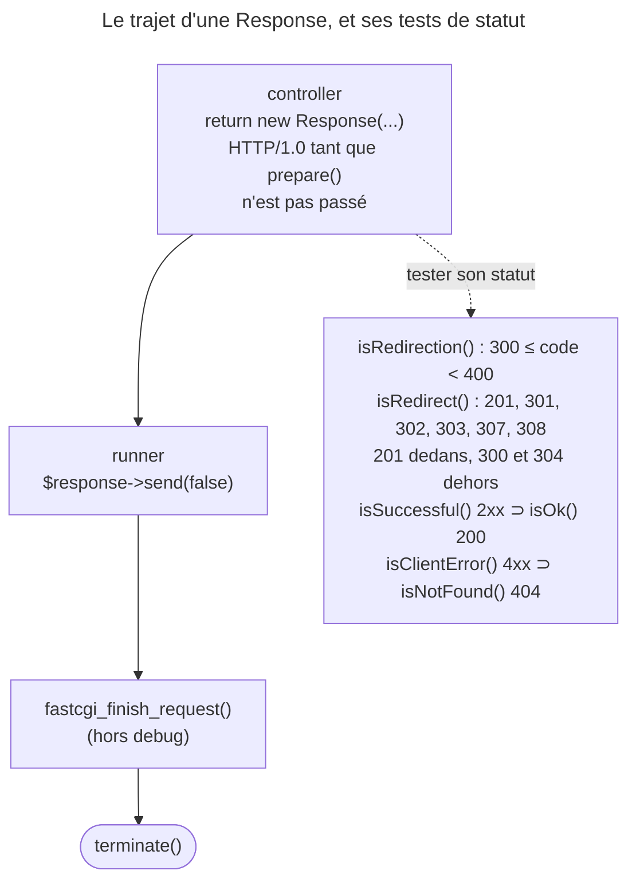

## Objectif

Construire la bonne sous-classe de `Response` et distinguer ses methods de
test — dont deux sont dangereusement proches.

## L'essentiel

Un controller **rend** une `Response` — ou une sous-classe spécialisée — et
ne l'envoie pas : c'est le runner du component Runtime qui l'émet, une fois.
L'examen vise surtout les methods de test, dont deux sont dangereusement
proches : `isRedirection()` (la class 3xx) et `isRedirect()` (une liste qui
inclut 201 et exclut 304).

## Le schéma



## L'exemple : la bonne sous-classe

```php
return new JsonResponse(['id' => 42], Response::HTTP_CREATED);
return new RedirectResponse('/orders/42');           // 302 par défaut
return JsonResponse::fromJsonString($alreadyEncoded);
return new BinaryFileResponse('/var/exports/report.pdf');
```

## La class de base

`$response->headers` est un `ResponseHeaderBag`, qui porte aussi les cookies.
Une `Response` neuve est en **`HTTP/1.0`** : `prepare($request)` la promeut en
1.1, vide le body sur un `HEAD` ou un statut sans corps et complète le
`Content-Type`. Le kernel l'appelle ; une Response fabriquée hors du cycle, non.

| Class | Usage |
|---|---|
| `JsonResponse` | encode en JSON, pose le `Content-Type` ; `fromJsonString()` n'encode pas deux fois |
| `RedirectResponse` | pose `Location`, statut 302 par défaut |
| `BinaryFileResponse` | sert un file, Requests de plage comprises |
| `StreamedResponse` | body produit par un callable, sans tout charger |
| `StreamedJsonResponse` | JSON diffusé à partir d'un itérable |

`JsonResponse` n'écrit pas le JSON de `json_encode()` : elle ajoute quatre
options d'escaping HTML. Comparer les données décodées, jamais la string.

## `isRedirect()` contre `isRedirection()`

- `isRedirection()` est la **class 3xx**, littéralement.
- `isRedirect()` est la liste des statuts qui portent un `Location` : elle
  **inclut 201** et **exclut 300 et 304**. Avec une URL en argument, elle
  vérifie aussi `Location` — pratique en functional test.

Les deux ne sont ni équivalentes ni imbriquées : un `304` est 3xx sans être un
redirect. La même liste valide le statut de `RedirectResponse` :
`new RedirectResponse($url, 304)` lève une `InvalidArgumentException`,
`new RedirectResponse($url, 201)` est accepté.

## Autres methods de test

`isSuccessful()` teste la class 2xx, `isOk()` **200 exactement** ;
`isClientError()` la class 4xx, `isNotFound()` **404 exactement** ;
`isServerError()` la class 5xx.

## L'émission : `send()`, et qui l'appelle

`send()` = `sendHeaders()` + `sendContent()`, puis clôture des buffers — sauf
avec `$flush = false`. Le controller rend, le runner émet :
`HttpKernelRunner::run()` appelle `send(false)`, exécute lui-même
`fastcgi_finish_request()` hors debug, **puis** `terminate()`. D'où la promesse
de `kernel.terminate` : ses listeners tournent après que le client est relâché.

Si les headers sont déjà partis, `sendHeaders()` tente seulement de réémettre
la ligne de statut. Exécuté sous `php -S`, un `echo` avant `send()` donne un
`E_WARNING` *Cannot modify header information*, et un 404 arrive en 200 : pas
d'exception, mais un avertissement, et un statut perdu.

## Pièges d'examen

**`isRedirect()` n'est pas « le statut est 3xx ».** Retenir 201 inclus, 304
exclu.

**`send()` n'appartient pas au controller.** Un controller retourne une
`Response` ; il ne l'envoie pas. Et le runner l'appelle avec `false`, pas avec
le défaut.

**`isOk()` n'est pas `isSuccessful()`** : le premier teste 200 exactement, le
second toute la class 2xx.

**Un `RedirectResponse` renvoie 302 par défaut** ; un permanent demande
`new RedirectResponse($url, 301)`.

**Son constructor valide le statut avec `isRedirect()`** et lève une
`\InvalidArgumentException` sinon. Conséquence directe de la liste ci-dessus :
`new RedirectResponse($url, 304)` **échoue**, alors que
`new RedirectResponse($url, 201)` est **accepté**.

## Application

- Un endpoint qui crée une ressource → `new JsonResponse($data, 201)` ; un test
  qui doit survivre au passage de 200 à 201 → `isSuccessful()`.
- Un envoi d'email après la Response → un listener de `kernel.terminate`.

## QCM d'entraînement

**Question 1.** Quelle version de protocole porte `new Response('x')` avant
tout appel à `prepare()` ?

- **A.** `HTTP/1.1`, la version courante
- **B.** Celle de la Request en cours
- **C.** `HTTP/1.0`
- **D.** `HTTP/2`, si le serveur le gère

<details>
<summary>Correction</summary>

**Bonne réponse : C.** Le constructor pose `1.0` ; c'est `prepare()` qui passe
en `1.1` quand la Request le permet, et le kernel l'appelle pour vous.

</details>

**Question 2.** Que contient le body de `new JsonResponse()`, appelée sans
argument ?

- **A.** `{}`
- **B.** `null`
- **C.** `[]`
- **D.** Une string vide

<details>
<summary>Correction</summary>

**Bonne réponse : A.** Le constructor remplace `null` par un `ArrayObject`
vide, qui s'encode en object JSON vide plutôt qu'en array.

</details>

**Question 3.** Dans un functional test, que rend `getContent()` sur une
`StreamedResponse` ?

- **A.** Le body déjà produit par le callable
- **B.** `false`
- **C.** Une string vide, avant l'envoi
- **D.** Une `LogicException`

<details>
<summary>Correction</summary>

**Bonne réponse : B.** Le body n'existe pas tant que le callable n'a pas tourné
pendant l'envoi : la class renvoie `false` au lieu d'un contenu.

</details>

**Question 4.** Que contient le body de `new RedirectResponse('/login')` ?

- **A.** Rien : un redirect n'a pas de body
- **B.** L'URL seule, en texte brut
- **C.** Un JSON `{"location": "/login"}`
- **D.** Une page HTML à `meta refresh`

<details>
<summary>Correction</summary>

**Bonne réponse : D.** La class écrit une petite page HTML qui redirige aussi
par `meta http-equiv="refresh"`, pour un client qui ignorerait `Location`.

</details>

## Fiche express

**Si tu dois retenir seulement 7 choses :**

- Le controller **rend**, le runner **émet** — avec `send(false)`.
- `isRedirection()` = **3xx** ; `isRedirect()` = **201, 301, 302, 303, 307,
  308**.
- `RedirectResponse` : **302** par défaut ; refuse 304, accepte 201.
- `isOk()` = 200 pile ; **`isSuccessful()`** = 2xx.
- Response neuve en **`HTTP/1.0`** ; `prepare()` corrige.
- `JsonResponse` échappe le HTML ; `fromJsonString()` n'encode pas.
- Headers déjà partis : **`E_WARNING`**, statut perdu.

Moyen mnémotechnique : **« 201 dedans, 304 dehors »**.

## Sources officielles

- [`Response`](https://github.com/symfony/symfony/blob/8.0/src/Symfony/Component/HttpFoundation/Response.php) — `isRedirect()` l. 1254, `isRedirection()` l. 1194,
  `isOk()` l. 1224, `isSuccessful()` l. 1184, `sendHeaders()` l. 316,
  `sendContent()` l. 385, `send()` l. 399 (branche 8.0, `6f841c0`)
- [`HttpKernelRunner`](https://github.com/symfony/symfony/blob/8.0/src/Symfony/Component/Runtime/Runner/Symfony/HttpKernelRunner.php) — `run()` : `send(false)` l. 36 puis
  `terminate()` l. 48 (branche 8.0)
- [Component HttpFoundation](https://github.com/symfony/symfony-docs/blob/8.0/components/http_foundation.rst)
