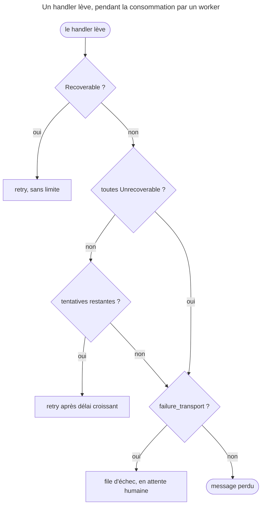

## Objectif

Décider ce qui arrive à un message dont le handler a levé une exception : le
rejouer, l'abandonner, ou le mettre de côté. Trois mécanismes se superposent, et
c'est leur ordre qui décide.

## Prérequis

Les transports et les workers.

## D'abord : synchrone ou asynchrone ?

Tout ce qui suit ne concerne que les messages **consommés par un worker**. Un
message non routé, traité pendant `dispatch()`, n'a ni retry ni file d'échec :
l'exception remonte à l'appelant. Exécuté avec Messenger 8.0.15 :
`HandlerFailedException` — « Handling "App\P13\M\Boom" failed: boom » —, une
seule tentative.

## Le comportement par défaut

Pour un message asynchrone, une exception dans un handler **n'est pas fatale** :
le message est renvoyé dans le transport et rejoué plus tard. C'est voulu — la
plupart des échecs sont temporaires : base indisponible, API en timeout.

Le nombre de tentatives est fini. Sans configuration de repli, un message qui a
épuisé ses tentatives est **abandonné**.

## La stratégie de retry

```yaml
framework:
    messenger:
        transports:
            async:
                dsn: '%env(MESSENGER_TRANSPORT_DSN)%'
                retry_strategy:
                    max_retries: 3
                    delay: 1000        # premier délai, en millisecondes
                    multiplier: 2      # 1s, 2s, 4s
                    max_delay: 10000   # plafond ; 0 = pas de plafond
                    jitter: 0.1        # aléatoire, de 0 à 1
```

Les default values de FrameworkBundle 8.0 sont celles-ci, sauf `max_delay`,
qui vaut **0**. Le délai croît **exponentiellement** — `delay × multiplier^n` —
pour ne pas marteler un service déjà en difficulté ; `max_delay` plafonne la
progression ; le `jitter` disperse les retries pour que mille messages ne
repartent pas à la même seconde. Calculé avec `MultiplierRetryStrategy` :
1000, 2000, 4000 ms sans jitter ; 1096, 2109, 4298 ms avec un jitter de 0,1.

`max_retries: 3` signifie **trois retries après l'échec initial**, donc quatre
tentatives en tout. Exécuté avec un handler qui échoue toujours : **4**
tentatives.

## Court-circuiter la stratégie

Deux familles d'exceptions changent la décision, dans les deux sens :

| Exception | Effet |
|---|---|
| `UnrecoverableMessageHandlingException` | **aucun retry** : le message part directement en échec |
| `RecoverableMessageHandlingException` | retry **forcé** ; son quatrième argument, `retryDelay`, fixe le délai en ms |

Lu dans `SendFailedMessageForRetryListener::shouldRetry()` : une exception
*recoverable* renvoie `true` **avant** que `max_retries` ne soit consulté. Elle
réessaie donc **sans limite**. Exécuté, worker limité à 12 messages : 12
tentatives, et le message toujours en file, jamais en échec.

Quand plusieurs handlers échouent, leurs exceptions sont emballées dans une
`HandlerFailedException` : il faut que **toutes** soient *unrecoverable* pour
que le retry soit refusé.

La première est la plus utile. Un message invalide — un identifier qui
n'existera jamais — ne deviendra pas valide en le rejouant. C'est la
distinction de fond : **la stratégie traite l'échec temporaire,
`Unrecoverable` l'échec permanent**. La seconde se manie avec prudence : sans
condition de sortie, elle boucle.

## Le transport d'échec

```yaml
framework:
    messenger:
        failure_transport: failed
        transports:
            failed: '%env(MESSENGER_FAILED_DSN)%'
```

Sans lui, un message épuisé est **perdu**. Avec lui, il est déplacé dans une file
dédiée, où il attend une décision humaine. Exécuté :

| Exception | Tentatives | Sans `failure_transport` | Avec |
|---|---|---|---|
| ordinaire | 4 | perdu | en file d'échec |
| `Unrecoverable…` | 1 | perdu | en file d'échec |
| `Recoverable…` | illimitées | jamais en échec | jamais en échec |

```bash
php bin/console messenger:failed:show
php bin/console messenger:failed:show --stats
php bin/console messenger:failed:retry
php bin/console messenger:failed:remove <id>
```

`messenger:failed:retry` ne renvoie **pas** le message vers son transport
d'origine : la command le **traite elle-même**, en lisant la file d'échec. Le
compteur de tentatives a été remis à zéro à l'entrée en file d'échec
(`RedeliveryStamp(0)`). Exécuté : un message qui échoue encore pendant
`failed:retry` revient dans la file d'échec, avec un compteur à 1 — rien n'est
envoyé vers `async`.

## L'enchaînement complet



Chaque étage change la Response, et c'est l'ordre qui compte : une
`UnrecoverableMessageHandlingException` saute la stratégie mais **pas** le
transport d'échec.

## Pièges d'examen

- En **synchrone**, l'exception remonte au `dispatch()` : pas de retry.
- En asynchrone, une exception ne perd pas le message : elle déclenche un retry.
- `max_retries: 3` = **quatre** tentatives au total.
- `RecoverableMessageHandlingException` ignore `max_retries`.
- Sans `failure_transport`, un message épuisé est **définitivement perdu**.
- `UnrecoverableMessageHandlingException` saute les retries, pas la file d'échec.
- Le délai est **exponentiel**, pas constant ; `max_delay` vaut 0 par défaut.
- `messenger:failed:retry` traite le message lui-même, depuis la file d'échec.

## Points clés

- Échec asynchrone = retry, jusqu'à `max_retries`, avec un délai croissant.
- `Unrecoverable` court-circuite les retries ; `Recoverable` les impose, sans
  limite.
- `failure_transport` est ce qui distingue « mis de côté » de « perdu ».
- `messenger:failed:*` inspecte, rejoue et supprime.

## Sources officielles

- [Messenger, « Retries & Failures »](https://github.com/symfony/symfony-docs/blob/8.0/messenger.rst)
- [Messenger 8.0, `SendFailedMessageForRetryListener`](https://github.com/symfony/symfony/blob/8.0/src/Symfony/Component/Messenger/EventListener/SendFailedMessageForRetryListener.php)
- [Messenger 8.0, `SendFailedMessageToFailureTransportListener`](https://github.com/symfony/symfony/blob/8.0/src/Symfony/Component/Messenger/EventListener/SendFailedMessageToFailureTransportListener.php)
- [Messenger 8.0, `MultiplierRetryStrategy`](https://github.com/symfony/symfony/blob/8.0/src/Symfony/Component/Messenger/Retry/MultiplierRetryStrategy.php)
- [Messenger 8.0, `FailedMessagesRetryCommand`](https://github.com/symfony/symfony/blob/8.0/src/Symfony/Component/Messenger/Command/FailedMessagesRetryCommand.php)
