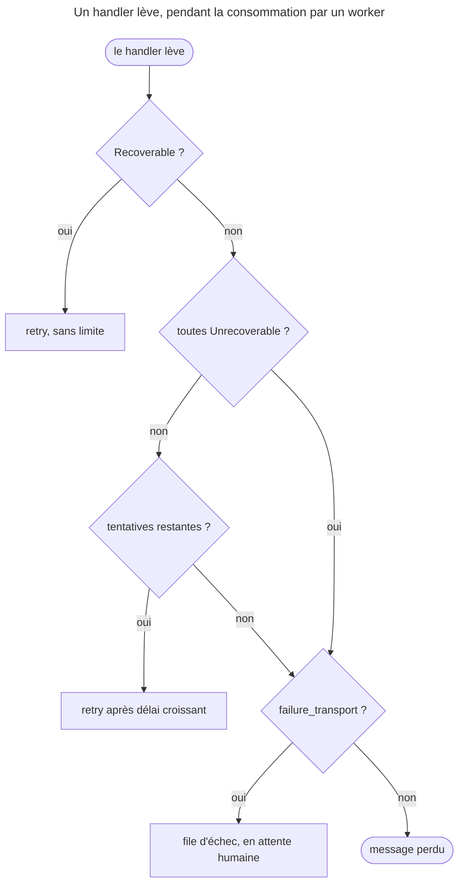

## Objectif

Décider ce qui arrive à un message dont le handler a levé une exception : le
rejouer, l'abandonner, ou le mettre de côté. Trois mécanismes se superposent, et
c'est leur ordre qui décide.

## L'essentiel

En **synchrone**, l'exception d'un handler remonte au `dispatch()`, emballée,
sans retry. Dans un **worker**, elle déclenche un retry à délai croissant ;
deux exceptions spéciales court-circuitent cette strategy ; et un message
épuisé part dans le **failure transport** — ou est perdu s'il n'y en a pas.

## Le schéma



Chaque étage change l'issue, et c'est l'ordre qui compte : une
`UnrecoverableMessageHandlingException` saute la strategy mais **pas** le
failure transport.

## L'exemple

```yaml
framework:
    messenger:
        failure_transport: failed
        transports:
            async:
                dsn: '%env(MESSENGER_TRANSPORT_DSN)%'
                retry_strategy: { max_retries: 3, delay: 1000, multiplier: 2 }
            failed: '%env(MESSENGER_FAILED_DSN)%'
```

```php
$customer = $this->customers->find($message->customerId)
    ?? throw new UnrecoverableMessageHandlingException('Customer deleted.');
$this->gateway->charge($customer);   // un timeout lève une exception ordinaire
```

Un timeout : quatre tentatives, à environ 1 s, 2 s, 4 s d'intervalle, puis la
file `failed`. Un client supprimé : une seule tentative, puis la file `failed`.

## Synchrone : l'exception remonte, emballée

Un message non routé n'a ni retry ni file d'échec. Ce qui remonte est une
`HandlerFailedException` — « Handling "App\…\Boom" failed: boom » : un
`catch (\DomainException $e)` autour de `dispatch()` ne l'attrape **pas** ;
l'exception d'origine se lit dans `getWrappedExceptions()`.

## La strategy de retry

```yaml
retry_strategy:
    max_retries: 3
    delay: 1000        # premier délai, en millisecondes
    multiplier: 2      # 1s, 2s, 4s
    max_delay: 10000   # plafond ; 0 = pas de plafond
    jitter: 0.1        # aléatoire, de 0 à 1
```

- Défauts de FrameworkBundle 8.0 : ceux-ci, sauf **`max_delay`, qui vaut 0**.
- Le délai croît **exponentiellement**, `delay × multiplier^n` ; le `jitter`
  le fait varier de ±10 % pour que mille messages ne repartent pas ensemble.
- `max_retries: 3` = trois retries après l'échec initial, **quatre**
  tentatives.
- Un retry ne rejoue que ce qui a échoué : un handler dont l'Envelope porte
  déjà le `HandledStamp` est sauté.

## Court-circuiter la strategy

| Exception | Effet |
|---|---|
| `UnrecoverableMessageHandlingException` | **aucun retry** : le message part directement en échec |
| `RecoverableMessageHandlingException` | retry **forcé**, **sans limite** ; son quatrième argument, `retryDelay`, fixe le délai en ms |

- `shouldRetry()` renvoie `true` pour une exception *recoverable* **avant** de
  consulter `max_retries`.
- `new RecoverableMessageHandlingException('later', 0, null, 5000)` renvoie le
  message avec un `DelayStamp(5000)`, quelle que soit la strategy.
- Plusieurs handlers échouent : il faut que **toutes** les exceptions emballées
  soient *unrecoverable* pour refuser le retry.

La strategy traite l'échec **temporaire**, `Unrecoverable` l'échec
**permanent** — un identifier qui n'existera jamais.

## Le failure transport

| Exception | Tentatives | Sans `failure_transport` | Avec |
|---|---|---|---|
| ordinaire | 4 | perdu | en file d'échec |
| `Unrecoverable…` | 1 | perdu | en file d'échec |
| `Recoverable…` | illimitées | jamais en échec | jamais en échec |

```bash
php bin/console messenger:failed:show --stats
php bin/console messenger:failed:retry
php bin/console messenger:failed:remove <id>
```

- `messenger:failed:retry` **traite lui-même** le message, depuis la file
  d'échec ; le compteur a été remis à zéro à l'entrée (`RedeliveryStamp(0)`).
  Un nouvel échec le renvoie dans la file d'échec, pas vers `async`.
- Hors mode interactif, il faut un id : « Message id must be passed when in
  non-interactive mode. » Pour tout rejouer : `messenger:consume failed`.

## L'enchaînement complet

1. Traité pendant `dispatch()` : `HandlerFailedException`, et rien d'autre.
2. Dans un worker, une exception `Recoverable…` : retry, sans limite.
3. Toutes les exceptions `Unrecoverable…` : aucun retry, directement à
   l'étape 5.
4. Sinon : retry à délai croissant, tant que `max_retries` le permet.
5. Épuisé : le failure transport s'il est configuré, sinon le message est
   perdu.

## Pièges d'examen

- En **synchrone**, l'exception remonte au `dispatch()` : pas de retry.
- En asynchrone, une exception ne perd pas le message : elle déclenche un retry.
- `max_retries: 3` = **quatre** tentatives au total.
- `RecoverableMessageHandlingException` ignore `max_retries`.
- Sans `failure_transport`, un message épuisé est **définitivement perdu**.
- `UnrecoverableMessageHandlingException` saute les retries, pas la file d'échec.
- Le délai est **exponentiel**, pas constant ; `max_delay` vaut 0 par défaut.
- `messenger:failed:retry` traite le message lui-même, depuis la file d'échec.

## Application

- Un controller attrape `PaymentDeclined` autour d'un `dispatch()` synchrone,
  sans effet → attraper `HandlerFailedException`, puis `getWrappedExceptions()`.
- Une CI lance `messenger:failed:retry --force` et échoue → passer un id, ou
  `messenger:consume failed`.

## QCM d'entraînement

**Question 1.** Un message asynchrone a deux handlers. Le premier lève au
premier essai, le second réussit. Au retry, combien de fois le second a-t-il
été appelé en tout ?

- **A.** Une fois, au premier essai
- **B.** Deux fois : le retry rejoue tout le message
- **C.** Zéro : un échec annule tous les handlers
- **D.** Quatre fois : `max_retries` vaut 3

<details>
<summary>Correction</summary>

**Bonne réponse : A.** Le `HandledStamp` du second est resté sur l'Envelope,
et `HandleMessageMiddleware` saute un handler déjà traité.

</details>

**Question 2.** Un handler lève
`new RecoverableMessageHandlingException('later', 0, null, 5000)`. La strategy
du transport dit `delay: 1000`. Quel délai avant le retry ?

- **A.** 1000 ms : la strategy décide
- **B.** 5000 ms, le délai de l'exception
- **C.** Aucun : `Recoverable` rejoue immédiatement
- **D.** 6000 ms : les deux s'additionnent

<details>
<summary>Correction</summary>

**Bonne réponse : B.** Le message repart avec un `DelayStamp(5000)` : le
`retryDelay` de l'exception passe avant la strategy du transport.

</details>

**Question 3.** Deux handlers échouent sur le même message : l'un lève
`UnrecoverableMessageHandlingException`, l'autre une `DomainException`.
`max_retries: 3`. Combien de tentatives ?

- **A.** Une : un `Unrecoverable` suffit à tout arrêter
- **B.** Sans limite
- **C.** Quatre, comme une exception ordinaire
- **D.** Deux : une par handler

<details>
<summary>Correction</summary>

**Bonne réponse : C.** Le retry n'est refusé que si toutes les exceptions
emballées sont *unrecoverable* ; sinon la strategy s'applique.

</details>

**Question 4.** Une CI, non interactive, lance `messenger:failed:retry --force`
sans identifier. Résultat ?

- **A.** Tous les messages de la file d'échec sont rejoués
- **B.** Les messages repartent vers leur transport d'origine
- **C.** Rien : la command attend une confirmation
- **D.** Une erreur : il faut passer un identifier

<details>
<summary>Correction</summary>

**Bonne réponse : D.** `--force` supprime la confirmation, pas le besoin d'un
id ; A ne vaut qu'en mode interactif.

</details>

## Fiche express

**Si tu dois retenir seulement 7 choses :**

- **Synchrone** : une `HandlerFailedException` remonte, sans retry.
- **`max_retries: 3`** = quatre tentatives, délais exponentiels.
- **`max_delay`** vaut **0** par défaut : pas de plafond.
- **`Unrecoverable…`** saute les retries, **pas** la file d'échec.
- **`Recoverable…`** force le retry, sans limite ; `retryDelay` fixe le délai.
- Sans **`failure_transport`**, un message épuisé est perdu.
- **`messenger:failed:retry`** traite lui-même ; en script, un id.

Moyen mnémotechnique : **« réessayer, abandonner, mettre de côté »**.

```text
sync → HandlerFailedException (getWrappedExceptions) ; async → Recoverable ? retry sans fin : toutes Unrecoverable ? échec : max_retries (+1 tentative) ;
délai delay×multiplier^n, max_delay 0 ; échec → failure_transport ou perdu ; failed:retry traite lui-même, id hors interactif
```

## Sources officielles

- [Messenger, « Retries & Failures »](https://github.com/symfony/symfony-docs/blob/8.0/messenger.rst)
- [Messenger 8.0, `SendFailedMessageForRetryListener`](https://github.com/symfony/symfony/blob/8.0/src/Symfony/Component/Messenger/EventListener/SendFailedMessageForRetryListener.php)
- [Messenger 8.0, `SendFailedMessageToFailureTransportListener`](https://github.com/symfony/symfony/blob/8.0/src/Symfony/Component/Messenger/EventListener/SendFailedMessageToFailureTransportListener.php)
- [Messenger 8.0, `MultiplierRetryStrategy`](https://github.com/symfony/symfony/blob/8.0/src/Symfony/Component/Messenger/Retry/MultiplierRetryStrategy.php)
- [Messenger 8.0, `FailedMessagesRetryCommand`](https://github.com/symfony/symfony/blob/8.0/src/Symfony/Component/Messenger/Command/FailedMessagesRetryCommand.php)
- [Messenger 8.0, `HandleMessageMiddleware`](https://github.com/symfony/symfony/blob/8.0/src/Symfony/Component/Messenger/Middleware/HandleMessageMiddleware.php)

