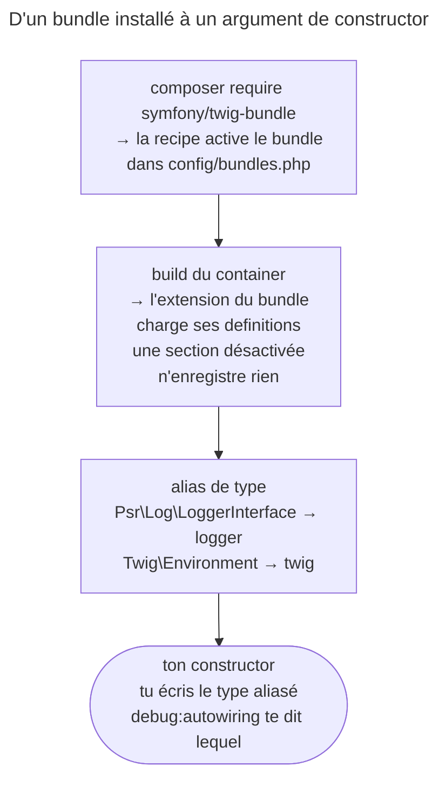

## Objectif

Savoir d'où viennent les services que l'on n'a jamais déclarés, pourquoi l'un
d'eux peut manquer, et trouver le type à écrire dans un constructor avec la
bonne command, sans apprendre de liste par cœur.

## L'essentiel

Les services que tu n'as jamais déclarés viennent des **bundles** installés —
FrameworkBundle d'abord —, chacun avec le **type** sous lequel il s'injecte.
Pas de liste à apprendre : `debug:autowiring` dit quel type écrire. Un service
manque si son bundle est absent ou sa section désactivée.

## Le schéma



## Le fil rouge : un `InvoiceMailer`

```php
class InvoiceMailer
{
    public function __construct(
        private LoggerInterface $logger,              // Psr\Log\LoggerInterface
        private UrlGeneratorInterface $urls,          // Symfony\Component\Routing\Generator\…
        private Environment $twig,                    // Twig\Environment
    ) {
    }
}
```

## D'où viennent les services intégrés

- Chaque bundle apporte les siens : FrameworkBundle (router, dispatcher,
  `RequestStack`, cache, filesystem, et serializer, validator, client HTTP
  quand leurs packages sont là), TwigBundle, SecurityBundle…
- L'extension du bundle déclare le service **et** son type :
  `->alias(RequestStack::class, 'request_stack')`.

| Situation | Injectable ? |
|---|---|
| TwigBundle activé | `Twig\Environment` : **oui** |
| `twig/twig` installé, **sans** TwigBundle | **non** : « …but no such service exists » |
| `symfony/serializer` installé, section par défaut | `SerializerInterface` : **oui** |
| `framework.serializer.enabled: false` | **non** : 89 types au lieu de 98 dans `debug:autowiring` |

C'est le **bundle** qui fournit le service, pas la bibliothèque ; et une
section activable n'enregistre rien tant qu'elle est désactivée.

## Trouver le bon type : `debug:autowiring`

| Écriture | Résultat |
|---|---|
| `debug:autowiring` | les types utilisables comme type-hint |
| `debug:autowiring log` | ceux qui **contiennent** « log » : `Psr\Log\LoggerInterface - alias:logger` |
| `debug:autowiring zzzz` | « No autowirable classes or interfaces found », exit code 1 |
| `debug:autowiring RedirectController --all` | ajoute les services sans alias de type |

- `debug:container` répond à « quels **services** existent ? » (`logger`,
  `twig`…) ; `debug:autowiring`, à « quel **type** écrire ? ».
- On injecte le **type aliasé**, pas la class du service : un argument typé
  `Symfony\Component\HttpKernel\Log\Logger` échoue,
  « Try changing the type-hint to "Psr\Log\LoggerInterface" instead ».
- Souvent une interface, pas toujours : `RequestStack`, `Filesystem` et
  `Twig\Environment` sont des classes aliasées.

## Pièges d'examen

**`debug:container` et `debug:autowiring` ne répondent pas à la même
question.** Le premier liste **tous** les identifiers du container, le second
les types utilisables comme type-hint. Apparaître dans `debug:container` ne rend
pas un service injectable par son type : `logger` y figure, sa class concrète
ne s'injecte pas.

**On type-hinte le type aliasé, pas la class du service.** Viser la class
concrète de `logger` échoue ; `LoggerInterface` fonctionne.

**« Toujours une interface » est faux** : `RequestStack` ou `Filesystem`
s'injectent par leur class, parce que c'est elle que le bundle a aliasée.

**Un service intégré vient d'un bundle, pas du framework en bloc.** Retirer le
bundle retire ses services : sans TwigBundle, pas d'`Environment` à injecter.

**Une section désactivée n'enregistre aucun service.** Avec
`framework.serializer.enabled: false`, `SerializerInterface` n'est plus
injectable, même si `symfony/serializer` est installé.

## Application

- Mettre en cache un calcul → `debug:autowiring cache` donne le type à
  écrire ; `cache:pool:list` liste les pools, pas les types.
- `Twig\Environment` n'est pas injectable alors que `twig/twig` est installé →
  installer TwigBundle.

## QCM d'entraînement

**Question 1.** Quel argument de constructor reçoit le logger du framework par
autowiring ?

- **A.** `Symfony\Component\HttpKernel\Log\Logger $logger`, la class du service
- **B.** `Psr\Log\LoggerInterface $logger`
- **C.** `string $logger`, avec `'logger'` comme identifier du service visé
- **D.** `ContainerInterface $container`, puis `get('logger')` dans le body

<details>
<summary>Correction</summary>

**Bonne réponse : B.** C'est le type que le bundle a aliasé vers `logger` ; la
class concrète n'est le nom d'aucun service.

</details>

**Question 2.** Quelle affirmation sur les types que propose
`debug:autowiring` est exacte ?

- **A.** Ce sont toujours des interfaces, jamais des classes
- **B.** Ce sont tous les identifiers du container, triés par type de class
- **C.** Des types aliasés, parfois des classes comme `RequestStack`
- **D.** Ce sont seulement les services déclarés dans `services.yaml`

<details>
<summary>Correction</summary>

**Bonne réponse : C.** Le bundle choisit le type sous lequel publier chaque
service, et ce type peut être une class.

</details>

**Question 3.** `symfony/serializer` est installé, mais `framework.yaml`
contient `serializer: { enabled: false }`. Que devient `SerializerInterface` ?

- **A.** Il n'est plus injectable : la section désactivée n'enregistre rien
- **B.** Il reste injectable : la présence du package suffit
- **C.** Il est injectable dans les controllers seulement
- **D.** Il est remplacé par un serializer vide, qui renvoie toujours un array vide

<details>
<summary>Correction</summary>

**Bonne réponse : A.** FrameworkBundle n'enregistre les services d'une section
que si elle est activée ; le type disparaît de `debug:autowiring`.

</details>

**Question 4.** `debug:autowiring RedirectController` n'affiche rien, mais
signale un service concret de plus. Quelle command le montre ?

- **A.** `debug:autowiring RedirectController --show-hidden`
- **B.** `debug:autowiring RedirectController --verbose`
- **C.** `debug:container --show-arguments RedirectController --types`
- **D.** `debug:autowiring RedirectController --all`

<details>
<summary>Correction</summary>

**Bonne réponse : D.** `--all` ajoute les services enregistrés sous leur nom de
class sans alias de type.

</details>

## Fiche express

**Si tu dois retenir seulement 6 choses :**

- Un service intégré vient d'un **bundle**, activé par sa recipe.
- Sans le bundle, ou section **désactivée** : pas de service.
- **`debug:autowiring`** : quel type écrire ; **`debug:container`** : quels
  services existent.
- On injecte le **type aliasé**, pas la class du service.
- Interface le plus souvent ; **`RequestStack`**, **`Filesystem`** : des classes.
- **`--all`** : les services sans alias de type.

Moyen mnémotechnique :
**« container = QUI existe, autowiring = QUOI écrire »**.

## Sources officielles

- [Service Container, « Fetching and using Services »](https://github.com/symfony/symfony-docs/blob/8.0/service_container.rst)
- [Flex recipes, activation du bundle](https://github.com/symfony/symfony-docs/blob/8.0/quick_tour/flex_recipes.rst)
- [FrameworkBundle 8.0, `DebugAutowiringCommand`](https://github.com/symfony/symfony/blob/8.0/src/Symfony/Bundle/FrameworkBundle/Command/DebugAutowiringCommand.php)
- [FrameworkBundle 8.0, `Resources/config/services.php`](https://github.com/symfony/symfony/blob/8.0/src/Symfony/Bundle/FrameworkBundle/Resources/config/services.php)
- [FrameworkBundle 8.0, `FrameworkExtension`](https://github.com/symfony/symfony/blob/8.0/src/Symfony/Bundle/FrameworkBundle/DependencyInjection/FrameworkExtension.php)
- [FrameworkBundle 8.0, `Configuration`](https://github.com/symfony/symfony/blob/8.0/src/Symfony/Bundle/FrameworkBundle/DependencyInjection/Configuration.php)

