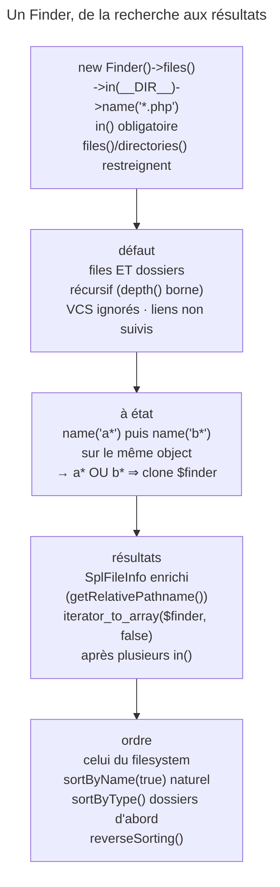

## Objectif

Trouver des files et des directories par critères chaînés, et connaître le
piège qui fait échouer une réutilisation d'object.

## L'essentiel

Le `Finder` cherche files et directories par **critères chaînés**, `in()`
étant le seul obligatoire. Il rend les deux par défaut, récursivement, dans
l'ordre du filesystem. Le piège central : l'object est **à état** — un second
`name()` s'ajoute au premier ; pour réutiliser une configuration, on clone.

## Le schéma



## L'exemple : deux recherches sur une base commune

```php
$finder = new Finder();
$finder->files()->in('./templates');

foreach ((clone $finder)->name('partial_*') as $file) {
    $file->getRelativePathname();
}
foreach ((clone $finder)->name('plugin_*') as $file) {
    // sans clone : partial_* ET plugin_*
}
```

## L'usage de base

Chaque résultat est un `Symfony\Component\Finder\SplFileInfo`, qui étend celui
de PHP pour ajouter `getRelativePath()` et `getRelativePathname()`. Toutes les
methods de critère se chaînent.

## L'object est à état — le piège central

> Le `Finder` est **stateful**. Tout appel de method modifie toutes ses
> instances.

Un second `name()` **s'ajoute** : un file après le premier, deux après le
second, sur le même object. `clone` donne une copie indépendante.

## Quoi chercher

- `in()` : un ou plusieurs directories, joker `*` permis — chaque pattern
  doit résoudre vers un directory, sinon `DirectoryNotFoundException` ;
  `exclude()` prend des paths **relatifs** à ceux d'`in()` ; une URL
  `ftp://` ou `zlib://` est acceptée.
- **Par défaut, files et directories** ; `files()` ou `directories()`
  restreignent. Sans `in()` ni `append()`, l'itération lève une
  `LogicException`.
- Récursif par défaut ; `depth('== 0')`, `depth(['> 2', '< 5'])` bornent.
- Métadonnées VCS ignorées par défaut (`ignoreVCS(false)`) ;
  `ignoreVCSIgnored(true)` applique les `.gitignore` en partant du directory
  de recherche. Liens symboliques suivis seulement avec `followLinks()`.

## Récupérer les résultats

`Finder` implémente `IteratorAggregate` : `foreach`, `iterator_to_array()`,
`iterator_count()`, `hasResults()`. La key est le path du file : deux `a.txt`
de directories distincts donnent deux keys, sans collision. Deux `in()` qui
se recouvrent atteignent le même file deux fois — `iterator_count()` rend 5,
`iterator_to_array()` 4, avec `false` en second argument 5.

## Un ordre déterministe

| Appel | Ordre |
|---|---|
| aucun tri | celui du filesystem : ni alphabétique, ni de création |
| `sortByName()` | `f1, f10, f2` — comparaison de strings |
| `sortByName(true)` | `f1, f2, f10` — ordre naturel |
| `sortByType()` | directories d'abord, puis files |
| `->reverseSorting()` | l'ordre inverse du tri |

## Pièges d'examen

**Le `Finder` est à état** : deux `name()` s'additionnent. Cloner pour réutiliser.

**Sans `files()` ni `directories()`, les deux sont rendus.**

**`in()` est le seul critère obligatoire.**

**Plusieurs `in()` : `iterator_to_array($finder, false)`.**

## Application

- Deux recherches sur les mêmes dossiers, avec des noms différents → une base
  commune, et `clone` pour chaque recherche.
- Un test qui compare une liste de files → `sortByName(true)`.

## QCM d'entraînement

**Question 1.** `(new Finder())->in('src/*/Resources')` est itéré, et aucun
directory ne correspond au joker. Que se passe-t-il ?

- **A.** Aucun résultat, sans erreur
- **B.** Une `DirectoryNotFoundException`
- **C.** Le joker est ignoré, `src/` est parcouru
- **D.** Une `LogicException` : `in()` manque

<details>
<summary>Correction</summary>

**Bonne réponse : B.** Chaque pattern passé à `in()` doit résoudre vers au
moins un directory ; sinon le Finder refuse de chercher.

</details>

**Question 2.** Un directory contient `zdir/`, `adir/`, `b.txt` et `m.txt`.
Dans quel ordre `depth(0)->sortByType()` les rend-il ?

- **A.** `adir`, `zdir`, `b.txt`, `m.txt`
- **B.** `b.txt`, `m.txt`, `adir`, `zdir`
- **C.** `adir`, `b.txt`, `m.txt`, `zdir`
- **D.** L'ordre du filesystem : `sortByType()` ne trie pas les noms

<details>
<summary>Correction</summary>

**Bonne réponse : A.** `sortByType()` place les directories d'abord, puis les
files, chacun dans l'ordre de son nom.

</details>

**Question 3.** Même directory : `depth(0)->sortByName()->reverseSorting()`.
Quel est le premier résultat ?

- **A.** `adir`
- **B.** `b.txt`
- **C.** Une exception : deux tris
- **D.** `zdir`

<details>
<summary>Correction</summary>

**Bonne réponse : D.** `reverseSorting()` inverse le tri demandé : le nom le
plus grand passe en premier.

</details>

**Question 4.** `g/` contient seulement `link`, un lien symbolique vers un
directory qui contient un file. Combien de files rend
`files()->in('g')` ?

- **A.** 1 : le file du directory lié
- **B.** 0
- **C.** 2 : le lien et le file
- **D.** Une exception : lien détecté

<details>
<summary>Correction</summary>

**Bonne réponse : B.** Les liens symboliques ne sont pas suivis par défaut ;
avec `followLinks()`, le file serait trouvé.

</details>

## Fiche express

**Si tu dois retenir seulement 6 choses :**

- **`in()`** obligatoire ; joker sans correspondance → exception.
- Par défaut **files et directories**, récursif, VCS ignorés, liens non
  suivis.
- Object **à état** : `clone` pour réutiliser.
- `exclude()` **relatif** à `in()`.
- Plusieurs `in()` : **`iterator_to_array($finder, false)`**.
- Trier pour un ordre stable : `sortByName(true)`, `sortByType()`,
  `reverseSorting()`.

Moyen mnémotechnique : **« Où, quoi, dans quel ordre — et cloner »**.

## Sources officielles

- [The Finder Component](https://github.com/symfony/symfony-docs/blob/8.0/components/finder.rst)
- [`Finder`, branche 8.0](https://github.com/symfony/symfony/blob/8.0/src/Symfony/Component/Finder/Finder.php)

