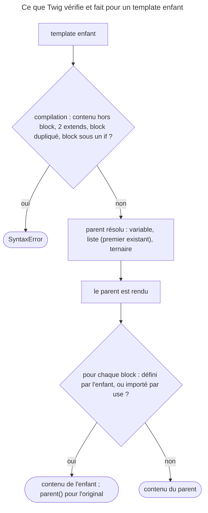

## Objectif

Construire une hiérarchie de templates, savoir ce que l'inheritance autorise, et
distinguer l'inheritance de la réutilisation horizontale.

## Avant la règle : le problème à résoudre

Toutes les pages d'un site partagent un header, un menu, un pied de page. Les
recopier dans chaque template, c'est les voir diverger au premier changement.
Il faut **un squelette commun**, et dans chaque page **seulement ce qui change**.
Twig le fait par l'inheritance : un parent déclare des trous, les enfants les
remplissent.

Trois questions : **ce qu'un enfant peut écrire**, **comment il réutilise le
parent**, et **comment partager des blocks sans hériter**. Tous les faits de
cette page ont été exécutés avec Twig 3.22.2.

## Le fil rouge : base, section, page

```twig
{# base.html.twig #}
<title>Mon site</title>
<link rel="stylesheet" href="app.css">
<main></main>

{# blog/layout.html.twig #}

Blog — {{ block('page_title') }}

{# blog/show.html.twig #}

{{ post.title }}
{{ parent() }}<link rel="stylesheet" href="post.css">
<article>{{ post.body }}</article>
```

Trois niveaux, un seul parent chacun. La page ajoute une feuille de style
sans perdre celle du parent, et le titre de la section réutilise un block de
la page.

## Le cycle complet en un schéma

Comment un enfant est compilé puis rendu, lu dans `Parser` et rejoué :



## Le mécanisme

Un template parent déclare des **blocks** ; un template enfant `extends` le parent
et redéfinit ceux qui l'intéressent.

```html


Articles


    <h1>Derniers articles</h1>

```

Un block non redéfini garde le contenu du parent. Un enfant n'affiche **que** ses
blocks.

## Hors d'un block : une erreur, pas un oubli silencieux

Dans un template qui étend un parent, du texte ou un `{{ … }}` écrit hors de tout
block **n'est pas ignoré** : le compiler de Twig 3.22 lève une
`Twig\Error\SyntaxError` : `A template that extends another one cannot include
content outside Twig blocks` (`Parser::filterBodyNodes()`, fixture de test
`child_contents_outside_blocks.test`). Seuls les blancs sont tolérés.

Les tags qui n'affichent rien, comme ``, restent permis hors block.

Rejoué : la variable posée par un `` hors block est lisible dans les
blocks de l'enfant — `` puis `{{ x }}`
affiche `v`.

## Les règles de l'inheritance

**Un seul inheritance.** Un template ne peut étendre qu'un seul parent : un second
tag lève « Multiple extends tags are forbidden. » Placé dans un block ou une
macro, `extends` est refusé lui aussi.

**`extends` en tête.** La documentation demande qu'il soit le premier tag
du template.

**Un nom de block, une seule fois par template.** Un block est à la fois un trou à
remplir et le contenu qui le remplit : deux blocks de même nom rendraient
l'inheritance ambigu.

Rien n'empêche en revanche d'empiler les niveaux — `base` → `layout de section`
→ `page` — et c'est le pattern habituel.

**Rejoué, ce que le parser refuse — et ce qu'il laisse passer :**

| Template | Résultat |
|---|---|
| deux `extends` | « Multiple extends tags are forbidden » |
| `extends` dans un block | « Cannot use "extend" in a block » |
| deux `` | « The block 'body' has already been defined line 1 » |
| `` **avant** `extends` | **accepté**, `x` lisible dans les blocks |

La dernière ligne nuance la règle « en tête » : c'est une consigne de la
documentation, pas un contrôle du parser — seul le contenu affiché hors block
est refusé.

## L'inheritance dynamique

Le parent est une expression :

- `` — une variable, éventuellement un object
  `TemplateWrapper` ;
- `` — le **premier
  template qui existe** est retenu ;
- `` —
  inheritance conditionnel.

Rejoué : `['missing', 'layout', 'base']` retient `layout` ; une liste dont aucun
template n'existe lève une `LoaderError` : « Unable to find one of the following
templates: "missing", "absent" ».

## Reprendre, réafficher, tester un block

`{{ parent() }}` insère le contenu que le block avait dans le parent, ce qui
permet d'ajouter au lieu de remplacer :

```html

    {{ parent() }}
    <link rel="stylesheet" href="page.css">

```

Un block ne s'affiche qu'une fois par son tag ; pour le réafficher, la
**function** `block('title')` — qui peut aussi lire un block d'un autre template,
`block('title', 'common.html.twig')`. `block('footer') is defined` teste son
existence. Deux formes utiles : le nom répété après `endblock`, et le
raccourci ``.

**Un block ne rend pas conditionnel ce qui l'entoure.** Placé dans un `if`, il
reste défini : seul son affichage suit la condition. Pour conditionner le
contenu, on met le `if` **dans** le block. Dans un enfant, un block imbriqué sous
un `if` lève d'ailleurs « A block definition cannot be nested under
non-capturing nodes ».

Rejoué : un parent place `` sous `` ; un enfant le
redéfinit ; avec `show` faux, ni l'original ni la redéfinition ne s'affichent.

## Réutilisation horizontale

`` **importe les blocks** d'un autre template sans
l'étendre ni les afficher. C'est la solution de Twig au besoin d'inheritance
multiple, sans sa complexité : on peut `use` plusieurs templates tout en n'en
`extends` qu'un. Un block du template courant l'emporte sur un block importé du
même nom ; `with sidebar as base_sidebar` renomme à l'import. La cible de `use`
ne peut pas être une expression.

La documentation la présente comme une fonctionnalité avancée, rarement
nécessaire dans un template ordinaire — mais c'est exactement pour cela qu'elle
est interrogeable.

**Rejoué, l'effet de bord :** un block importé compte comme un block de
l'enfant. Si `blocks.html.twig` définit `title` et que l'enfant ne le redéfinit
pas, ce `title` importé **remplace** celui du parent. Et ``, avec
une variable, lève « The template references in a "use" statement must be a
string ».

## Concrètement dans ton application

- Un `base.html.twig`, un layout par section, des pages : trois niveaux, un
  parent chacun.
- Ajouter à un block du parent : `{{ parent() }}` dans le block.
- Réafficher le titre dans un `<h1>` : `{{ block('title') }}`.
- Un parent selon le contexte : une liste ou un ternaire dans `extends`.
- Des morceaux partagés entre layouts sans les hériter : ``, en
  vérifiant qu'aucun nom ne masque un block du parent.
- Hors block, dans un enfant : seulement des `` et des blancs.

## À comprendre

- **Pourquoi interdire le contenu hors block ?** Le parent décide de tout ce
  qui s'affiche ; un texte hors block n'aurait aucune place où aller.
- **Pourquoi un seul parent ?** Deux parents rendraient ambigu l'ordre des
  blocks ; `use` donne le partage sans cette ambiguïté.
- **Pourquoi un block importé masque-t-il le parent ?** `use` copie les blocks
  dans le template courant : pour l'inheritance, ils sont à lui.

## À mémoriser

- **`extends`** + **`block`** ; un block non redéfini garde le parent.
- Hors block dans un enfant : **SyntaxError** — sauf blancs et ``.
- **Un seul `extends`** ; jamais dans un block ; un **nom de block unique**.
- Parent **dynamique** : variable, **liste** (premier existant), ternaire.
- **`parent()`** reprend, **`block()`** réaffiche, **`is defined`** teste.
- **`use`** importe des blocks — qui masquent ceux du parent.
- Moyen mnémotechnique : **« un parent, des trous, rien hors des trous »**.

## Pièges d'examen

**Du contenu hors block dans un enfant est une erreur de syntaxe**, pas un
contenu ignoré.

**Un seul parent**, mais un parent choisi dynamiquement : variable, liste dont
le premier existant gagne, ou ternaire.

**`block()` réaffiche, `parent()` reprend.** Le tag, lui, n'affiche qu'une
fois.

**Un block dans un `if` reste défini.** Seul son rendu dépend de la condition.

**Importer les blocks d'un autre template n'est pas en hériter.**

## Application : trois scénarios

**Scénario 1 — Le titre qui change tout seul.** Une page ajoute
`` pour un block `sidebar` ; le `<title>` du site
change. *Solution.* `widgets.html.twig` définit aussi `title`, qui masque celui
du parent : renommer à l'import, `with title as widget_title`, ou retirer ce
block du file partagé.

**Scénario 2 — Le layout introuvable.** `` lève une `LoaderError` sur un nouveau theme.
*Solution.* Terminer la liste par un template qui existe toujours,
`base.html.twig`.

**Scénario 3 — La bannière conditionnelle.** Un enfant écrit
`…` et la compilation
échoue. *Solution.* Mettre le `if` dans le block :
`…`.

## QCM d'entraînement

Cinq questions sur l'inheritance. Choisis avant d'ouvrir la correction.

**Question 1.** Un template commence par ``, puis
``, puis un block qui affiche `{{ x }}`.
Que se passe-t-il ?

- **A.** Une `SyntaxError` : `extends` doit être le premier tag
- **B.** Le rendu fonctionne et affiche `1`
- **C.** Le rendu fonctionne, mais `x` est inconnu dans le block
- **D.** Twig ignore le `set` placé avant `extends`

<details>
<summary>Correction</summary>

**Bonne réponse : B.** Rejoué avec Twig 3.22.2. « En tête » est une consigne de
la documentation ; le parser ne refuse que le contenu affiché hors block.

A est l'idée reçue. C et D sont faux.

</details>

**Question 2.** ``, et
aucun des deux n'existe. Résultat ?

- **A.** Le template est rendu sans parent
- **B.** Une `SyntaxError` à la compilation
- **C.** Une `LoaderError` au rendu
- **D.** Twig retombe sur `base.html.twig`

<details>
<summary>Correction</summary>

**Bonne réponse : C.** Rejoué : « Unable to find one of the following
templates: "missing", "absent" ».

A et D supposent un repli implicite. B est faux : la liste est valide.

</details>

**Question 3.** Le parent définit `title` ; l'enfant ne le redéfinit pas mais
fait ``, qui définit lui aussi `title`. Quel titre
s'affiche ?

- **A.** Celui de `blocks.html.twig`
- **B.** Celui du parent : `use` n'hérite de rien
- **C.** Une `SyntaxError` : block défini deux fois
- **D.** Aucun : les deux s'annulent

<details>
<summary>Correction</summary>

**Bonne réponse : A.** Rejoué : un block importé compte comme un block de
l'enfant, et un block de l'enfant remplace celui du parent.

B confond « ne pas hériter » et « ne rien remplacer ». C et D sont faux.

</details>

**Question 4.** Un template contient deux fois ``. Que se
passe-t-il ?

- **A.** Le second remplace le premier
- **B.** Les deux s'affichent, l'un après l'autre
- **C.** Le premier gagne, le second est ignoré
- **D.** Une `SyntaxError`

<details>
<summary>Correction</summary>

**Bonne réponse : D.** Rejoué : « The block 'body' has already been defined ».
Un nom de block est unique dans un template.

A, B et C supposent une résolution silencieuse.

</details>

**Question 5.** Un template écrit ``, avec une variable.
Que se passe-t-il ?

- **A.** Les blocks du template nommé par la variable sont importés
- **B.** Une `SyntaxError` : la cible doit être une string
- **C.** Une `LoaderError` si la variable est vide
- **D.** `use` accepte une variable seulement dans un enfant

<details>
<summary>Correction</summary>

**Bonne réponse : B.** Rejoué : « The template references in a "use" statement
must be a string ». Contrairement à `extends`, `use` n'accepte pas
d'expression.

A, C et D supposent une cible dynamique.

</details>

## Fiche express

**Si tu dois retenir seulement 7 choses :**

- **`extends`** + **`block`** ; un block non redéfini garde le parent.
- Hors block, dans un enfant : **SyntaxError**, sauf blancs et **`set`**.
- **Un seul parent**, jamais dans un block ; **un nom de block unique**.
- Parent **dynamique** : liste (premier existant), ternaire, variable.
- **`parent()`** ajoute, **`block()`** réaffiche.
- Un block sous un **`if`** reste défini.
- **`use`** importe des blocks, qui **masquent** ceux du parent.

**En une phrase, pour tout reconstruire :**

```text
enfant = extends (1 seul, expression permise) + blocks (noms uniques) ; hors block : SyntaxError sauf set/blancs ;
parent() reprend, block() réaffiche, is defined teste ; use = blocks importés (masquent le parent), cible = string
```

## Sources officielles

- [Twig 3.22, tag `extends`](https://github.com/twigphp/Twig/blob/v3.22.0/doc/tags/extends.rst)
- [Twig 3.22, tag `use`](https://github.com/twigphp/Twig/blob/v3.22.0/doc/tags/use.rst) et [function `block`](https://github.com/twigphp/Twig/blob/v3.22.0/doc/functions/block.rst)
- [Twig 3.22, `Parser`](https://github.com/twigphp/Twig/blob/v3.22.0/src/Parser.php) et [fixture `child_contents_outside_blocks.test`](https://github.com/twigphp/Twig/blob/v3.22.0/tests/Fixtures/exceptions/child_contents_outside_blocks.test)
