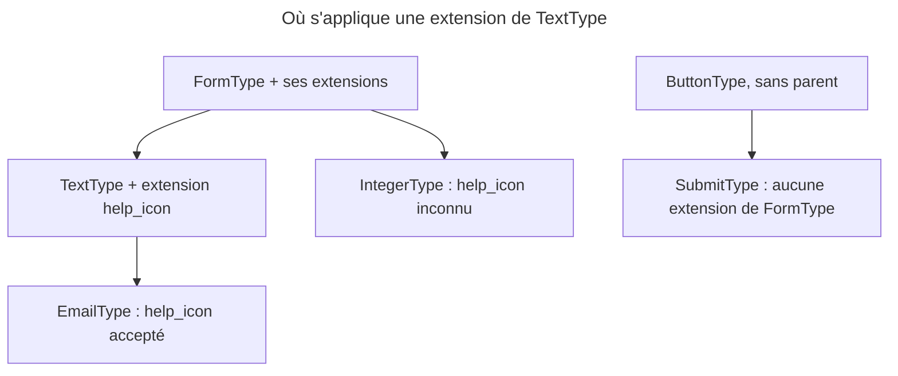

## Objectif

Modifier un type de field **existant** — y compris un type fourni par Symfony ou
par un bundle tiers — sans le remplacer, et savoir jusqu'où la modification
s'étend.

## Avant la règle : le problème à résoudre

L'équipe veut afficher une petite icône d'aide à côté de **tous** les fields
texte de l'application, réglable field par field par une option `help_icon`.

Écrire un `IconTextType` obligerait à remplacer `TextType` dans chaque
form, et ne toucherait pas les forms des bundles tiers. Modifier
`TextType` lui-même est impossible : c'est du code de Symfony. Il faut un moyen
de **greffer** un comportement sur un type existant, partout, sans changer une
seule ligne des forms.

## Le fil rouge : `help_icon`

```php
class HelpIconExtension extends AbstractTypeExtension
{
    public static function getExtendedTypes(): iterable
    {
        return [TextType::class];
    }

    public function configureOptions(OptionsResolver $resolver): void
    {
        $resolver->setDefined('help_icon');
    }

    public function buildView(FormView $view, FormInterface $form, array $options): void
    {
        $view->vars['help_icon'] = $options['help_icon'] ?? null;
    }
}
```

## Le cycle complet en un schéma



## Le principe

Une extension étend `AbstractTypeExtension` et s'applique à tous les fields des
types qu'elle désigne, partout dans l'application. C'est la façon d'ajouter une
option à `FileType` ou une class CSS à tous les `TextType` sans toucher à un
seul form.

C'est la différence avec un type personnalisé : un type crée un nouveau field,
une extension modifie ceux qui existent déjà.

## La seule method obligatoire

```php
public static function getExtendedTypes(): iterable
{
    return [FileType::class];
}
```

`getExtendedTypes()` est **statique**, retourne un itérable, et c'est la seule
method que l'on doive implémenter. Elle en retourne plusieurs si l'extension
s'applique à plusieurs types. Un itérable **vide** est refusé à la compilation
du container : exécuté, `FormPass` lève une `InvalidArgumentException`, « The
getExtendedTypes() method for service "e" does not return any extended
types. ».

## Ce qu'on redéfinit ensuite

Les mêmes points d'accroche que dans un type : `buildForm()` pour ajouter un
listener, `configureOptions()` pour déclarer une option supplémentaire,
`buildView()` et `finishView()` pour exposer une variable au template.

## Qui est touché, et quand

Une extension suit l'**inheritance** des types. Exécuté avec `symfony/form` 8.0.15,
l'extension `help_icon` sur `TextType` :

| Field | Résultat |
|---|---|
| `TextType` | option acceptée, variable de vue transmise |
| `EmailType`, qui hérite de `TextType` | option acceptée aussi |
| `IntegerType`, qui hérite de `FormType` | `UndefinedOptionsException`, « The option "help_icon" does not exist » |

Étendre `FormType::class` touche donc tous les fields — **mais pas les
boutons** : `ButtonType` n'a pas de parent, et une extension de `FormType` ne
l'atteint pas.

L'ordre d'appel suit celui des types : pour un `EmailType`, `buildForm()` de
l'extension de `FormType` passe avant celui de l'extension de `TextType`
(exécuté). Chaque extension s'exécute juste après le type qu'elle étend.

## L'enregistrement

Une extension est un service tagué `form.type_extension`. L'autoconfiguration
pose le tag toute seule pour une class placée dans `src/` : FrameworkBundle
autoconfigure `FormTypeExtensionInterface` (lu dans `FrameworkExtension`).

Plusieurs extensions d'un même type s'ordonnent par l'attribute **`priority`**
du tag : 0 par défaut, la plus haute passe la première. Exécuté avec
`FormPass` : trois extensions de priorities -5, 0 et 20 sont chargées dans
l'ordre 20, 0, -5.

La documentation précise que cet attribute exige de **déclarer le service
explicitement**. Le code le confirme : un attribute PHP `#[AsTaggedItem(priority:
10)]` sur une extension autoconfigurée est **ignoré** par `FormPass` — exécuté,
l'ordre reste celui de l'enregistrement.

`php bin/console debug:form` vérifie qu'une extension est bien enregistrée.

## Concrètement dans ton application

- Une option de plus sur un type de Symfony ou d'un bundle : une extension,
  jamais un nouveau type.
- Un comportement pour tous les fields : une extension de `FormType` — en
  sachant que les boutons y échappent.
- Deux extensions d'un même type dont l'ordre compte : `priority` sur le tag,
  dans `services.yaml`.
- Un doute sur l'enregistrement : `debug:form`.

## À comprendre

- **Pourquoi une extension plutôt qu'un type ?** Parce qu'elle modifie les
  forms existants sans qu'on les touche, y compris ceux qu'on n'a pas
  écrits.
- **Pourquoi `IntegerType` refuse-t-il l'option ?** Parce qu'il n'hérite pas de
  `TextType` : l'extension ne le voit pas, et l'option reste inconnue.
- **Pourquoi `getExtendedTypes()` est-elle statique ?** Parce que `FormPass` la
  lit à la compilation du container, sans instancier l'extension.

## À mémoriser

- Une extension modifie des types existants **et leurs descendants**.
- `getExtendedTypes()` : statique, seule obligatoire, jamais vide.
- `FormType::class` : tous les fields, aucun bouton.
- Ordre : extension du parent avant celle de l'enfant.
- Tag `form.type_extension`, posé par autoconfiguration ; `priority` sur le
  tag, plus haute d'abord ; `#[AsTaggedItem]` ignoré.
- Moyen mnémotechnique : **« Greffer, pas remplacer »**.

## Pièges d'examen

**Un type crée un field ; une extension modifie ceux qui existent.** Pour
ajouter une option à un type fourni par Symfony, écrire un nouveau type ne sert
à rien.

**La method qui désigne les types étendus est statique**, retourne un itérable,
et ne peut pas être vide.

**Une extension atteint les types enfants**, pas les types frères : étendre
`TextType` touche `EmailType`, pas `IntegerType`.

**Étendre le type racine touche tous les fields, pas les boutons.**

**La priority se règle sur le tag**, dans la configuration du service.

## Application : trois scénarios

**Scénario 1 — L'option refusée sur l'âge.** `help_icon` marche sur les
fields texte et e-mail, mais `->add('age', IntegerType::class, ['help_icon' =>
'i'])` lève une `UndefinedOptionsException`. *Solution.* `IntegerType` hérite de
`FormType` : ajouter `IntegerType::class` à `getExtendedTypes()`, ou étendre
`FormType::class`.

**Scénario 2 — Le bouton oublié.** Une extension de `FormType` ajoute une class
CSS partout, sauf aux boutons « Enregistrer ». *Solution.* `SubmitType` descend
de `ButtonType`, sans parent : étendre aussi `ButtonType::class`.

**Scénario 3 — L'ordre qui ne bouge pas.** Une extension porte
`#[AsTaggedItem(priority: 10)]` pour passer avant une autre, sans effet.
*Solution.* `FormPass` lit la priority du tag : déclarer le service avec le
tag `form.type_extension` et son attribute `priority`.

## QCM d'entraînement

Six questions sur les extensions. Choisis avant d'ouvrir la correction.

**Question 1.** Une extension désigne `TextType::class` et déclare l'option `help_icon`. Quel field refuse cette option ?

- **A.** Un `EmailType`
- **B.** Un `TextareaType`
- **C.** Un `IntegerType`
- **D.** Un `PasswordType`

<details>
<summary>Correction</summary>

**Bonne réponse : C.** `IntegerType` hérite de `FormType`, pas de `TextType` :
`UndefinedOptionsException` (exécuté).

A, B et D descendent de `TextType` et reçoivent l'option.

</details>

**Question 2.** `getExtendedTypes()` d'une extension rend un array vide. Quand l'erreur apparaît-elle ?

- **A.** Jamais : l'extension ne s'applique simplement à rien
- **B.** À la compilation du container, par `FormPass`
- **C.** À la première création d'un form
- **D.** Au rendu Twig

<details>
<summary>Correction</summary>

**Bonne réponse : B.** Exécuté : `InvalidArgumentException`, « does not return
any extended types ».

A est le piège. C et D arrivent trop tard : le container refuse avant.

</details>

**Question 3.** Pour un field `EmailType`, une extension de `FormType` et une extension de `TextType` ajoutent chacune un listener dans `buildForm()`. Laquelle s'exécute la première ?

- **A.** Celle de `TextType`, la plus spécifique
- **B.** Celle enregistrée en premier dans le container
- **C.** Les deux en même temps
- **D.** Celle de `FormType`

<details>
<summary>Correction</summary>

**Bonne réponse : D.** Chaque extension s'exécute juste après le type qu'elle
étend, et `FormType` passe avant `TextType` (exécuté).

A inverse la lignée. B confond avec la priority entre extensions d'un **même**
type. C est faux.

</details>

**Question 4.** Trois extensions d'un même type portent sur leur tag les priorities `-5`, `0` et `20`. Dans quel ordre sont-elles chargées ?

- **A.** `-5`, `0`, `20`
- **B.** `20`, `0`, `-5`
- **C.** Dans l'ordre de déclaration des services
- **D.** `0`, `20`, `-5`

<details>
<summary>Correction</summary>

**Bonne réponse : B.** La plus haute passe la première (exécuté avec
`FormPass`).

A inverse. C ignore la priority. D est faux.

</details>

**Question 5.** Une extension autoconfigurée porte l'attribute PHP `#[AsTaggedItem(priority: 10)]`. Que fait `FormPass` de cette priority ?

- **A.** Il l'ignore
- **B.** Il l'applique comme celle d'un tag
- **C.** Il lève une exception de configuration
- **D.** Il l'additionne à la priority du tag

<details>
<summary>Correction</summary>

**Bonne réponse : A.** Seule la priority du tag compte ; exécuté, l'ordre reste
celui de l'enregistrement. La documentation demande de déclarer le service
explicitement.

B, C et D supposent que l'attribute est lu.

</details>

**Question 6.** Une extension étend `FormType::class` et ajoute un attribute HTML. Quels éléments d'un form ne le reçoivent pas ?

- **A.** Les fields de type `ChoiceType`
- **B.** Les forms imbriqués
- **C.** Les boutons, comme `SubmitType`
- **D.** Aucun : `FormType` est la racine de tout

<details>
<summary>Correction</summary>

**Bonne réponse : C.** `ButtonType` n'a pas de parent : une extension de
`FormType` ne l'atteint pas (exécuté).

D est le piège. A et B descendent bien de `FormType`.

</details>

## Fiche express

**Si tu dois retenir seulement 6 choses :**

- Une extension **greffe** un comportement sur des types existants, sans les
  remplacer.
- **`getExtendedTypes()`** : statique, seule obligatoire, jamais vide (sinon
  `FormPass` refuse).
- Elle atteint les **descendants** du type : `TextType` → `EmailType`, pas
  `IntegerType`.
- **`FormType::class`** : tous les fields, **aucun bouton**.
- Ordre : extension du **parent d'abord**.
- Tag **`form.type_extension`** (autoconfiguré) ; **`priority`** sur le tag,
  pas par `#[AsTaggedItem]`.

**En une phrase, pour tout reconstruire :**

```text
AbstractTypeExtension + static getExtendedTypes() → s'applique au type et à ses descendants
  ; FormType = tout sauf les boutons ; tag form.type_extension, priority la plus haute d'abord
```

## Sources officielles

- [How to Create a Form Type Extension](https://github.com/symfony/symfony-docs/blob/8.0/form/create_form_type_extension.rst)
- [Form 8.0, `FormPass`](https://github.com/symfony/symfony/blob/8.0/src/Symfony/Component/Form/DependencyInjection/FormPass.php)
- [DependencyInjection 8.0, `PriorityTaggedServiceTrait`](https://github.com/symfony/symfony/blob/8.0/src/Symfony/Component/DependencyInjection/Compiler/PriorityTaggedServiceTrait.php)
