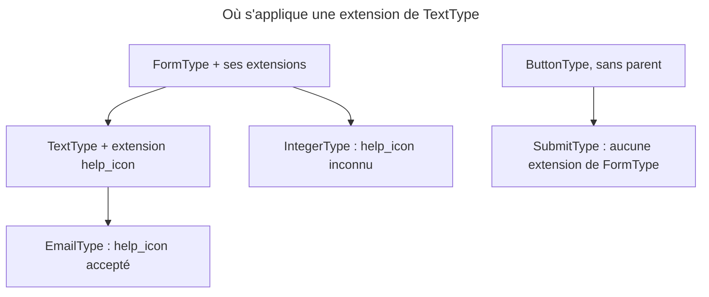

## Objectif

Modifier un type de field **existant** — y compris un type fourni par Symfony ou
par un bundle tiers — sans le remplacer, et savoir jusqu'où la modification
s'étend.

## L'essentiel

Une **form type extension** greffe un comportement sur un type existant —
`TextType`, `FileType`, un type de bundle — partout dans l'application, sans
toucher un seul form. Un type crée un nouveau field ; une extension modifie
ceux qui existent. Elle suit l'**inheritance** des types : elle atteint leurs
descendants, pas leurs frères.

## Le schéma



## L'exemple : `help_icon`

```php
class HelpIconExtension extends AbstractTypeExtension
{
    public static function getExtendedTypes(): iterable
    {
        return [TextType::class];
    }

    public function configureOptions(OptionsResolver $resolver): void
    {
        $resolver->setDefined('help_icon');
    }

    public function buildView(FormView $view, FormInterface $form, array $options): void
    {
        $view->vars['help_icon'] = $options['help_icon'] ?? null;
    }
}
```

Un `IconTextType` obligerait à remplacer `TextType` dans chaque form, et ne
toucherait pas les forms des bundles.

## Le principe

Une extension étend `AbstractTypeExtension` et s'applique à tous les fields
des types qu'elle désigne. Elle redéfinit les mêmes points d'accroche qu'un
type : `buildForm()`, `configureOptions()`, `buildView()`, `finishView()`.

## La seule method obligatoire

`getExtendedTypes()` est **statique**, retourne un itérable, et peut nommer
plusieurs types. Un itérable **vide** est refusé à la compilation du
container : `FormPass` lève une `InvalidArgumentException`, « The
getExtendedTypes() method for service "e" does not return any extended
types. ».

## Qui est touché, et quand

| Field | Extension de `TextType` |
|---|---|
| `TextType` | option acceptée |
| `EmailType`, enfant de `TextType` | option acceptée |
| `IntegerType`, enfant de `FormType` | `UndefinedOptionsException` : « The option "help_icon" does not exist » |

- Étendre `FormType::class` touche tous les fields, **mais pas les boutons** :
  `ButtonType` n'a pas de parent.
- Ordre : chaque extension s'exécute juste après le type qu'elle étend. Pour un
  `EmailType`, l'extension de `FormType` passe avant celle de `TextType`.

## L'enregistrement

- Un service tagué `form.type_extension`, posé par l'autoconfiguration pour
  une class de `src/`.
- Plusieurs extensions d'un même type s'ordonnent par l'attribute
  **`priority`** du tag : 0 par défaut, la plus haute d'abord.
- Cette priority exige de **déclarer le service explicitement** :
  `#[AsTaggedItem(priority: 10)]` sur une extension autoconfigurée est ignoré
  par `FormPass`.
- `php bin/console debug:form` vérifie l'enregistrement.

## Pièges d'examen

**Un type crée un field ; une extension modifie ceux qui existent.** Pour
ajouter une option à un type fourni par Symfony, écrire un nouveau type ne sert
à rien.

**La method qui désigne les types étendus est statique**, retourne un itérable,
et ne peut pas être vide.

**Une extension atteint les types enfants**, pas les types frères : étendre
`TextType` touche `EmailType`, pas `IntegerType`.

**Étendre le type racine touche tous les fields, pas les boutons.**

**La priority se règle sur le tag**, dans la configuration du service.

## Application

- `help_icon` refusé sur un `IntegerType` → ajouter `IntegerType::class` à
  `getExtendedTypes()`, ou étendre `FormType::class`.
- Une class CSS ajoutée partout sauf au bouton « Enregistrer » → étendre aussi
  `ButtonType::class`.

## QCM d'entraînement

**Question 1.** `getExtendedTypes()` d'une extension rend un array vide. Quand
l'erreur apparaît-elle ?

- **A.** Au premier rendu d'un form qui utilise l'extension
- **B.** À la compilation du container
- **C.** Jamais : l'extension ne s'applique simplement à rien
- **D.** À la création du premier form

<details>
<summary>Correction</summary>

**Bonne réponse : B.** `FormPass` lit les types étendus en compilant le
container, et refuse une liste vide par une `InvalidArgumentException`.

</details>

**Question 2.** Pour un field `EmailType`, une extension de `FormType` et une
extension de `TextType` ajoutent chacune un listener dans `buildForm()`.
Laquelle s'exécute la première ?

- **A.** Celle de `TextType`, la plus proche du field
- **B.** Celle enregistrée en premier dans le container
- **C.** Celle de `FormType`
- **D.** Aucun ordre garanti

<details>
<summary>Correction</summary>

**Bonne réponse : C.** Les types s'exécutent de la racine vers le field, et
chaque extension juste après le type qu'elle étend.

</details>

**Question 3.** Trois extensions d'un même type portent sur leur tag les
priorities `-5`, `0` et `20`. Dans quel ordre sont-elles chargées ?

- **A.** `20`, `0`, `-5`
- **B.** `-5`, `0`, `20`
- **C.** L'ordre d'enregistrement des services
- **D.** `0`, puis les autres par ordre croissant

<details>
<summary>Correction</summary>

**Bonne réponse : A.** La priority du tag `form.type_extension` vaut 0 par
défaut, et la plus haute passe la première.

</details>

**Question 4.** Une extension autoconfigurée porte l'attribute PHP
`#[AsTaggedItem(priority: 10)]`. Que fait `FormPass` de cette priority ?

- **A.** Il la lit comme celle du tag
- **B.** Il l'ignore
- **C.** Il lève une exception : deux sources de priority
- **D.** Il l'additionne à celle du tag

<details>
<summary>Correction</summary>

**Bonne réponse : B.** `FormPass` ne lit que l'attribute `priority` du tag
déclaré sur le service ; l'ordre reste celui de l'enregistrement.

</details>

## Fiche express

**Si tu dois retenir seulement 6 choses :**

- Un type **crée** un field ; une extension **modifie** ceux qui existent.
- **`getExtendedTypes()`** : statique, itérable, jamais vide.
- Elle atteint les **descendants** : `TextType` → `EmailType`, pas
  `IntegerType`.
- Étendre **`FormType`** : tous les fields, **pas les boutons**.
- Tag **`form.type_extension`**, autoconfiguré ; `priority` sur le tag, la plus
  haute d'abord.
- `#[AsTaggedItem]` : **ignoré** par `FormPass`.

Moyen mnémotechnique : **« Greffer, pas remplacer »**.

## Sources officielles

- [How to Create a Form Type Extension](https://github.com/symfony/symfony-docs/blob/8.0/form/create_form_type_extension.rst)
- [Form 8.0, `FormPass`](https://github.com/symfony/symfony/blob/8.0/src/Symfony/Component/Form/DependencyInjection/FormPass.php)
- [DependencyInjection 8.0, `PriorityTaggedServiceTrait`](https://github.com/symfony/symfony/blob/8.0/src/Symfony/Component/DependencyInjection/Compiler/PriorityTaggedServiceTrait.php)

