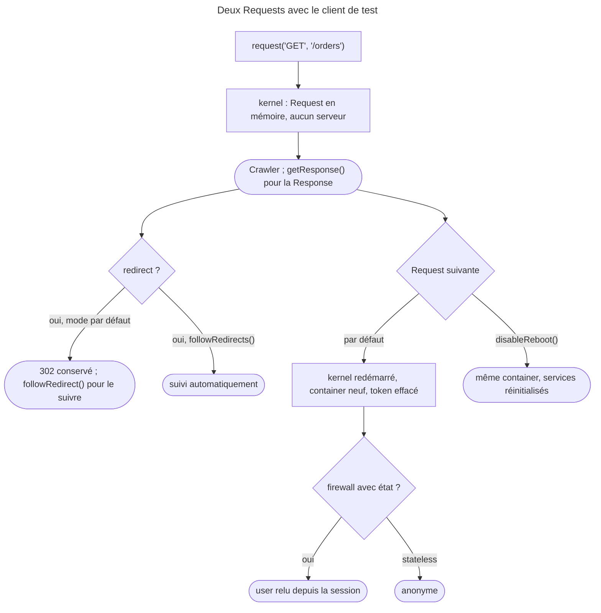

## Objectif

Piloter l'application comme un navigateur : Requests, navigation, redirects,
authentication.

## Avant la règle : le problème à résoudre

Un test doit se connecter, ouvrir « Mes commandes », suivre la redirection qui
suit une annulation, puis revenir en arrière. Un vrai navigateur ferait cela
lentement, et il faudrait un serveur web.

Le **client de test** simule un navigateur en mémoire. Trois questions : ce
qu'il **rend** à chaque Request, comment il traite les **redirects** — pas
comme un navigateur ordinaire —, et ce qui se passe **entre deux Requests** :
kernel redémarré, token de sécurité effacé.

## Le fil rouge : annuler une commande

```php
$client = static::createClient();
$client->loginUser($user);                      // sans form de connexion

$crawler = $client->request('GET', '/orders');  // un Crawler, pas une Response
$client->request('POST', '/orders/42/cancel');  // répond par un redirect

$this->assertResponseRedirects('/orders');      // le client ne l'a pas suivi
$client->followRedirect();                      // on le suit, une fois
$this->assertSelectorTextContains('.flash', 'annulée');
```

## Le cycle complet en un schéma



## Ce qu'est le client

`static::createClient()` rend un `KernelBrowser`. Il **simule** un navigateur :
aucune socket n'est ouverte, aucun serveur web n'intervient. La Request est
construite en mémoire et passée au kernel. C'est pourquoi ces tests sont rapides
— et pourquoi ils n'exécutent aucun JavaScript.

Le client est disponible dans le container sous le service **`test.client`**, en
environment `test` ou partout où l'option `framework.test` est activée ; on
peut donc le remplacer entièrement.

## Faire une Request

```php
$crawler = $client->request('GET', '/post/hello-world');
```

La signature complète :

```php
request(
    string $method,
    string $uri,
    array $parameters = [],
    array $files = [],
    array $server = [],
    ?string $content = null,
    bool $changeHistory = true,
): Crawler
```

`request()` **retourne un `Crawler`**, pas une Response. La Response se lit par
`$client->getResponse()`.

Pour une Request AJAX, `xmlHttpRequest()` a les mêmes arguments et ajoute
le header `HTTP_X_REQUESTED_WITH` automatiquement — exécuté :
`$client->getRequest()->isXmlHttpRequest()` vaut `true`.

Rejoué pour cette page avec FrameworkBundle 8.0.15 : `request()` rend un
`Symfony\Component\DomCrawler\Crawler`, et `xmlHttpRequest()` donne de nouveau
`isXmlHttpRequest()` à `true`.

## Naviguer

```php
$client->back();
$client->forward();
$client->reload();
$client->restart();   // vide les cookies et l'historique
```

`back()` et `forward()` sautent les redirects, comme un navigateur — mais
**seulement celles que le client a suivies seul**, en mode `followRedirects()`
(voir plus bas). Lu dans le code 8.0 : `AbstractBrowser::request()` ne mémorise
un redirect que dans ce mode. Exécuté, `/created` puis `/go`, qui redirige
vers `/hello` :

| Mode du client | Après `back()` |
|---|---|
| `followRedirects()` | `/created`, 201 |
| par défaut, puis `followRedirect()` | `/go`, de nouveau 302 |

## Les redirects

Le client **ne suit pas** les redirects par défaut. Deux methods, à ne pas
confondre :

| Method | Effet |
|---|---|
| `followRedirect()` | suit **la** redirect en attente, une fois |
| `followRedirects()` | change le **mode** : toutes les suivantes seront suivies |
| `followRedirects(false)` | revient au comportement par défaut |

La différence est le singulier : l'une agit sur la Response courante, l'autre
règle le client. `followRedirects()` doit être appelée **avant** la Request.

Le défaut n'est pas celui de BrowserKit. Lu dans le code 8.0 :
`AbstractBrowser` déclare `$followRedirects = true`, mais `HttpKernelBrowser`
— parent de `KernelBrowser` — le passe à `false` dans son constructor. Un
`HttpBrowser`, qui parle à un vrai serveur, suit donc les redirects ; le
client de test, non. Exécuté, `GET /go` qui redirige vers `/hello` :

| Client | Après `request()` | Après `followRedirect()` |
|---|---|---|
| `createClient()`, par défaut | 302, `isFollowingRedirects()` faux | 200 sur `/hello` |

Rejoué : `302` et `isFollowingRedirects()` à `false` après `request()`, puis
`200` sur `http://localhost/hello` après `followRedirect()` ; en mode
`followRedirects()`, `back()` depuis `/hello` ramène à `/created`.

## Plusieurs Requests dans un test

Après une Request, la suivante **redémarre le kernel** et reconstruit le
container, pour isoler les Requests. Conséquence pratique : le token de sécurité
est effacé entre deux Requests. Exécuté : deux Requests, deux objects container
différents ; après `disableReboot()`, le même container sert la Request
suivante.

Ce token effacé n'implique pas toujours une déconnexion. `loginUser()` le
place dans le stockage de tokens **et**, s'il y a une session, dans la session.
Exécuté avec SecurityBundle 8.0.15, `loginUser()` puis deux Requests :

| Firewall | 1ʳᵉ Request | 2ᵉ Request |
|---|---|---|
| avec état (par défaut) | `alice` | `alice` — restauré depuis la session |
| `stateless: true` | `alice` | anonyme |

`disableReboot()` réinitialise le kernel au lieu de le redémarrer — Symfony
appelle alors `reset()` sur les services marqués `kernel.reset`. Cela efface
également le token de sécurité ; pour le conserver, il faut retirer le tag
`kernel.reset` du service concerné par un compiler pass en environment
de test.

Rejoué : deux Requests, deux identifiants d'object container différents ; après
`disableReboot()`, le même ; et avec un firewall avec état, le journal montre
« Read existing security token from the session » à la seconde Request, qui
voit toujours `alice`.

## S'authentifier

```php
$client->loginUser($user);
```

Rejouer un form de connexion à chaque test le rendrait lent.
`loginUser()` place directement le user dans le firewall — `main` par
défaut, modifiable par le deuxième argument.

## Voir l'exception

```php
$client->catchExceptions(false);
```

Par défaut les exceptions sont interceptées et rendues en page d'erreur ; le
test échoue alors sur un code 500 sans dire pourquoi. Cette method les laisse
remonter jusqu'à PHPUnit. Exécuté, un controller qui lève
`RuntimeException('kaboom')` : Response 500 par défaut, puis l'exception
elle-même après `catchExceptions(false)`.

## Concrètement dans ton application

- Lire le contenu : le `Crawler` rendu par `request()` ; le code et les headers :
  `getResponse()`.
- Un formulaire qui redirige : `assertResponseRedirects()`, puis
  `followRedirect()` — ou `followRedirects()` avant la Request.
- Un espace membre : `loginUser($user)`, pas le form de connexion.
- Un test qui échoue sur un 500 muet : `catchExceptions(false)` le temps de
  comprendre.
- Un service à garder d'une Request à l'autre : `disableReboot()`.
- Du JavaScript à tester : un autre outil — le client n'en exécute pas.

## À comprendre

- **Que gagne-t-on à ne pas suivre les redirects ?** Le test voit la Response
  de redirection et peut l'assertir ; la suivre devient un choix explicite.
- **Pourquoi redémarrer le kernel entre deux Requests ?** Pour isoler chaque
  Request : chacune repart d'un container neuf.
- **Pourquoi un firewall avec état garde-t-il l'utilisateur ?** `loginUser()`
  écrit aussi le token dans la session, que le firewall relit à la Request
  suivante.

## À mémoriser

- **`createClient()`** → **`KernelBrowser`**, service **`test.client`**.
- **`request()`** → **`Crawler`** ; **`getResponse()`** → Response.
- Redirects **non suivis** par défaut ; **`followRedirect()`** une fois,
  **`followRedirects()`** en mode.
- **`back()`** ne saute que les redirects suivis en mode.
- Kernel **redémarré** entre deux Requests ; **`disableReboot()`** l'évite.
- **`loginUser()`** ; stateful : session relue ; stateless : perdu.
- **`catchExceptions(false)`** ; **`xmlHttpRequest()`** ; aucun JavaScript.
- Moyen mnémotechnique : **« Requêter, rediriger à la main, redémarrer »**.

## Pièges d'examen

**`request()` retourne un `Crawler`**, pas une `Response`.

**Le client de test ne suit pas les redirects par défaut** — alors que le
`AbstractBrowser` de BrowserKit, lui, les suit.

**`followRedirect()` ≠ `followRedirects()`** : une fois, contre un réglage.

**`back()` ne saute que les redirects suivis en mode `followRedirects()`** ;
après un `followRedirect()` manuel, il revient sur l'URL qui a redirigé.

**Le kernel redémarre entre deux Requests** et le token en mémoire est perdu ;
un firewall avec état le restaure depuis la session, un firewall `stateless`
non.

**Aucun JavaScript n'est exécuté** : c'est un client simulé, pas un navigateur.

## Application : trois scénarios

**Scénario 1 — Le 500 sans explication.** Un test échoue sur « 500 is not 200 »
et la page d'erreur ne s'affiche pas. *Solution.* `$client->catchExceptions(false)`
avant la Request : l'exception remonte jusqu'à PHPUnit, avec son message et sa
trace.

**Scénario 2 — Le compteur de service remis à zéro.** Un test compte les appels
à un service entre deux Requests et trouve toujours 1. *Solution.* Le kernel a
redémarré : `disableReboot()` garde le même container — en sachant que les
services `kernel.reset` sont réinitialisés.

**Scénario 3 — L'API déconnectée.** Un test d'API appelle `loginUser()`, puis
deux endpoints ; le second répond 401. *Solution.* Le firewall de l'API est
`stateless` : rien n'est relu en session. Appeler `loginUser()` avant chaque
Request, ou envoyer les credentials attendus.

## QCM d'entraînement

Six questions sur le client de test. Choisis avant d'ouvrir la correction.

**Question 1.** Que change `$client->xmlHttpRequest('GET', '/hello')` par
rapport à `request()` ?

- **A.** `isXmlHttpRequest()` vaut `true` côté serveur
- **B.** Le client exécute le JavaScript de la page
- **C.** La Response est décodée en JSON automatiquement
- **D.** Rien : c'est un alias

<details>
<summary>Correction</summary>

**Bonne réponse : A.** Mêmes arguments, plus le header `HTTP_X_REQUESTED_WITH`
(exécuté).

B est faux : aucun JavaScript ne tourne. C et D sont faux.

</details>

**Question 2.** Un controller lève une `RuntimeException`. Le test appelle
`$client->catchExceptions(false)` puis fait la Request. Que se passe-t-il ?

- **A.** La Response est un 500, comme par défaut
- **B.** La Response est vide
- **C.** L'exception remonte jusqu'à PHPUnit
- **D.** Le client relance la Request une fois

<details>
<summary>Correction</summary>

**Bonne réponse : C.** Exécuté : `RuntimeException: kaboom` reçue par le test.

A est le comportement par défaut. B et D sont faux.

</details>

**Question 3.** Que fait `$client->restart()` ?

- **A.** Il redémarre le kernel, sans toucher aux cookies
- **B.** Il vide les cookies et l'historique
- **C.** Il rejoue la dernière Request
- **D.** Il recrée la base de test

<details>
<summary>Correction</summary>

**Bonne réponse : B.** Le client repart d'un navigateur neuf.

A décrit le redémarrage entre deux Requests. C est `reload()`. D est faux.

</details>

**Question 4.** Lequel de ces clients suit les redirects **par défaut** ?

- **A.** `KernelBrowser`, rendu par `createClient()`
- **B.** `HttpKernelBrowser`, son parent
- **C.** Aucun : tout client BrowserKit les laisse en attente
- **D.** `HttpBrowser`, qui parle à un vrai serveur

<details>
<summary>Correction</summary>

**Bonne réponse : D.** `AbstractBrowser` les suit par défaut ;
`HttpKernelBrowser` — et donc `KernelBrowser` — désactive ce comportement dans
son constructor.

A et B sont justement les clients qui ne les suivent pas. C est faux.

</details>

**Question 5.** Après `$client->disableReboot()`, la Request suivante
utilise-t-elle le même container ?

- **A.** Oui : il est réinitialisé
- **B.** Non : le kernel redémarre toujours
- **C.** Oui, et le token de sécurité est conservé
- **D.** Seulement en environment `dev`

<details>
<summary>Correction</summary>

**Bonne réponse : A.** Le kernel est réinitialisé au lieu de redémarrer
(exécuté : même identifiant d'object container).

B est le comportement par défaut. C oublie que les services `kernel.reset` —
dont le stockage du token — sont réinitialisés. D est faux.

</details>

**Question 6.** Où le service `test.client` est-il disponible ?

- **A.** Dans tous les environments, `dev` compris
- **B.** Seulement dans les commands de console
- **C.** Là où `framework.test` est activé
- **D.** Seulement après un `bootKernel()` explicite dans le test

<details>
<summary>Correction</summary>

**Bonne réponse : C.** C'est l'option `framework.test`, active en environment
`test`, qui le déclare.

A, B et D inventent d'autres conditions.

</details>

## Fiche express

**Si tu dois retenir seulement 7 choses :**

- **`request()`** → **`Crawler`** ; **`getResponse()`** → Response.
- **Pas de redirect suivi** par défaut ; **`followRedirect()`** /
  **`followRedirects()`**.
- **`back()`** saute seulement les redirects suivis en mode.
- **Kernel redémarré** entre deux Requests ; **`disableReboot()`**.
- **`loginUser()`** : stateful relu en session, stateless perdu.
- **`catchExceptions(false)`** pour voir l'exception.
- **Aucun JavaScript** ; **`xmlHttpRequest()`** pour l'AJAX.

**En une phrase, pour tout reconstruire :**

```text
createClient() = KernelBrowser (test.client) ; request() → Crawler ; redirects : à la main (followRedirect) ou en mode ;
entre deux Requests : reboot (disableReboot), token perdu sauf session ; catchExceptions(false) ; pas de JS
```

## Sources officielles

- [Testing](https://github.com/symfony/symfony-docs/blob/8.0/testing.rst)
- [`KernelBrowser`, branche 8.0](https://github.com/symfony/symfony/blob/8.0/src/Symfony/Bundle/FrameworkBundle/KernelBrowser.php)
- [`HttpKernelBrowser`, branche 8.0](https://github.com/symfony/symfony/blob/8.0/src/Symfony/Component/HttpKernel/HttpKernelBrowser.php)
- [`AbstractBrowser`, branche 8.0](https://github.com/symfony/symfony/blob/8.0/src/Symfony/Component/BrowserKit/AbstractBrowser.php)
