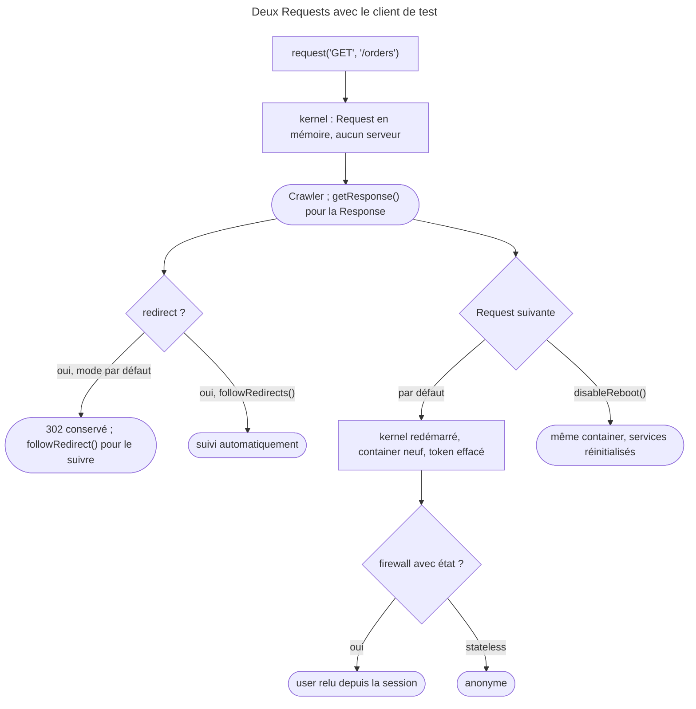

## Objectif

Piloter l'application comme un navigateur : Requests, navigation, redirects,
authentication.

## L'essentiel

`static::createClient()` rend un `KernelBrowser` qui **simule** un navigateur
en mémoire : pas de serveur, pas de JavaScript. `request()` rend un
**`Crawler`**. Le client **ne suit pas** les redirects par défaut. Et entre deux
Requests, le kernel **redémarre** : le token de sécurité en mémoire est perdu.

## Le schéma



## L'exemple

```php
$client = static::createClient();
$client->loginUser($user);                      // sans form de connexion
$crawler = $client->request('GET', '/orders');  // un Crawler, pas une Response
$client->request('POST', '/orders/42/cancel');  // répond par un redirect
$this->assertResponseRedirects('/orders');      // le client ne l'a pas suivi
$client->followRedirect();                      // on le suit, une fois
```

## Faire une Request

- `request($method, $uri, $parameters, $files, $server, $content,
  $changeHistory)` rend un **`Crawler`** ; la Response se lit par
  `$client->getResponse()`.
- `xmlHttpRequest()` prend les mêmes arguments et ajoute
  `HTTP_X_REQUESTED_WITH` : `isXmlHttpRequest()` vaut `true` côté serveur.
- Naviguer : `back()`, `forward()`, `reload()`, et `restart()`, qui vide les
  cookies et l'historique.
- Le client est le service `test.client`, déclaré par `framework.test`.

## Les redirects

| Method | Effet |
|---|---|
| `followRedirect()` | suit **la** redirect en attente, une fois |
| `followRedirects()` | change le **mode** : toutes les suivantes, à appeler **avant** la Request |
| `followRedirects(false)` | revient au défaut |

- Le défaut n'est pas celui de BrowserKit : `AbstractBrowser` suit les
  redirects, mais `HttpKernelBrowser`, parent de `KernelBrowser`, désactive ce
  comportement. Un `HttpBrowser`, qui parle à un vrai serveur, les suit.
- `back()` saute les redirects, mais
  **seulement celles que le client a suivies seul**, en mode `followRedirects()` :

| Mode du client | `/created`, puis `/go` qui redirige vers `/hello` ; après `back()` |
|---|---|
| `followRedirects()` | `/created`, 201 |
| par défaut, puis `followRedirect()` | `/go`, de nouveau 302 |

## Plusieurs Requests dans un test

La Request suivante **redémarre le kernel** :
deux Requests, deux objects container différents. `disableReboot()` garde le même container, mais
réinitialise les services `kernel.reset` — le stockage du token compris.

`loginUser($user)` place le token dans le stockage et, s'il y a une session,
dans la session. Le deuxième argument nomme le **firewall context**, `main` par
défaut.

| Firewall | 1ʳᵉ Request | 2ᵉ Request |
|---|---|---|
| avec état | `alice` | `alice`, relu de la session (« Read existing security token from the session ») |
| `stateless: true` | `alice` | anonyme |

`catchExceptions(false)` fait remonter l'exception d'un controller jusqu'à
PHPUnit, au lieu d'une page 500.

## Pièges d'examen

**`request()` retourne un `Crawler`**, pas une `Response`.

**Le client de test ne suit pas les redirects par défaut** — alors que le
`AbstractBrowser` de BrowserKit, lui, les suit.

**`followRedirect()` ≠ `followRedirects()`** : une fois, contre un réglage.

**`back()` ne saute que les redirects suivis en mode `followRedirects()`** ;
après un `followRedirect()` manuel, il revient sur l'URL qui a redirigé.

**Le kernel redémarre entre deux Requests** et le token en mémoire est perdu ;
un firewall avec état le restaure depuis la session, un firewall `stateless`
non.

**Aucun JavaScript n'est exécuté** : c'est un client simulé, pas un navigateur.

## Application

- Un test compte les appels à un service sur deux Requests et trouve toujours 1
  → le kernel a redémarré : `disableReboot()`.
- Un test d'API appelle `loginUser()`, puis deux endpoints ; le second répond
  401 → firewall `stateless` : `loginUser()` avant chaque Request.

## QCM d'entraînement

**Question 1.** Que change `$client->xmlHttpRequest('GET', '/hello')` par
rapport à `request()` ?

- **A.** `isXmlHttpRequest()` vaut `true` côté serveur
- **B.** Le client exécute le JavaScript de la page
- **C.** La Response est décodée en JSON automatiquement
- **D.** Rien : c'est un alias

<details>
<summary>Correction</summary>

**Bonne réponse : A.** Mêmes arguments, plus le header `HTTP_X_REQUESTED_WITH` ;
aucun JavaScript ne tourne jamais dans ce client simulé.

</details>

**Question 2.** Que fait `$client->restart()` ?

- **A.** Il redémarre le kernel, sans toucher aux cookies
- **B.** Il vide les cookies et l'historique
- **C.** Il rejoue la dernière Request
- **D.** Il recrée la base de test

<details>
<summary>Correction</summary>

**Bonne réponse : B.** Le client repart d'un navigateur neuf ; C est
`reload()`, et A décrit le redémarrage entre deux Requests.

</details>

**Question 3.** Après `$client->disableReboot()`, la Request suivante
utilise-t-elle le même container ?

- **A.** Non : le kernel redémarre toujours
- **B.** Oui, et le token de sécurité est conservé
- **C.** Oui : il est réinitialisé
- **D.** Seulement en environment `dev`

<details>
<summary>Correction</summary>

**Bonne réponse : C.** Le kernel est réinitialisé au lieu de redémarrer ; B
oublie que le stockage du token, `kernel.reset`, est réinitialisé aussi.

</details>

**Question 4.** Lequel de ces clients suit les redirects **par défaut** ?

- **A.** `KernelBrowser`, rendu par `createClient()`
- **B.** `HttpKernelBrowser`, son parent
- **C.** Aucun : tout client BrowserKit les laisse en attente
- **D.** `HttpBrowser`, qui parle à un vrai serveur

<details>
<summary>Correction</summary>

**Bonne réponse : D.** `AbstractBrowser` les suit par défaut ;
`HttpKernelBrowser`, et donc `KernelBrowser`, désactive ce comportement.

</details>

## Fiche express

**Si tu dois retenir seulement 7 choses :**

- **`request()`** → **`Crawler`** ; **`getResponse()`** → Response.
- **Pas de redirect suivi** par défaut ; **`followRedirect()`** /
  **`followRedirects()`**.
- **`back()`** saute seulement les redirects suivis en mode.
- **Kernel redémarré** entre deux Requests ; **`disableReboot()`**.
- **`loginUser()`** : stateful relu en session, stateless perdu.
- **`catchExceptions(false)`** pour voir l'exception.
- **Aucun JavaScript** ; **`xmlHttpRequest()`** pour l'AJAX.

Moyen mnémotechnique :
**« Requêter, rediriger à la main, redémarrer »**.

```text
createClient() = KernelBrowser (test.client) ; request() → Crawler ; redirects : à la main (followRedirect) ou en mode ;
entre deux Requests : reboot (disableReboot), token perdu sauf session ; catchExceptions(false) ; pas de JS
```

## Sources officielles

- [Testing](https://github.com/symfony/symfony-docs/blob/8.0/testing.rst)
- [`KernelBrowser`, branche 8.0](https://github.com/symfony/symfony/blob/8.0/src/Symfony/Bundle/FrameworkBundle/KernelBrowser.php)
- [`HttpKernelBrowser`, branche 8.0](https://github.com/symfony/symfony/blob/8.0/src/Symfony/Component/HttpKernel/HttpKernelBrowser.php)
- [`AbstractBrowser`, branche 8.0](https://github.com/symfony/symfony/blob/8.0/src/Symfony/Component/BrowserKit/AbstractBrowser.php)

