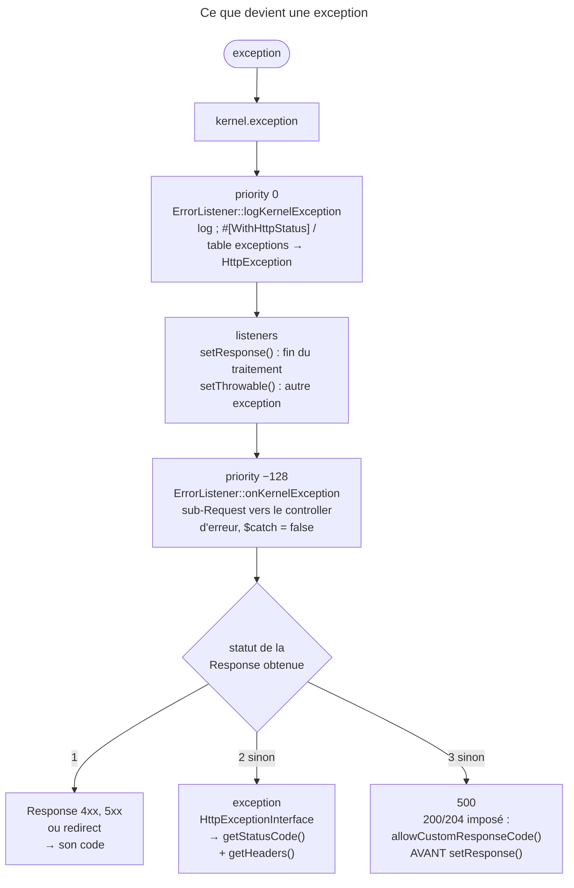

## Objectif

Savoir ce que Symfony fait d'une exception non rattrapée, et surtout **comment
il choisit le status code** de la Response produite.

## L'essentiel

Une exception non rattrapée devient l'event `kernel.exception`. Un listener
peut fournir une Response ou remplacer l'exception ; sinon `ErrorListener`
construit la page d'erreur par une sub-Request. Le statut final suit une règle
en trois temps, que l'examen interroge par des Responses `200` ou `204` qui ne
sortent **pas** avec leur statut.

## Le schéma



## L'exemple : une exception qui porte son statut

```php
use Symfony\Component\HttpKernel\Attribute\WithHttpStatus;

#[WithHttpStatus(422)]
final class InvalidQuantity extends \InvalidArgumentException {}
// levée dans un controller : la Response sort en 422, sans listener maison
```

## Le mécanisme

`ExceptionEvent` offre deux leviers : `setThrowable()` remplace l'exception,
`setResponse()` fournit une Response et met fin au traitement. Si aucun listener
ne répond, l'`ErrorListener` intégré délègue à un controller d'erreur.

`ErrorListener` est branché sur **quatre** hooks, dont `kernel.exception` deux
fois : `logKernelException` à **0**, `onKernelException` à **−128** ; s'y
ajoutent `onControllerArguments` et `removeCspHeader` (`kernel.response`,
−128). Le log passe donc toujours, même si un listener répond ensuite.

## La page d'erreur est une vraie sub-Request

`onKernelException` duplique la Request vers le controller d'erreur et rappelle
`handle($request, SUB_REQUEST, false)` : une exception levée **dans** le
controller d'erreur n'est pas rattrapée, elle remonte avec l'originale en
`previous`. En production, une exception pendant `kernel.terminate` ne produit
pas de page : la Response est déjà partie.

## Le choix du status code

1. Response fournie en 4xx, 5xx ou redirect : **son** code est conservé.
2. Sinon, exception `HttpExceptionInterface` : `getStatusCode()` de
   l'exception, et ses `getHeaders()` sont ajoutés à la Response.
3. Sinon : **500**.

Une Response `200` ou `204` construite dans un listener ne sort pas avec ce
statut ; pour l'imposer, `allowCustomResponseCode()` **avant** `setResponse()`.

## HttpExceptionInterface

Elle relie une exception à un statut : `NotFoundHttpException` (404),
`AccessDeniedHttpException` (403), `BadRequestHttpException` (400), la class
générique `HttpException`. **Le critère est l'interface, jamais la class mère** :
`HttpException` étend `\RuntimeException`. Avant la règle du statut,
`logKernelException` remplace par une `HttpException` toute exception annotée
`#[WithHttpStatus(…)]` ou listée dans la table `exceptions` du framework — keys
`status_code`, `log_level`, `log_channel` : la règle 2 s'applique alors
sans un seul listener écrit à la main.

## Pièges d'examen

**Le statut de la Response fournie par un listener n'est pas toujours conservé.**
Il ne l'est que si elle est 4xx, 5xx ou un redirect. Une Response `200` ou
`204` prend le statut **de l'exception** — exécuté : `404` pour une
`NotFoundHttpException` — et `500` dans le seul cas où l'exception n'implémente
pas `HttpExceptionInterface`. Sauf `allowCustomResponseCode()` préalable.

**`\RuntimeException` n'est pas le contre-exemple qu'on croit.**
`HttpException extends \RuntimeException implements HttpExceptionInterface` :
la class mère ne dit rien du statut. Seule l'interface le dit.

**`setResponse()` met fin au traitement de l'erreur** — l'`ErrorListener`
intégré ne prend plus la main, et la page d'erreur n'est pas produite. Mais le
**log**, lui, a déjà eu lieu : il passe à la priority 0, la page d'erreur à
−128.

**« Elle n'implémente pas l'interface, donc 500 » est trop rapide.**
`#[WithHttpStatus]` et la table `exceptions` du framework font remplacer
l'exception par une `HttpException` avant que la règle du statut ne s'applique.

**Une exception dans le controller d'erreur n'est pas rattrapée.** La
sub-Request est lancée avec `$catch = false` ; elle remonte, l'originale
chaînée en `previous`.

## Application

- Une exception métier qui doit répondre 409 → `#[WithHttpStatus(409)]`, ou la
  table `exceptions` pour une class tierce.
- Une page « maintenance » en 200 pour une exception attendue →
  `allowCustomResponseCode()` puis `setResponse()`.

## QCM d'entraînement

**Question 1.** Quelles keys la table `exceptions` de la configuration du
framework associe-t-elle à une class d'exception ?

- **A.** Statut, `log_level`, `log_channel`
- **B.** `status_code` et `template`, une vue
- **C.** `code`, `message` et `headers`
- **D.** `status_code` seulement

<details>
<summary>Correction</summary>

**Bonne réponse : A.** Les keys `status_code`, `log_level` et `log_channel`
fixent le statut HTTP, le niveau et le canal de log ; `logKernelException` s'en sert avant la règle du statut.

</details>

**Question 2.** Le controller lève une `HttpException` de statut 429, avec le
header `Retry-After: 60`. Un listener pose une Response `200`. Que reçoit le
client ?

- **A.** `200`, sans header ajouté
- **B.** `500`, l'exception n'étant pas rattrapée
- **C.** `429`, avec `Retry-After: 60`
- **D.** `200`, avec `Retry-After: 60`

<details>
<summary>Correction</summary>

**Bonne réponse : C.** Une `200` ne garde pas son statut : la règle 2 prend
celui de l'exception, et le kernel ajoute au passage ses headers.

</details>

**Question 3.** En production, une exception survient pendant
`kernel.terminate`. Une page d'erreur est-elle produite ?

- **A.** Oui, envoyée après la Response
- **B.** Non : `onKernelException` renonce
- **C.** Oui, mais seulement dans les logs
- **D.** Oui, elle remplace la Response déjà partie

<details>
<summary>Correction</summary>

**Bonne réponse : B.** Hors debug, le listener détecte que le kernel termine et
ne construit rien : le client a déjà reçu sa Response.

</details>

**Question 4.** Sur combien d'events `ErrorListener` est-il branché ?

- **A.** Un : `kernel.exception`
- **B.** Deux : `kernel.exception` et `kernel.terminate`
- **C.** Cinq, un par phase du kernel
- **D.** Trois events, quatre methods

<details>
<summary>Correction</summary>

**Bonne réponse : D.** `kernel.exception` reçoit deux methods (log à 0, page à
−128) ; `kernel.controller_arguments` et `kernel.response` en reçoivent une.

</details>

## Fiche express

**Si tu dois retenir seulement 7 choses :**

- `setResponse()` **termine** ; `setThrowable()` **remplace**.
- Statut : 4xx/5xx/redirect → le sien ; sinon **`HttpExceptionInterface`** ;
  sinon **500**.
- 200 ou 204 voulu : **`allowCustomResponseCode()`** d'abord.
- Le critère est l'**interface**, pas `\RuntimeException`.
- `#[WithHttpStatus]` et la table `exceptions` : statut **sans listener**.
- Log à **0**, page d'erreur à **−128**.
- Page d'erreur = sub-Request, **`$catch = false`**.

Moyen mnémotechnique : **« Logguer tôt, répondre tard »**.

## Sources officielles

- [Built-in Symfony Events, section « kernel.exception »](https://github.com/symfony/symfony-docs/blob/8.0/reference/events.rst)
- [`ErrorListener`](https://github.com/symfony/symfony/blob/8.0/src/Symfony/Component/HttpKernel/EventListener/ErrorListener.php)
- [`HttpKernel::handleThrowable()`](https://github.com/symfony/symfony/blob/8.0/src/Symfony/Component/HttpKernel/HttpKernel.php)

