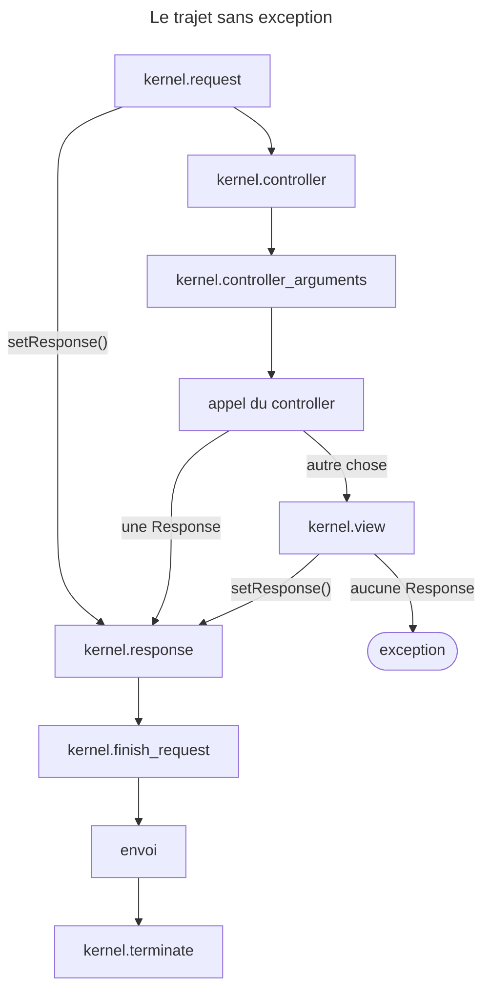
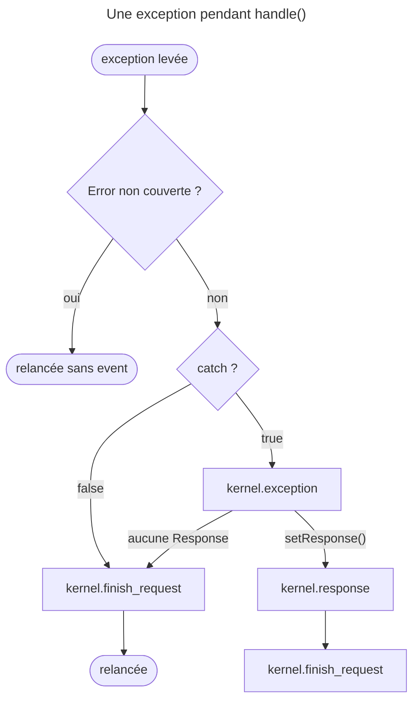

## Objectif

Suivre le trajet complet d'une Request HTTP dans une application Symfony, depuis
le front controller jusqu'à l'envoi de la Response, et savoir **qui** fait quoi
à chaque étape.

## Prérequis

Le composant HttpFoundation et le vocabulaire Request / Response.

## Le contrat

Tout part d'une seule signature, celle de `HttpKernelInterface` :

```php
public function handle(
    Request $request,
    int $type = self::MAIN_REQUEST,
    bool $catch = true
): Response;
```

Elle dit l'essentiel de l'architecture : une Request entre, une Response sort,
toujours. Les deux autres arguments méritent d'être lus. `$type` vaut
`MAIN_REQUEST` (**1**) ou `SUB_REQUEST` (**2**) — le kernel traite les deux par le
même code, et c'est aux listeners de faire la différence quand elle compte. `$catch` décide si
une exception est convertie en Response ou relancée telle quelle ; c'est ce qui
distingue le comportement de production du comportement de debug.

## Le trajet

**1. Le front controller.** `public/index.php` est le seul entry point. Il
inclut `vendor/autoload_runtime.php` et retourne une function qui construit le
`Kernel`. C'est le composant **Runtime** qui prend le relais : c'est lui, et non
le file, qui crée la `Request` depuis les globales, appelle `handle()`, envoie
la Response et déclenche `terminate()`.

**2. Le kernel démarre.** `Kernel::boot()` enregistre les bundles et construit —
ou recharge depuis `var/cache/` — le service container compilé.

**3. `kernel.request`.** Le premier event, dispatché **avant** que le
controller soit connu. C'est là que le router résout la route et dépose ses
parameters dans `request->attributes`, dont la key `_controller`. C'est là aussi
qu'un listener peut court-circuiter : s'il appelle `setResponse()`, la résolution
et l'exécution du controller sont sautées — mais **pas la suite du cycle**.
`kernel.response`, puis `kernel.finish_request`, puis `kernel.terminate` après
l'envoi, ont lieu normalement. Un redirect de sécurité fonctionne
exactement ainsi.

**4. Résolution du controller.** Le `ControllerResolver` lit `_controller` dans
les attributes et retourne un *callable* PHP. Le kernel ne sait rien d'autre : un
controller est un callable, pas nécessairement une method d'une class.

**5. `kernel.controller`.** Le controller est connu mais pas encore exécuté. Un
listener peut ici le **remplacer entièrement**.

**6. Résolution des arguments**, puis `kernel.controller_arguments`, juste avant
l'appel. Cet event relit **deux** choses après le dispatch, le controller
*et* les arguments : un listener peut donc encore remplacer le controller ici,
pas seulement à l'étape 5. Le détail des resolvers de valeur appartient au lot
Controllers.

**7. Le controller est appelé.** Sa return value décide de la suite.

**8. `kernel.view` — conditionnel.** Il n'est dispatché **que si** le controller
n'a pas retourné de `Response`. Son role est de transformer la valeur retournée
en Response. Si le controller a retourné une `Response`, cet event n'a jamais
lieu.

**9. `kernel.response`.** Dispatché dans tous les cas, une fois la Response
obtenue — par le controller ou par un listener de `kernel.view`. C'est le dernier
endroit où la modifier : headers, cookies, injection de la debug toolbar.

**10. `kernel.finish_request`.** Après `kernel.response`. Il sert à **restaurer
l'état global** de l'application — la locale, par exemple — ce qui n'a
d'importance que lorsqu'une Request en imbrique une autre.

**11. Envoi**, puis **12. `kernel.terminate`**, dispatché *après* que la Response
a été envoyée au client. C'est le seul endroit où un traitement lent ne coûte
rien au user.

## La pile de Requests, poussée et dépilée par `handle()`

`handle()` ne se contente pas d'orchestrer les events. Il **empile** la
Request dans le `RequestStack` dès l'entrée, et la **dépile** dans un `finally`
— donc quoi qu'il arrive, exception comprise. C'est tout le mécanisme derrière
`getCurrentRequest()` : la Request courante est simplement celle du sommet, et
une sub-Request empilée par-dessus la principale rend la première accessible
par `getParentRequest()`.

Une exception : si la Response est une `StreamedResponse`, sa function de rendu
est **réenveloppée** pour réempiler la Request le temps du flux, puis la
dépiler. Sans cela, `getCurrentRequest()` rendrait `null` à l'intérieur du
`callback`, puisqu'il s'exécute après l'output de `handle()`.

## La branche que le trajet nominal ne montre pas

Le trajet ci-dessus décrit le cas où rien n'échoue. Dès qu'une exception est
levée, `handleRaw()` est interrompu et `$catch` décide :

- **`$catch` vaut `true`** — `kernel.exception` est dispatché. Si un listener
  pose une Response, le cycle **reprend** au filter de Response : `kernel.response`
  puis `kernel.finish_request` ont lieu normalement. Si aucun ne le fait,
  `kernel.finish_request` est dispatché **quand même**, puis l'exception est
  relancée.
- **`$catch` vaut `false`** — `kernel.exception` n'a pas lieu du tout, mais
  `kernel.finish_request` est dispatché avant que l'exception ne remonte.

Autrement dit `kernel.finish_request` a lieu sur **les trois** paths : succès,
exception rattrapée, exception relancée — **à une condition**. Une `\Error`
n'entre dans ces branches que si `handleAllThrowables` est vrai :
`framework.handle_all_throwables` le fait par défaut, mais le constructeur
d'`HttpKernel` le met à `false`. Exécuté avec une `TypeError` et ce défaut :
seul `kernel.request` a lieu, ni `kernel.exception` ni `kernel.finish_request`.

## Le cycle en schéma





## Trois façons d'échouer, trois exceptions

| Ce qui manque | Ce qui est levé |
|---|---|
| Le resolver ne trouve aucun controller | `NotFoundHttpException` — « the route is wrongly configured » |
| Le controller ne rend pas une `Response`, et aucun listener de `kernel.view` n'en pose une | `ControllerDoesNotReturnResponseException` |
| La Request elle-même est malformée (`RequestExceptionInterface`) | convertie en `BadRequestHttpException` avant la branche d'exception |

La deuxième porte un message que tout le monde a déjà lu : « Did you forget to
add a return statement somewhere in your controller? » Elle n'est levée
**qu'après** `kernel.view` — l'event a bien eu lieu, il n'a simplement rien
donné.

## Pièges d'examen

- `kernel.view` est **conditionnel**, `kernel.response` ne l'est pas.
- `kernel.terminate` est après l'envoi, pas avant.
- `kernel.finish_request` vient après `kernel.response`, pas avant.
- `kernel.request` précède la résolution du controller : à ce moment,
  `_controller` peut être encore absent.
- Un court-circuit sur `kernel.request` saute le controller, **pas**
  `kernel.response`, `kernel.finish_request` ni `kernel.terminate`.
- Un seul front controller, `public/index.php` — quel que soit l'URL demandée.
- `kernel.finish_request` a lieu **même quand l'exception remonte**, et même
  quand `$catch` vaut `false` — mais une `\Error` hors
  `handle_all_throwables` le saute.
- `kernel.controller_arguments` peut remplacer le controller, pas seulement ses
  arguments.
- `MAIN_REQUEST` vaut **1** et `SUB_REQUEST` **2** — pas `0` et `1`.

## Tips d'examen

**Deux questions suffisent à placer un event.** Le controller est-il connu ?
(non → `kernel.request`). La Response existe-t-elle ? (oui → `kernel.response`
puis `kernel.finish_request`, et `kernel.terminate` après l'envoi).

**`finally` est le mot-clé du cycle.** Le dépilement de la Request a lieu sur
tous les paths ; `kernel.finish_request`, sur tous ceux qu'`HttpKernel`
rattrape.

## Points clés

- `handle(Request, $type, $catch): Response` est le contrat unique.
- L'ordre : request → controller → controller_arguments →
  *(appel)* → [view, sans `Response`] → response → finish_request →
  *(envoi)* → terminate.
- Tout le travail est fait par des listeners ; `handle()` ne fait qu'orchestrer.
- `handle()` empile la Request à l'entrée et la dépile dans un `finally` : c'est
  ce qui fait fonctionner `getCurrentRequest()` et `getParentRequest()`.
- Sur exception : `kernel.exception` si `$catch`, et `kernel.finish_request`
  dans tous les cas.

## Sources officielles

- [Composant HttpKernel, « The Request-Response Lifecycle »](https://github.com/symfony/symfony-docs/blob/8.0/components/http_kernel.rst)
- [Built-in Symfony Events, « Kernel Events »](https://github.com/symfony/symfony-docs/blob/8.0/reference/events.rst)
- [Composant Runtime, section « Usage »](https://github.com/symfony/symfony-docs/blob/8.0/components/runtime.rst)
- [`HttpKernel` (le code du cycle)](https://github.com/symfony/symfony/blob/8.0/src/Symfony/Component/HttpKernel/HttpKernel.php)
- [`HttpKernelInterface`](https://github.com/symfony/symfony/blob/8.0/src/Symfony/Component/HttpKernel/HttpKernelInterface.php)
