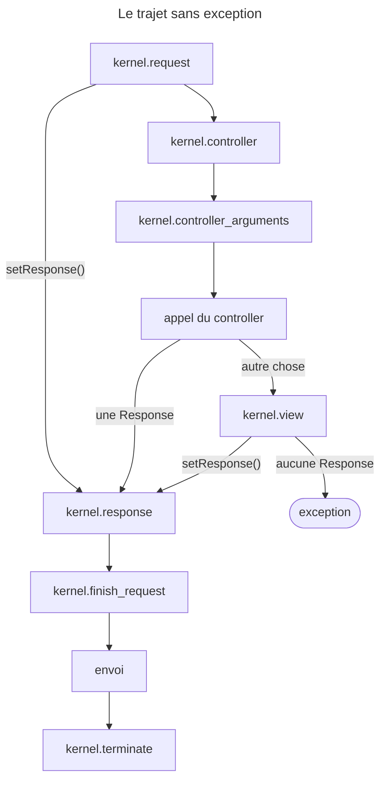
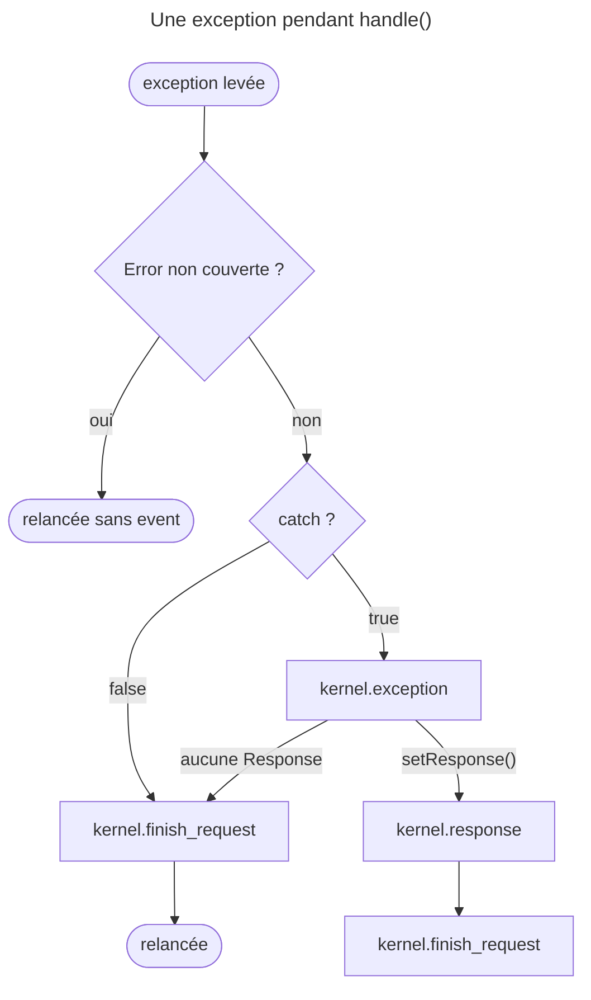

## Objectif

Suivre le trajet complet d'une Request HTTP dans une application Symfony, depuis
le front controller jusqu'à l'envoi de la Response, et savoir **qui** fait quoi
à chaque étape.

## L'essentiel

Une Request entre, une Response sort : tout le cycle tient dans
`HttpKernelInterface::handle()`. Le kernel ne fait qu'orchestrer des events ;
le travail — router, résoudre, convertir — est fait par des listeners. Trois
points tombent à l'examen : `kernel.view` est **conditionnel**, un court-circuit
ne saute pas la fin du cycle, et `kernel.finish_request` a lieu même quand une
exception remonte — à une condition.

## Le cycle en schéma



## L'exemple : une page de maintenance qui court-circuite

```php
#[AsEventListener(priority: 100)]
final class MaintenanceListener
{
    public function __invoke(RequestEvent $event): void
    {
        $event->setResponse(new Response('Maintenance', 503));
        // controller sauté ; response, finish_request et terminate ont lieu
    }
}
```

## Le contrat

```php
public function handle(Request $request, int $type = self::MAIN_REQUEST, bool $catch = true): Response;
```

`$type` vaut `MAIN_REQUEST` (**1**) ou `SUB_REQUEST` (**2**) : même code, aux
listeners de distinguer. `$catch` décide si une exception devient une Response
ou remonte.

## Le trajet

1. `public/index.php`, seul front controller, rend une function ; le component
   **Runtime** crée la Request, appelle `handle()`, envoie, puis `terminate()`.
2. `Kernel::boot()` enregistre les bundles et charge le container compilé.
3. **`kernel.request`**, avant que le controller soit connu : le router y pose
   `_controller` dans les attributes. `setResponse()` y saute le controller,
   pas la suite.
4. Le `ControllerResolver` rend un **callable** ; puis **`kernel.controller`**,
   qui peut le remplacer.
5. Arguments résolus, puis **`kernel.controller_arguments`**, qui relit le
   controller **et** les arguments.
6. Appel. **`kernel.view`** n'a lieu **que si** le retour n'est pas une
   `Response`.
7. **`kernel.response`** dans tous les cas, puis **`kernel.finish_request`**,
   qui restaure l'état global.
8. Envoi, puis **`kernel.terminate`** : le seul endroit où un traitement lent ne
   coûte rien au user.

## La pile de Requests, poussée et dépilée par `handle()`

`handle()` empile la Request dans le `RequestStack` à l'entrée et la dépile dans
un `finally`, exception comprise : c'est ce qui fait marcher
`getCurrentRequest()`. Pour une `StreamedResponse`, le callback est réenveloppé
pour réempiler la Request le temps du flux — sans quoi il trouverait une pile
vide, `handle()` étant terminé.

## La branche que le trajet nominal ne montre pas



Avec `$catch` à `true`, `kernel.exception` est dispatché ; si un listener pose
une Response, `kernel.response` puis `kernel.finish_request` ont lieu, sinon
`kernel.finish_request` puis l'exception remonte. Avec `$catch` à `false`, pas de
`kernel.exception`, mais `kernel.finish_request` avant de remonter. Il a donc
lieu sur les trois paths — à une condition : une `\Error` n'entre dans ces
branches que si `handleAllThrowables` est vrai. `framework.handle_all_throwables`
le fait par défaut, le constructor d'`HttpKernel` non : avec une `TypeError`,
seul `kernel.request` a lieu.

## Trois façons d'échouer, trois exceptions

| Ce qui manque | Ce qui est levé |
|---|---|
| Le resolver ne trouve aucun controller | `NotFoundHttpException` — « the route is wrongly configured » |
| Le controller ne rend pas une `Response`, et aucun listener de `kernel.view` n'en pose une | `ControllerDoesNotReturnResponseException` |
| La Request elle-même est malformée (`RequestExceptionInterface`) | convertie en `BadRequestHttpException` avant la branche d'exception |

La deuxième — « Did you forget to add a return statement somewhere in your
controller? » — n'est levée qu'**après** `kernel.view`.

## Pièges d'examen

- `kernel.view` est **conditionnel**, `kernel.response` ne l'est pas.
- `kernel.terminate` est après l'envoi, pas avant.
- `kernel.finish_request` vient après `kernel.response`, pas avant.
- `kernel.request` précède la résolution du controller : à ce moment,
  `_controller` peut être encore absent.
- Un court-circuit sur `kernel.request` saute le controller, **pas**
  `kernel.response`, `kernel.finish_request` ni `kernel.terminate`.
- Un seul front controller, `public/index.php` — quelle que soit l'URL demandée.
- `kernel.finish_request` a lieu **même quand l'exception remonte**, et même
  quand `$catch` vaut `false` — mais une `\Error` hors
  `handle_all_throwables` le saute.
- `kernel.controller_arguments` peut remplacer le controller, pas seulement ses
  arguments.
- `MAIN_REQUEST` vaut **1** et `SUB_REQUEST` **2** — pas `0` et `1`.

## Application

- Envoyer un email lent sans retarder la Response → `kernel.terminate`.
- Restaurer une locale modifiée par une sub-Request → `kernel.finish_request`.

## QCM d'entraînement

**Question 1.** `HttpKernel` est construit avec ses arguments par défaut, et le
controller provoque une `TypeError`. Quels events ont lieu ?

- **A.** `kernel.request` et `kernel.exception`
- **B.** `kernel.request` seulement
- **C.** `kernel.request`, `kernel.exception`, `kernel.finish_request`
- **D.** `kernel.request` et `kernel.finish_request`

<details>
<summary>Correction</summary>

**Bonne réponse : B.** Sans `handleAllThrowables`, une `\Error` n'entre pas
dans la branche d'exception : ni `kernel.exception` ni `kernel.finish_request`.

</details>

**Question 2.** Le resolver ne trouve aucun controller pour la Request. Quelle
exception est levée ?

- **A.** `ControllerDoesNotReturnResponseException`
- **B.** `NotFoundHttpException`
- **C.** `\LogicException`, faute de callable
- **D.** `BadRequestHttpException`

<details>
<summary>Correction</summary>

**Bonne réponse : B.** Le kernel juge la route mal configurée et lève un 404 :
« Unable to find the controller for path … The route is wrongly configured. »

</details>

**Question 3.** Dans le callback d'une `StreamedResponse`, exécuté pendant
l'envoi, que rend `$requestStack->getCurrentRequest()` ?

- **A.** `null` : `handle()` est terminé
- **B.** La main Request d'une autre exécution
- **C.** Une `LogicException`
- **D.** La Request qui a produit la Response

<details>
<summary>Correction</summary>

**Bonne réponse : D.** `handle()` réenveloppe le callback pour réempiler la
Request le temps du flux ; hors du callback, la pile est vide.

</details>

**Question 4.** Le controller lève une `SuspiciousOperationException`, avec
`$catch` à `false`. Quelle exception remonte ?

- **A.** `SuspiciousOperationException`, telle quelle
- **B.** `NotFoundHttpException`
- **C.** `BadRequestHttpException`
- **D.** Aucune : une Response 400 est rendue

<details>
<summary>Correction</summary>

**Bonne réponse : C.** Une `RequestExceptionInterface` est convertie en
`BadRequestHttpException` avant la branche d'exception ; `$catch` à `false` la
laisse remonter.

</details>

## Fiche express

**Si tu dois retenir seulement 8 choses :**

- `handle(Request, $type, $catch): Response` ; `MAIN_REQUEST` = **1**,
  `SUB_REQUEST` = **2**.
- Ordre : request → controller → controller_arguments → *(appel)* → [view] →
  response → finish_request → *(envoi)* → terminate.
- `kernel.view` n'est dispatché que si le controller ne rend pas une `Response`.
- Court-circuit sur `kernel.request` : **response, finish_request, terminate**
  ont lieu.
- `controller_arguments` peut encore **remplacer le controller**.
- Pile : empilée à l'entrée, dépilée dans un **`finally`**.
- `finish_request` sur les trois paths — sauf `\Error` hors
  `handle_all_throwables`.
- Aucun controller → 404 ; pas de Response → `ControllerDoesNotReturnResponseException`.

Moyen mnémotechnique : **« Une Request entre, une Response sort »**.

## Sources officielles

- [Component HttpKernel, « The Request-Response Lifecycle »](https://github.com/symfony/symfony-docs/blob/8.0/components/http_kernel.rst)
- [Built-in Symfony Events, « Kernel Events »](https://github.com/symfony/symfony-docs/blob/8.0/reference/events.rst)
- [Component Runtime, section « Usage »](https://github.com/symfony/symfony-docs/blob/8.0/components/runtime.rst)
- [`HttpKernel` (le code du cycle)](https://github.com/symfony/symfony/blob/8.0/src/Symfony/Component/HttpKernel/HttpKernel.php)
- [`HttpKernelInterface`](https://github.com/symfony/symfony/blob/8.0/src/Symfony/Component/HttpKernel/HttpKernelInterface.php)

