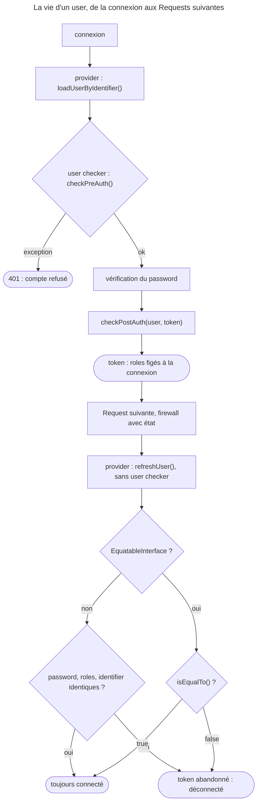

## Objectif

Écrire une class user conforme à Symfony 8.0, et connaître le contrat
minimal — plus court qu'on ne le croit.

## L'essentiel

En 8.0, `UserInterface` n'a que **deux methods**. Le password vit dans une
interface séparée. À chaque Request, le user rechargé est **comparé** à celui
du token, et un compte suspendu se refuse dans un **user checker**, pas dans
`getRoles()`.

## Le schéma



## L'exemple

```php
class User implements UserInterface, PasswordAuthenticatedUserInterface
{
    public function getUserIdentifier(): string { return $this->email; }        // pas l'id SQL
    public function getRoles(): array { return [...$this->roles, 'ROLE_USER']; } // convention
    public function getPassword(): ?string { return $this->password; }          // interface à part
    public function __serialize(): array                                       // remplace eraseCredentials()
    {
        return ['email' => $this->email, 'roles' => $this->roles, 'password' => $this->password];
    }
}
```

## `UserInterface`, en 8.0

```php
interface UserInterface
{
    public function getRoles(): array;
    public function getUserIdentifier(): string;
}
```

- `eraseCredentials()` **n'existe plus** (dépréciée en 7.3, retirée en 8.0) ;
  le CHANGELOG renvoie à `__serialize()` pour écarter les données sensibles. Une
  class qui la déclare encore ne casse rien, mais personne ne l'appelle.
- `getUserIdentifier()` rend l'identifier de recherche — email, login —, celui
  que reçoit `loadUserByIdentifier()`, pas forcément la key primaire.

## `getRoles()` : aucun minimum imposé

Ajouter `ROLE_USER` est une **convention** de la class, pas une exigence : un
user dont `getRoles()` rend `[]` se connecte, `IS_AUTHENTICATED_FULLY` est
vrai, mais `isGranted('ROLE_USER')` est faux.

## Le password est une interface séparée

Un user peut ne pas avoir de password (token d'API, identité externe) :
`getPassword()` vient de `PasswordAuthenticatedUserInterface`, l'interface que
le hasher attend.

## Comparer deux users

À chaque Request d'un firewall avec état, `ContextListener::hasUserChanged()`
compare le user rechargé à celui du token : **password**, **roles**,
**identifier**. Une différence abandonne le token. Une class
`EquatableInterface` remplace cette règle par `isEqualTo()`.

| Class | Changement | Request suivante |
|---|---|---|
| ordinaire | `ROLE_EDITOR` ajouté, ou password changé | **déconnectée** |
| `isEqualTo()` ne comparant que l'identifier | `ROLE_EDITOR` ajouté | connectée, mais `isGranted('ROLE_EDITOR')` **faux** |
| la même | password changé | **toujours connectée** |

Le token garde les roles **de la connexion** : c'est lui que les voters lisent.

## Interdire un compte

Un compte suspendu ou expiré se refuse dans un **user checker**
(`UserCheckerInterface`), déclaré par `user_checker` sur le firewall :

- `checkPreAuth()` écoute `CheckPassportEvent` en priority 256, **avant** la
  vérification du password — il tourne même si le password est faux ;
- `checkPostAuth(UserInterface $user, ?TokenInterface $token = null)` tourne
  après le succès ;
- aucun des deux n'est appelé sur les Requests suivantes, portées par le cookie.

## Pièges d'examen

**`UserInterface` n'a que deux methods en Symfony 8.0** ; `eraseCredentials()`
a été retirée.

**`getPassword()` vient de `PasswordAuthenticatedUserInterface`.**

**`getUserIdentifier()` n'est pas l'identifier de base de données.**

**Un user sans role est authentifié** ; `ROLE_USER` est une convention.

**Les roles sont déjà comparés par défaut** : en changer déconnecte.

**Le token fige les roles de la connexion**, même quand `isEqualTo()` garde
le user connecté.

**Un compte désactivé relève d'un user checker**, appelé à la connexion
seulement.

## Application

- Un user sans `ROLE_USER` est refusé par `access_control` alors qu'il est
  connecté → ajouter la convention dans `getRoles()`.
- Un compte suspendu garde sa session ouverte → le user checker n'agit qu'à la
  connexion ; les Requests portées par la session ne le rappellent pas.

## QCM d'entraînement

**Question 1.** La class user implémente `EquatableInterface`, et `isEqualTo()`
ne compare que l'identifier. Le password d'`alice`, connectée, est changé en
base. À la Request suivante ?

- **A.** Elle est déconnectée : le password est toujours comparé
- **B.** Elle reste connectée
- **C.** Le firewall relance `checkPreAuth()`
- **D.** Une exception : le token ne correspond plus au user

<details>
<summary>Correction</summary>

**Bonne réponse : B.** `isEqualTo()` remplace entièrement la comparaison par
défaut : sans test du password, la session reste ouverte.

</details>

**Question 2.** Combien de fois le user checker est-il appelé sur une Request
qui ne porte que le cookie de session d'un user déjà connecté ?

- **A.** Une fois, `checkPreAuth()`
- **B.** Une fois, `checkPostAuth()`
- **C.** Deux fois, comme à la connexion
- **D.** Aucune

<details>
<summary>Correction</summary>

**Bonne réponse : D.** Le user checker n'intervient que pendant une
authentication ; une Request portée par la session n'en déclenche pas.

</details>

**Question 3.** `getRoles()` rend `[]` pour `alice`, connectée en HTTP Basic.
Que contient la liste de roles du token ?

- **A.** `[]`
- **B.** `['ROLE_USER']`, ajouté par le firewall
- **C.** Une erreur : un token exige au moins un role
- **D.** `['IS_AUTHENTICATED_FULLY']`

<details>
<summary>Correction</summary>

**Bonne réponse : A.** Le framework n'ajoute aucun role : la liste est vide, et
`alice` est pourtant authentifiée.

</details>

**Question 4.** Un user checker refuse `alice` dans `checkPreAuth()` ; elle tape
un mauvais password. Que note le journal du user checker ?

- **A.** Rien : le password est vérifié d'abord
- **B.** `pre(alice)` puis `post(alice)`
- **C.** `post(alice)` seulement
- **D.** `pre(alice)` seulement

<details>
<summary>Correction</summary>

**Bonne réponse : D.** `checkPreAuth()` écoute `CheckPassportEvent` en priority
256, avant la vérification du password ; l'échec empêche `checkPostAuth()`.

</details>

## Fiche express

**Si tu dois retenir seulement 7 choses :**

- `UserInterface` : **`getRoles()`** et **`getUserIdentifier()`**, rien d'autre.
- **`eraseCredentials()`** retirée ; **`__serialize()`** à la place.
- **`getPassword()`** : `PasswordAuthenticatedUserInterface`.
- **`ROLE_USER`** : convention, pas obligation.
- Comparaison par défaut : **password, roles, identifier**.
- **`isEqualTo()`** remplace tout ; le token **fige** les roles.
- **User checker** à la connexion : `checkPreAuth()` avant le password.

Moyen mnémotechnique : **« Deux methods, trois comparaisons, un checker à la
porte »**.

```text
UserInterface = getRoles + getUserIdentifier ; password = PasswordAuthenticatedUserInterface ;
hasUserChanged (password, roles, identifier) ou isEqualTo ; user checker : pre (CheckPassportEvent, 256), post
```

## Sources officielles

- [`UserInterface`, branche 8.0](https://github.com/symfony/symfony/blob/8.0/src/Symfony/Component/Security/Core/User/UserInterface.php)
- [Security Core 8.0, CHANGELOG](https://github.com/symfony/symfony/blob/8.0/src/Symfony/Component/Security/Core/CHANGELOG.md)
- [Security HTTP 8.0, `ContextListener`](https://github.com/symfony/symfony/blob/8.0/src/Symfony/Component/Security/Http/Firewall/ContextListener.php)
- [Security HTTP 8.0, `UserCheckerListener`](https://github.com/symfony/symfony/blob/8.0/src/Symfony/Component/Security/Http/EventListener/UserCheckerListener.php)
- [`UserCheckerInterface`, branche 8.0](https://github.com/symfony/symfony/blob/8.0/src/Symfony/Component/Security/Core/User/UserCheckerInterface.php)
- [Security](https://github.com/symfony/symfony-docs/blob/8.0/security.rst)
- [User Checkers](https://github.com/symfony/symfony-docs/blob/8.0/security/user_checkers.rst)

