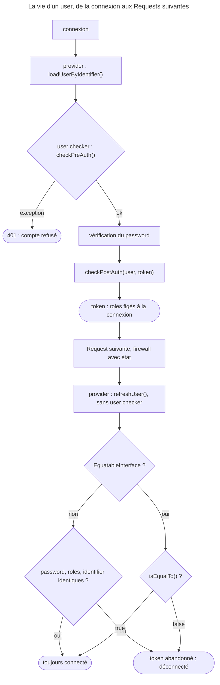

## Objectif

Écrire une class user conforme à Symfony 8.0, et connaître le contrat
minimal — plus court qu'on ne le croit.

## Avant la règle : le problème à résoudre

Une application porte sa propre class `User` : un email, un password hashé, des
roles, un compte qu'on peut suspendre. Que doit-elle implémenter pour que le
firewall l'accepte ? Et que se passe-t-il quand ses données changent pendant
qu'elle est connectée ?

Trois questions : le **contrat minimal** de `UserInterface` en 8.0, la place du
**password**, et ce qui arrive à un user **modifié** ou **suspendu**.

On suppose connus les firewalls et les providers.

## Le fil rouge : la class `User` de l'application

```php
class User implements UserInterface, PasswordAuthenticatedUserInterface
{
    public function getUserIdentifier(): string { return $this->email; }   // pas l'id SQL
    public function getRoles(): array { return [...$this->roles, 'ROLE_USER']; } // convention
    public function getPassword(): ?string { return $this->password; }     // interface à part

    public function __serialize(): array                                  // remplace eraseCredentials()
    {
        return ['email' => $this->email, 'roles' => $this->roles, 'password' => $this->password];
    }
}
```

## Le cycle complet en un schéma



## `UserInterface`, en 8.0

Deux methods. C'est tout :

```php
interface UserInterface
{
    public function getRoles(): array;
    public function getUserIdentifier(): string;
}
```

`eraseCredentials()` **n'existe plus** : dépréciée en 7.3, retirée en 8.0, avec
`TokenInterface::eraseCredentials()`. Le CHANGELOG de Security Core 8.0 indique
le remplaçant : effacer les données sensibles « e.g. using `__serialize()` ».
Une class qui déclare encore la method ne provoque pas d'erreur, mais aucun
code de Security Core 8.0.15, Security HTTP 8.0.14 ou SecurityBundle 8.0.15
ne l'appelle.

`getUserIdentifier()` retourne l'identifier **d'affichage et de recherche** —
email, nom de connexion — pas nécessairement la key primaire. C'est la valeur
que le provider reçoit dans `loadUserByIdentifier()`.

## `getRoles()` : aucun minimum imposé

La documentation montre une class dont `getRoles()` ajoute toujours
`ROLE_USER` — « guarantee every user at least has ROLE_USER ». C'est une
**convention de la class**, pas une exigence du framework. Exécuté avec
SecurityBundle 8.0.15, un user dont `getRoles()` rend `[]` :

| Vérification | Résultat |
|---|---|
| connexion HTTP Basic | **200**, authentifié |
| `isGranted('IS_AUTHENTICATED_FULLY')` | `true` |
| `isGranted('ROLE_USER')` | `false` |

Sans la convention, une règle `access_control` sur `ROLE_USER` refuserait donc
un user pourtant connecté.

Rejoué pour cette page : même résultat, et le token porte une liste de roles
vide, `getRoleNames()` rendant `[]`.

## Le password est une interface séparée

Un user n'a pas forcément de password : un token d'API, un
provider d'identité externe s'en passent. Le password vit donc dans
`PasswordAuthenticatedUserInterface` :

```php
class User implements UserInterface, PasswordAuthenticatedUserInterface
{
    public function getPassword(): ?string { return $this->password; }
}
```

C'est cette interface que le système de hash attend.

## Comparer deux users

À chaque Request d'un firewall avec état, le user est rechargé et
**comparé** à celui du token par `ContextListener::hasUserChanged()`. Par défaut,
la comparaison porte sur le **password**, les **roles** et l'**identifier** ;
une différence abandonne le token. Une class qui implémente
`EquatableInterface` remplace cette règle par sa method `isEqualTo()`.

Exécuté : `alice` connectée, puis sa source modifiée avant la Request suivante.

| Class | Changement | Request suivante |
|---|---|---|
| sans `EquatableInterface` | aucun | `alice`, connectée |
| sans `EquatableInterface` | `ROLE_EDITOR` ajouté | **déconnectée** |
| sans `EquatableInterface` | password changé | **déconnectée** |
| `isEqualTo()` ne comparant que l'identifier | `ROLE_EDITOR` ajouté | connectée, mais `isGranted('ROLE_EDITOR')` **faux** |

La dernière ligne est le point subtil : `getUser()->getRoles()` rend bien le
nouveau role, mais le token garde les roles **de la connexion**, et c'est lui
que les voters lisent. Dans les deux cas, le nouveau role ne s'obtient qu'en se
reconnectant.

Rejoué pour cette page, une ligne de plus, qui touche à la security :

| Class | Changement | Request suivante |
|---|---|---|
| `isEqualTo()` ne comparant que l'identifier | password changé | **toujours connectée** |

Remplacer la comparaison par défaut, c'est donc aussi renoncer à déconnecter
les sessions ouvertes quand le password change — sauf à le comparer dans
`isEqualTo()`.

## Interdire un compte

Un compte désactivé ou expiré ne se refuse pas dans `getRoles()` : c'est le role
d'un **user checker**, déclaré sur le firewall par `user_checker`. Lu dans
`UserCheckerListener` :

- `checkPreAuth()` écoute `CheckPassportEvent` en priority 256, donc **avant**
  la vérification du password ;
- `checkPostAuth()` écoute `AuthenticationSuccessEvent`, et reçoit en 8.0 le
  token en second argument.

Exécuté : un compte refusé par `checkPreAuth()` reçoit **401** ;
`checkPreAuth()` tourne aussi quand le password est faux, et aucun des deux
n'est appelé sur les Requests suivantes portant le cookie de session.

Rejoué pour cette page, un user checker qui journalise ses appels :

| Situation | Journal du user checker |
|---|---|
| compte suspendu, `CustomUserMessageAccountStatusException` | `pre(alice)`, puis 401 |
| password faux | `pre(alice)` seulement, puis 401 |
| connexion réussie | `pre(alice)`, `post(alice, token=UsernamePasswordToken)` |
| Request suivante, cookie seul | rien |

La signature 8.0, lue dans `UserCheckerInterface` :
`checkPostAuth(UserInterface $user, ?TokenInterface $token = null): void`.

## Concrètement dans ton application

- La class : `UserInterface` + `PasswordAuthenticatedUserInterface` si elle a
  un password.
- L'identifier : l'email ou le login, ce que l'utilisateur tape.
- `ROLE_USER` : à ajouter soi-même dans `getRoles()`.
- Les secrets en clair : hors de `__serialize()`, plus d'`eraseCredentials()`.
- Un nouveau role : il vaut à la prochaine connexion.
- Un compte suspendu : un user checker, `AccountStatusException`.
- `EquatableInterface` : seulement en comparant aussi ce qui doit déconnecter,
  password compris.

## À comprendre

- **Pourquoi deux methods seulement ?** Le firewall n'a besoin que de savoir qui
  est le user et ce qu'il peut faire ; le reste dépend du mode d'authentication.
- **Pourquoi comparer à chaque Request ?** Pour qu'un changement fait ailleurs
  — password, roles — ne laisse pas une session vivre avec d'anciens droits.
- **Pourquoi le user checker ne tourne-t-il qu'à la connexion ?** Il valide un
  passage ; les Requests suivantes s'appuient sur le token et sur la
  comparaison.

## À mémoriser

- **`UserInterface`** : **`getRoles()`**, **`getUserIdentifier()`**.
- **`eraseCredentials()`** retirée en 8.0 → **`__serialize()`**.
- **`getPassword()`** → **`PasswordAuthenticatedUserInterface`**.
- **Aucun role** : authentifié quand même ; **`ROLE_USER`** = convention.
- Comparaison par défaut : **password, roles, identifier**.
- **`isEqualTo()`** décide seul ; le **token fige** les roles.
- User checker : **`checkPreAuth()`** avant le password, **`checkPostAuth()`**
  après, **à la connexion seulement**.
- Moyen mnémotechnique : **« Deux methods, trois comparaisons, un checker à la
  porte »**.

## Pièges d'examen

**`UserInterface` n'a que deux methods en Symfony 8.0** ; `eraseCredentials()`
a été retirée.

**`getPassword()` vient de `PasswordAuthenticatedUserInterface`.**

**`getUserIdentifier()` n'est pas l'identifier de base de données.**

**Un user sans role est authentifié** ; `ROLE_USER` est une convention.

**Les roles sont déjà comparés par défaut** : en changer déconnecte.

**Le token fige les roles de la connexion**, même quand `isEqualTo()` garde
le user connecté.

**Un compte désactivé relève d'un user checker**, appelé à la connexion
seulement.

## Application : trois scénarios

**Scénario 1 — Le promu qui ne voit rien.** Un admin ajoute `ROLE_EDITOR` à un
user connecté ; sans `EquatableInterface`, le user est déconnecté à sa Request
suivante. *Solution.* C'est la comparaison par défaut : il se reconnecte, et
le nouveau role vaut.

**Scénario 2 — La session qui survit.** Après une fuite, un user change son
password, mais une session ouverte ailleurs reste connectée. La class
implémente `isEqualTo()` en ne comparant que l'email. *Solution.* Comparer
aussi le password dans `isEqualTo()`, ou revenir à la comparaison par défaut.

**Scénario 3 — Le compte suspendu.** Un compte suspendu doit être refusé avant
même la vérification du password. *Solution.* Un user checker sur le firewall,
`checkPreAuth()` levant une `CustomUserMessageAccountStatusException`.

## QCM d'entraînement

Cinq questions sur les users. Choisis avant d'ouvrir la correction.

**Question 1.** La class user implémente `EquatableInterface`, et `isEqualTo()` ne
compare que l'identifier. Le password d'`alice` change pendant qu'elle est
connectée. À sa Request suivante ?

- **A.** Elle est déconnectée : le password est toujours comparé
- **B.** Elle reste connectée
- **C.** Le firewall relance `checkPreAuth()`
- **D.** Une exception : le token ne correspond plus au user

<details>
<summary>Correction</summary>

**Bonne réponse : B.** Exécuté avec SecurityBundle 8.0.15 : `isEqualTo()` décide
seul, et il ne regarde pas le password.

A décrit la comparaison par défaut, sans `EquatableInterface`. C et D sont
faux.

</details>

**Question 2.** Combien de fois le user checker est-il appelé sur la Request qui
suit une connexion réussie, portant le seul cookie de session ?

- **A.** Une fois, `checkPreAuth()`
- **B.** Une fois, `checkPostAuth()`
- **C.** Deux fois, comme à la connexion
- **D.** Aucune

<details>
<summary>Correction</summary>

**Bonne réponse : D.** Exécuté : le journal est vide. À la connexion, il notait
`pre(alice)` puis `post(alice, …)`.

A, B et C supposent une nouvelle authentication à chaque Request.

</details>

**Question 3.** Quelle est la signature de `checkPostAuth()` en Symfony 8.0 ?

- **A.** `checkPostAuth(UserInterface $user): void`
- **B.** `checkPostAuth(TokenInterface $token): void`
- **C.** `checkPostAuth(UserInterface $user, ?TokenInterface $token = null): void`
- **D.** `checkPostAuth(UserInterface $user, ?TokenInterface $token = null, array $context = []): void`

<details>
<summary>Correction</summary>

**Bonne réponse : C.** Lu dans `UserCheckerInterface` (8.0), et rejoué : le
token reçu est un `UsernamePasswordToken`.

A est la signature d'avant 8.0. B et D n'existent pas.

</details>

**Question 4.** `getRoles()` rend `[]` pour `alice`, connectée en HTTP Basic. Que
rend `$security->getToken()->getRoleNames()` ?

- **A.** `[]`
- **B.** `['ROLE_USER']`, ajouté par le firewall
- **C.** Une erreur : un token exige au moins un role
- **D.** `['IS_AUTHENTICATED_FULLY']`

<details>
<summary>Correction</summary>

**Bonne réponse : A.** Exécuté : la liste est vide, et `alice` est pourtant
authentifiée (`IS_AUTHENTICATED_FULLY` vrai).

B est la convention de la documentation, que le framework n'impose pas. C et D
sont faux.

</details>

**Question 5.** Un user checker refuse `alice` dans `checkPreAuth()` ; elle tape
un password faux. Que montre le journal du user checker ?

- **A.** Rien : le password est vérifié d'abord
- **B.** `pre(alice)` puis `post(alice)`
- **C.** `post(alice)` seulement
- **D.** `pre(alice)` seulement

<details>
<summary>Correction</summary>

**Bonne réponse : D.** Exécuté : `checkPreAuth()` écoute `CheckPassportEvent` en
priority 256, avant le password ; l'échec arrête tout, `checkPostAuth()` n'est
jamais atteint.

A inverse l'ordre. B et C supposent un succès.

</details>

## Fiche express

**Si tu dois retenir seulement 7 choses :**

- **`UserInterface`** = `getRoles()` + `getUserIdentifier()`.
- **`eraseCredentials()`** n'existe plus : **`__serialize()`**.
- **`PasswordAuthenticatedUserInterface`** porte le password.
- **Sans role**, on est authentifié ; `ROLE_USER` est une convention.
- Comparaison par défaut : **password, roles, identifier** — une différence
  déconnecte.
- **`isEqualTo()`** décide seul ; le token **fige** les roles.
- **User checker** : avant et après la connexion, jamais ensuite.

**En une phrase, pour tout reconstruire :**

```text
UserInterface = getRoles + getUserIdentifier (eraseCredentials → __serialize) ; password = PasswordAuthenticatedUserInterface ;
Request suivante : refresh + comparaison (password/roles/identifier, ou isEqualTo) ; token = roles de la connexion ; checker = connexion seulement
```

## Sources officielles

- [`UserInterface`, branche 8.0](https://github.com/symfony/symfony/blob/8.0/src/Symfony/Component/Security/Core/User/UserInterface.php)
- [Security Core 8.0, CHANGELOG](https://github.com/symfony/symfony/blob/8.0/src/Symfony/Component/Security/Core/CHANGELOG.md)
- [Security HTTP 8.0, `ContextListener`](https://github.com/symfony/symfony/blob/8.0/src/Symfony/Component/Security/Http/Firewall/ContextListener.php)
- [Security HTTP 8.0, `UserCheckerListener`](https://github.com/symfony/symfony/blob/8.0/src/Symfony/Component/Security/Http/EventListener/UserCheckerListener.php)
- [`UserCheckerInterface`, branche 8.0](https://github.com/symfony/symfony/blob/8.0/src/Symfony/Component/Security/Core/User/UserCheckerInterface.php)
- [Security](https://github.com/symfony/symfony-docs/blob/8.0/security.rst)
- [User Checkers](https://github.com/symfony/symfony-docs/blob/8.0/security/user_checkers.rst)
