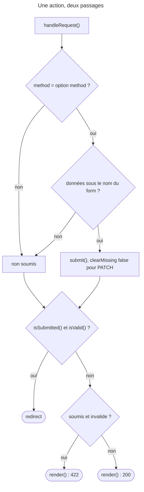

## Objectif

Traiter une submission, dans le bon ordre, et connaître l'alternative à
`handleRequest()`.

## Le pattern recommandé

Une **seule action** affiche et traite le form :

```php
$form = $this->createForm(TaskType::class, $task);
$form->handleRequest($request);

if ($form->isSubmitted() && $form->isValid()) {
    // $form->getData() porte les valeurs soumises,
    // et $task a été mis à jour au passage
    return $this->redirectToRoute('task_success');
}

return $this->render('task/new.html.twig', ['form' => $form]);
```

`handleRequest()` regarde la Request, décide si le form a été soumis, et
ne fait rien s'il ne l'a pas été. C'est ce qui permet au même code de servir les
deux cas.

Le critère est d'abord la **method** : `HttpFoundationRequestHandler` compare
la method de la Request à l'option `method` du form, `POST` par défaut,
et s'arrête si elles diffèrent. Exécuté : un form `POST` reçoit une
Request `GET` portant ses fields → `isSubmitted()` vaut `false`.

Le redirect après succès évite qu'un rafraîchissement du navigateur ne
renvoie le `POST`.

## L'ordre des deux tests

`isSubmitted()` **avant** `isValid()` — et ce n'est pas une question de style :
`Form::isValid()` **lève une `LogicException`** sur un form non soumis,
« Cannot check if an unsubmitted form is valid ». Vérifié par exécution. Un
form soumis mais désactivé (`disabled`) est, lui, toujours valide.

Après une submission valide, l'object passé à `createForm()` est **déjà mis à
jour** : `getData()` et la variable d'origine désignent la même chose.

## Le rendu qui suit

Rendre le form invalide est le comportement normal :
`AbstractController::render()` repère un form soumis et invalide parmi ses
parameters et passe la Response en **422** — seulement si son statut était
encore 200. Il convertit aussi le form en vue : pas besoin d'appeler
`createView()`.



## `submit()`, pour le contrôle fin

`handleRequest()` est recommandé. `submit()` sert quand on décide soi-même du
moment et de la donnée :

```php
if ($request->isMethod('POST')) {
    $form->submit($request->getPayload()->all($form->getName()));
}
```

L'exemple de `forms.rst` (8.0) écrit `getPayload()->get($form->getName())`.
Pour un form composé, la valeur est un array, et `InputBag::get()` le
refuse : **`BadRequestException`**, « Input value "form" contains a non-scalar
value » — exécuté avec HttpFoundation 8.0.15. La forme correcte est `all()`,
comme ci-dessus.

Son second argument, `$clearMissing`, vaut `true` par défaut : les fields absents
de la submission sont mis à `null`. Le passer à `false` — le cas d'une Request
`PATCH` — laisse les fields absents intacts. `handleRequest()` fait ce choix de
lui-même : il appelle `submit($data, 'PATCH' !== $method)`.

**Le piège qui va avec :** avec `$clearMissing = false`, la validation ne
s'applique **qu'aux fields soumis**. Exécuté avec un `NotBlank` sur un field
vide absent de la submission : form **valide** ; le même field ajouté avec
`null` : **invalide**. C'est la parade documentée.

## Pièges d'examen

**`isValid()` sur un form non soumis lève une exception.** Le garde
`isSubmitted() && isValid()` n'est pas facultatif.

**Une Request d'une autre method que celle du form est ignorée.**

**Après une submission valide, l'object est déjà à jour.**

**La submission manuelle vide les fields absents par défaut** ; `false` les
préserve, et ne valide alors que ce qui a été soumis.

## Points clés

- Une seule action rend et traite ; `handleRequest()` ne fait rien si la
  method diffère.
- `isSubmitted()` puis `isValid()` ; l'inverse lève une `LogicException`.
- L'object d'origine est mis à jour ; `getData()` le retourne.
- `render()` : 422 pour un form soumis invalide.
- `submit($data, $clearMissing = true)` ; `false` pour un `PATCH`, choisi
  automatiquement par `handleRequest()`.

## Sources officielles

- [Forms, « Processing Forms » et « Using the submit() Method »](https://github.com/symfony/symfony-docs/blob/8.0/forms.rst)
- [Form 8.0, `Form`](https://github.com/symfony/symfony/blob/8.0/src/Symfony/Component/Form/Form.php) et [`HttpFoundationRequestHandler`](https://github.com/symfony/symfony/blob/8.0/src/Symfony/Component/Form/Extension/HttpFoundation/HttpFoundationRequestHandler.php)
- [FrameworkBundle 8.0, `AbstractController`](https://github.com/symfony/symfony/blob/8.0/src/Symfony/Bundle/FrameworkBundle/Controller/AbstractController.php)
